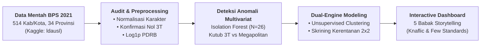

# PovertyRadar SDGs

> **Sistem Pemetaan Klaster dan Analisis Kerentanan Kemiskinan Daerah Indonesia**  
> *Mata Kuliah Presentasi Data dan Storytelling — Mendukung Capaian SDG 1: No Poverty (Tanpa Kemiskinan)*

[](https://www.python.org/)
[](LICENSE)
[-orange.svg)](https://www.kaggle.com/datasets/ldausl/klasifikasi-tingkat-kemiskinan-di-indonesia)

---

## 📌 Sekilas Proyek

**PovertyRadar SDGs** adalah platform analitik data dan *storytelling* interaktif yang memetakan variasi spasial dan profil struktural sosio-ekonomi 514 kabupaten/kota di Indonesia. Proyek ini menggunakan dataset publik dari repositori Kaggle: **[Klasifikasi Tingkat Kemiskinan di Indonesia](https://www.kaggle.com/datasets/ldausl/klasifikasi-tingkat-kemiskinan-di-indonesia)** yang diunggah oleh kontributor **ldausl**.

> [!NOTE]
> **Hasil Verifikasi Kolom Data (BPS RI 2021):**
> * **12 dari 13 kolom terbukti 100% data resmi BPS 2021:** Terverifikasi silang dengan publikasi Susenas Maret 2021, Sakernas Agustus 2021, IPM Metode Baru 2021, dan PDRB Pengeluaran ADHK Seri 2010 (514 kab/kota di 34 provinsi).
> * **Kolom `Klasifikasi Kemiskinan` BUKAN data BPS:** Merupakan label biner buatan pengunggah Kaggle yang inkonsisten sehingga **resmi dibuang** dari pipeline analisis.
> * **Koreksi Header Asli:** Data RLS merupakan capaian penduduk usia 25+ tahun (komponen IPM, bukan 15+), dan satuan riil PDRB adalah Juta Rupiah (bukan Rupiah satuan).
> *Detail audit forensik per kolom: [`data/README.md`](file:///d:/ARFI/Kuliah/Project/project-semester5/PovertyRadar/data/README.md) & [`docs/data_audit_and_understanding.md`](file:///d:/ARFI/Kuliah/Project/project-semester5/PovertyRadar/docs/data_audit_and_understanding.md).*

Proyek ini mengatasi kelemahan kebijakan penanggulangan kemiskinan yang bersifat seragam (*one-size-fits-all*). Dua daerah dengan persentase kemiskinan 15% dapat memiliki akar permasalahan yang bertolak belakang: yang satu miskin akibat keterisolasian infrastruktur air dan sanitasi, sementara yang lain miskin akibat pengangguran perkotaan. 

Melalui pendekatan **Unsupervised Clustering** dan **Matriks Skrining Kerentanan Struktural 2x2**, PovertyRadar SDGs membantu pengambil kebijakan mengidentifikasi prioritas intervensi secara transparan dan berbasis bukti.

> [!IMPORTANT]
> **Penegasan Metodologi: Proyek Ini TIDAK Melakukan Supervised Classification**  
> Walaupun berkas data sumber bernama `Klasifikasi Tingkat Kemiskinan di Indonesia.csv` dan memuat kolom biner `Klasifikasi Kemiskinan`, **proyek ini secara tegas TIDAK melatih model klasifikasi terawasi** untuk mencegah *circular reasoning / target leakage*. Fokus analitis diarahkan pada *Unsupervised Clustering* murni dan *Spatial Storytelling*.

---

## 🧭 Peta Alur Metodologi Analisis



---

## 📊 Ringkasan Dataset & Temuan Audit Faktual

Berdasarkan audit komputasi menyeluruh pada [`docs/data_audit_and_understanding.md`](file:///d:/ARFI/Kuliah/Project/project-semester5/PovertyRadar/docs/data_audit_and_understanding.md):

* **Cakupan:** 514 unit analisis unik (413 Kabupaten dan 101 Kota/Kota Administrasi) di 34 Provinsi.
* **Kelengkapan Mutlak:** **0 Missing Values** di seluruh baris dan kolom.
* **Verifikasi Periode:** Terverifikasi resmi data BPS Tahun 2021 (pencocokan presisi pada Surakarta, Cilacap, dan Banyumas).
* **Disparitas Kabupaten vs. Kota:** Persentase kemiskinan ($P_0$) rata-rata Kabupaten (**13.51%**) hampir dua kali lipat lebih tinggi dibandingkan Kota (**7.22%**), sementara IPM Kota unggul signifikan (77.85 vs. 67.99).
* **Disparitas Antarpulau:** Kawasan Maluku & Papua mencatat rata-rata kemiskinan tertinggi (**23.31%**), sedangkan Kalimantan mencatat kemiskinan terendah (**6.30%**).
* **Paradoks Ketenagakerjaan:** TPAK berkorelasi positif terhadap kemiskinan ($r = +0.462$) karena keharusan bekerja subsisten di perdesaan tertinggal, sedangkan TPT berkorelasi negatif ($r = -0.401$) karena pengangguran terbuka terkonsentrasi pada angkatan kerja terdidik perkotaan.
* **Deteksi Anomali Multivariat:** 26 daerah terdeteksi sebagai anomali multivariat (*Isolation Forest*, `contamination=0.05`), mewakili daerah 3T terpencil (Nduga, Deiyai, Tambrauw) dan megapolitan raksasa (Jakarta Pusat, Jakarta Selatan). Seluruh anomali **dipertahankan (Do Not Drop)** demi prinsip inklusivitas SDG 1.

---

## 🗂️ Struktur Direktori Proyek

```text
PovertyRadar/
├── pyproject.toml             # Konfigurasi paket Python & test suite (pytest)
├── AGENTS.md                  # Kontrak kerja coding agent & aturan domain proyek
├── README.md                  # Halaman orientasi & dokumentasi utama repositori
├── dashboard_guide.md         # Pedoman visualisasi data & storytelling (Knaflic & Few)
├── data/
│   ├── raw/                   # [READ-ONLY] Data mentah BPS 2021 dari Kaggle
│   ├── interim/               # poverty_data_cleaned.csv (terstandar & ter-flag anomali)
│   ├── processed/             # poverty_clusters.csv & poverty_cluster_summary.csv
│   └── README.md              # Kamus data lengkap & catatan kualitas teknis
├── docs/
│   ├── problem_framing_and_objectives.md  # Framing masalah, sasaran SDG 1, matriks 2x2
│   ├── data_audit_and_understanding.md    # Audit statistik komprehensif 514 daerah
│   ├── clustering_protocol.md             # Protokol unsupervised clustering & evaluasi empiris
│   ├── clustering_rationale_and_findings.md # Rationale komprehensif benchmark 20+ model
│   ├── data_contracts.md                  # Kontrak skema & validasi pipeline
│   ├── development.md                     # Panduan lingkungan kerja (uv/python) & git
│   ├── design.md                          # Arsitektur dashboard storytelling 5 babak
│   └── ui_brief_mockup.md                 # Panduan wireframe ASCII untuk tim desain UI/UX
├── experiments/               # Skrip & log benchmark 20+ konfigurasi clustering
├── notebooks/                 # Notebook eksplorasi interaktif (01, 02, 03)
├── reports/
│   └── figures/               # 9 Gambar visualisasi publikasi terstandarisasi
├── src/
│   └── poverty_radar/         # Paket modular (loader, preprocessor, models, plots, pipeline)
└── tests/                     # Suite pengujian otomatis (data integrity, clustering, vulnerability)
```

---

## ⚡ Quickstart & Reproduksibilitas

Pipeline data dan seluruh visualisasi dapat dijalankan secara instan dan deterministik:

```powershell
# 1. Instalasi paket dalam mode editable
python -m pip install -e .

# 2. Jalankan seluruh unit & integration test
python -m pytest tests -v

# 3. Jalankan end-to-end pipeline (Data Mentah -> Interim -> Processed -> Visualisasi)
python -m poverty_radar.pipeline
```

---

## 🚀 Panduan Memulai Cepat (Quickstart)

### 1. Klon Repositori & Penyiapan Environment
```powershell
# Buat dan aktifkan virtual environment dengan uv
uv venv .venv
.venv\Scripts\Activate.ps1

# Instal dependensi
uv pip install pandas numpy scikit-learn matplotlib seaborn jupyter nbconvert nbformat
```

### 2. Menjalankan Verifikasi Reproduksibilitas Otomatis
```powershell
# Eksekusi notebook audit data secara headless
jupyter nbconvert --to notebook --execute notebooks/01_data_audit_and_understanding.ipynb

# Uji integritas data interim
python -c "import pandas as pd; df = pd.read_csv('data/interim/poverty_data_cleaned.csv'); assert len(df) == 514; print('Data Integrity: PASS')"
```


---

## 📚 Indeks Dokumentasi Teknis

| Dokumen | Deskripsi & Peruntukan |
| :--- | :--- |
| [`AGENTS.md`](file:///d:/ARFI/Kuliah/Project/project-semester5/PovertyRadar/AGENTS.md) | Kontrak kerja operasional untuk coding agent. |
| [`docs/problem_framing_and_objectives.md`](file:///d:/ARFI/Kuliah/Project/project-semester5/PovertyRadar/docs/problem_framing_and_objectives.md) | Problem framing, perumusan objektif, dan arsitektur analitis. |
| [`docs/data_audit_and_understanding.md`](file:///d:/ARFI/Kuliah/Project/project-semester5/PovertyRadar/docs/data_audit_and_understanding.md) | Laporan audit statistik mendalam terhadap 514 kabupaten/kota. |
| [`docs/clustering_protocol.md`](file:///d:/ARFI/Kuliah/Project/project-semester5/PovertyRadar/docs/clustering_protocol.md) | Pedoman pemodelan klaster tanpa supervisi dan seleksi fitur. |
| [`docs/data_contracts.md`](file:///d:/ARFI/Kuliah/Project/project-semester5/PovertyRadar/docs/data_contracts.md) | Kontrak skema data, batas nilai, dan fungsi validasi otomatis. |
| [`docs/development.md`](file:///d:/ARFI/Kuliah/Project/project-semester5/PovertyRadar/docs/development.md) | Panduan setup lingkungan kerja lokal dan alur kerja Git. |
| [`docs/design.md`](file:///d:/ARFI/Kuliah/Project/project-semester5/PovertyRadar/docs/design.md) | Spesifikasi antarmuka dashboard storytelling 5 babak naratif. |
| [`docs/ui_brief_mockup.md`](file:///d:/ARFI/Kuliah/Project/project-semester5/PovertyRadar/docs/ui_brief_mockup.md) | Wireframe ASCII dan panduan visual untuk desainer Figma/Canva. |
| [`dashboard_guide.md`](file:///d:/ARFI/Kuliah/Project/project-semester5/PovertyRadar/dashboard_guide.md) | Pedoman prinsip visualisasi data (Knaflic, Few, Desbarats). |
| [`data/README.md`](file:///d:/ARFI/Kuliah/Project/project-semester5/PovertyRadar/data/README.md) | Kamus data 13 variabel asli dan 4 variabel hasil rekayasa fitur. |

---

## 👥 Tim Pengembang & Lisensi
Dikembangkan untuk mata kuliah **Presentasi Data dan Storytelling** — Program Studi **Sains Data Terapan**, Departemen Teknik Informatika dan Komputer, **Politeknik Elektronika Negeri Surabaya (PENS)**.  
Lisensi di bawah [MIT License](LICENSE).
