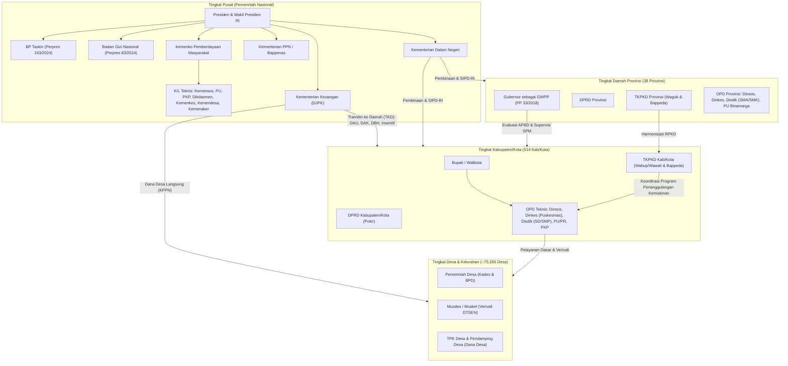
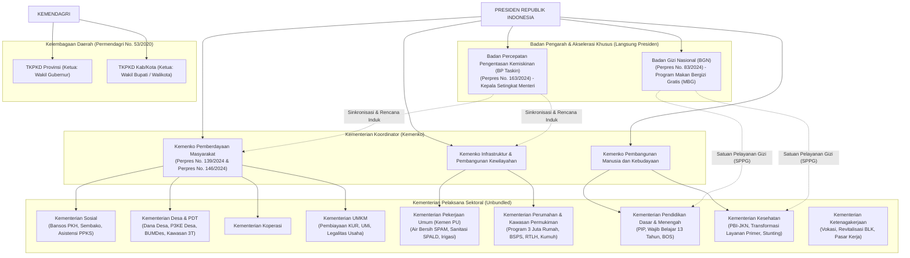
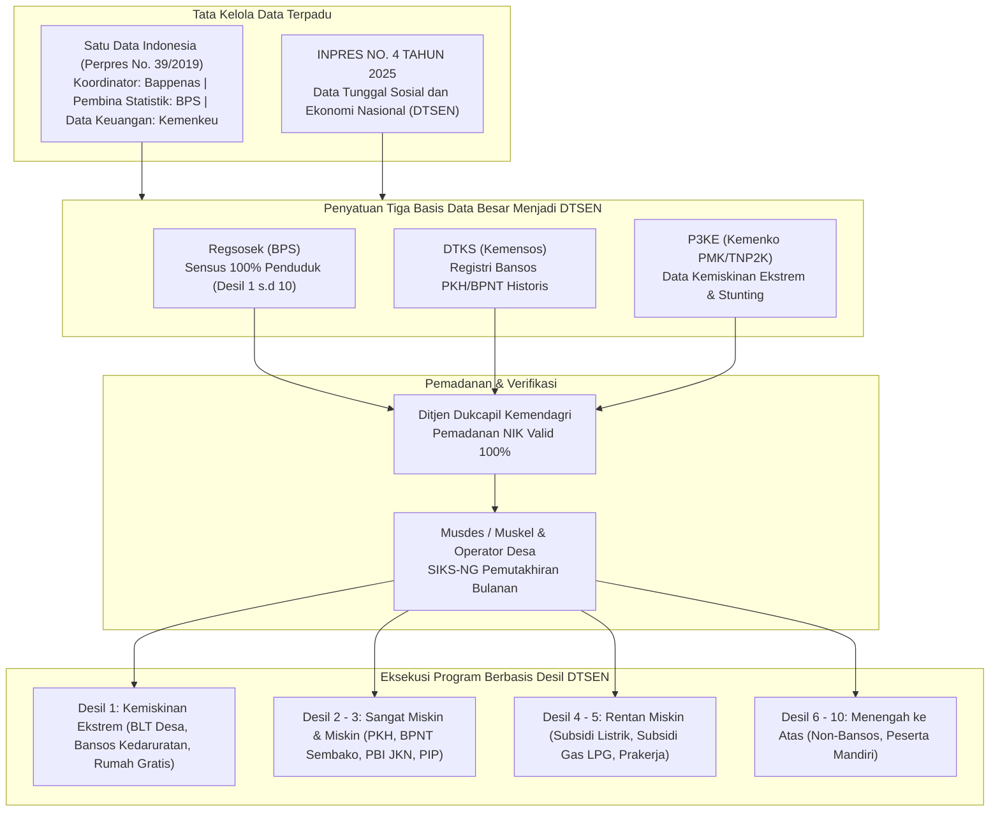
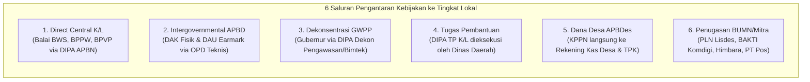

# Sistem Kebijakan Publik, Perencanaan Pembangunan, dan Mekanisme Intervensi Wilayah di Indonesia (Konteks Tahun 2026)

**PovertyRadar SDGs — Regional Poverty Clustering and Relative Vulnerability Screening System**  
*Dokumen Riset Kebijakan Publik, Arsitektur Tata Kelola, dan Keuangan Publik Subnasional*  
**Tanggal Referensi Riset:** 30 Oktober 2026  
**Status Regulasi:** Aktif & Terverifikasi (Konteks Kabinet Merah Putih, Pasca-UU No. 1/2022 HKPD & UU No. 59/2024 RPJPN 2025–2045)  
**Dokumen Pendamping:** [`docs/02-desain-rekomendasi-kebijakan-berbasis-clustering-povertyradar.md`](file:///d:/ARFI/Kuliah/Project/project-semester5/PovertyRadar/docs/02-desain-rekomendasi-kebijakan-berbasis-clustering-povertyradar.md)

---

## DAFTAR ISI
1. [Ringkasan Eksekutif & Peta Konseptual Tata Kelola Publik Indonesia 2026](#1-ringkasan-eksekutif--peta-konseptual-tata-kelola-publik-indonesia-2026)
2. [Struktur Pemerintahan & Pembagian Urusan Pemerintahan (UU No. 23/2014)](#2-struktur-pemerintahan--pembagian-urusan-pemerintahan-uu-no-232014)
3. [Otonomi Daerah, Relasi Antartingkat Pemerintahan, & Transformasi 38 Provinsi](#3-otonomi-daerah-relasi-antartingkat-pemerintahan--transformasi-38-provinsi)
4. [Siklus Terintegrasi Perencanaan dan Penganggaran Nasional-Daerah](#4-siklus-terintegrasi-perencanaan-dan-penganggaran-nasional-daerah)
5. [Arsitektur Fiskal Daerah & Transfer ke Daerah (TKD) Pasca UU No. 1/2022 (HKPD)](#5-arsitektur-fiskal-daerah--transfer-ke-daerah-tkd-pasca-uu-no-12022-hkpd)
6. [Ekosistem Kelembagaan Penanggulangan Kemiskinan Era Kabinet Merah Putih](#6-ekosistem-kelembagaan-penanggulangan-kemiskinan-era-kabinet-merah-putih)
7. [Tata Kelola Data Sosial & Arsitektur Penyasaran: Menuju DTSEN](#7-tata-kelola-data-sosial--arsitektur-penyasaran-menuju-dtsen)
8. [Tipologi 6 Kanal Pengantaran Layanan Publik (Service Delivery Channels)](#8-tipologi-6-kanal-pengantaran-layanan-publik-service-delivery-channels)
9. [Studi Kasus Nyata Pelaksanaan Kebijakan: Komparasi Dua Arketipe Wilayah](#9-studi-kasus-nyata-pelaksanaan-kebijakan-komparasi-dua-arketipe-wilayah)
10. [Hambatan Struktural Pengantaran Kebijakan (*Structural Delivery Bottlenecks*)](#10-hambatan-struktural-pengantaran-kebijakan-structural-delivery-bottlenecks)
11. [Kerangka Pemantauan, Evaluasi, dan Akuntabilitas Penyelenggaraan](#11-kerangka-pemantauan-evaluasi-dan-akuntabilitas-penyelenggaraan)
12. [Glosarium Istilah Resmi & Rujukan Peraturan Perundang-undangan Terverifikasi](#12-glosarium-istilah-resmi--rujukan-peraturan-perundang-undangan-terverifikasi)

---

## 1. RINGKASAN EKSEKUTIF & PETA KONSEPTUAL TATA KELOLA PUBLIK INDONESIA 2026

Tahun 2026 merupakan momentum transformasi mendalam (*inflection point*) dalam administrasi publik, desentralisasi fiskal, dan penanggulangan kemiskinan di Indonesia. Tiga pergeseran tektonik mendasari seluruh tata kelola pemerintahan:

1. **Transformasi Perencanaan Jangka Panjang:** Berlakunya **UU No. 59 Tahun 2024 tentang RPJPN 2025–2045** menuju visi *Indonesia Emas 2045*, berjalannya tahun kedua implementasi **RPJMN 2025–2029 (Asta Cita)** di bawah kepemimpinan Presiden Prabowo Subianto dan Wakil Presiden Gibran Rakabuming Raka, serta tahun pertama eksekusi murni **RPJMD 2025–2029** oleh 514 Kepala Daerah definitif hasil Pilkada Serentak November 2024.
2. **Transformasi Desentralisasi Fiskal Berbasis Kinerja:** Pelaksanaan penuh **UU No. 1 Tahun 2022 tentang Hubungan Keuangan antara Pemerintah Pusat dan Pemerintahan Daerah (UU HKPD)** beserta aturan pelaksananya (**PP No. 35/2023 tentang KUPDRD** dan **PP No. 37/2023 tentang Pengelolaan TKD**). Era *unconditional block grant* telah berakhir; Transfer ke Daerah (TKD) dikunci melalui *earmarking* ketat untuk pemenuhan Standar Pelayanan Minimal (SPM), pemangkasan belanja birokrasi, dan kewajiban belanja infrastruktur publik.
3. **Restrukturisasi Kelembagaan Eksekutif (Kabinet Merah Putih):** Pemisahan kementerian teknis (*unbundling*), pembentukan **Badan Percepatan Pengentasan Kemiskinan (BP Taskin)** melalui Perpres No. 163 Tahun 2024, **Badan Gizi Nasional (BGN)** melalui Perpres No. 83 Tahun 2024, berdirinya **Kementerian Koordinator Bidang Pemberdayaan Masyarakat**, serta konsolidasi data sosial-ekonomi tunggal nasional melalui payung hukum **Inpres No. 4 Tahun 2025 tentang Data Tunggal Sosial dan Ekonomi Nasional (DTSEN)**.



Laporan ini ditujukan sebagai kompas navigasi tata kelola pemerintahan yang menghubungkan hasil temuan saintifik platform **PovertyRadar SDGs** dengan kenyataan birokrasi, hukum anggaran, dan kanal intervensi lapangan di Indonesia.

---

## 2. STRUKTUR PEMERINTAHAN & PEMBAGIAN URUSAN PEMERINTAHAN (UU NO. 23/2014)

### 2.1. Tiga Asas Penyelenggaraan Pemerintahan Daerah
Berdasarkan **Undang-Undang Nomor 23 Tahun 2014 tentang Pemerintahan Daerah** (yang telah diubah beberapa kali, terakhir dengan UU No. 6 Tahun 2023), tata hubungan penyelenggaraan kekuasaan negara di daerah bertumpu pada 3 asas:
1. **Desentralisasi:** Penyerahan urusan pemerintahan oleh Pemerintah Pusat kepada daerah otonom berdasarkan asas otonomi untuk mengatur dan mengurus urusan pemerintahan dalam sistem NKRI.
2. **Dekonsentrasi:** Pelimpahan sebagian urusan pemerintahan yang menjadi kewenangan Pemerintah Pusat kepada Gubernur sebagai wakil Pemerintah Pusat (GWPP), kepada instansi vertikal di wilayah tertentu, dan/atau kepada gubernur/bupati/walikota selaku penanggung jawab urusan pemerintahan umum.
3. **Tugas Pembantuan (*Medebewind*):** Penugasan dari Pemerintah Pusat kepada daerah otonom untuk melaksanakan sebagian urusan pemerintahan yang menjadi kewenangan Pemerintah Pusat atau dari pemerintah daerah provinsi kepada daerah kabupaten/kota untuk melaksanakan sebagian urusan pemerintahan yang menjadi kewenangan daerah provinsi.

### 2.2. Klasifikasi Urusan Pemerintahan
Pasal 9 s.d. Pasal 18 UU No. 23/2014 membagi urusan pemerintahan menjadi 3 ranah:
* **Urusan Pemerintahan Absolut:** Kewenangan mutlak Pemerintah Pusat yang tidak diserahkan ke daerah: (1) Politik luar negeri; (2) Pertahanan; (3) Keamanan; (4) Yustisi; (5) Moneter dan fiskal nasional; serta (6) Agama.
* **Urusan Pemerintahan Umum:** Kewenangan Presiden selaku kepala pemerintahan yang pelaksanaannya dilimpahkan kepada Gubernur dan Bupati/Walikota (pembinaan ideologi kebangsaan, koordinasi antar-instansi vertikal, kerukunan antarsuku/agama, dan penanganan konflik sosial).
* **Urusan Pemerintahan Konkuren:** Urusan pemerintahan yang dibagi antara Pemerintah Pusat, Daerah Provinsi, dan Daerah Kabupaten/Kota. Urusan inilah yang mendasari seluruh program pembangunan sosial, infrastruktur dasar, dan pengentasan kemiskinan.

### 2.3. Urusan Konkuren: Pelayanan Dasar, Non-Pelayanan Dasar, dan Pilihan
Urusan Konkuren yang diserahkan ke daerah otonom dikelompokkan ke dalam:

1. **Urusan Pemerintahan Wajib Pelayanan Dasar (Pasal 12 ayat 1):**
   Urusan yang wajib diselenggarakan oleh seluruh Pemda dan **wajib diprioritaskan pelaksanaannya dengan berpedoman pada Standar Pelayanan Minimal (SPM)** sebagaimana diatur dalam **PP No. 2 Tahun 2018** dan **Permendagri No. 59 Tahun 2021**. Meliputi 6 urusan:
   * **Pendidikan** (Akses dan penuntasan wajib belajar).
   * **Kesehatan** (Pelayanan kesehatan ibu, anak, balita, usia produktif, lansia, serta penyakit menular/tidak menular).
   * **Pekerjaan Umum dan Penataan Ruang (PUPR)** (Penyediaan air minum dan sanitasi domestik).
   * **Perumahan Rakyat dan Kawasan Permukiman (PKP)** (Penyediaan rumah layak huni bagi MBR dan peremajaan kumuh).
   * **Ketenteraman, Ketertiban Umum, dan Pelindungan Masyarakat (Trantibumlinmas)** (Penanganan bencana dan ketertiban).
   * **Sosial** (Rehabilitasi dan perlindungan sosial bagi penyandang disabilitas, lansia terlantar, anak terlantar, dan korban bencana).
2. **Urusan Pemerintahan Wajib Non-Pelayanan Dasar (Pasal 12 ayat 2):**
   Meliputi 18 urusan, di antaranya: Tenaga Kerja, Pemberdayaan Perempuan dan Perlindungan Anak, Pangan, Pertanahan, Lingkungan Hidup, Administrasi Kependudukan dan Pencatatan Sipil, Pemberdayaan Masyarakat dan Desa, Pengendalian Penduduk dan KB, Perhubungan, Komunikasi dan Informatika, Koperasi dan UKM, Penanaman Modal, serta Transmigrasi.
3. **Urusan Pemerintahan Pilihan (Pasal 12 ayat 3):**
   Urusan yang diselenggarakan sesuai potensi unggulan dan karakteristik spesifik daerah: Kelautan dan Perikanan, Pariwisata, Pertanian, Kehutanan, Energi dan Sumber Daya Mineral, Perdagangan, Perindustrian, dan Transmigrasi.

---

### 2.4. Matriks Pembagian Rigid Kewenangan Konkuren (UU No. 23/2014)

Ketidaktepatan rekomendasi kebijakan publik umumnya bermula dari kegagalan mengenali batas yuridis pembagian urusan. Berdasarkan **Lampiran Pembagian Urusan Pemerintahan UU No. 23 Tahun 2014**, berikut adalah batas rigid kewenangan antartingkat pemerintahan pada 6 pilar penentu kemiskinan dan kerentanan struktural:

| Sektor Pelayanan Dasar | Sub-Urusan / Dimensi | Kewenangan Pemerintah Pusat | Kewenangan Pemerintah Provinsi | Kewenangan Pemerintah Kabupaten/Kota |
| :--- | :--- | :--- | :--- | :--- |
| **Air Minum** | Penyediaan Sistem Air Bersih (SPAM) | • Penetapan NSPK nasional.<br>• Pembangunan SPAM lintas provinsi.<br>• SPAM untuk Kepentingan Strategis Nasional (PSN). | • Pengelolaan dan pembangunan SPAM lintas kabupaten/kota dalam 1 provinsi. | • **Pengelolaan dan pengembangan SPAM di dalam daerah kabupaten/kota** (PDAM, SPAM IKK, PAMSIMAS perdesaan, sambungan rumah warga miskin). |
| **Sanitasi & Air Limbah** | Pengelolaan Air Limbah Domestik (SPALD) | • Penetapan NSPK sanitasi nasional.<br>• SPALD skala terpusat lintas provinsi dan PSN. | • SPALD skala terpusat lintas daerah kabupaten/kota. | • **Pengelolaan SPALD skala permukiman dan skala setempat (SPALD-S)**: penyediaan tangki septik individual/komunal, IPLT, armada sedot tinja, SANIMAS. |
| **Pendidikan** | Pembagian Jenjang Pendidikan | • Penetapan standar nasional pendidikan, kurikulum inti, uji kompetensi guru.<br>• Pengelolaan Pendidikan Tinggi (Universitas/Politeknik). | • **Pengelolaan Pendidikan Menengah (SMA dan SMK)**.<br>• Pengelolaan Pendidikan Khusus (SLB). | • **Pengelolaan Pendidikan Dasar (SD dan SMP)**.<br>• Pengelolaan PAUD (formal & nonformal).<br>• Pengelolaan Pendidikan Masyarakat / Kesetaraan (Paket A, B, C / PKBM). |
| **Kesehatan** | Faskes, Rujukan, dan Pembiayaan | • NSPK kesehatan nasional.<br>• Pengelolaan RS Rujukan Nasional / Vertikal (RS Kelas A).<br>• Pembiayaan PBI JKN APBN (~96,8 juta jiwa). | • Pengelolaan RS Rujukan Regional/Provinsi (RSUD Kelas B).<br>• Surveilans dan penanganan KLB lintas daerah.<br>• Alokasi PBI APBD Provinsi. | • **Pengelolaan Faskes Tingkat Pertama (Puskesmas, Pustu, Posyandu)**.<br>• Pengelolaan RSUD Kelas C dan D.<br>• Penanganan stunting/gizi buruk di lapangan.<br>• Pembiayaan PBI APBD Kab/Kota. |
| **Perumahan & Permukiman** | Perumahan MBR & Penataan Kumuh | • Program Nasional 3 Juta Rumah.<br>• Bantuan Stimulan Perumahan Swadaya (BSPS).<br>• Penanganan permukiman kumuh dengan luas **≥ 15 Hektar**. | • Penanganan permukiman kumuh dengan luas **10 s.d. < 15 Hektar**.<br>• Fasilitasi perumahan bagi korban bencana skala provinsi. | • **Penanganan permukiman kumuh dengan luas < 10 Hektar**.<br>• Rehabilitasi Rumah Tidak Layak Huni (RTLH) skala lokal.<br>• Pencegahan permukiman kumuh baru. |
| **Sosial** | Perlindungan & Bantuan Sosial | • Penetapan kriteria kemiskinan dan registri terpadu nasional (DTSEN).<br>• Bansos reguler APBN (PKH, BPNT/Sembako, ATENSI Sentra). | • Rehabilitasi sosial PPKS di dalam panti sosial provinsi.<br>• Bantuan logistik tanggap darurat bencana lintas kab/kota. | • **Pendataan, verifikasi, dan validasi (verval) fakir miskin di desa/kelurahan**.<br>• Bantuan sosial kedaruratan lokal APBD.<br>• Pemberdayaan sosial fakir miskin lokal. |
| **Ketenagakerjaan** | Pelatihan Kerja & Pengawasan | • Penetapan standar kompetensi kerja nasional (SKKNI).<br>• Pengelolaan Balai Besar Pelatihan Vokasi Pusat (BBPVP). | • Pengelolaan UPTD Balai Latihan Kerja (BLK) Provinsi.<br>• **Pengawasan ketenagakerjaan dan K3** (ditarik mutlak ke Provinsi). | • **Pengelolaan UPTD BLK Kabupaten/Kota**.<br>• Pelayanan penempatan tenaga kerja lokal (bursa kerja / AK-1).<br>• Mediasi hubungan industrial bipartit/tripartit. |

> [!IMPORTANT]
> **Aturan Emas Kewenangan Kebijakan:**  
> 1. Pemerintah Kabupaten/Kota **tidak memiliki wewenang** atas kurikulum SMA/SMK atau pengawasan ketenagakerjaan perusahaan (kewenangan Provinsi).  
> 2. Pemerintah Pusat/Provinsi **tidak dapat langsung membangun jamban keluarga individual** di pekarangan warga tanpa melalui mekanisme hibah transfer APBD, penugasan DAK Fisik, atau Dana Desa.

---

## 3. OTONOMI DAERAH, RELASI ANTARTINGKAT PEMERINTAHAN, & TRANSFORMASI 38 PROVINSI

### 3.1. Hubungan Hierarkis dan Peran GWPP (PP No. 33 Tahun 2018)
Sistem desentralisasi Indonesia bukanlah sistem federal. Hubungan antartingkat pemerintahan bersifat hierarkis-unitaris:
* **Gubernur sebagai Wakil Pemerintah Pusat (GWPP):** Diatur secara tegas dalam **PP No. 33 Tahun 2018**. Gubernur memiliki peran ganda: sebagai kepala daerah otonom provinsi sekaligus perpanjangan tangan Presiden di wilayahnya.
* **Instrumen Pengendalian GWPP:**
  1. Melakukan pembinaan dan pengawasan atas penyelenggaraan pemerintahan daerah kabupaten/kota.
  2. Melakukan evaluasi rancangan Peraturan Daerah (Ranperda) tentang RPJPD, RPJMD, RKPD, APBD, dan Tata Ruang (RTRW) kabupaten/kota sebelum disahkan menjadi Perda definitif.
  3. Membatalkan Perda/Perkada kabupaten/kota yang bertentangan dengan kepentingan umum atau peraturan perundang-undangan yang lebih tinggi.
  4. Menjatuhkan sanksi administratif dan memfasilitasi penyelesaian sengketa batas antardaerah kabupaten/kota.

### 3.2. Asimetri Otonomi Daerah (Daerah Khusus dan Istimewa)
Indonesia menerapkan konsep desentralisasi asimetris (*asymmetric decentralization*) untuk mengakomodasi kekhususan sejarah dan sosiopolitis:
* **Provinsi Daerah Istimewa Yogyakarta (UU No. 13 Tahun 2012):** Memiliki kelembagaan Sultan dan Paku Alam sebagai Gubernur/Wagub tanpa pilkada langsung, serta didanai oleh **Dana Keistimewaan (Dais)** dari APBN untuk urusan kebudayaan, tata ruang, pertanahan kasultanan/kadipaten, dan kelembagaan.
* **Provinsi Aceh (UU No. 11 Tahun 2006 tentang Pemerintahan Aceh):** Menerapkan syariat Islam, memiliki partai politik lokal, lembaga Wali Nanggroe, serta menerima **Dana Otonomi Khusus Aceh** (sebesar 1% DAU Nasional per 2023–2027).
* **Provinsi Daerah Khusus Jakarta (UU No. 2 Tahun 2024 tentang DKJ):** Bertransisi pasca-pemindahan Ibukota Negara ke IKN; menyandang status pusat ekonomi nasional dan kota global dengan kewenangan khusus aglomerasi Jabodetabekjur di bawah Dewan Kawasan Aglomerasi.
* **Tanah Papua (UU No. 2 Tahun 2021 jo PP 106 & 107 Tahun 2021):** Menerapkan Otonomi Khusus jilid II dengan alokasi **Dana Otsus sebesar 2,25% dari pagu DAU Nasional**, pembentukan Majelis Rakyat Papua (MRP), dan pengawasan percepatan pembangunan melalui Badan Pengarah Percepatan Pembangunan Otonomi Khusus Papua (BP3OKP) yang diketuai langsung oleh Wakil Presiden.

---

### 3.3. Transformasi Spasial 38 Provinsi: Pembentukan 4 DOB di Tanah Papua

Antara akhir 2022 hingga beroperasi penuh pada tahun 2024–2026, peta administratif Indonesia telah bertransformasi dari **34 provinsi menjadi 38 provinsi**, ditandai dengan pemekaran 4 Daerah Otonom Baru (DOB) di Tanah Papua:

```
                            PETA ADMINISTRATIF TANAH PAPUA
                 (Dari 2 Provinsi Induk Menjadi 6 Provinsi Definitif)
                 
   [1] PROVINSI PAPUA (Induk)     : 8 Kabupaten + 1 Kota (Pesisir & Teluk Cenderawasih)
                                    (Kota Jayapura, Jayapura, Keerom, Sarmi, Mamberamo Raya,
                                     Biak Numfor, Supiori, Kepulauan Yapen, Waropen)
                                     
   [2] PAPUA SELATAN (UU 14/2022) : 4 Kabupaten (Pesisir Selatan & Perbatasan Papua Nugini)
                                    (Merauke, Boven Digoel, Mappi, Asmat)
                                    
   [3] PAPUA TENGAH (UU 15/2022)  : 8 Kabupaten (Pesisir Nabire & Dataran Tinggi Barat)
                                    (Nabire, Puncak Jaya, Paniai, Mimika, Puncak, Dogiyai,
                                     Intan Jaya, Deiyai)
                                     
   [4] PAPUA PEGUNUNGAN (UU 16/22): 8 Kabupaten (Lembah Baliem & Dataran Tinggi Tengah)
                                    (Jayawijaya, Pegunungan Bintang, Yahukimo, Tolikara,
                                     Mamberamo Tengah, Yalimo, Lanny Jaya, Nduga)
                                    *SATU-SATUNYA PROVINSI LANDLOCKED DI INDONESIA*
                                    
   [5] PAPUA BARAT (Induk)        : 7 Kabupaten (Semenanjung Doberai & Bomberai)
                                    (Manokwari, Manokwari Selatan, Peg. Arfak, Teluk Bintuni,
                                     Teluk Wondama, Fakfak, Kaimana)
                                     
   [6] PAPUA BARAT DAYA (UU 29/22): 5 Kabupaten + 1 Kota (Kepala Burung & Raja Ampat)
                                    (Kota Sorong, Sorong, Sorong Selatan, Raja Ampat,
                                     Tambrauw, Maybrat)
```

### 3.4. Implikasi Spasial terhadap Analisis PovertyRadar SDGs
* **Jumlah Entitas Kabupaten/Kota Tetap 514:** Pemekaran 4 provinsi di Papua **tidak menambah jumlah kabupaten/kota**. Total nasional tetap 514 daerah (416 kabupaten dan 98 kota/kota administrasi) karena moratorium pemekaran tingkat dua masih diberlakukan.
* **Crosswalk Data Statistik Historis (BPS 2021 vs Konstelasi 2026):**
  Dataset utama PovertyRadar bersumber dari BPS 2021 yang merekam 34 provinsi. Seluruh unit kabupaten/kota 3T ekstrem di Papua (Klaster 4: Nduga, Lanny Jaya, Mamberamo Tengah, Yahukimo, Tolikara, Intan Jaya, Tambrauw) secara spasial tetap identik, namun dalam tata kelola anggaran 2026 telah berpindah ke yurisdiksi provinsi baru:
  * Nduga, Lanny Jaya, Yahukimo, Mamberamo Tengah $\rightarrow$ **Provinsi Papua Pegunungan (Kode BPS: 95)**.
  * Intan Jaya, Deiyai, Puncak $\rightarrow$ **Provinsi Papua Tengah (Kode BPS: 94)**.
  * Tambrauw, Maybrat $\rightarrow$ **Provinsi Papua Barat Daya (Kode BPS: 96)**.
  * Asmat, Mappi $\rightarrow$ **Provinsi Papua Selatan (Kode BPS: 93)**.
* **Dampak Kebijakan:** Koordinasi teknis pembinaan SPM bagi kabupaten-kabupaten Klaster 4 tidak lagi berpusat di Jayapura atau Manokwari, melainkan harus diadvokasikan melalui Gubernur dan Bappeda provinsi DOB masing-masing.

---

## 4. SIKLUS TERINTEGRASI PERENCANAAN DAN PENGANGGARAN NASIONAL-DAERAH

### 4.1. Hirarki Dokumen Perencanaan Pembangunan
Sistem perencanaan pembangunan nasional dan daerah diikat secara kaskade melalui **UU No. 25 Tahun 2004** tentang SPPN dan **UU No. 59 Tahun 2024** tentang RPJPN 2025–2045:

```
                  [ TINGKAT NASIONAL ]                                [ TINGKAT DAERAH ]
       
+----------------------------------------------------+      +----------------------------------------------------+
|                  UU No. 59/2024                    |      |                   PERDA DAERAH                     |
|                 RPJPN 2025–2045                    |<====>|                 RPJPD 2025–2045                    |
|       (Visi Indonesia Emas, 8 Misi Transformasi,   |      |  (Wajib selaras 17 Arah & 45 Indikator Makro)      |
|             17 Arah, 45 Indikator Utama)           |      |                                                    |
+----------------------------------------------------+      +----------------------------------------------------+
                          │                                                           │
                          ▼                                                           ▼
+----------------------------------------------------+      +----------------------------------------------------+
|                 PERPRES PRESIDEN                   |      |                   PERDA DAERAH                     |
|                 RPJMN 2025–2029                    |<====>|                 RPJMD 2025–2029                    |
|         (Asta Cita & 17 Program Prioritas)         |      | (Disahkan 6 bulan pasca-Pilkada 2024 / Pertengahan |
|                                                    |      |  2025, integrasi janji KDH & Pemenuhan SPM)        |
+----------------------------------------------------+      +----------------------------------------------------+
                          │                                                           │
                          ▼                                                           ▼
+----------------------------------------------------+      +----------------------------------------------------+
|                 PERPRES PRESIDEN                   |      |                 PERKADA (BUPATI/WALIKOTA)          |
|                    RKP 2026                        |<====>|                    RKPD 2026                       |
|   (Tema: Penguatan Pondasi Transformasi & PHTC)    |      | (Ditetapkan akhir Mei 2025, pedoman KUA-PPAS 2026) |
+----------------------------------------------------+      +----------------------------------------------------+
```

### 4.2. Alur Penganggaran Subnasional (APBD Cycle) dari RKP hingga SP2D
Penyusunan Anggaran Pendapatan dan Belanja Daerah (APBD) diatur secara kronologis dalam **PP No. 12 Tahun 2019 tentang Pengelolaan Keuangan Daerah**:

```mermaid
sequenceDiagram
    autonumber
    participant BAPPEDA as Bappeda & SKPD
    participant KDH as Kepala Daerah (KDH)
    participant DPRD as Banggar DPRD
    participant GWPP as Gubernur / Kemendagri
    participant KASDA as BUD / BPKAD

    Note over BAPPEDA,KDH: Tahap 1: Perencanaan Teknokrastis & Partisipatif (Jan - Mei)
    BAPPEDA->>KDH: Musrenbang berjenjang & Rancangan Akhir RKPD 2026
    KDH->>KDH: Penetapan PERKADA tentang RKPD 2026 (Maks. Akhir Mei)

    Note over KDH,DPRD: Tahap 2: Kebijakan Anggaran & Plafon Sementara (Juni - Agustus)
    KDH->>DPRD: Penyampaian Rancangan KUA & PPAS (Maks. Minggu II Juli)
    DPRD->>KDH: Pembahasan & Nota Kesepakatan Bersama KUA-PPAS (Maks. Minggu II Agustus)

    Note over BAPPEDA,KDH: Tahap 3: Penyusunan RKA & Raperda APBD (Agustus - September)
    BAPPEDA->>BAPPEDA: SKPD menyusun RKA-SKPD berbasis KUA-PPAS & Standar Harga (SSH/ASB)
    BAPPEDA->>KDH: TAPD memverifikasi RKA-SKPD & menyusun Raperda APBD
    KDH->>DPRD: Penyampaian Raperda APBD & Nota Keuangan (Maks. Minggu II September)

    Note over KDH,DPRD: Tahap 4: Pembahasan Legislatif & Persetujuan Bersama (Okt - Nov)
    DPRD->>KDH: Pembahasan Banggar & Persetujuan Bersama KDH-DPRD (DEADLINE MUTLAK: 30 NOVEMBER)

    Note over KDH,GWPP: Tahap 5: Evaluasi Pengawasan & Pengesahan (Desember)
    KDH->>GWPP: Penyampaian Raperda untuk Evaluasi (Kab/Kota ke Gubernur; Prov ke Kemendagri)
    GWPP->>KDH: SK Hasil Evaluasi (15 hari kerja) & Penyempurnaan (7 hari kerja)
    KDH->>KDH: Penetapan PERDA APBD & PERKADA Penjabaran APBD (Maks. 31 Desember)

    Note over KASDA,BAPPEDA: Tahap 6: Eksekusi Kas & Penatausahaan Anggaran (Mulai 1 Januari 2026)
    KASDA->>BAPPEDA: Pengesahan Dokumen Pelaksanaan Anggaran (DPA-SKPD)
    BAPPEDA->>KASDA: Pengajuan Tagihan (SPP & SPM)
    KASDA->>KASDA: Penerbitan SP2D Elektronik & Transfer Bank Rekanan / Pihak Ketiga
```

### 4.3. Titik Rawan Politik Anggaran: Pokir DPRD dan Sanksi Keterlambatan
1. **Pokok-Pokok Pikiran (Pokir) DPRD:**
   * Diatur dalam PP No. 12/2018; merupakan aspirasi konstituen yang dihimpun anggota legislatif saat masa reses.
   * **Batas Waktu Yuridis:** Wajib dimasukkan ke dalam sistem informasi **sebelum Musrenbang RKPD ditetapkan (Maret–April)**.
   * *Realitas Penyimpangan:* Pokir kerap diselundupkan pada tahap pembahasan KUA-PPAS (Agustus) atau pembahasan Raperda APBD (Oktober) melalui tekanan politik *budget bargaining*. Anggota Banggar DPRD mengancam menolak persetujuan bersama jika paket proyek penunjukan langsung (PL) di daerah pemilihannya tidak diakomodasi. Hal ini kerap menggerus alokasi belanja modal sanitasi dan air bersih yang dirancang Bappeda.
2. **Sanksi Keterlambatan Pengesahan (Pasal 312 ayat 2 UU 23/2014):**
   * Apabila persetujuan bersama Raperda APBD melampaui tanggal **30 November**, Kepala Daerah dan seluruh Anggota DPRD dikenai **sanksi administratif tidak dibayarkannya hak keuangan (gaji dan tunjangan representasi) selama 6 (enam) bulan**.
3. **Mekanisme Darurat: Perkada APBD (*Fallback Mechanism*):**
   * Sesuai Pasal 313 UU 23/2014, jika DPRD menolak menyetujui Raperda, Kepala Daerah berhak menetapkan **Peraturan Kepala Daerah (Perkada) APBD** tanpa persetujuan DPRD.
   * **Konsekuensi Pembatasan:** Pagu belanja Perkada APBD dibatasi **paling tinggi sebesar angka realisasi APBD tahun anggaran sebelumnya**, dan **hanya boleh digunakan untuk belanja wajib, belanja mengikat, dan Standar Pelayanan Minimal (SPM)**. Seluruh usulan proyek baru dan pokir DPRD otomatis dibatalkan.

### 4.4. Ekosistem Digital Terintegrasi: SIPD-RI (Kemendagri)
Mulai diberlakukan penuh sejak Permendagri No. 70/2019 dan dimutakhirkan menjadi **Sistem Informasi Pemerintahan Daerah Republik Indonesia (SIPD-RI)**:
* **Prinsip Single Database:** Seluruh proses perencanaan (e-Planning), penganggaran (e-Budgeting), hingga penatausahaan kas (e-Penatausahaan) terintegrasi dalam satu peladen nasional di bawah Kemendagri.
* **Penguncian Kodefikasi Nasional:** Struktur anggaran dikunci dalam kodefikasi baku: `Urusan -> Bidang Urusan -> Program -> Kegiatan -> Sub-Kegiatan -> Akun Belanja`. Anggaran tidak dapat diinput jika sub-kegiatannya tidak memiliki nomenklatur resmi dalam Kepmendagri 050-5889.
* **Integrasi dengan Kemenkeu (SIKD & SAKTI):** Transaksi realisasi belanja di SIPD-RI terhubung secara *real-time API* dengan Sistem Informasi Keuangan Daerah (SIKD) DJPK Kemenkeu untuk memantau kepatuhan *earmarking* DAU dan DAK.

---

## 5. ARSITEKTUR FISKAL DAERAH & TRANSFER KE DAERAH (TKD) PASCA UU NO. 1/2022 (HKPD)

Reformasi desentralisasi fiskal terbesar dalam dua dekade terakhir ditetapkan melalui **Undang-Undang Nomor 1 Tahun 2022 tentang Hubungan Keuangan antara Pemerintah Pusat dan Pemerintahan Daerah (UU HKPD)** serta aturan operasionalnya: **PP No. 35 Tahun 2023** (Pajak Daerah dan Retribusi Daerah / PDRD) dan **PP No. 37 Tahun 2023** (Pengelolaan Transfer ke Daerah / TKD).

```
                                  STRUKTUR TKD APBN ERA UU HKPD
                                                │
         ┌──────────────────────────────┬───────┴──────────────────────┬──────────────────────────────┐
         ▼                              ▼                              ▼                              ▼
  [ DANA BAGI HASIL ]          [ DANA ALOKASI UMUM ]         [ DANA ALOKASI KHUSUS ]         [ DANA DESA & LAINNYA ]
  - DBH Pajak (PPh, PBB)       - DAU Block Grant             - DAK Fisik:                    - Dana Desa (UU 3/2024)
  - DBH SDA (Migas, Minerba,   - DAU Earmarked:                * Penugasan                   - Dana Otsus & DTI
    Kehutanan, Perikanan)        * Pendidikan                  * Reguler                     - Insentif Fiskal Kinerja
  - DBH Sawit (PP 38/2023:       * Kesehatan                   * Afirmasi                      (Pasal 76 PP 37/2023)
    Min 80% Jalan)               * Pekerjaan Umum            - DAK Non-Fisik:
                                 * Gaji Formasi PPPK           * BOSP Sekolah (Direct KPPN)
                                 * Pendanaan Kelurahan         * BOK Kesehatan Puskesmas
```

### 5.1. Reformasi Pendapatan Asli Daerah (PAD) & Skema Opsen Pajak
Mulai berlaku efektif per **5 Januari 2025** (masuk tahun kedua pelaksanaan penuh di 2026):
* Penyederhanaan 16 pajak daerah menjadi 14 jenis; 5 pajak konsumsi (hotel, restoran, hiburan, parkir, PPJ) digabung menjadi **Pajak Barang dan Jasa Tertentu (PBJT)** dengan tarif seragam maksimal 10%.
* **Pemberlakuan Skema Opsen Pajak:**
  * **Opsen Pajak Kendaraan Bermotor (PKB):** Sebesar 66% dari PKB terutang dialokasikan langsung ke kas Kabupaten/Kota.
  * **Opsen Bea Balik Nama Kendaraan Bermotor (BBNKB):** Sebesar 66% dialokasikan langsung ke kas Kabupaten/Kota.
  * **Opsen Pajak Mineral Bukan Logam dan Batuan (MBLB):** Sebesar 25% dialokasikan ke Provinsi.
  * *Mekanisme Kas:* Diterapkan sistem *real-time split payment* pada rekening bank penampung Samsat; dana hak kabupaten/kota otomatis ditransfer hari itu juga ke RKUD tanpa pengendapan di kas provinsi.

---

### 5.2. Restrukturisasi Dana Alokasi Umum (DAU) Pasca-PP No. 37/2023

#### Formula Perhitungan DAU
Alokasi DAU nasional dibagi: **10% untuk Provinsi** dan **90% untuk Kabupaten/Kota**. Alokasi setiap daerah dihitung berdasarkan:
$$\text{DAU}_i = \text{Alokasi Dasar}_i + \text{Celah Fiskal}_i$$

* **Alokasi Dasar (AD):** Dihitung berdasarkan proporsi belanja gaji pokok dan tunjangan melekat Pegawai Negeri Sipil Daerah (PNSD).
* **Celah Fiskal (CF):** Selisih antara Kebutuhan Fiskal Daerah ($\text{KFD}$) dan Kapasitas Fiskal Daerah ($\text{KPD}$):
  $$\text{CF}_i = \text{KFD}_i - \text{KPD}_i$$
  * $\text{KFD}_i$ dihitung dari perkalian standar kebutuhan layanan dasar dengan bobot indeks: Jumlah Penduduk ($IJP$), Luas Wilayah darat/laut ($ILW$), **Indeks Kemahalan Konstruksi ($IKK$)**, Indeks Pembangunan Manusia terbalik $(100 - IPM)$, dan Rasio Kemiskinan.
  * $\text{KPD}_i$ merupakan proyeksi potensi pendapatan daerah: Pendapatan Asli Daerah potensial + DBH Pajak + DBH SDA.

#### Pemisahan DAU: Block Grant vs Earmarked DAU (5 Bidang Layanan)
Untuk menghentikan praktik pemborosan APBD pada belanja operasional birokrasi, Kemenkeu membagi DAU menjadi dua komponen:
1. **DAU yang Tidak Ditentukan Penggunaannya (*General DAU / Block Grant*):** Diserahkan kepada diskresi daerah untuk belanja operasional rutin kantor, gaji PNSD di luar PPPK, dan program pilihan KDH.
2. **DAU yang Ditentukan Penggunaannya (*Earmarked DAU*):** Dikunci penggunaannya secara statuter ke dalam 5 klaster rekening:
   * **Bidang Pendidikan:** Pemenuhan sarpras SD/SMP dan operasional SPM pendidikan dasar.
   * **Bidang Kesehatan:** Pemenuhan operasional SPM kesehatan, obat-obatan, dan peningkatan faskes primer Puskesmas.
   * **Bidang Pekerjaan Umum:** Pemeliharaan jalan kabupaten/kota, drainase, **pembangunan instalasi air minum (SPAM), dan sanitasi lingkungan**.
   * **Pendanaan Kelurahan:** Pembangunan sarpras dan pemberdayaan masyarakat kelurahan.
   * **Penggajian Formasi Pegawai Pemerintah dengan Perjanjian Kerja (PPPK):** Terkunci khusus untuk membayar gaji guru dan nakes PPPK yang telah lulus formasi.
* **Sanksi Kepatuhan Earmarking:** Penyaluran dilakukan bertahap berdasarkan laporan penyerapan di sistem SIKD/OMSPAN. Jika Pemda mengalihkan atau gagal merealisasikan alokasi earmarked, Kemenkeu melakukan **penundaan (*postponement*) penyaluran DAU Block Grant bulan berikutnya** atau **pemotongan langsung (*intercept*)**.

---

### 5.3. Dana Bagi Hasil (DBH) & Mandat DBH Sawit
* **DBH Pajak:** PPh Pasal 25/29 dan PPh 21 (daerah mendapat 20%); PBB Sektor P3 (Perkebunan, Perhutanan, Pertambangan - daerah mendapat 100%).
* **DBH SDA:** Minyak Bumi (15,5% untuk daerah), Gas Bumi (30,5%), Royalti Minerba (80%), Kehutanan (80%), dan Perikanan (80%).
* **DBH Sawit (PP No. 38 Tahun 2023):** Dialokasikan minimal 4% dari penerimaan bea keluar dan pungutan sawit nasional kepada provinsi dan kabupaten penghasil/perbatasan. **Amanat Earmarking Mutlak: Minimal 80% dari DBH Sawit wajib digunakan untuk pembangunan dan pemeliharaan infrastruktur jalan jembatan**, sisanya untuk jaminan sosial ketenagakerjaan buruh sawit.

### 5.4. Dana Alokasi Khusus (DAK Fisik & Non-Fisik)
* **DAK Fisik (Reguler, Penugasan, Afirmasi):**
  * Dikelola melalui aplikasi **KRISNA-DAK** dengan verifikasi ketat kriteria kesiapan (*Readiness Criteria*): DED teknis, sertifikat kepemilikan tanah *clean and clear*, AMDAL/UKL-UPL, dan SK penetapan lokasi.
  * Disalurkan dalam 3 tahap berbasis kinerja penyerapan kas dan fisik di aplikasi OMSPAN:
    * **Tahap I (25%):** Syarat wajib unggah dokumen kontrak pengadaan barang/jasa sebelum **batas mutlak 21 Juli**.
    * **Tahap II (45%):** Syarat realisasi fisik minimal 75% Tahap I dan laporan reviu Inspektorat (APIP).
    * **Tahap III (30%):** Syarat penyelesaian fisik mendekati 100%.
* **DAK Non-Fisik:**
  * **Bantuan Operasional Satuan Pendidikan (BOSP):** Disalurkan langsung oleh KPPN ke Rekening Sekolah (*direct-to-school*) berbasis verifikasi Dapodik tanpa mengendap di kas daerah.
  * **Bantuan Operasional Kesehatan (BOK):** Disalurkan ke Dinas Kesehatan dan Puskesmas untuk operasional pelayanan luar gedung, surveilans gizi, dan penanganan stunting.

### 5.5. Insentif Fiskal Kinerja Daerah (Pasal 76 PP No. 37/2023)
Diberikan oleh Menteri Keuangan sebagai *reward* tanpa proposal kepada pemerintah daerah yang menunjukkan capaian terukur dalam:
1. Keberhasilan penghapusan kemiskinan ekstrem (berdasarkan verifikasi data BPS dan P3KE/DTSEN).
2. Percepatan penurunan stunting (hasil Survei Kesehatan Indonesia / SKI).
3. Pengendalian inflasi daerah (stabilitas Indeks Perkembangan Harga / IPH mingguan oleh Kemendagri).
4. Peningkatan penggunaan Produk Dalam Negeri (P3DN / realisasi belanja e-Katalog).
5. Kepatuhan tata kelola anggaran: Wajar Tanpa Pengecualian (WTP) BPK dan penetapan APBD sebelum 31 Desember.

### 5.6. Dana Otonomi Khusus & DTI
* **Dana Otsus Papua (UU No. 2/2021 jo PP 106 & 107/2021):** Plafon **2,25% dari total DAU Nasional**. Terdiri atas:
  * *Block Grant* (1,00% DAU Nasional).
  * *Earmarked Grant* (1,25% DAU Nasional): **Minimal 30% wajib untuk pendidikan** dan **minimal 20% wajib untuk kesehatan**.
  * **Dana Tambahan Infrastruktur (DTI) Papua:** Anggaran afirmasi ratusan miliar untuk membuka keterisolasian transportasi, pelabuhan, lapangan terbang perintis, dan jaringan air bersih di 6 provinsi Papua.
* **Dana Otsus Aceh (UU No. 11/2006):** Berkurang menjadi **1,00% dari total DAU Nasional** untuk periode tahun ke-16 s.d. tahun ke-20 (2023–2027), menyebabkan kontraksi belanja modal APBA.

### 5.7. Dana Desa (UU No. 6/2014 jo UU No. 3/2024)
* **Formula Pembagian Dana Desa:**
  $$\text{Dana Desa}_j = \text{Alokasi Dasar}_j + \text{Alokasi Formula}_j + \text{Alokasi Afirmasi}_j + \text{Alokasi Kinerja}_j$$
  * Alokasi Dasar (~65% pagu nasional): Dibagi merata kepada seluruh desa definitif.
  * Alokasi Formula (~30% pagu): Memperhitungkan Jumlah Penduduk Miskin desa (bobot 50%), Indeks Kesulitan Geografis/IKD (bobot 25%), Luas Wilayah (15%), dan Jumlah Penduduk (10%).
  * Alokasi Afirmasi (~1% pagu): Diberikan khusus kepada Desa Tertinggal dan Sangat Tertinggal dengan kemiskinan ekstrem.
  * Alokasi Kinerja (~4% pagu): Diberikan kepada desa-desa dengan skor tata kelola APBDes terbaik dan berstatus Desa Mandiri.
* **Ketentuan Earmarking Dana Desa TA 2026:**
  1. **BLT Dana Desa:** Dialokasikan maksimal 15% pagu untuk keluarga miskin ekstrem desil 1 (Rp 300.000/KPM/bulan). Jika di desa tidak ditemukan lagi warga miskin ekstrem melalui Musdes, alokasi dapat dialihkan ke kegiatan ketahanan pangan atau pemberdayaan.
  2. **Ketahanan Pangan dan Hewani:** **Minimal 20%** dari total Dana Desa (lumbung pangan, irigasi desa, alsintan kelompok tani, peternakan).
  3. **Penurunan Stunting:** Pemberian Makanan Tambahan (PMT) Posyandu, air bersih desa, dan sanitasi jamban desa.
  4. **Operasional Pemerintah Desa:** Maksimal 3% dari total Dana Desa.
* **Mekanisme Kas:** Ditransfer langsung dari Rekening Kas Umum Negara (KPPN) ke Rekening Kas Desa (RKD) melalui sistem OMSPAN Desa.

---

### 5.8. Batasan Belanja Wajib (*Mandated Spending*) & Analisis Ruang Fiskal Daerah

#### Dua Ketentuan Krusial UU HKPD Menuju 2027
1. **Batas Maksimal Belanja Pegawai (Pasal 146 UU HKPD):**
   * Belanja pegawai APBD dibatasi **paling tinggi 30% dari total belanja APBD** (di luar tunjangan guru dari TKD).
   * Diberikan masa transisi 5 tahun sejak UU diundangkan (jatuh tempo penuh pada **Januari 2027**). Daerah yang saat ini masih memiliki belanja pegawai 35%–50% diwajibkan melakukan moratorium rekrutmen pegawai non-SPM dan penataan Tunjangan Kinerja Daerah (TPP).
2. **Batas Minimal Belanja Infrastruktur Pelayanan Publik (Pasal 147 UU HKPD):**
   * Pemda wajib mengalokasikan **minimal 40% dari total belanja APBD** untuk infrastruktur pelayanan publik (di luar bagi hasil/transfer desa).
   * Wajib dipenuhi penuh pada **TA 2027**, mendorong Pemda mengalihkan belanja barang/jasa seremonial ke belanja modal fisik jalan, air minum, dan sanitasi.

#### Dekonstruksi Ruang Fiskal Diskresioner (*Discretionary Fiscal Space / DFS*)
Ruang fiskal murni yang dapat digunakan Kepala Daerah untuk program inisiatif baru dihitung melalui:
$$\text{DFS} = \text{Total Pendapatan APBD} - \left( \text{Belanja Pegawai Wajib} + \text{Operasional Kantor Mengikat} + \text{Mandated Pendidikan 20\%} + \text{Earmarked DAU/DAK} + \text{ADD 10\%} \right)$$

Berdasarkan struktur keuangan 514 kabupaten/kota, Pemda terbagi ke dalam 4 tipologi kapasitas fiskal:

| Tipologi Kapasitas Fiskal | Komposisi PAD vs TKD | Estimasi DFS Murni | Karakteristik Belanja & Dampak Kebijakan |
| :--- | :---: | :---: | :--- |
| **Tipologi 1: Fiskal Mandiri / Metropolitan** *(Surabaya, Badung, Tangerang, Semarang, Medan)* | PAD: 40% – 65%<br>TKD: 35% – 60% | **25% – 40%** | Sangat leluasa mendanai program jaminan sosial mandiri (UHC BPJS 100%, seragam sekolah gratis, subsidi bus perkotaan). Hambatan: serapan lambat di awal tahun memicu SILPA tinggi. |
| **Tipologi 2: Kaya SDA / Volatil** *(Bojonegoro, Kutai Kartanegara, Bengkalis, Mimika)* | PAD: 10% – 20%<br>TKD (DBH SDA): 80% – 90% | **20% – 35%** | Anggaran per kapita masif namun rentan gejolak harga komoditas global. Berdasarkan UU HKPD wajib menyisihkan penerimaan ke **Dana Abadi Daerah**. Ketimpangan intra-wilayah tinggi. |
| **Tipologi 3: Fiskal Moderat / Agraris Jawa-Sumatera** *(Banyumas, Tabanan, Lampung Tengah, Malang)* | PAD: 15% – 25%<br>TKD: 75% – 85% | **10% – 18%** | Ruang diskresi terbatas untuk janji politik baru. Sangat mengandalkan DAU Earmarked dan DAK Fisik untuk pemeliharaan rutin jalan dan irigasi. Penanganan kemiskinan harus tepat sasaran. |
| **Tipologi 4: Fiscally Dependent / Terbelenggu** *(3T, NTT, Maluku, Dataran Tinggi Papua)* | PAD: 1% – 5%<br>TKD: 95% – 99% | **2% – 7%** *(Mendekati NOL)* | **Pemda tidak memiliki kapasitas fiskal mandiri**. 75%–85% APBD habis untuk gaji ASN dan belanja kantor rutin. Pembangunan air minum, sanitasi, dan bansos **100% bergantung pada DAK Fisik, DAU Earmark, Otsus, dan Dana Desa**. |

---

## 6. EKOSISTEM KELEMBAGAAN PENANGGULANGAN KEMISKINAN ERA KABINET MERAH PUTIH

Pemerintahan Kabinet Merah Putih (2024–2029) melakukan penataan ulang (*re-engineering*) kelembagaan pengentasan kemiskinan dengan membentuk badan-badan komando setingkat kementerian yang bertanggung jawab langsung kepada Presiden:



### 6.1. Badan Percepatan Pengentasan Kemiskinan (BP Taskin) — Perpres No. 163 Tahun 2024
* **Kedudukan Yuridis:** Dibentuk melalui **Perpres No. 163 Tahun 2024** (ditetapkan 5 November 2024) sebagai lembaga nonstruktural yang berada di bawah dan **bertanggung jawab langsung kepada Presiden**. Dipimpin oleh Kepala Badan setingkat Menteri (Budiman Sudjatmiko) didampingi Wakil Kepala Badan.
* **Mandat Utama:** Mengorkestrasikan, menyelaraskan, dan mengendalikan perencanaan serta pelaksanaan kebijakan percepatan pengentasan kemiskinan lintas kementerian/lembaga dan pemerintah daerah secara terpadu. Berfungsi sebagai akselerator transformasi graduasi kemiskinan dari bantuan sosial konsumtif menuju kemandirian ekonomi produktif.
* **Struktur Eselon I (Dua Deputi Teknis):**
  1. **Deputi Bidang Percepatan Fasilitasi dan Perlindungan Kesejahteraan:** Bertanggung jawab atas perumusan, penyelarasan, dan pengendalian program pemenuhan kebutuhan dasar, jaminan sosial terpadu, dan perlindungan kerentanan sosial.
  2. **Deputi Bidang Percepatan Pemberdayaan Kapasitas dan Penyediaan Akses:** Bertanggung jawab atas penyelarasan program peningkatan keterampilan kerja, penyediaan akses modal usaha produktif, inklusi pasar, dan korporatisasi ekonomi perdesaan.
* **Transformasi dari TNP2K:** BP Taskin melembagakan dan memperkuat fungsi koordinasi penanggulangan kemiskinan yang sebelumnya berada di bawah Tim Nasional Percepatan Penanggulangan Kemiskinan (TNP2K / Sekretariat Kantor Wapres), memberikan daya dorong eksekutif langsung dari garis komando Presiden.

### 6.2. Badan Gizi Nasional (BGN) — Perpres No. 83 Tahun 2024
* **Kedudukan & Tugas Pokok:** Lembaga pemerintah non-kementerian yang bertugas melaksanakan pemenuhan gizi nasional melalui program prioritas **Makan Bergizi Gratis (MBG)**.
* **Empat Kelompok Sasaran Mutlak (Pasal 5):**
  1. Peserta didik PAUD, Pendidikan Dasar (SD/SMP), dan Menengah (SMA/SMK/MA/Pesantren/SLB).
  2. Anak usia di bawah lima tahun (balita).
  3. Ibu hamil.
  4. Ibu menyusui.
* **Operasionalisasi Unit Pelaksana Teknis:** BGN mendirikan **Satuan Pelayanan Pemenuhan Gizi (SPPG)** / dapur gizi di tingkat distrik/kecamatan yang bermitra dengan BUMDes, koperasi petani/peternak lokal, dan berkoordinasi dengan Puskesmas Dinas Kesehatan untuk pemantauan antropometri stunting dan *wasting*.

### 6.3. Kementerian Koordinator Bidang Pemberdayaan Masyarakat
Dibentuk berdasarkan **Perpres No. 139/2024** dan **Perpres No. 146/2024** untuk memimpin koordinasi lintas kementerian yang bertumpu pada kemandirian masyarakat:
1. **Kementerian Sosial (Kemensos):** Pengelola bansos PKH, BPNT/Sembako, rehabilitasi sosial PPKS, dan operator verivali data kemiskinan di daerah.
2. **Kementerian Desa dan Pembangunan Daerah Tertinggal (Kemendesa PDT):** Pengawalan Dana Desa, BUMDes, serta percepatan infrastruktur dasar kawasan perdesaan tertinggal.
3. **Kementerian Koperasi:** Peningkatan kapasitas kelembagaan koperasi produksi perdesaan.
4. **Kementerian Usaha Mikro, Kecil, dan Menengah (Kemen UMKM):** Fasilitasi akses pembiayaan ultra mikro (UMi), KUR mikro, pendampingan legalitas NIB, dan akses rantai pasok.
5. **Kementerian Pelindungan Pekerja Migran Indonesia (Kemen P2MI) / BP2MI:** Perlindungan dan pemberdayaan ekonomi keluarga pahlawan devisa di kantong migran miskin.
6. **Kementerian Ekonomi Kreatif / Badan Ekonomi Kreatif:** Penciptaan lapangan kerja kreatif berbasis potensi lokal.

### 6.4. Pemisahan Kementerian Teknis Infrastruktur dan Pendidikan
* **Kementerian Pekerjaan Umum (Kemen PU):** Fokus pada infrastruktur makro: bendungan, air baku, jaringan transmisi Sistem Penyediaan Air Minum (SPAM) regional/nasional, pengolahan air limbah terpusat (SPALD-T), dan jalan nasional.
* **Kementerian Perumahan dan Kawasan Permukiman (Kementerian PKP):** Mengawal Program Pembangunan 3 Juta Rumah (2 juta di perdesaan/pesisir dan 1 juta di perkotaan), Bantuan Stimulan Perumahan Swadaya (BSPS), dan penanganan kawasan kumuh luas ≥ 15 Ha.
* **Kementerian Pendidikan Dasar dan Menengah (Kemendikdasmen):** Menuntaskan Wajib Belajar 13 Tahun (termasuk prasekolah), rehabilitasi fisik ruang kelas rusak berat, Program Indonesia Pintar (PIP), dan digitalisasi sekolah 3T.

### 6.5. Kelembagaan Koordinasi Subnasional: TKPKD Provinsi & Kabupaten/Kota
Diatur secara mandatori melalui **Permendagri No. 53 Tahun 2020**:
* **Susunan Organisasi:**
  * **Penanggung Jawab:** Gubernur (Provinsi) / Bupati atau Walikota (Kabupaten/Kota).
  * **Ketua Tim:** **Wakil Gubernur (Provinsi) / Wakil Bupati atau Wakil Walikota (Kabupaten/Kota)**. Mandat ini diberikan agar Wakil Kepala Daerah dapat memimpin pengawasan lintas instansi secara objektif.
  * **Sekretaris Tim:** Kepala Bappeda Provinsi / Kepala Bappeda Kabupaten/Kota.
  * **Anggota:** Kepala Dinas Sosial, Dinkes, Disdik, Dinas PU, Dinas PKP, Dinas Tenaga Kerja, Dinas PMD, BPS, akademisi, dan perwakilan CSR swasta.
* **Keluaran Wajib TKPKD:**
  1. **Rencana Penanggulangan Kemiskinan Daerah (RPKD):** Dokumen perencanaan strategis 5 tahunan penanggulangan kemiskinan daerah yang diintegrasikan ke dalam RPJMD.
  2. **Rencana Aksi Tahunan (RKT):** Rencana operasional tahunan yang memetakan program konvergensi lintas OPD dan wajib diakomodasi ke dalam RKPD dan APBD setiap tahun anggaran.
  3. **Laporan Pelaksanaan Penanggulangan Kemiskinan Daerah (LP2KD):** Laporan evaluasi tahunan kinerja penurunan kemiskinan yang disampaikan kepada Mendagri dan Menteri Keuangan.

---

## 7. TATA KELOLA DATA SOSIAL & ARSITEKTUR PENYASARAN: MENUJU DTSEN

Kelemahan paling kronis dalam sejarah penanggulangan kemiskinan di Indonesia adalah tumpang tindih data penerima manfaat yang menimbulkan kesalahan inklusi (*inclusion error* - orang mampu menerima bansos) dan kesalahan eksklusi (*exclusion error* - orang sangat miskin terlewatkan).



### 7.1. Satu Data Indonesia (Perpres No. 39 Tahun 2019)
Penyelenggaraan data sosial mengacu pada 4 prinsip tata kelola Satu Data Indonesia:
1. Memenuhi standar data.
2. Memiliki metadata yang baku.
3. Memenuhi kaidah interoperabilitas sistem informasi.
4. Menggunakan kode referensi dan data induk nasional yang seragam (kode wilayah Kemendagri & BPS).

### 7.2. Kelahiran DTSEN melalui Inpres No. 4 Tahun 2025
Hingga tahun 2024, terjadi fragmentasi antara **DTKS** (Kemensos), data **P3KE** (Kemenko PMK), dan **Regsosek** (BPS). Melalui **Inpres No. 4 Tahun 2025 tentang Data Tunggal Sosial dan Ekonomi Nasional (DTSEN)**, Presiden menginstruksikan integrasi penuh:
* **Penggabungan Menjadi Satu Pintu:** Menyatukan data historis DTKS, data spasial P3KE, dan hasil sensus Registrasi Sosial Ekonomi (Regsosek) menjadi satu basis data terpadu: **DTSEN**.
* **Pemeringkatan Desil 1 s.d. 10:** Seluruh penduduk Indonesia diperingkat tingkat kesejahteraannya dari Desil 1 (10% termiskin / kemiskinan ekstrem) hingga Desil 10 (10% terkaya).
* **Pemadanan Wajib NIK Dukcapil:** Menghapus data ganda dan anomali nomor identitas kependudukan.
* **Akses Lintas Kementerian:** Menjadi rujukan wajib tunggal bagi Kemensos (PKH/BPNT), BPJS Kesehatan (PBI JKN), Kemendikdasmen (PIP), Kementerian ESDM (subsidi listrik dan LPG 3 kg), Kementerian PKP (bantuan rumah), hingga Badan Gizi Nasional (MBG).

### 7.3. Distingsi Kritis Metodologis: Tiga Tingkatan Data Sosial
Penting untuk menegaskan batas metodologis peran platform **PovertyRadar**:

```
+----------------------------------------------------------------------------------------------------+
|                                    TIGA TINGKATAN DATA SOSIAL                                      |
+----------------------------------------------------------------------------------------------------+
|  1. TINGKAT MAKRO AREA (BPS Susenas / Indikator P0):                                               |
|     - Survei sampel probabilitas representatif tingkat kabupaten/kota (514 daerah).                |
|     - Menghasilkan persentase agregat kemiskinan makro (P0, P1, P2), RLS, IPM, angka sanitasi.     |
|     - BERSIFAT ANONIM (Tanpa NIK, tanpa nama dan alamat rumah tangga).                             |
|     - FUNGSI: Kompas perencanaan makro, alokasi formula DAU/DAK, dan model PovertyRadar.          |
+----------------------------------------------------------------------------------------------------+
|  2. TINGKAT MESO TIPOLOGI WILAYAH (PovertyRadar SDGs Unsupervised Profiling):                      |
|     - Analisis klastering sosio-ekonomi & skrining kerentanan 2x2 pada 514 kabupaten/kota.         |
|     - Merumuskan hipotesis defisit struktural daerah (misal: kantong daya beli vs krisis sanitasi)  |
|     - FUNGSI: Prioritisasi menu intervensi daerah, penajaman RKPD, advokasi alokasi DAK Fisik/PU.  |
+----------------------------------------------------------------------------------------------------+
|  3. TINGKAT MIKRO PENYASARAN PENERIMA (DTSEN / By-Name By-Address):                               |
|     - Sensus registrasi 100% penduduk berbasis NIK dan geolokasi rumah tangga.                     |
|     - Memuat nama penerima, desil kemiskinan, kondisi dinding/lantai, kepemilikan aset.            |
|     - FUNGSI: Operasional penyaluran kartu bansos, pencairan rekening KKS, dan penetapan KPM.     |
+----------------------------------------------------------------------------------------------------+
```

> [!WARNING]
> **Larangan Metodologis:**  
> Platform PovertyRadar beroperasi pada level **Meso Tipologi Wilayah (Statistik Makro 514 Daerah)**. PovertyRadar **bukan alat penentu kelayakan individu penerima bansos PKH/sembako di desa**, dan tidak boleh disalahgunakan untuk menggantikan verivali DTSEN by-name by-address.

### 7.4. Mekanisme Verifikasi dan Validasi (Verivali) di Tingkat Tapak
Pemutakhiran dinamis DTSEN di tingkat lapangan berlangsung melalui:
1. **Musyawarah Desa / Kelurahan (Musdes/Muskel):** Forum musyawarah warga untuk memvalidasi kelayakan warga (graduasi mandiri, meninggal dunia, pindah domisili, atau warga miskin baru). Berita Acara Musdes ditandatangani Kades dan BPD.
2. **Tenaga Lapangan & Operator:** Pendamping PKH, Tenaga Kesejahteraan Sosial Kecamatan (TKSK), dan Operator Desa mengunggah Berita Acara dan bukti foto rumah ke dalam sistem aplikasi SIKS-NG DTSEN.
3. **Pengesahan Kepala Daerah:** Rekapitulasi disahkan secara elektronik melalui Surat Keputusan (SK) Bupati/Walikota setiap bulan sebelum ditransfer ke server pusat Kemensos dan Bappenas.

---

## 8. TIPOLOGI 6 KANAL PENGANTARAN LAYANAN PUBLIK (SERVICE DELIVERY CHANNELS)

Bagaimana sebuah program pemerintah yang dirancang di Jakarta benar-benar menjangkau warga miskin di 514 kabupaten/kota? Terdapat 6 saluran pengantaran (*delivery channels*) yang beroperasi dengan karakteristik regulasi dan anggaran yang sangat berbeda:



### 1. Pelaksanaan Langsung Pemerintah Pusat (*Direct Central Implementation via Balai K/L*)
* **Mekanisme Anggaran:** DIPA APBN murni kementerian yang dikelola oleh Satuan Kerja Unit Pelaksana Teknis (UPT) Balai di daerah: Balai Wilayah Sungai (BWS), Balai Prasarana Permukiman Wilayah (BPPW), Balai Pelaksanaan Jalan Nasional (BPJN) di bawah Kementerian PU; Balai Pelatihan Vokasi (BPVP) Kemenaker; serta Balai Pelaksana Penyediaan Perumahan (BP2P) Kementerian PKP.
* **Titik Kritis Kegagalan Lapangan:**
  * *Disparitas Sambungan Rumah (*The Last-Mile Disconnect*):* Balai PU berhasil membangun Instalasi Pengolahan Air Bersih (IPA) skala besar, namun air bersih tidak pernah sampai ke rumah warga miskin karena Pemkab/PDAM tidak memiliki kapasitas fiskal APBD untuk membangun jaringan pipa retikulasi tersier.
  * *Aset Terbengkalai (*Stranded Assets*):* Konstruksi fisik selesai dibangun oleh kontraktor kementerian, namun tidak dapat dioperasikan karena proses hibah alih status Barang Milik Negara (BMN) dari Kemenkeu ke Barang Milik Daerah (BMD) Pemkab terganjal birokrasi bertahun-tahun. Pemda dilarang mengalokasikan anggaran pemeliharaan untuk aset yang belum tercatat sebagai BMD.

### 2. Transfer Fiskal Antarpemerintah ke APBD (*Intergovernmental Transfers - DAK & DAU Earmark*)
* **Mekanisme Anggaran:** Dana APBN ditransfer ke Rekening Kas Umum Daerah (RKUD) dan dibelanjakan melalui Dokumen Pelaksanaan Anggaran (DPA-SKPD) oleh dinas teknis kabupaten/kota (Dinas PU/PR, Dinkes, Disdik, Dinsos).
* **Titik Kritis Kegagalan Lapangan:**
  * *Batas Mutlak Kontrak OMSPAN (21 Juli):* Sesuai regulasi Kemenkeu, jika dokumen kontrak lelang DAK Fisik gagal diunggah ke aplikasi OMSPAN sebelum batas mutlak 21 Juli, pagu DAK Fisik otomatis **dibatalkan/hangus**, memaksa Pemda menalangi proyek melalui APBD murni atau membatalkan pembangunan jembatan/puskesmas.
  * *Kegagalan Kesiapan Kriteria (*Readiness Criteria Failure*):* Daerah miskin gagal menyusun dokumen teknis (DED, AMDAL, pembebasan lahan) setahun sebelumnya, sehingga proposal DAK otomatis gugur di sistem KRISNA.

### 3. Dekonsentrasi (*Gubernur sebagai Wakil Pemerintah Pusat / GWPP*)
* **Mekanisme Anggaran:** DIPA kementerian dilimpahkan pengelolaannya kepada Gubernur melalui Satker Perangkat Daerah Provinsi (PP No. 33/2018). Bersifat non-fisik: pembinaan, monitoring SPM, harmonisasi Ranperda, dan bimtek teknis.
* **Titik Kritis Kegagalan Lapangan:** Mandat tanpa daya paksa (*toothless mandate*). Hubungan politik Bupati/Walikota yang dipilih langsung sering kali mengabaikan arahan pembinaan teknis provinsi. Anggaran dekonsentrasi kerap habis untuk kegiatan rapat koordinasi seremonial di hotel ibukota provinsi tanpa dampak nyata bagi wilayah 3T.

### 4. Tugas Pembantuan (*Medebewind / TP*)
* **Mekanisme Anggaran:** Penugasan urusan fisik/operasional spesifik dari kementerian (misal: revitalisasi pasar rakyat oleh Kemendag, cetak sawah/alsintan Kementan) kepada Dinas teknis Pemprov/Pemkab disertai DIPA tugas pembantuan.
* **Titik Kritis Kegagalan Lapangan:** Sering terjadi ketidakjelasan tanggung jawab operasional dan biaya perawatan pasca-konstruksi, memicu mangkraknya sarana pasar rakyat dan traktor pertanian di gudang dinas.

### 5. Pengantaran Tingkat Desa (*Village Delivery - Dana Desa*)
* **Mekanisme Anggaran:** Transfer APBN langsung dari KPPN ke Rekening Kas Desa (RKD), dikelola dalam APBDes melalui skema Padat Karya Tunai Desa (PKTD) oleh Tim Pelaksana Kegiatan (TPK) desa dengan bimbingan Pendamping Lokal Desa (PLD) Kemendesa PDT.
* **Titik Kritis Kegagalan Lapangan:** *Elite capture* (alokasi dana didominasi kepentingan kepala desa dan kroninya), manipulasi Musdes, serta tingginya beban administrasi SPJ formalitas (aplikasi Siskeudes) yang menyita waktu aparatur desa dari pengawasan mutu fisik bangunan saluran air desa.

### 6. Kemitraan Penugasan BUMN & Sektor Swasta (*SOE Partnerships*)
* **Mekanisme Anggaran:** Penugasan Kewajiban Pelayanan Publik (*Public Service Obligation / PSO*) dan subsidi APBN kepada PT PLN (Listrik Desa & PLTS Komunal), BAKTI Komdigi (BTS 4G dan internet satelit SATRIA), PT Pos Indonesia dan Bank Himbara (penyaluran bansos PKH/sembako).
* **Titik Kritis Kegagalan Lapangan:** Kerusakan teknis pada baterai PLTS komunal dan menara BTS di pedalaman tidak tertangani berbulan-bulan akibat ketiadaan suku cadang dan mahalnya sewa pesawat terbang perintis. Penyaluran bansos non-tunai berbasis kartu ATM lumpuh di distrik tanpa sinyal/listrik, menyuburkan calo penarikan tunai yang memotong bansos 10%–20%.

---

## 9. STUDI KASUS NYATA PELAKSANAAN KEBIJAKAN: KOMPARASI DUA ARKETIPE WILAYAH

Untuk membuktikan bagaimana arsitektur kebijakan beroperasi secara berbeda di lapangan, berikut disajikan analisis komparatif mendalam antara dua skenario wilayah nyata yang merefleksikan temuan klaster PovertyRadar SDGs:

```
+----------------------------------------------------------------------------------------------------+
|                               KOMPARASI EKSTREM IMPLEMENTASI LAPANGAN                              |
+----------------------------------------------------------------------------------------------------+
|  SKENARIO A: DAERAH 3T DEPRIVASI AKUT                 SKENARIO B: KAWASAN INDUSTRI PERKOTAAN       |
|  (Representasi Klaster 4 PovertyRadar)                (Representasi Klaster 1 PovertyRadar)        |
|  Lokus: Kab. Nduga / Yahukimo (Papua Pegunungan)      Lokus: Kab. Karawang / Kota Tangerang        |
+-------------------------------------------------------+--------------------------------------------+
| • P0: 31.39% (Kemiskinan Ekstrem)                     • P0: 5.54% (Kemiskinan Rendah)              |
| • Sanitasi: 31.22% | Air Minum: 52.65%                • Sanitasi: 92.35% | Air Minum: 97.81%       |
| • RLS: 5.26 tahun (Tidak Tamat SD)                    • RLS: 10.87 tahun (Setara SMA)              |
| • TPT: 1.91% (Semua Orang Bekerja Subsisten)          • TPT: 8.68% (Paradoks Pengangguran Terbuka) |
| • PAD: < 3% APBD (Ketergantungan Total TKD)           • PAD: > 45% APBD (Kemandirian Fiskal Kuat)  |
| • Tantangan: Ketiadaan Jalan Darat, Logistik Pesawat, • Tantangan: Slum Enclave di Sela Pabrik,   |
|   IKK Ekstrem, Konflik Keamanan, Kelangkaan PBJ       • Mismatch Keterampilan Vokasi vs Otomasi 4.0|
+-------------------------------------------------------+--------------------------------------------+
```

### 9.1. Skenario A: Daerah 3T Deprivasi Akut (Kabupaten di Dataran Tinggi Papua)
* **Kondisi Empiris Lapangan:**
  Di Kabupaten Nduga, Yahukimo, atau Lanny Jaya (Provinsi Papua Pegunungan), sebagian besar distrik tidak memiliki akses jalan darat. Transportasi logistik 100% bergantung pada pesawat perintis (Pilatus Porter/Cessna Caravan) dengan tarif sewa Rp 45–60 juta per jam terbang.
* **Hambatan IKK & Kemahalan Konstruksi Ekstrem:**
  Indeks Kemahalan Konstruksi (IKK) mencapai 300–500. Harga 1 sak semen (50 kg) melonjak dari Rp 65.000 di pelabuhan menjadi **Rp 1.200.000 s.d. Rp 1.800.000** di distrik pedalaman. Standar Harga Satuan (SSH) kementerian pusat sering kali tidak realistis, menyebabkan lelang pengadaan DAK Fisik sepi peminat (*tender gagal*).
* **Defisit Kapasitas Birokrasi & Kelangkaan SDM PBJ:**
  Sangat langka aparatur sipil negara yang memiliki sertifikasi Pengadaan Barang/Jasa (PBJ Level-1 LKPP). Banyak ASN menolak diangkat menjadi Pejabat Pembuat Komitmen (PPK) karena ancaman kekerasan fisik lokal dan risiko hukum pertanggungjawaban. Dokumen DED sanitasi dan air bersih dibuat tanpa survei geohidrologi lapangan.
* **Friksi Tanah Ulayat & Stabilitas Keamanan:**
  Proyek pembangunan puskesmas atau bak penampung air sering dipalang oleh pemilik hak ulayat yang menuntut ganti rugi adat berulang kali. Ancaman gangguan keamanan bersenjata memaksa tenaga medis dan kontraktor luar daerah melarikan diri, meninggalkan bangunan mangkrak.
* **Runtuhnya Transaksi Non-Tunai:**
  Ketiadaan jaringan perbankan (hanya ada 1 kantor kas BPD di ibukota kabupaten tanpa mesin ATM di distrik) dan hilangnya sinyal telekomunikasi membuat mekanisme bansos digital nontunai runtuh total. Warga harus berjalan kaki 2–3 hari ke ibukota untuk mencairkan bantuan, menghabiskan uang bantuan untuk ongkos perjalanan dan penginapan.

### 9.2. Skenario B: Kawasan Industri Perkotaan (Kabupaten Karawang / Tangerang)
* **Kondisi Empiris Lapangan:**
  Memiliki kawasan industri manufaktur skala raksasa dengan infrastruktur konektivitas prima (jalan tol, pelabuhan, jaringan serat optik). Pendapatan Asli Daerah (PAD) melimpah ruah dari PBB-P2 pabrik, BPHTB transaksi lahan industri, dan PBJT.
* **Paradoks Ketenagakerjaan (*The Unemployment Paradox*):**
  Angka kemiskinan agregat rendah ($P_0 \approx 5\%–7\%$), namun angka Tingkat Pengangguran Terbuka (TPT) melonjak tinggi (**TPT 8%–11%**). Mengapa? Industri manufaktur telah bertransformasi mengadopsi otomasi dan robotika industri 4.0 yang membutuhkan teknisi tersertifikasi, sementara mayoritas pencari kerja lokal lulusan SMK/SMA reguler mengalami *skills mismatch*. Terjadi urbanisasi komuter yang memadati perumahan kos-kosan liar.
* **Kantong Kemiskinan Tersembunyi (*Urban Slum Pockets*):**
  Di balik megahnya gedung pabrik multinasional, terdapat enklave permukiman kumuh padat di sepanjang sempadan rel kereta api atau bantaran sungai. Warga lokal bekerja di sektor informal dengan upah harian tidak menentu dan tidak tercover oleh jaminan kesehatan ketenagakerjaan.
* **Kendala Legalitas Lahan Permukiman:**
  Pemkab Karawang memiliki anggaran kasda yang cukup untuk merenovasi rumah warga miskin, namun **terbentur aturan legalitas kepemilikan lahan**. APBD dilarang membiayai renovasi rumah tidak layak huni (RTLH) di atas tanah milik negara (Kementerian PUPR/BBWS Citarum atau PT KAI). Intervensi membutuhkan skema konsolidasi tanah perkotaan dan relokasi rusunawa terpadu.

---

## 10. HAMBATAN STRUKTURAL PENGANTARAN KEBIJAKAN (*STRUCTURAL DELIVERY BOTTLENECKS*)

Penyelidikan mendalam terhadap birokrasi pemerintahan daerah mengidentifikasi 5 sumbatan struktural yang menghalangi keterwujudan target kebijakan:

```
[1. PLANNING-BUDGETING DISCONNECT] ──► RKPD teknokratis dibajak Pokir DPRD transaksional pada KUA-PPAS.
[2. THE LIQUIDITY TRAP (UU HKPD)] ──► Earmarked DAU mengunci kasda; sisa dana PPPK beku tak bisa dipinjam.
[3. THE HOCKEY-STICK EXPENDITURE] ──► Lelang lambat (Q1-Q2), budget cramming dipaksakan di musim hujan (Q4).
[4. THE MATTHEW EFFECT (DAK RC)]  ──► Daerah miskin tak punya DED/AMDAL, DAK tersedot kembali ke Jawa.
[5. DIGITAL COMPLIANCE OVERLOAD]  ──► ASN habis waktu mengetik di 8 aplikasi, abai pantau kualitas riil layanan.
```

### 1. Pembajakan Perencanaan oleh "Pokir DPRD" (*Planning-Budgeting Disconnect*)
Prioritas penanggulangan kemiskinan ekstrem dan pemenuhan SPM (sanitasi, stunting, air bersih) yang telah dirumuskan secara teknokratis dalam RKPD kerap terdistorsi saat pembahasan KUA-PPAS di Badan Anggaran (Banggar) DPRD. Anggota legislatif memaksakan ratusan paket proyek Pokir DPRD (senilai < Rp 200 juta untuk pengadaan langsung: pengaspalan jalan setapak konstituen, tenda pesta, hibah ormas) sebagai syarat kompromi pengesahan APBD, memangkas alokasi belanja SPM hingga 30%–40% dari ruang fiskal diskresi daerah.

### 2. Kekakuan Earmarking Pasca UU HKPD (*The Subnational Liquidity Trap*)
Pelaksanaan penuh UU No. 1/2022 dan PP No. 37/2023 mengunci alokasi DAU secara kaku (DAU PPPK, DAU Pendidikan, DAU Kesehatan, DAU Pekerjaan Umum). Ruang fiskal bebas bupati/walikota menyusut drastis hingga tersisa 5%–10%. Kas daerah terperangkap dalam rekening sub-alokasi (*liquidity trap*): sisa dana DAU PPPK miliaran rupiah tidak dapat dipinjam sementara untuk menalangi beras bantuan bencana atau tangki septik darurat.

### 3. Sindrom Penyerapan Akhir Tahun (*Hockey-Stick Expenditure Curve*)
Pola realisasi anggaran daerah menunjukkan kurva tongkat hoki: belanja sangat lambat di Kuartal I–II akibat keterlambatan input SiRUP LKPP dan ketakutan kriminalisasi PPK. Lelang konstruksi baru rampung Agustus–September. Akibatnya, pekerjaan fisik air bersih dan drainase dipaksakan berjalan pada Kuartal IV (Oktober–Desember) di tengah puncak musim hujan. Terjadi penumpukan serapan anggaran (*budget cramming*) yang dipaksakan cair 100% menggunakan jaminan bank, menghasilkan kualitas bangunan/pipa yang rapuh dan cepat rusak.

### 4. Defisit Kapasitas Dokumen Teknis (*The Matthew Effect in DAK Allocation*)
Syarat mutlak pengusulan DAK Fisik di KRISNA mewajibkan dokumen kesiapan (*readiness criteria*): DED bersertifikat, AMDAL, dan status lahan *clean & clear*. Kabupaten-kabupaten miskin di Klaster 4 tidak memiliki anggaran penyusunan DED di APBD tahun sebelumnya dan tanahnya berstatus ulayat adat, sehingga proposal DAK mereka otomatis gugur di kementerian pusat. Alokasi dana tersedot kembali ke kabupaten-kabupaten mapan di Jawa yang siap dokumen (*the rich get richer*).

### 5. Beban Kepatuhan Digital yang Terfragmentasi (*Siloed Digital Compliance Trap*)
Aplikasi pelaporan pemerintah pusat yang tidak interoperabel (SIPD Kemendagri, OMSPAN & SAKTI Kemenkeu, KRISNA Bappenas, e-Monev Bappenas, e-SAKIP KemenPAN-RB, Dapodik, SIKS-NG) membebani aparatur daerah dengan entri data transaksi berulang. Jam kerja birokrasi habis untuk mengejar kepatuhan administratif dan audit kuitansi SPJ formalitas BPK/Inspektorat, bukan mengawasi apakah air bersih benar-benar mengalir ke dapur keluarga miskin.

---

## 11. KERANGKA PEMANTAUAN, EVALUASI, DAN AKUNTABILITAS PENYELENGGARAAN

Penyelenggaraan kebijakan pengentasan kemiskinan dan pelayanan dasar diawasi melalui kerangka akuntabilitas berjenjang:

```
+----------------------------------------------------------------------------------------------------+
|                               KERANGKA AKUNTABILITAS 4 TINGKATAN                                   |
+----------------------------------------------------------------------------------------------------+
|  1. INPUT       : Kepatuhan belanja wajib (Mandated spending 40% infra, 30% pegawai, 20% dik).     |
|                   Verifikasi di SIKD DJPK Kemenkeu & Kemendagri.                                    |
|  2. PROSES      : Kepatuhan pengadaan via SiRUP LKPP, batas lelang DAK OMSPAN (21 Juli).           |
|                   Pengawasan internal oleh APIP / Inspektorat Daerah.                              |
|  3. OUTPUT      : Panjang jaringan pipa terpasang, jumlah sambungan rumah (SR), unit jamban sehat,  |
|                   KPM bansos menerima transfer. Audit kepatuhan & fisik oleh BPK RI.               |
|  4. OUTCOME     : Penurunan persentase kemiskinan makro (P0 BPS), penurunan prevalensi stunting,   |
|                   peningkatan RLS wujud, penilaian SAKIP KemenPAN-RB & Insentif Fiskal Kemenkeu.  |
+----------------------------------------------------------------------------------------------------+
```

### 11.1. Peran Lembaga Pemeriksa dan Pengawas
* **Badan Pemeriksa Keuangan (BPK RI):** Melakukan Pemeriksaan Keuangan (Opini WTP/WDP atas LKPD), Pemeriksaan Kinerja (efektivitas program pengentasan kemiskinan dan penyerapan DAK Fisik), serta Pemeriksaan Dengan Tujuan Tertentu (DTT).
* **Aparat Pengawasan Intern Pemerintah (APIP / Inspektorat Daerah):** Melakukan reviu DPA-SKPD, probity audit lelang pengadaan barang/jasa, dan verifikasi progres fisik DAK Tahap I dan II sebagai prasyarat pencairan dana di KPPN.
* **Badan Pengawasan Keuangan dan Pembangunan (BPKP):** Mengawal akuntabilitas program strategis nasional, konvergensi penanganan stunting, dan audit penyaluran bansos bersubsidi.

### 11.2. Sistem Akuntabilitas Kinerja Instansi Pemerintah (SAKIP)
Mengacu pada PermenPAN-RB No. 88/2021; menggeser paradigma birokrasi dari sekadar "menghabiskan anggaran" (*budget-based*) menjadi "menghasilkan dampak nyata" (*performance-based*). Evaluasi SAKIP menghubungkan indikator kinerja utama (IKU) Kepala Daerah dalam RPJMD dengan indikator kinerja program pada Renja SKPD teknis.

---

## 12. GLOSARIUM ISTILAH RESMI & RUJUKAN PERATURAN PERUNDANG-UNDANGAN TERVERIFIKASI

### 12.1. Glosarium Singkatan & Istilah Teknis
* **APBD:** Anggaran Pendapatan dan Belanja Daerah.
* **BGN:** Badan Gizi Nasional (Perpres No. 83 Tahun 2024).
* **BP Taskin:** Badan Percepatan Pengentasan Kemiskinan (Perpres No. 163 Tahun 2024).
* **BUMDes:** Badan Usaha Milik Desa.
* **DAK Fisik / Non-Fisik:** Dana Alokasi Khusus.
* **DAU:** Dana Alokasi Umum (Alokasi Dasar + Celah Fiskal).
* **DBH:** Dana Bagi Hasil (Pajak, Sumber Daya Alam, Sawit).
* **DED:** *Detail Engineering Design* (Rancang Bangun Rinci bersertifikat).
* **DPA-SKPD:** Dokumen Pelaksanaan Anggaran Satuan Kerja Perangkat Daerah.
* **DTSEN:** Data Tunggal Sosial dan Ekonomi Nasional (Inpres No. 4 Tahun 2025).
* **GWPP:** Gubernur sebagai Wakil Pemerintah Pusat (PP No. 33 Tahun 2018).
* **IKK:** Indeks Kemahalan Konstruksi (proksi disparitas biaya geografis).
* **KUA-PPAS:** Kebijakan Umum Anggaran dan Prioritas Plafon Anggaran Sementara.
* **MBG:** Makan Bergizi Gratis (Program Prioritas Nasional).
* **Musrenbang:** Musyawarah Perencanaan Pembangunan (Desa $\rightarrow$ Kecamatan $\rightarrow$ Kab/Kota $\rightarrow$ Provinsi $\rightarrow$ Nasional).
* **OMSPAN:** *Online Monitoring* Sistem Perbendaharaan dan Anggaran Negara (Kemenkeu).
* **Opsen Pajak:** Pungutan tambahan pajak daerah menurut persentase tertentu (UU HKPD).
* **P3KE:** Pensasaran Percepatan Penghapusan Kemiskinan Ekstrem.
* **PBJT:** Pajak Barang dan Jasa Tertentu (Penggabungan 5 pajak konsumtif daerah).
* **Pokir DPRD:** Pokok-Pokok Pikiran Dewan Perwakilan Rakyat Daerah.
* **Regsosek:** Registrasi Sosial Ekonomi (Sensus 100% penduduk BPS).
* **RKPD:** Rencana Kerja Pemerintah Daerah (Rencana kerja tahunan daerah).
* **RPJMD:** Rencana Pembangunan Jangka Menengah Daerah (5 tahunan).
* **RPJPN:** Rencana Pembangunan Jangka Panjang Nasional (UU No. 59 Tahun 2024, 20 tahunan).
* **SIPD-RI:** Sistem Informasi Pemerintahan Daerah Republik Indonesia (Kemendagri).
* **SPALD:** Sistem Pengelolaan Air Limbah Domestik.
* **SPAM:** Sistem Penyediaan Air Minum.
* **SPM:** Standar Pelayanan Minimal (PP No. 2 Tahun 2018).
* **TKD:** Transfer ke Daerah (UU No. 1 Tahun 2022).
* **TKPKD:** Tim Koordinasi Penanggulangan Kemiskinan Daerah (Permendagri No. 53 Tahun 2020).

### 12.2. Landasan Peraturan Perundang-undangan Positif (Terverifikasi Aktif per 30 Oktober 2026)

#### Undang-Undang (UU)
1. **Undang-Undang Nomor 25 Tahun 2004** tentang Sistem Perencanaan Pembangunan Nasional (SPPN).
2. **Undang-Undang Nomor 11 Tahun 2006** tentang Pemerintahan Aceh.
3. **Undang-Undang Nomor 13 Tahun 2012** tentang Keistimewaan Daerah Istimewa Yogyakarta.
4. **Undang-Undang Nomor 6 Tahun 2014** tentang Desa, sebagaimana telah diubah dengan **Undang-Undang Nomor 3 Tahun 2024**.
5. **Undang-Undang Nomor 23 Tahun 2014** tentang Pemerintahan Daerah, beserta lampiran pembagian urusan konkuren, sebagaimana diubah terakhir dengan UU No. 6 Tahun 2023.
6. **Undang-Undang Nomor 2 Tahun 2021** tentang Perubahan Kedua atas UU No. 21 Tahun 2001 tentang Otonomi Khusus bagi Provinsi Papua.
7. **Undang-Undang Nomor 1 Tahun 2022** tentang Hubungan Keuangan antara Pemerintah Pusat dan Pemerintahan Daerah (HKPD).
8. **Undang-Undang Nomor 14, 15, 16, dan 29 Tahun 2022** tentang Pembentukan Provinsi Papua Selatan, Papua Tengah, Papua Pegunungan, dan Papua Barat Daya.
9. **Undang-Undang Nomor 17 Tahun 2023** tentang Kesehatan (Pencabutan *Mandated Spending* 10% APBD).
10. **Undang-Undang Nomor 2 Tahun 2024** tentang Provinsi Daerah Khusus Jakarta.
11. **Undang-Undang Nomor 59 Tahun 2024** tentang Rencana Pembangunan Jangka Panjang Nasional (RPJPN) 2025–2045 (Visi Indonesia Emas 2045).

#### Peraturan Pemerintah (PP)
1. **Peraturan Pemerintah Nomor 2 Tahun 2018** tentang Standar Pelayanan Minimal (SPM).
2. **Peraturan Pemerintah Nomor 12 Tahun 2018** tentang Pedoman Penyusunan Tata Tertib DPRD (Pengaturan Pokir DPRD).
3. **Peraturan Pemerintah Nomor 33 Tahun 2018** tentang Pelaksanaan Tugas dan Wewenang Gubernur sebagai Wakil Pemerintah Pusat (GWPP).
4. **Peraturan Pemerintah Nomor 12 Tahun 2019** tentang Pengelolaan Keuangan Daerah.
5. **Peraturan Pemerintah Nomor 106 & 107 Tahun 2021** tentang Kewenangan dan Kelembagaan serta Tata Kelola Keuangan Otonomi Khusus Papua.
6. **Peraturan Pemerintah Nomor 35 Tahun 2023** tentang Ketentuan Umum Pajak Daerah dan Retribusi Daerah (KUPDRD).
7. **Peraturan Pemerintah Nomor 37 Tahun 2023** tentang Pengelolaan Transfer ke Daerah (TKD).
8. **Peraturan Pemerintah Nomor 38 Tahun 2023** tentang Dana Bagi Hasil Sawit.

#### Peraturan Presiden (Perpres) & Instruksi Presiden (Inpres)
1. **Peraturan Presiden Nomor 39 Tahun 2019** tentang Satu Data Indonesia (SDI).
2. **Peraturan Presiden Nomor 83 Tahun 2024** tentang Badan Gizi Nasional (BGN).
3. **Peraturan Presiden Nomor 139 Tahun 2024** tentang Penataan Tugas dan Fungsi Kementerian Negara Kabinet Merah Putih Periode 2024–2029.
4. **Peraturan Presiden Nomor 146 Tahun 2024** tentang Kementerian Koordinator Bidang Pemberdayaan Masyarakat.
5. **Peraturan Presiden Nomor 163 Tahun 2024** tentang Badan Percepatan Pengentasan Kemiskinan (BP Taskin).
6. **Instruksi Presiden Nomor 4 Tahun 2025** tentang Data Tunggal Sosial dan Ekonomi Nasional (DTSEN).

#### Peraturan Menteri Dalam Negeri & Keuangan (Permendagri & PMK)
1. **Permendagri Nomor 70 Tahun 2019** tentang Sistem Informasi Pemerintahan Daerah (SIPD-RI).
2. **Permendagri Nomor 53 Tahun 2020** tentang Tata Kerja, Penyelarasan Kerja, Pembinaan Kelembagaan dan SDM Tim Koordinasi Penanggulangan Kemiskinan Provinsi dan Kabupaten/Kota (TKPKD).
3. **Permendagri Nomor 59 Tahun 2021** tentang Penerapan Standar Pelayanan Minimal (SPM).
4. **PMK Pengelolaan Transfer ke Daerah** dan **PMK Pengelolaan Dana Desa** Tahun Anggaran 2025 & 2026.

---
*Dokumen ini merupakan bagian pertama dari dua laporan resmi PovertyRadar SDGs. Lanjutkan telaah aplikatif pada berkas:*  
[`docs/02-desain-rekomendasi-kebijakan-berbasis-clustering-povertyradar.md`](file:///d:/ARFI/Kuliah/Project/project-semester5/PovertyRadar/docs/02-desain-rekomendasi-kebijakan-berbasis-clustering-povertyradar.md).
