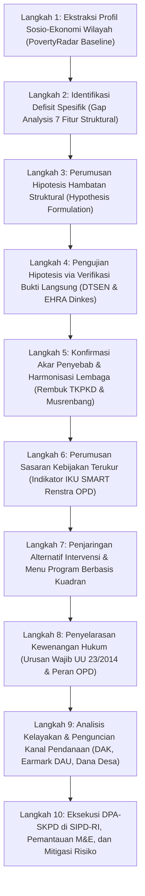
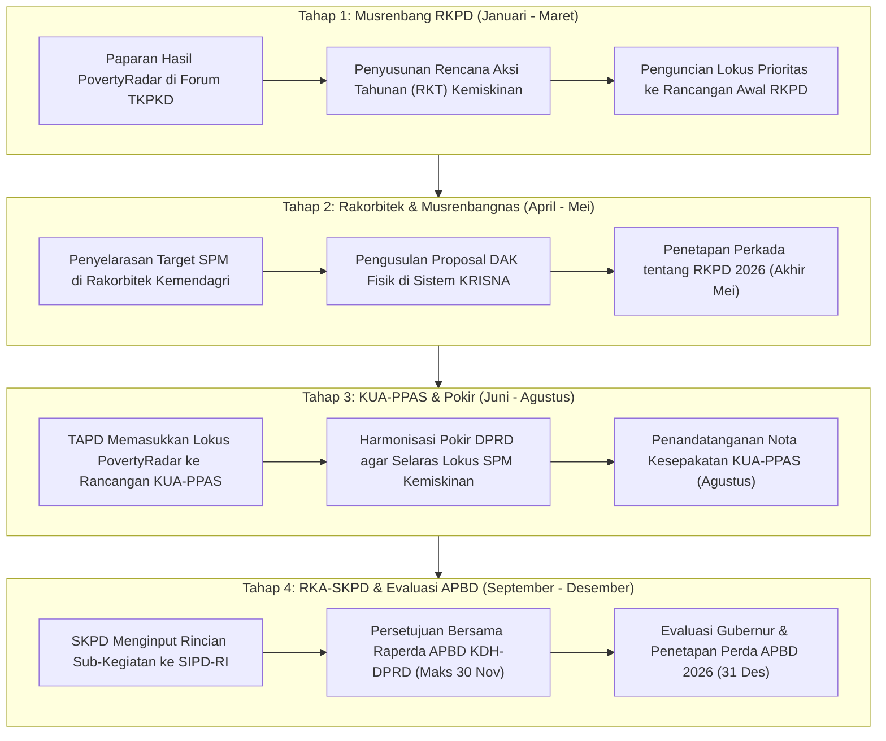

# Kerangka Rekomendasi Kebijakan Berbasis Bukti: Translasi Klaster Sosio-Ekonomi dan Skrining Kerentanan 2x2 PovertyRadar SDGs

**PovertyRadar SDGs — Regional Poverty Clustering and Relative Vulnerability Screening System**  
*Dokumen Rujukan Desain Intervensi Kebijakan, Pemetaan Kelembagaan, dan Advokasi Pembangunan Daerah*  
**Tanggal Referensi Riset:** 30 Oktober 2026  
**Status Metodologis:** Terverifikasi Empiris (BPS 514 Kabupaten/Kota, Bebas Target Leakage, Non-Supervised)  
**Dokumen Pendamping:** [`docs/01-sistem-kebijakan-dan-intervensi-pemerintah-indonesia-2026.md`](file:///d:/ARFI/Kuliah/Project/project-semester5/PovertyRadar/docs/01-sistem-kebijakan-dan-intervensi-pemerintah-indonesia-2026.md)

---

## DAFTAR ISI
1. [Ringkasan Eksekutif & Batasan Metodologis Translasi Kebijakan](#1-ringkasan-eksekutif--batasan-metodologis-translasi-kebijakan)
2. [Dekonstruksi & Interpretasi 4 Klaster Sosio-Ekonomi PovertyRadar](#2-dekonstruksi--interpretasi-4-klaster-sosio-ekonomi-povertyradar)
3. [Dekonstruksi & Interpretasi Matriks Skrining Kerentanan Relatif 2x2](#3-dekonstruksi--interpretasi-matriks-skrining-kerentanan-relatif-2x2)
4. [Kerangka Translasi Kebijakan 10 Langkah (Cluster-to-Policy Protocol)](#4-kerangka-translasi-kebijakan-10-langkah-cluster-to-policy-protocol)
5. [Jalur Intervensi Terdiferensiasi per Klaster dan Kuadran](#5-jalur-intervensi-terdiferensiasi-per-klaster-dan-kuadran)
6. [Pemetaan Kewenangan Lembaga (OPD Daerah & K/L Pusat Era Kabinet Merah Putih)](#6-pemetaan-kewenangan-lembaga-opd-daerah--kl-pusat-era-kabinet-merah-putih)
7. [Penyelarasan Kanal Pendanaan Statuter (APBN, TKD Pasca UU HKPD, & Dana Desa)](#7-penyelarasan-kanal-pendanaan-statuter-apbn-tkd-pasca-uu-hkpd--dana-desa)
8. [Matriks Rekomendasi Kebijakan Komprehensif (11 Dimensi Analisis)](#8-matriks-rekomendasi-kebijakan-komprehensif-11-dimensi-analisis)
9. [Kerangka Prioritisasi Kebijakan Multi-Kriteria (MCDA Scoring Framework)](#9-kerangka-prioritisasi-kebijakan-multi-kriteria-mcda-scoring-framework)
10. [Siklus Integrasi ke dalam Dokumen Perencanaan Resmi Daerah (RKPD & APBD)](#10-siklus-integrasi-ke-dalam-dokumen-perencanaan-resmi-daerah-rkpd--apbd)
11. [Kerangka Pemantauan, Evaluasi, dan Indikator Kinerja Berjenjang](#11-kerangka-pemantauan-evaluasi-dan-indikator-kinerja-berjenjang)
12. [Batasan Metodologis, Risiko Etika, dan Prinsip Penggunaan yang Bertanggung Jawab](#12-batasan-metodologis-risiko-etika-dan-prinsip-penggunaan-yang-bertanggung-jawab)
13. [Studi Kasus Kebijakan End-to-End: Kabupaten Barito Kuala (Kuadran II)](#13-studi-kasus-kebijakan-end-to-end-kabupaten-barito-kuala-kuadran-ii)
14. [Templat Advokasi Kebijakan Siap Pakai (Policy Brief Template untuk Bappeda)](#14-templat-advokasi-kebijakan-siap-pakai-policy-brief-template-untuk-bappeda)

---

## 1. RINGKASAN EKSEKUTIF & BATASAN METODOLOGIS TRANSLASI KEBIJAKAN

Dokumen ini memformalkan arsitektur penerjemahan (*policy translation framework*) dari temuan saintifik platform **PovertyRadar SDGs** menuju keputusan kebijakan publik, penganggaran teknis, dan penetapan program pembangunan daerah di Indonesia tahun 2026. 

PovertyRadar SDGs dibangun di atas fondasi analisis *unsupervised clustering* (K-Means, $k=4$, `RobustScaler` 7 fitur struktural) dan *skrining kerentanan relatif matriks kuadran 2x2* terhadap 514 kabupaten/kota di Indonesia. Pendekatan ini menolak generalisasi kebijakan penanggulangan kemiskinan yang seragam (*one-size-fits-all*). Di lapangan, daerah dengan tingkat kemiskinan moneter ($P_0$) yang identik kerap memiliki konfigurasi defisit fasilitas dasar, derajat kesehatan, dan struktur pasar tenaga kerja yang bertolak belakang.

```mermaid
flowchart LR
    subgraph DATA_SCIENCE["1. Bukti Empiris Data Sains"]
        C4["4 Klaster Profil Wilayah<br/>(K-Means k=4)"]
        Q4["Matriks Skrining 2x2<br/>(P0 vs V_struc)"]
    end

    subgraph TRANSLATION["2. Protokol Translasi 10 Langkah"]
        GAP["Perumusan Hipotesis &<br/>Verifikasi Bukti Langsung"]
        MCDA["Prioritisasi Kebijakan<br/>Multi-Kriteria (IPK)"]
    end

    subgraph INSTITUSI["3. Ekosistem Regulasi & Fiskal 2026"]
        UU23["Kewenangan UU 23/2014<br/>(SPM Urusan Wajib)"]
        HKPD["Kanal Fiskal UU 1/2022<br/>(DAU Earmark, DAK, Dana Desa)"]
    end

    subgraph DOKUMEN_PEMDA["4. Output Teranggarkan"]
        RKPD["Prioritas RKPD 2026"]
        DPA["DPA-SKPD Terkunci di SIPD-RI"]
    end

    DATA_SCIENCE --> TRANSLATION
    TRANSLATION --> INSTITUSI
    INSTITUSI --> DOKUMEN_PEMDA
```



### Penegasan Batasan Metodologis, Larangan Kausalitas, dan Tangga Bukti Kebijakan

Sebagai dokumen translasi kebijakan publik berbasis bukti (*evidence-based policy*), ditetapkan protokol integritas ilmiah yang tidak boleh dilanggar oleh pembuat kebijakan maupun analis perencana:

```
+----------------------------------------------------------------------------------------------------+
|                TANGGA BUKTI KEBIJAKAN POVERTYRADAR (FOUR-TIER POLICY EVIDENCE LADDER)               |
+----------------------------------------------------------------------------------------------------+
| LEVEL 1: BUKTI EMPIRIS TERAMATI (OBSERVED EMPIRICAL EVIDENCE)                                      |
| • Fakta numerik terukur langsung dari BPS 2021: P0, Sanitasi, Air Bersih, RLS, UHH, TPT, Pengeluaran|
| • Status: FAKTA DATA TERVERIFIKASI (Deskriptif Makro 514 Daerah).                                 |
+----------------------------------------------------------------------------------------------------+
| LEVEL 2: HIPOTESIS KERJA / DUGAAN KAUSALITAS SEMENTARA (WORKING HYPOTHESES)                        |
| • Dugaan mekanisme mengapa pola indikator terjadi (misal: dugaan pengaruh pangan subsisten,        |
|   remitansi migran, jeratan tengkulak panen, alih fungsi lahan, atau geohidrologi rawa gambut).   |
| • Status: DUGAAN SEMENTARA (BELUM TERBUKTI). DILARANG DIKLAIM SEBAGAI AKAR MASALAH PASTI!        |
+----------------------------------------------------------------------------------------------------+
| LEVEL 3: VERIFIKASI BUKTI LANGSUNG (DIRECT EMPIRICAL PROOF / FIELD VERIFICATION)                  |
| • Data mikro primer/sektoral yang wajib diperiksa Pemda: Susenas modul konsumsi, Sakernas mikro,    |
|   Survei EHRA Dinas Kesehatan, verivali P3KE/DTSEN desil 1–2, dan audit rantai pasok dinas teknis.  |
| • Status: UJI VALIDITAS EMPIRIS (Menguji apakah hipotesis Level 2 benar atau salah di lapangan).    |
+----------------------------------------------------------------------------------------------------+
| LEVEL 4: AKAR PENYEBAB TERKONFIRMASI (VERIFIED ROOT CAUSES)                                        |
| • Kesimpulan kausal yang SAH disimpulkan HANYA JIKA hipotesis Level 2 telah dibuktikan oleh bukti   |
|   langsung Level 3. Menjadi landasan legal penguncian DPA-SKPD dan DAK di RKPD/APBD.               |
| • Status: FAKTA KAUSAL TERKONFIRMASI (Bukan asumsi atau dugaan lagi).                              |
+----------------------------------------------------------------------------------------------------+
```

> [!IMPORTANT]
> **Prinsip Bebas Klaim Kausalitas Palsu (*Correlation is Not Causation*):**  
> 1. **Bukan Model Sebab-Akibat Deterministik (*No Causal Inference*):** Model klastering mengelompokkan kesamaan profil sosio-ekonomi secara korelatif. Klastering **tidak membuktikan hubungan sebab-akibat** (misalnya: tidak dapat diklaim bahwa sanitasi buruk secara langsung menyebabkan kemiskinan moneter, melainkan keduanya saling berasosiasi secara struktural).
> 2. **Larangan Menyamakan Hipotesis dengan Akar Masalah:** Seluruh penjelasan substantif mengenai *mengapa* suatu daerah mengalami defisit tertentu (seperti ketiadaan off-taker, pengaruh remitansi buruh migran, atau ketidaksesuaian kurikulum SMK) adalah **hipotesis kerja**, bukan akar penyebab yang terbukti, sampai Bappeda/Dinas terkait melakukan verifikasi bukti langsung di lapangan.
> 3. **Bukan Prediksi Risiko Probabilistik Masa Depan:** Sumbu kerentanan pada Matriks Kuadran 2x2 mengukur **kerentanan fondasi struktural saat ini (*current structural vulnerability*)** berdasarkan defisit fasilitas sanitasi, air minum, lama sekolah, dan angka harapan hidup. Sistem tidak memproyeksikan probabilitas berapa persen warga yang akan jatuh miskin di tahun berikutnya karena dataset berbasis *cross-section*.
> 4. **Pemisahan Penyasaran Geografis Makro vs Penyasaran Mikro Individu:** PovertyRadar menetapkan lokus wilayah dan menu intervensi kebijakan (*where and what*). PovertyRadar **tidak boleh digunakan untuk menentukan nama dan alamat warga penerima bantuan sosial individu (*who*)**. Penentuan penerima bansos merupakan kewenangan mutlak basis data **DTSEN (Data Tunggal Sosial dan Ekonomi Nasional)** di bawah payung Inpres No. 4 Tahun 2025 melalui mekanisme Musyawarah Desa (Musdes).

---

## 2. DEKONSTRUKSI & INTERPRETASI 4 KLASTER SOSIO-EKONOMI POVERTYRADAR

Model K-Means membagi 514 kabupaten/kota menjadi 4 arketipe sosio-ekonomi yang memiliki daya pembeda tajam (*ANOVA F-stat = 155.94, p-value < 10^-70; Kruskal-Wallis H-test = 167.52*). Karakteristik empiris dan dekonstruksi substantif kebijakan diuraikan sebagai berikut:

```
+----------------------------------------------------------------------------------------------------+
|                               PROFIL RINGKAS 4 KLASTER SOSIO-EKONOMI                               |
+----------------------------------------------------------------------------------------------------+
| KLASTER 1: PERKOTAAN MODERN & FORMAL (N=78, 15.18%) ──► 89.7% KOTA (70 Kota, 8 Kab)               |
| • P0: 5.54% | Sanitasi: 92.35% | Air: 97.81% | RLS: 10.87 thn | TPT: 8.68% | Pengeluaran: 14,60 jt|
+----------------------------------------------------------------------------------------------------+
| KLASTER 2: KABUPATEN PENYANGGA MAPAN (N=187, 36.38%) ──► 88.2% KABUPATEN (165 Kab, 22 Kota)       |
| • P0: 9.68% | Sanitasi: 84.67% | Air: 90.53% | RLS: 8.34 thn  | TPT: 5.37% | Pengeluaran: 10,90 jt|
+----------------------------------------------------------------------------------------------------+
| KLASTER 3: PERDESAAN AGRARIS RENTAN (N=216, 42.02%) ──► 95.8% KABUPATEN (207 Kab, 9 Kota)         |
| • P0: 13.13%| Sanitasi: 72.29% | Air: 80.85% | RLS: 8.13 thn  | TPT: 3.96% | Pengeluaran: 8,94 jt |
+----------------------------------------------------------------------------------------------------+
| KLASTER 4: WILAYAH 3T DEPRIVASI AKUT (N=33, 6.42%) ──► 100% KABUPATEN (33 Kab, 0 Kota)            |
| • P0: 31.39%| Sanitasi: 31.22% | Air: 52.65% | RLS: 5.26 thn  | TPT: 1.91% | Pengeluaran: 6,01 jt |
+----------------------------------------------------------------------------------------------------+
```

### 2.1. Klaster 1: Perkotaan Modern & Formal ($N=78$, 15.18% Wilayah Nasional)
* **Komposisi Wilayah:** Didominasi mutlak oleh kawasan perkotaan (**89.7% Kota / 70 Kota dan 8 Kabupaten**). Terkonsentrasi di Jawa (32 daerah) dan Sumatera (21 daerah), mencakup kota-kota metropolitan dan ibukota provinsi (Jakarta, Surabaya, Bandung, Semarang, Medan, Makassar).
* **Bukti Empiris Teramati (*Observed Statistical Evidence*):** Modal manusia dan fasilitas fisik terbaik nasional: RLS **10.87 tahun** (setara kelas 2 SMA), akses sanitasi layak **92.35%**, akses air minum terlindung **97.81%**, pengeluaran riil per kapita tertinggi (**Rp14,60 juta/tahun**), dan median tingkat kemiskinan moneter $P_0$ terendah nasional (**5.54%**), namun mencatat Tingkat Pengangguran Terbuka (TPT) tertinggi nasional (**rata-rata 8.68%**).
* **Hipotesis Kerja Mekanisme Sosio-Ekonomi (*Working Hypotheses* yang Perlu Diuji Lapangan):**
  1. *Hipotesis Pengangguran Friksional & Upah Reservasi:* Angkatan kerja perkotaan berpendidikan menengah/tinggi diduga memiliki daya tahan ekonomi keluarga yang memungkinkan mereka menganggur sementara (*job search/wait unemployment*) demi mencari posisi pekerjaan formal yang sesuai.
  2. *Hipotesis Ketidaksesuaian Keterampilan (Skills Mismatch):* Kompetensi lulusan vokasi (SMK/Diploma) lokal diduga belum beradaptasi dengan otomatisasi industri jasa/manufaktur modern di perkotaan.
  3. *Hipotesis Kerentanan Sektor Gig & Biaya Hidup:* Pekerja informal perkotaan dan pekerja lepas (*gig economy*) diduga menghadapi kerentanan jaminan sosial, beban sewa hunian tinggi (*housing affordability*), dan keterjebakan di kantong permukiman kumuh (*slums*).
* **Verifikasi Bukti Langsung yang Diperlukan (*Direct Empirical Proof Required*):**
  - Mikrodata Sakernas BPS: Tabulasi silang pengangguran menurut tingkat pendidikan, usia, dan durasi mencari kerja guna memastikan apakah pengangguran bersifat friksional terdidik atau struktural kronis.
  - Peta Spasial SK Kawasan Kumuh Walikota dan basis data DTSEN desil 1–2 tingkat kelurahan untuk memvalidasi lokasi kantong kemiskinan perkotaan.
  - Data kepesertaan BPJS Ketenagakerjaan sektor Bukan Penerima Upah (BPU).

### 2.2. Klaster 2: Kabupaten Penyangga Mapan ($N=187$, 36.38% Wilayah Nasional)
* **Komposisi Wilayah:** Mayoritas kabupaten di koridor utama ekonomi (**88.2% Kabupaten / 165 Kab dan 22 Kota**), dengan konsentrasi tinggi di Jawa (74 daerah) dan Sumatera (54 daerah). Merupakan wilayah penyangga metropolitan (*peri-urban*) dan kabupaten agraris beririgasi teknis matang.
* **Bukti Empiris Teramati (*Observed Statistical Evidence*):** Modal manusia dan fasilitas dasar di atas rata-rata nasional: RLS **8.34 tahun** (tamat SMP), derajat kesehatan tinggi dengan UHH **71.39 tahun**, sanitasi layak **84.67%**, air minum layak **90.53%**, pengeluaran riil **Rp10,90 juta/tahun**, kemiskinan $P_0$ rata-rata **9.68%** (di bawah median nasional), dan TPT moderat (**5.37%**).
* **Hipotesis Kerja Mekanisme Sosio-Ekonomi (*Working Hypotheses* yang Perlu Diuji Lapangan):**
  1. *Hipotesis Perangkap Pendapatan Menengah Daerah (Regional Middle-Income Trap):* Daerah berisiko mengalami stagnasi produktivitas jika gagal bertransisi dari agraris tradisional menuju agribisnis bernilai tambah tinggi atau manufaktur terampil.
  2. *Hipotesis Alih Fungsi Lahan Tanpa Kesiapan Tenaga Kerja:* Masifnya konversi Lahan Pertanian Pangan Berkelanjutan (LP2B) menjadi kawasan industri atau perumahan diduga menyingkirkan buruh tani lokal yang belum memiliki keterampilan untuk masuk ke industri baru.
  3. *Hipotesis Disparitas Koridor vs Pedalaman:* Kesejahteraan terkonsentrasi di sepanjang jalan arteri nasional/provinsi, sementara desa pedalaman kabupaten tertinggal fasilitas sanitasi dan akses jalan kelas IV.
* **Verifikasi Bukti Langsung yang Diperlukan (*Direct Empirical Proof Required*):**
  - Data Sensus Pertanian dan luas konversi LP2B dalam RTRW 5 tahun terakhir.
  - Audit serapan tenaga kerja lokal KTP setempat pada pabrik/industri di kawasan industri kabupaten.
  - Profil sanitasi dan kemiskinan per kecamatan dari data mikro DTSEN dan Dinkes.

### 2.3. Klaster 3: Perdesaan Agraris Rentan ($N=216$, 42.02% Wilayah Nasional)
* **Komposisi Wilayah:** Klaster terbesar di Indonesia (**95.8% Kabupaten / 207 Kab dan 9 Kota**). Dominan berada di Luar Jawa: Sumatera (73 daerah), Sulawesi (42 daerah), Maluku & Papua pesisir (34 daerah), Kalimantan (31 daerah), serta Bali & Nusa Tenggara (27 daerah).
* **Bukti Empiris Teramati (*Observed Statistical Evidence*):** Rata-rata lama sekolah setara Klaster 2 (RLS **8.13 tahun**), namun mengalami **kejatuhan tajam pada derajat kesehatan dan fasilitas fisik**:
  * Angka Harapan Hidup (UHH) anjlok ke **67.67 tahun** (terpangkas 3.72 tahun dibanding Klaster 2).
  * Akses sanitasi layak turun ke **72.29%** (hampir 28% rumah tangga tidak memiliki jamban sehat).
  * Akses air minum layak turun ke **80.85%**.
  * Pengeluaran riil per kapita rendah (**Rp8,94 juta/tahun**).
  * Median kemiskinan moneter $P_0$ melompat di atas batas nasional menjadi **13.13%**.
  * Paradoks ketenagakerjaan: TPT sangat rendah (**3.96%**), sementara TPAK tinggi (**70.04%**).
* **Hipotesis Kerja Mekanisme Sosio-Ekonomi (*Working Hypotheses* yang Perlu Diuji Lapangan):**
  1. *Hipotesis Keterpaksaan Bekerja Subsisten (Mandatory Subsistence Labor):* Rendahnya pengangguran terbuka bukan bukti kemakmuran, melainkan dugaan ketiadaan jaring pengaman sehingga warga miskin (termasuk lansia dan anak) terpaksa bekerja apa saja di sektor pertanian/perkebunan informal berproduktivitas rendah demi bertahan hidup harian.
  2. *Hipotesis Asimetri Rantai Pasok Pertanian:* Nilai tambah komoditas pertanian/perikanan diduga dinikmati oleh pedagang perantara/tengkulak, sementara petani gurem menerima harga di tingkat kebun (*farm-gate price*) yang berfluktuasi rendah di bawah biaya hidup.
  3. *Hipotesis Beban Ganda Lingkungan & Kesehatan:* Defisit air bersih saat kemarau dan tingginya BABS diduga menjadi determinan biologis tingginya infeksi berulang (diare, cacingan) yang menekan usia harapan hidup dan memicu stunting balita.
* **Verifikasi Bukti Langsung yang Diperlukan (*Direct Empirical Proof Required*):**
  - Analisis Nilai Tukar Petani (NTP) subsektor tanaman pangan dan perkebunan rakyat BPS.
  - Survei tata niaga dan margin keuntungan rantai pasok gabah/karet/sawit oleh Dinas KUKM dan Perdagangan.
  - Survei *Environmental Health Risk Assessment* (EHRA) Dinas Kesehatan dan data balita stunting di Posyandu (e-PPGBM).

### 2.4. Klaster 4: Wilayah 3T Deprivasi Akut ($N=33$, 6.42% Wilayah Nasional)
* **Komposisi Wilayah:** Seluruhnya berstatus kabupaten (**100% Kabupaten / 33 Kab, 0 Kota**). Sangat terkonsentrasi di kawasan Timur Indonesia: Maluku & Papua (**22 kabupaten, terutama di dataran tinggi Papua Pegunungan dan Papua Tengah**), Sumatera (**6 kabupaten di Kepulauan Nias dan Mentawai**), Nusa Tenggara Timur (**4 kabupaten di Pulau Sumba dan Timor**), serta Sulawesi (**1 kabupaten**).
* **Bukti Empiris Teramati (*Observed Statistical Evidence*):** Mengalami **defisit ekstrem simultan infrastruktur fisik dan modal manusia**:
  * Akses sanitasi layak hanya **31.22%** (hampir 70% penduduk belum memiliki sanitasi layak/BABS).
  * Akses air minum terlindung hanya **52.65%** (separuh warga mengonsumsi air permukaan/sungai mentah).
  * Rata-rata lama sekolah hanya **5.26 tahun (tidak menuntaskan jenjang SD)**.
  * Pengeluaran riil tertekan ekstrem (**Rp6,01 juta/tahun**).
  * Tingkat kemiskinan moneter $P_0$ tertinggi nasional (**rata-rata 29.47%, median 31.39%, puncak 41.66%**).
  * TPT terendah nasional (**1.91%**) dan TPAK tertinggi (**81.51%**).
* **Hipotesis Kerja Mekanisme Sosio-Ekonomi (*Working Hypotheses* yang Perlu Diuji Lapangan):**
  1. *Hipotesis Perangkap Kemiskinan Spasial (Spatial Poverty Trap):* Keterisolasian topografi ekstrem (pegunungan curam tanpa jalan darat atau pulau karang terpencil) diduga melipatgandakan Indeks Kemahalan Konstruksi (IKK) 5–10 kali lipat, membuat intervensi pasar swasta dan proyek standar APBD gagal berjalan.
  2. *Hipotesis Runtuhnya Penyelenggaraan Pelayanan Publik (Delivery Failure):* Kelangkaan ekstrem tenaga pendidik dan medis di distrik pedalaman diduga akibat insentif penugasan dan jaminan keamanan yang belum memadai, mengakibatkan fasilitas sekolah dan puskesmas tidak beroperasi secara kontinu.
* **Verifikasi Bukti Langsung yang Diperlukan (*Direct Empirical Proof Required*):**
  - Audit keberadaan fisik (*physical presence/absenteeism*) guru dan tenaga kesehatan di distrik pedalaman oleh Inspektorat Daerah.
  - Data manifes logistik penerbangan perintis dan harga bahan pokok riil di pasar distrik pedalaman.
  - Pemetaan geospasial sumber mata air gravitasi dan topografi oleh Balai Wilayah Sungai (BWS) Kementerian PU.

---

## 3. DEKONSTRUKSI & INTERPRETASI MATRIKS SKRINING KERENTANAN RELATIF 2X2

Matriks Skrining Kerentanan Relatif 2x2 memadukan dua sumbu ortogonal independen:
* **Sumbu X (Tingkat Kemiskinan Moneter Aktual $P_0$):** Garis batas ambang = **Median Nasional $10.46\%$**.
* **Sumbu Y (Indeks Kerentanan Fasilitas Dasar $V_{\text{struc}}$):** Komposit tertimbang defisit sanitasi, air minum, RLS, dan UHH. Garis batas ambang = **Median Indeks $0.2720$**.

```
                   Indeks Kerentanan Fasilitas Dasar (Tinggi / Defisit)
                                           ▲
                                           │
                 KUADRAN II                │                KUADRAN I
        [ KERENTANAN TERSEMBUNYI ]         │          [ PRIORITAS UTAMA ]
           (N = 95 Kabupaten/Kota)         │        (N = 162 Kabupaten/Kota)
        P0 Rendah, Kerentanan Tinggi       │      P0 Tinggi, Kerentanan Tinggi
        Contoh: Tanah Datar, Barito Kuala, │      Contoh: Nduga, Yahukimo, Sampang,
                Mandailing Natal, Lebak    │              Wonosobo, Sumba Barat Daya
                                           │
  ─────────────────────────────────────────┼─────────────────────────────────────────► Tingkat Kemiskinan
                                           │                                           Moneter P0 (Aktual)
                 KUADRAN IV                │               KUADRAN III
             [ TERBINA / MAPAN ]           │        [ KANTONG DAYA BELI ]
           (N = 162 Kabupaten/Kota)        │         (N = 95 Kabupaten/Kota)
        P0 Rendah, Kerentanan Rendah       │      P0 Tinggi, Kerentanan Rendah
        Contoh: Surabaya, Badung,          │      Contoh: Biak Numfor, Kota Bengkulu,
                Tangerang, Medan, Semarang │              Lembata, Kulon Progo, Kebumen
                                           │
                                           ▼
                   Indeks Kerentanan Fasilitas Dasar (Rendah / Memadai)
```

### Tabel Silang Sebaran 514 Daerah: Klaster Sosio-Ekonomi vs Kuadran Kerentanan

| Klaster Sosio-Ekonomi | Kuadran I (Prioritas Utama) | Kuadran II (Kerentanan Tersembunyi) | Kuadran III (Kantong Daya Beli) | Kuadran IV (Terbina/Mapan) | Total Daerah |
| :--- | :---: | :---: | :---: | :---: | :---: |
| **Klaster 1: Perkotaan Modern & Formal** | 0 | 0 | **8** | **70** | 78 |
| **Klaster 2: Kabupaten Penyangga Mapan** | 11 | **27** | **64** | **85** | 187 |
| **Klaster 3: Perdesaan Agraris Rentan** | **119** | **67** | **23** | 7 | 216 |
| **Klaster 4: Wilayah 3T Deprivasi Akut** | **32** | **1** | 0 | 0 | 33 |
| **Total Nasional** | **162** | **95** | **95** | **162** | **514** |

---

### 3.1. Analisis Kritis Empat Kuadran Skrining

#### Kuadran I — Prioritas Utama (*High Poverty, High Vulnerability* | $N=162$)
* **Kondisi Riil Lapangan:** Mengalami **beban ganda (*double burden*)**: kemiskinan moneter konsumsi yang parah dibarengi defisit fasilitas fisik air, sanitasi, dan modal manusia yang kritis. Terdiri atas 32 kabupaten Klaster 4 (pedalaman Papua, Nias, Sumba), 119 kabupaten Klaster 3, dan 11 kabupaten Klaster 2.
* **Potensi Masalah:** Lingkaran setan kemiskinan antargenerasi; morbiditas tinggi akibat infeksi bawaan air dan sanitasi buruk; stunting kronis; serta ketidakmampuan berpartisipasi dalam ekonomi formal.
* **Arah Kebijakan Terpadu:** **Intervensi Konvergensi Ganda**. Menyalurkan jaring pengaman sosial langsung (bansos tunai PKH/sembako/BLT Desa) untuk menopang daya beli jangka pendek, dibarengi secara simultan dengan pembangunan fisik instalasi air minum komunal (Pamsimas), tangki septik (SPALD-S), dan ruang kelas sekolah baru.

#### Kuadran II — Kerentanan Tersembunyi (*Low Poverty, High Vulnerability* | $N=95$)
* **Bukti Empiris Teramati (*Observed Statistical Evidence*):** Disebut sebagai **"Fenomena Kerentanan Tersembunyi"**. Secara statistik BPS, persentase kemiskinan moneter daerah ini berada di bawah median nasional ($P_0 < 10.46\%$, bahkan sejumlah daerah mencatat angka 4%–6%), namun indeks kerentanan fasilitas fisiknya tergolong kritis ($V_{\text{struc}} \ge 0.2720$).
  * *Contoh Bukti Lapangan:*
    * **Tanah Datar (Sumbar):** $P_0$ sangat rendah (**4.54%**), namun sanitasi layak hanya **53.73%** (hampir separuh warga BABS).
    * **Barito Kuala (Kalsel):** $P_0$ hanya **5.11%**, namun sanitasi layak hanya **55.29%** dan air minum layak **65.15%**.
    * **Mandailing Natal (Sumut):** $P_0$ **9.49%**, namun akses sanitasi layak hanya **35.73%** (krisis sanitasi parah).
    * **Lebak (Banten):** $P_0$ **10.29%**, namun akses sanitasi hanya **56.82%**.
* **Hipotesis Kerja Penjelas (*Working Hypotheses* Mengapa $P_0$ Tampak Rendah):**
  1. *Hipotesis Ketahanan Pangan Subsisten:* Pemenuhan kalori harian warga diduga tertopang oleh hasil panen kebun/lahan sawah sendiri yang tidak tercatat sebagai transaksi moneter pasar, namun mencukupi kebutuhan fisik minimum di atas Garis Kemiskinan.
  2. *Hipotesis Remitansi Tenaga Kerja Migran:* Rumah tangga diduga menerima kiriman uang (*remittances*) dari anggota keluarga yang merantau ke kota besar atau luar negeri, menjaga daya beli harian tetap stabil.
* **Syarat Verifikasi Bukti Langsung (*Direct Evidence Testing*):**
  - **Peringatan Ilmiah:** Penjelasan di atas adalah *hipotesis kerja*, bukan akar penyebab yang terbukti. Bappeda dilarang menghentikan program perlindungan sosial tanpa memeriksa mikrodata Susenas BPS (proporsi konsumsi dari produksi sendiri) dan data remitansi pos/perbankan.
  - Survei *Environmental Health Risk Assessment* (EHRA) Dinas Kesehatan untuk membuktikan apakah rendahnya sanitasi disebabkan oleh faktor geohidrologi (lahan rawa pasang surut) atau perilaku kultural.
* **Risiko Struktural Laten (*The Latent Vulnerability Risk*):** Ketiadaan sanitasi dan air bersih aman adalah ancaman laten. Jika terjadi epidemi penyakit menular (kolera, diare massal) atau anjloknya harga komoditas perkebunan, rumah tangga rentan ini dapat terperosok ke bawah garis kemiskinan secara serentak.
* **Arah Kebijakan Prioritas:** **Infrastruktur Sanitasi dan Air Bersih Preventif**. Fokus anggaran diarahkan untuk pembangunan masif jamban keluarga kedap air, pengolahan air bersih terlindung, dan program Sanitasi Total Berbasis Masyarakat (STBM).

#### Kuadran III — Kantong Kemiskinan Daya Beli (*High Poverty, Low Vulnerability* | $N=95$)
* **Bukti Empiris Teramati (*Observed Statistical Evidence*):** Disebut sebagai **"Fasilitas Memadai, Kemiskinan Moneter Tinggi"**. Fasilitas fisik dasar daerah ini relatif lengkap dan melampaui tolok ukur median nasional (sanitasi baik, air minum terlindung tinggi, sekolah dan puskesmas terjangkau), namun tingkat kemiskinan moneter warganya berada di atas ambang nasional ($P_0 \ge 10.46\%$).
  * *Contoh Bukti Lapangan:*
    * **Biak Numfor (Papua):** $P_0$ tinggi (**24.45%**), namun akses sanitasi mencapai **83.32%**, air minum **97.67%**, dan RLS tinggi (**10.34 tahun**).
    * **Lembata (NTT):** $P_0$ **26.21%**, namun sanitasi layak **91.88%** dan air bersih **92.91%**.
    * **Kulon Progo (DIY):** $P_0$ **18.38%**, namun sanitasi **95.95%** dan RLS 9.02 tahun.
    * **Kebumen (Jateng):** $P_0$ **17.83%**, namun sanitasi **88.99%** dan air bersih **86.36%**.
    * **Kota Bengkulu:** $P_0$ **17.89%**, namun sanitasi **95.80%**, air bersih **92.21%**, dan RLS 11.80 tahun.
* **Peringatan Kesalahan Alokasi Kebijakan (*Policy Misallocation Warning*):**
  > [!CAUTION]
  > Membangun proyek fisik jamban atau gedung sekolah baru di wilayah Kuadran III berisiko tinggi menjadi **inefisiensi anggaran yang tidak menurunkan kemiskinan moneter**! Karena fondasi fisik dasar telah memadai, defisit utama terkonsentrasi pada daya beli dan perputaran ekonomi produktif.
* **Hipotesis Kerja Penjelas (*Working Hypotheses* Mengapa Kemiskinan Tetap Tinggi):**
  1. *Hipotesis Ketiadaan Off-Taker & Hambatan Rantai Pasok:* Komoditas unggulan lokal (ikan tangkap, jagung, atau hasil kerajinan) diduga melimpah namun tidak terserap pasar industri secara adil akibat ketiadaan pembeli siaga (*off-taker*) dan tingginya biaya kargo logistik perkapalan/perhubungan.
  2. *Hipotesis Keterbatasan Modal Usaha Produktif:* Pelaku usaha mikro dan petani gurem diduga terjebak dalam pembiayaan informal berbunga tinggi akibat kesulitan memenuhi persyaratan agunan perbankan formal.
* **Syarat Verifikasi Bukti Langsung (*Direct Evidence Testing*):**
  - **Peringatan Ilmiah:** Dugaan masalah rantai pasok dan permodalan di atas adalah *hipotesis kerja*. Bappeda dan Dinas KUKM/Perdagangan wajib menguji hipotesis ini melalui audit margin tata niaga komoditas, survei harga produsen vs konsumen akhir, dan analisis profil kepala keluarga desil 1–2 DTSEN sebelum meluncurkan intervensi subsidi atau bantuan sarana produksi.
* **Arah Kebijakan Prioritas:** **Pemberdayaan Ekonomi Produktif & Stimulus Daya Beli**. Fasilitasi pembiayaan ultra mikro (UMi/KUR super mikro), penguatan BUMDes Bersama sebagai stabilisator harga hasil panen, pelatihan vokasi adaptif industri kreatif, dan program Padat Karya Tunai (PKT) pemeliharaan sarana publik desa.

#### Kuadran IV — Terbina & Mapan (*Low Poverty, Low Vulnerability* | $N=162$)
* **Bukti Empiris Teramati (*Observed Statistical Evidence*):** Wilayah dengan kinerja statistik terbaik nasional: kemiskinan moneter rendah dan fasilitas dasar mantap ($P_0 < 10.46\%$, $V_{\text{struc}} < 0.2720$). Terdiri atas 70 Kota Klaster 1, 85 Kabupaten Klaster 2, dan 7 daerah Klaster 3.
* **Arah Kebijakan Prioritas:** Menjaga stabilitas daya beli dari inflasi pangan, penyerapan tenaga kerja formal, peremajaan permukiman kumuh kantong marginal, serta berperan sebagai *benchmark* tata kelola publik dan pembina rantai pasok (*supply chain hub*) bagi kabupaten sekitarnya.

---

### 3.2. Dekonstruksi Kasus Khusus (*Edge Cases*)
1. **Kasus Kepulauan Anambas (Kepri):**
   * Tercatat sebagai anggota **Klaster 4**, namun menempati **Kuadran II** ($P_0$ rendah **7.09%**, namun kerentanan struktural sangat tinggi **$V_{\text{struc}} = 0.6007$**).
   * *Hipotesis Penjelas & Uji Bukti:* Tingkat kemiskinan moneter makro tampak rendah diduga karena terdorong oleh perputaran aktivitas industri migas lepas pantai dan DBH migas yang besar. Namun, kondisi geografis kepulauan terluar memicu isolasi fasilitas fisik: air minum layak hanya **20.51%** dan sanitasi hanya **33.80%**. *Verifikasi:* Dinas PUPR wajib memvalidasi ketersediaan cadangan air tawar pulau-pulau kecil untuk menentukan apakah intervensi yang tepat adalah SPAM desalinasi atau pemanenan air hujan terintegrasi.
2. **Kasus 8 Kota Klaster 1 di Kuadran III:**
   * Kota Bengkulu ($P_0$ 17.89%), Kota Palembang (11.34%), Kota Langsa (10.96%), Kota Lhokseumawe (11.16%), Kota Sorong (15.35%), Kota Jayapura (11.39%), Bantul (14.04%), dan Gresik (12.42%).
   * *Hipotesis Penjelas & Uji Bukti:* Kota-kota ini memiliki fasilitas perkotaan modern khas Klaster 1, namun persentase kemiskinannya melompat di atas median nasional. *Hipotesis Kerja:* Kemiskinan diduga bersumber dari kantong kumuh perkotaan (*slums*), tingginya pengangguran terbuka (TPT), dan arus masuk penduduk perdesaan tanpa keterampilan formal. *Verifikasi:* Bappeda kota wajib memverifikasi tabulasi silang Sakernas mikro (pendidikan vs pengangguran) dan peta kawasan kumuh SK Walikota sebelum menyalurkan bantuan sosial atau padat karya.

---

## 4. KERANGKA TRANSLASI KEBIJAKAN 10 LANGKAH (CLUSTER-TO-POLICY PROTOCOL)

Untuk menjembatani temuan data sains PovertyRadar ke dalam dokumen perencanaan dan penganggaran resmi Pemda, disusun protokol operasional standar 10 langkah:



### Penjabaran Operasional 10 Langkah Translasi:

1. **Langkah 1: Profil Sosio-Ekonomi Wilayah (Baseline Data Extraction):** Mengambil posisi klaster (1 s.d. 4) dan kuadran (I s.d. IV) kabupaten/kota bersangkutan dari dataset PovertyRadar.
2. **Langkah 2: Identifikasi Defisit Spesifik (Gap Analysis):** Mendekomposisi nilai 7 variabel terhadap median nasional untuk menemukan kesenjangan terbesar ($\Delta$ Z-score): apakah defisit sanitasi, air bersih, RLS, atau UHH.
3. **Langkah 3: Perumusan Hipotesis Hambatan Struktural (Hypothesis Formulation):** Merumuskan dugaan awal mengapa defisit terjadi: apakah berakar pada (a) Ketiadaan infrastruktur fisik (*supply bottleneck*); (b) Ketiadaan daya beli atau perilaku warga (*demand bottleneck*); atau (c) Hambatan isolasi geografis/IKK (*spatial constraint*). *Penegasan Ilmiah:* Langkah ini HANYA menghasilkan hipotesis kerja yang dilarang dijadikan dasar komitmen anggaran sebelum diuji di Langkah 4.
4. **Langkah 4: Pengujian Hipotesis via Verifikasi Bukti Langsung (Direct Evidence Verification):** Menguji hipotesis Langkah 3 dengan bukti empiris mikro di lapangan: data spasial keluarga miskin Desil 1–2 DTSEN, data stunting Posyandu (e-PPGBM), survei risiko kesehatan lingkungan *Environmental Health Risk Assessment* (EHRA) Dinas Kesehatan, survei rantai niaga komoditas, dan peta RTRW/RDTR. Jika data lapangan membantah hipotesis awal, hipotesis gugur dan perencana wajib mereformulasi diagnosis.
5. **Langkah 5: Konfirmasi Akar Penyebab & Harmonisasi Kelembagaan (Verified Root Cause & Institutional Alignment):** Setelah hipotesis terbukti secara sahih oleh bukti langsung, statusnya naik menjadi **Akar Penyebab Terkonfirmasi (*Verified Root Cause*)**. Kesimpulan ini dibawa ke forum resmi **Tim Koordinasi Penanggulangan Kemiskinan Daerah (TKPKD)** yang dipimpin Wakil Bupati/Walikota bersama Kepala Bappeda, Dinas Teknis, dan DPRD pada forum Musrenbang RKPD.
6. **Langkah 6: Perumusan Sasaran Kebijakan Terukur (Measurable Targets):** Merumuskan sasaran kuantitatif SMART dalam dokumen RKPD dan Renstra OPD (misal: "Peningkatan akses sanitasi layak dari 55% menjadi 80% dalam 3 tahun anggaran").
7. **Langkah 7: Penjaringan Alternatif Intervensi & Menu Program:** Menyeleksi portofolio intervensi yang selaras dengan kuadran: melarang proyek fisik di Kuadran III dan melarang bansos tunai semata di Kuadran II.
8. **Langkah 8: Penyelarasan Kewenangan Hukum (Legal Mandate Compliance):** Memetakan instansi pelaksana (*Lead OPD* dan *Supporting OPD*) sesuai Lampiran Pembagian Urusan Pemerintahan UU No. 23 Tahun 2014 guna menghindari tumpang tindih anggaran.
9. **Langkah 9: Analisis Kelayakan & Penguncian Kanal Pendanaan (Fiscal Matching):** Menentukan struktur pembiayaan resmi: DAK Fisik Sanitasi via KRISNA, DAU Earmarked Bidang Pekerjaan Umum/Kesehatan di APBD, Dana Desa 20% ketahanan pangan, atau APBN K/L pusat.
10. **Langkah 10: Implementasi, Monitoring, Evaluasi, dan Mitigasi Risiko:** Memasukkan sub-kegiatan ke dalam SIPD-RI, menerbitkan DPA-SKPD, serta memantau ketercapaian *output* dan *outcome* secara berkala melalui Inspektorat dan e-Monev Bappeda.

---

## 5. JALUR INTERVENSI TERDIFERENSIASI PER KLASTER DAN KUADRAN

Berdasarkan integrasi profil klaster dan kuadran kerentanan, dirumuskan jalur intervensi prioritas yang terdiferensiasi:

```
+----------------------------------------------------------------------------------------------------+
|                               MENU JALUR INTERVENSI TERDIFERENSIASI                                |
+----------------------------------------------------------------------------------------------------+
| KLASTER 1 (KOTA MODERN)   ──► Revitalisasi Vokasi 4.0, Penataan Kumuh Rusunawa, Perlindungan BPJS BPU|
| KLASTER 2 (PENYANGGA)     ──► Perlindungan Lahan LP2B, Upskilling Petani, Sanitasi SPALD Terpadu   |
| KLASTER 3 (AGRARIS RENTAN)──► Pamsimas Air Bersih, Jamban Sehat STBM, Hilirisasi BUMDes, KUR Mikro|
| KLASTER 4 (3T DEPRIVASI)  ──► Afirmasi PHTC BGN (Makan Bergizi), DTI Otsus, Balai PU SPAM Gravitasi|
+----------------------------------------------------------------------------------------------------+
| KUADRAN I (PRIORITAS)     ──► Konvergensi Bansos Tunai + Pembangunan Fisik Air/Sanitasi Skala Masif|
| KUADRAN II (TERSEMBUNYI)  ──► Inpres Air Minum & Sanitasi, Tangki Septik Komunal, Larangan Bansos Murni|
| KUADRAN III (DAYA BELI)   ──► Hilirisasi Komoditas, Akses Pasar Offtaker, Subsidi Bunga Pembiayaan UMi|
| KUADRAN IV (MAPAN)        ──► Benchmarking Tata Kelola, Stabilitas Pasokan Pangan, Inkubator Bisnis|
+----------------------------------------------------------------------------------------------------+
```

### 5.1. Rincian Jalur Intervensi menurut Klaster Sosio-Ekonomi:
1. **Jalur Klaster 1 (Perkotaan Modern & Formal):**
   * *Program:* Revitalisasi Balai Latihan Kerja (BLK) / BPVP ke bidang digital, otomasi, logistik, dan ekonomi kreatif; fasilitasi Rusunawa MBR terintegrasi transportasi umum; penataan kawasan kumuh permukiman; subsidi APBD jaminan sosial ketenagakerjaan bagi pekerja informal (*gig economy*).
2. **Jalur Klaster 2 (Kabupaten Penyangga Mapan):**
   * *Program:* Pengendalian tata ruang dan insentif pajak perlindungan Lahan Pertanian Pangan Berkelanjutan (LP2B); modernisasi mekanisasi pertanian; peningkatan kapasitas tangki septik limbah domestik permukiman padat; penguatan SMK kejuruan industri penyangga.
3. **Jalur Klaster 3 (Perdesaan Agraris Rentan):**
   * *Program:* Pembangunan sarana air minum perdesaan (Pamsimas) berbasis gravitasi/surya; percepatan Stop BABS melalui stimulan jamban sehat swadaya; pembangunan jalan usaha tani via Padat Karya Tunai; korporatisasi petani/nelayan melalui BUMDes Bersama; perluasan kepesertaan PBI JKN APBN.
4. **Jalur Klaster 4 (Wilayah 3T Deprivasi Akut):**
   * *Program:* Pembangunan infrastruktur air dan sanitasi darurat berbasis kearifan lokal oleh Balai PU (BPPW); insentif tunjangan khusus bagi guru dan dokter pedalaman; pengadaan sarana komunikasi satelit (VSAT/SATRIA); penyaluran bansos logistik pangan langsung; dan intervensi gizi terpadu Satuan Pelayanan BGN.

---

## 6. PEMETAAN KEWENANGAN LEMBAGA (OPD DAERAH & K/L PUSAT ERA KABINET MERAH PUTIH)

Setiap rekomendasi intervensi dipetakan secara rigid ke dalam yurisdiksi kewenangan hukum berdasarkan UU No. 23/2014 dan penataan kementerian Kabinet Merah Putih:

| Bidang Kebijakan | Lokus Masalah Lapangan | Kewenangan Hukum (UU 23/2014) | Organisasi Perangkat Daerah (OPD) Pengampu di Kabupaten/Kota | Kementerian / Lembaga Pengampu di Pemerintah Pusat |
| :--- | :--- | :--- | :--- | :--- |
| **Air Minum** | Pipa transmisi rusak, cakupan PDAM rendah, krisis air pedesaan. | Urusan Wajib Pelayanan Dasar (Pekerjaan Umum). | **Dinas Pekerjaan Umum & Penataan Ruang (PUPR)**; BUMD Air Minum (PDAM); Dinas PMD (SPAM Desa). | **Kementerian Pekerjaan Umum (Kemen PU)** (Ditjen Cipta Karya / Balai BPPW/BWS); Kemendesa PDT. |
| **Sanitasi & Limbah** | BABS tinggi, ketiadaan tangki septik standar, IPLT mangkrak. | Urusan Wajib Pelayanan Dasar (Pekerjaan Umum & Kesehatan). | **Dinas PUPR / Perumahan Rakyat**; **Dinas Kesehatan** (Sanitasi Total Berbasis Masyarakat / STBM). | **Kementerian Pekerjaan Umum (Kemen PU)**; **Kementerian Kesehatan**; Kementerian Lingkungan Hidup. |
| **Pendidikan Dasar** | Ruang kelas rusak, angka putus sekolah SD/SMP, ketiadaan seragam. | Urusan Wajib Pelayanan Dasar (Pendidikan Dasar & PAUD). | **Dinas Pendidikan Kabupaten/Kota**; Bagian Kesra Setda (bantuan beasiswa). | **Kementerian Pendidikan Dasar dan Menengah (Kemendikdasmen)**; Kementerian Agama (Madrasah). |
| **Kesehatan & Gizi** | Stunting kronis, kematian maternal, puskesmas pembantu tanpa nakes. | Urusan Wajib Pelayanan Dasar (Kesehatan Masyarakat). | **Dinas Kesehatan Kabupaten/Kota**; Puskesmas; Rumah Sakit Umum Daerah (RSUD Kelas C/D). | **Kementerian Kesehatan**; **Badan Gizi Nasional (BGN)**; Kementerian Kependudukan/BKKBN. |
| **Perumahan & RTLH** | Rumah dinding bambu/lantai tanah, atap bocor, kawasan kumuh <10 Ha. | Urusan Wajib Pelayanan Dasar (Perumahan Rakyat & Permukiman). | **Dinas Perumahan Rakyat dan Kawasan Permukiman (Dinas PKP/Perkim)**. | **Kementerian Perumahan dan Kawasan Permukiman (Kementerian PKP)**; BP Tapera. |
| **Sosial & Bansos** | Kemiskinan ekstrem desil 1, lansia terlantar, penyandang disabilitas. | Urusan Wajib Pelayanan Dasar (Sosial PPKS). | **Dinas Sosial Kabupaten/Kota**; Tenaga Kesejahteraan Sosial Kecamatan (TKSK); Pendamping PKH. | **Kementerian Sosial**; **Badan Percepatan Pengentasan Kemiskinan (BP Taskin)**. |
| **Ekonomi & Kerja** | Pengangguran lulusan muda, akses modal rentenir, petani gurem. | Urusan Wajib Non-Pelayanan Dasar & Urusan Pilihan. | **Dinas Tenaga Kerja**; **Dinas Koperasi & UMKM**; **Dinas Pertanian / Ketahanan Pangan**. | **Kementerian Ketenagakerjaan**; **Kementerian UMKM**; **Kemenko Pemberdayaan Masyarakat**; Kementan. |

---

## 7. PENYELARASAN KANAL PENDANAAN STATUTER (APBN, TKD PASCA UU HKPD, & DANA DESA)

Rekomendasi kebijakan tidak boleh berakhir sebagai "dokumen angan-angan" (*unfunded wishes*). Setiap program dipasangkan dengan kanal penganggaran resmi yang diatur dalam **UU No. 1 Tahun 2022 (HKPD)** dan perundang-undangan sektoral:

```
+----------------------------------------------------------------------------------------------------+
|                               STRUKTUR PENYELARASAN SUMBER PENDANAAN                               |
+----------------------------------------------------------------------------------------------------+
| 1. DAU EARMARKED BIDANG PU        ──► Pemeliharaan jalan kabupaten, instalasi SPAM IKK, SPALD-S   |
| 2. DAU EARMARKED KESEHATAN        ──► Pemenuhan SPM kesehatan, operasional Puskesmas, obat gizi   |
| 3. DAU EARMARKED PENDIDIKAN       ──► Rehabilitasi fisik SD/SMP, mebeler ruang kelas, SPM Dikdas  |
| 4. DAK FISIK PENUGASAN/REGULER    ──► Proyek modal air minum, sanitasi skala permukiman via KRISNA|
| 5. DAK NON-FISIK (BOK & BOSP)     ──► Operasional sekolah (langsung ke rekening), surveilans gizi |
| 6. DANA DESA (EARMARK MIN 20%)    ──► Ketahanan pangan nabati/hewani desa, sanitasi jamban desa   |
| 7. DANA DESA (BLT DESA MAKS 15%)  ──► Bantuan tunai langsung keluarga miskin ekstrem desil 1     |
| 8. DIPA PUSAT KEMENTERIAN / BGN   ──► Makan Bergizi Gratis (BGN), BSPS (PKP), SPAM PSN (Kemen PU) |
| 9. INSENTIF FISKAL KINERJA        ──► Reward keberhasilan penurunan kemiskinan ekstrem & stunting |
| 10. DANA OTSUS & DTI PAPUA        ──► Pembukaan isolasi 3T, sarana kesehatan pedalaman Papua      |
+----------------------------------------------------------------------------------------------------+
```

### Kondisi dan Persyaratan Statuter Pencairan:
* **Pengusulan DAK Fisik:** Wajib memenuhi dokumen *Readiness Criteria* di aplikasi KRISNA (DED teknis bertanda tangan insinyur ber-SKA, bukti kepemilikan tanah Pemda *clean and clear*, dokumen lingkungan AMDAL/UKL-UPL) paling lambat pertengahan tahun anggaran sebelumnya.
* **Batas Waktu Kontrak OMSPAN:** Penyaluran DAK Fisik Tahap I (25%) mensyaratkan dokumen kontrak kerja sama pihak ketiga telah diunggah ke OMSPAN sebelum **21 Juli**.
* **Kepatuhan Belanja Wajib (*Mandated Spending*):** Penganggaran infrastruktur pelayanan publik wajib memenuhi target minimal 40% dan belanja pegawai maksimal 30% pada APBD (transisi menuju 2027).

---

## 8. MATRIKS REKOMENDASI KEBIJAKAN KOMPREHENSIF (11 DIMENSI ANALISIS)

Berikut adalah matriks operasional komprehensif yang mengintegrasikan bukti empiris teramati, hipotesis masalah struktural, pengujian bukti langsung, sasaran kebijakan, pilihan intervensi nyata, kelembagaan pengampu, kanal pendanaan statuter, dan indikator pemantauan:

| Klaster / Kuadran | Bukti Empiris Teramati (BPS 2021) | Hipotesis Masalah Struktural (Dugaan yang Perlu Diuji Lapangan) | Verifikasi Bukti Langsung (Syarat Pembuktian Hipotesis) | Sasaran Kebijakan | Pilihan Intervensi Nyata | OPD Pengampu di Daerah | K/L Pengampu di Pusat | Opsi Kanal Pendanaan | Indikator Pemantauan Kinerja | Risiko Utama & Mitigasi |
| :--- | :--- | :--- | :--- | :--- | :--- | :--- | :--- | :--- | :--- | :--- |
| **Klaster 1 / Kuadran IV** *(Kota Modern)* | Sanitasi 92.4%, Air 97.8%, RLS 10.9 thn, $P_0$ 5.5%, namun **TPT tinggi 8.7%**. | *Hipotesis:* Pengangguran friksional terdidik (*skills mismatch*); kerentanan kaum pekerja lepas (*gig economy*); kantong kumuh perkotaan padat. | Tabulasi silang Sakernas mikro (pendidikan vs durasi menganggur); peta spasial SK Kumuh Walikota; data kepesertaan BPJS Ketenagakerjaan BPU. | Penurunan TPT ke <6%; nol permukiman kumuh ilegal; proteksi sosial 100% pekerja informal. | • Revitalisasi kurikulum BLK digital & otomatisasi.<br>• Konsolidasi lahan & Rusunawa MBR.<br>• Subsidi APBD iuran BPJS Ketenagakerjaan BPU. | Disnaker; Dinas PKP; Bappeda; Dinsos. | Kemenaker; Kementerian PKP; Kemenko Pemberdayaan Masyarakat. | PAD murni; DAU Block Grant; DBH Pajak; CSR Industri. | • Tingkat penyerapan lulusan BLK (%).<br>• Luas kawasan kumuh tertata (Ha).<br>• Cakupan kepesertaan Jamsostek BPU. | *Risiko:* Resistensi relokasi kumuh.<br>*Mitigasi:* Dialog partisipatif & rusunawa terjangkau dekat sentra kerja. |
| **Klaster 2 / Kuadran III** *(Penyangga / Kantong Daya Beli)* | RLS 8.3 thn, UHH 71.4 thn, Sanitasi 84.7%, namun **$P_0$ tinggi (>15%)**. | *Hipotesis:* Asimetri rantai niaga komoditas (dikuasai tengkulak); konversi LP2B menggeser buruh tani; ketiadaan sarana pascapanen & off-taker industri. | Survei margin tata niaga gabah/komoditas oleh Dinas Perdagangan; data kepemilikan lahan tani gurem (<0.5 Ha) Sensus Pertanian. | Peningkatan nilai tukar petani (NTP >110); peningkatan pendapatan riil desil 1–2 sebesar 20%. | • Perlindungan insentif pajak LP2B.<br>• Korporatisasi petani via BUMDes Bersama & dryer padi.<br>• Perluasan kredit ultra mikro (UMi/KUR). | Dinas Pertanian; Dinas Koperasi/UMKM; Dinas PMD. | Kementerian UMKM; Kementan; Kemendesa PDT; Kemenkeu. | Earmarked DAU PU (Jalan Usaha Tani); Dana Desa (Ketahanan Pangan 20%); Subsidi KUR. | • Nilai Tukar Petani (NTP).<br>• Jumlah debitur baru UMi/KUR super mikro.<br>• Volume gabah diserap BUMDes. | *Risiko:* Gagal bayar kredit mikro.<br>*Mitigasi:* Pendampingan kelompok tanggung renteng (skema PNM). |
| **Klaster 3 / Kuadran II** *(Agraris / Kerentanan Tersembunyi)* | $P_0$ rendah (<8%), namun **Sanitasi buruk (40%–55%)** & UHH anjlok ke 67 thn. | *Hipotesis:* Lahan basah pasang surut membuat tangki septik biasa bocor; ketergantungan jamban apung; pemenuhan pangan subsisten menutupi kerentanan sanitasi. | Survei risiko sanitasi (EHRA Dinkes); uji laboratorium bakteri E.coli pada sumur gali; data mikro Susenas modul konsumsi pangan sendiri. | Akses sanitasi layak mencapai 85% dalam 3 tahun; deklarasi Stop BABS (ODF) 100% desa. | • Pembangunan tangki septik individual fabrikasi kedap air.<br>• Pembangunan IPLT & armada sedot tinja.<br>• Gerakan pemicuan STBM terpadu. | Dinas PUPR; Dinas Kesehatan; Dinas PMD. | **Kementerian PU**; **Kementerian Kesehatan**; Kemendesa PDT. | **Inpres Air Minum & Sanitasi**; DAK Fisik Sanitasi; Earmarked DAU Bidang PU; Dana Desa. | • Persentase rumah tangga bersanitasi aman (%).<br>• Jumlah desa berstatus ODF (Desa Bebas BABS).<br>• Angka insiden diare balita. | *Risiko:* Warga menolak menggunakan jamban baru.<br>*Mitigasi:* Edukasi pemicuan perilaku hidup bersih oleh kader desa. |
| **Klaster 3 / Kuadran I** *(Agraris / Beban Ganda)* | $P_0$ tinggi (>15%), **Sanitasi buruk (<65%)**, Air bersih rentan (<75%), RLS SMP. | *Hipotesis:* Beban ganda kemiskinan moneter kronis dan defisit infrastruktur; jebakan produktivitas rendah akibat penyakit infeksi berulang. | Pemadanan spasial keluarga miskin Desil 1–2 DTSEN dengan peta cakupan SPAM perdesaan dan data stunting Posyandu. | Penurunan $P_0$ ke <10%; pemenuhan 100% SPM air minum, sanitasi, dan bansos tepat waktu. | • Konvergensi bansos PKH + bansos sembako bulanan.<br>• Pembangunan SPAM perdesaan (Pamsimas).<br>• Bantuan Stimulan Rumah Swadaya (BSPS).<br>• Intervensi gizi spesifik balita stunting. | Dinas PUPR; Dinas Kesehatan; Dinsos; Bappeda. | Kemensos; Kemen PU; Kemen PKP; BGN; BKKBN. | DAK Fisik Tematik Pengentasan Kumuh; DAU Earmark PU & Kesehatan; Dana Desa BLT & Pangan. | • Penurunan angka kemiskinan makro ($P_0$).<br>• Jumlah sambungan rumah (SR) air bersih baru.<br>• Prevalensi stunting Posyandu (%). | *Risiko:* Ego sektoral dinas di daerah.<br>*Mitigasi:* Pengendalian mutlak di bawah mandat satu komando Ketua TKPKD. |
| **Klaster 4 / Kuadran I** *(3T Deprivasi Akut)* | **Sanitasi 31.2%, Air 52.7%, RLS 5.3 thn, $P_0$ 31.4%**, isolasi logistik udara. | *Hipotesis:* Perangkap kemiskinan spasial (*spatial poverty trap*); kegagalan penyelenggaraan layanan akibat kemahalan IKK dan ketiadaan nakes/guru di tapak. | Audit kehadiran fisik guru/nakes oleh Inspektorat Daerah; data manifes penerbangan perintis; survei sumber mata air gravitasi BWS. | Pengurangan isolasi fisik; pemenuhan gizi anak sekolah 100%; penyediaan air minum gravitasi komunal. | • Penugasan Balai PU pusat (SPAM gravitasi & bronjong).<br>• Dapur Satuan Pelayanan Makan Bergizi Gratis (SPPG BGN).<br>• Insentif tunjangan khusus guru/nakes 3T.<br>• Penyaluran bansos tunai via PT Pos Indonesia. | Dinas Pendidikan; Dinas Kesehatan; Dinas PUPR; Dinsos. | **BP Taskin**; **Badan Gizi Nasional**; **Kemen PU**; Kemendikdasmen; Kemenkes; Kemenkeu. | **Dana Otonomi Khusus & DTI Papua**; DIPA Khusus K/L Pusat; DAK Fisik Afirmasi. | • Rasio elektrifikasi & akses air minum pedalaman.<br>• Angka Melek Aksara anak usia 7–15 tahun.<br>• Keteraliran paket MBG ke sekolah 3T. | *Risiko:* Gangguan keamanan & kemahalan logistik.<br>*Mitigasi:* Pengawalan TNI/Polri & kontrak tahun jamak (*multi-year*). |

---

## 9. KERANGKA PRIORITISASI KEBIJAKAN MULTI-KRITERIA (MCDA SCORING FRAMEWORK)

Mengingat keterbatasan ruang fiskal diskresioner (*discretionary fiscal space*) di 514 daerah, penentuan prioritas tidak boleh didasarkan pada intuisi subjektif. Disusun instrumen penilaian **Multi-Criteria Decision Analysis (MCDA)** untuk menghasilkan **Indeks Prioritas Kebijakan (IPK)**:

$$\text{IPK} = \sum_{k=1}^{10} (W_k \times S_k)$$

### Bobot Kriteria & Rubrik Penilaian Objektif:

| No | Dimensi Kriteria | Bobot ($W$) | Deskripsi Operasional Penilaian (Skor 1 s.d. 5) |
| :---: | :--- | :---: | :--- |
| **1** | **Keparahan Masalah (*Problem Severity*)** | **15%** | Deviasi Z-score indikator terhadap standar nasional: Skor 5 jika Z-score defisit $< -2.0$ (krisis akut); Skor 1 jika di atas median. |
| **2** | **Skala Populasi Terdampak (*Population Scale*)** | **10%** | Jumlah absolut penduduk berisiko: Skor 5 jika $> 50.000$ jiwa; Skor 1 jika $< 2.000$ jiwa. |
| **3** | **Dampak Katalis Strategis (*Catalytic Impact*)** | **15%** | Daya ungkit terhadap target SDG lain: Skor 5 jika air bersih mengungkit langsung penurunan stunting, kesehatan, dan produktivitas sekolah. |
| **4** | **Urgensi & Risiko Ketiadaan Aksi (*Cost of Inaction*)** | **10%** | Risiko wabah penyakit menular atau krisis sosial jika ditunda 1 tahun: Skor 5 jika risiko KLB mengancam nyawa. |
| **5** | **Kekokohan Bukti Empiris (*Evidence Strength*)** | **10%** | Terkonfirmasi silang antara data makro BPS, data mikro P3KE/DTSEN Desil 1, dan survei lapangan Dinkes (Skor 5). |
| **6** | **Mandat & Kewenangan Hukum (*Legal Authority*)** | **10%** | Kesesuaian mutlak urusan wajib pelayanan dasar Pemda (UU 23/2014) tanpa sengketa yurisdiksi (Skor 5). |
| **7** | **Kelayakan Kanal Anggaran (*Fiscal Feasibility*)** | **10%** | Tersedianya pos anggaran resmi (DAK Fisik, DAU Earmark, Dana Desa) yang sah secara regulasi (Skor 5). |
| **8** | **Kesiapan Teknis (*Readiness Criteria*)** | **5%** | Dokumen DED bersertifikat, izin lingkungan AMDAL, dan status tanah Pemda *clean & clear* siap 100% (Skor 5). |
| **9** | **Kecepatan Hasil Nyata (*Quick Wins*)** | **5%** | Manfaat dapat dirasakan langsung oleh masyarakat miskin dalam waktu $< 12$ bulan pelaksanaan anggaran (Skor 5). |
| **10**| **Keadilan Sosial & Inklusi (*Social Equity*)** | **10%** | Mengutamakan perempuan kepala keluarga, anak balita, lansia terlantar, dan penyandang disabilitas (Skor 5). |

### Ambang Batas Keputusan (*Decision Thresholds*):
* **IPK $\ge 4.00$ (Prioritas Utama Mandatori):** Wajib dimasukkan ke dalam RKA-SKPD tahun anggaran berjalan dan dikunci di SIPD-RI.
* **$3.00 \le \text{IPK} < 4.00$ (Prioritas Sekunder):** Masuk daftar tunggu cadangan untuk diusulkan melalui perubahan anggaran (APBD-P) atau DAK tahun berikutnya.
* **IPK $< 3.00$ (Kaji Ulang / Ditolak):** Usulan ditunda karena ketiadaan dokumen kesiapan teknis atau tidak selaras dengan akar masalah empiris daerah.

---

## 10. SIKLUS INTEGRASI KE DALAM DOKUMEN PERENCANAAN RESMI DAERAH (RKPD & APBD)

Bagaimana sebuah analisis data analitik dapat berubah menjadi belanja nyata yang disahkan DPRD? Berikut adalah tahapan siklus advokasi teknokratis:



---

## 11. KERANGKA PEMANTAUAN, EVALUASI, DAN INDIKATOR KINERJA BERJENJANG

Pengawasan kinerja penanggulangan kemiskinan dan pemenuhan layanan dasar dipantau melalui model kaskade logis (*Logical Framework*):

```
+----------------------------------------------------------------------------------------------------+
|                               KERANGKA KASKADE LOGIS PEMANTAUAN                                    |
+----------------------------------------------------------------------------------------------------+
| 1. TINGKAT INPUT:                                                                                  |
|    • Alokasi belanja infrastruktur pelayanan publik APBD (Target UU HKPD: min 40%).                |
|    • Realisasi penyaluran DAU Earmarked Bidang PU, Kesehatan, Pendidikan tepat waktu.              |
|    • Alokasi APBDes untuk ketahanan pangan (min 20%) dan BLT Desa (maks 15%).                     |
+----------------------------------------------------------------------------------------------------+
| 2. TINGKAT AKTIVITAS & OUTPUT (Dapat Dipantau Setiap Kuartal):                                    |
|    • Jumlah sambungan rumah (SR) air minum perpipaan baru terpasang di rumah tangga MBR.           |
|    • Jumlah unit tangki septik individual/komunal fabrikasi kedap air yang tuntas dibangun.       |
|    • Jumlah unit RTLH yang berhasil direnovasi menjadi layak huni (Program BSPS/PKP).              |
|    • Jumlah KPM miskin ekstrem menerima pencairan bansos tunai dan paket MBG tepat sasaran.        |
+----------------------------------------------------------------------------------------------------+
| 3. TINGKAT OUTCOME (Dipantau Tahunan melalui Survei BPS & Dinkes):                                 |
|    • Peningkatan persentase rumah tangga yang mengakses air minum terlindung & sanitasi aman.      |
|    • Penurunan prevalensi balita stunting dan wasting di Posyandu (e-PPGBM).                       |
|    • Peningkatan Angka Melek Aksara dan Rata-rata Lama Sekolah (RLS).                              |
|    • Peningkatan Nilai Tukar Petani (NTP) dan pendapatan riil pekerja sektor informal.             |
+----------------------------------------------------------------------------------------------------+
| 4. TINGKAT IMPACT MAKRO (Sasaran Akhir SDG 1 & RPJPN 2025–2045):                                  |
|    • Penurunan persentase kemiskinan makro (Headcount Index P0 BPS).                               |
|    • Penurunan Indeks Kedalaman Kemiskinan (P1) dan Indeks Keparahan Kemiskinan (P2).              |
|    • Peningkatan Indeks Pembangunan Manusia (IPM) dan penurunan Rasio Gini daerah.                 |
+----------------------------------------------------------------------------------------------------+
```

---

## 12. BATASAN METODOLOGIS, RISIKO ETIKA, DAN PRINSIP PENGGUNAAN YANG BERTANGGUNG JAWAB

Penerapan hasil sains data ke dalam kebijakan publik menuntut kepatuhan etika dan metodologis yang ketat:

### 1. Bahaya Kesesatan Ekologis (*Ecological Fallacy*)
* *Peringatan Keras:* Penetapan suatu kabupaten ke dalam "Klaster 4: Deprivasi Akut" atau "Kuadran I" **tidak berarti bahwa setiap individu penduduk di daerah tersebut miskin**. Sebaliknya, keberadaan suatu kota di "Klaster 1: Modern" tidak berarti seluruh warganya sejahtera.
* *Prinsip Penjaga:* Angka agregat kabupaten/kota hanya menjadi panduan alokasi anggaran wilayah. Verifikasi kelayakan individu penerima manfaat **wajib diverifikasi menggunakan data sensus mikro DTSEN by-name by-address**.

### 2. Ketimpangan Internal Wilayah (*Intra-Regional Disparity*)
* Kabupaten dengan luas geografis besar kerap memiliki ketimpangan internal tajam. Wilayah pusat ibukota kabupaten memiliki sanitasi 90%, sementara desa perbatasan di pedalaman sanitasinya <20%.
* *Prinsip Penjaga:* Bappeda diwajibkan melakukan disagregasi data ke level kecamatan (*kecamatan-level profiling*) sebelum menetapkan titik lokasi proyek fisik.

### 3. Pencegahan Stigmatisasi Wilayah
* Label analitis seperti "Deprivasi Akut" atau "Agraris Rentan" adalah istilah teknis pemodelan data, **bukan vonis administratif yang merendahkan martabat daerah**.
* *Prinsip Penjaga:* Narasi publik harus dibingkai dalam perspektif pemenuhan hak asasi atas keadilan fiskal: label tersebut digunakan sebagai **argumen legal advokasi penambahan DAK Afirmasi dan intervensi khusus Pemerintah Pusat**.

### 4. Larangan Menyamakan Hipotesis dengan Akar Penyebab (*Correlation is Not Causation*)
* *Peringatan Metodologis:* Klastering K-Means dan Matriks Skrining 2x2 adalah metode analitis **deskriptif-eksploratif tanpa pengawasan (*unsupervised*)** berbasis data cross-section agregat. Model ini memperlihatkan korelasi dan pola kesamaan struktural, **bukan relasi kausalitas (sebab-akibat) yang terisolasi**.
* *Risiko Fatal Pengambilan Keputusan:* Menganggap penjelasan dugaan awal langsung sebagai "akar penyebab" tanpa uji bukti langsung dapat memicu **kegagalan kebijakan berskala besar (*massive policy failure*)**. Sebagai contoh: mengasumsikan bahwa kemiskinan nelayan semata-mata karena ketiadaan fasilitas pendingin (*cold storage*), lalu Pemda menggelontorkan miliaran rupiah APBD membangun fasilitas tersebut, padahal setelah dibangun fasilitas itu mangkrak karena akar penyebab aslinya adalah utang jeratan tengkulak (*debt bondage*) yang mewajibkan nelayan menjual ikan langsung ke rentenir di laut.
* *Prinsip Penjaga bagi Pemda:* **"No Direct Proof, No Budget Commitment"**. Setiap hipotesis kerja yang dimunculkan oleh tipologi PovertyRadar wajib diuji oleh OPD teknis terkait melalui data mikro dan survei lapangan sebelum pagu indikatif APBD disahkan.

---

## 13. STUDI KASUS KEBIJAKAN END-TO-END: KABUPATEN BARITO KUALA (KUADRAN II)

Untuk mendemonstrasikan implementasi nyata protokol translasi 10 langkah, disajikan studi kasus nyata pada **Kabupaten Barito Kuala, Provinsi Kalimantan Selatan**:

### Profil Empiris PovertyRadar:
* **Klaster Sosio-Ekonomi:** Klaster 3 (Perdesaan Agraris Rentan).
* **Posisi Kuadran:** **Kuadran II (Kerentanan Tersembunyi / *The Ticking Time Bomb*)**.
* **Metrik Data Empiris Teramati:** Tingkat kemiskinan moneter $P_0$ sangat rendah (**5.11%** - jauh di bawah median nasional 10.46%), namun **akses sanitasi layak hanya 55.29%** (hampir separuh warga BABS ke sungai/rawa pasang surut), akses air minum terlindung **65.15%**, dan UHH rendah (**66.86 tahun**).

### Eksekusi Protokol Translasi Menjadi Belanja APBD TA 2026:

1. **Perumusan Hipotesis Awal Pemodelan:** Berdasarkan gap analysis indikator PovertyRadar, Bappeda merumuskan hipotesis kerja awal: Rendahnya sanitasi diduga berkaitan dengan topografi rawa pasang surut dan kebiasaan jamban apung (*jamban helikopter*), sementara pengeluaran konsumsi moneter tampak stabil karena hasil panen padi pasang surut lokal.
2. **Pengujian Hipotesis via Verifikasi Bukti Langsung:** Hipotesis awal TIDAK langsung dijadikan dasar belanja. Bappeda menginstruksikan Dinas Kesehatan dan Dinas PUPR melakukan verifikasi bukti langsung:
   * Survei *Environmental Health Risk Assessment* (EHRA) Dinas Kesehatan membuktikan bahwa 78% sumber air sungai bantaran yang digunakan warga tercemar bakteri fecal coliform.
   * Uji teknis lapangan Dinas PUPR membuktikan tangki septik konvensional berbahan batu bata selalu retak dan rembes akibat fluktuasi air pasang surut.
   * Pemadanan spasial P3KE/DTSEN Desil 1–2 mengonfirmasi bahwa terdapat **4.500 keluarga miskin dan rentan di 40 desa bantaran sungai** yang mutlak membutuhkan intervensi tangki septik kedap air.
3. **Konfirmasi Akar Penyebab Lapangan:** Setelah lolos pengujian bukti langsung, dirumuskan bahwa **akar penyebab kerentanan kesehatan adalah ketiadaan tangki septik berteknologi kedap air pasang surut**, bukan ketiadaan bantuan pangan atau bansos tunai.
4. **Penyelarasan Regulasi UU 23/2014:** Urusan Wajib Pelayanan Dasar Pekerjaan Umum (Pengelolaan Air Limbah Domestik Skala Setempat - SPALD-S). OPD Pelaksana: **Dinas Pekerjaan Umum dan Penataan Ruang (PUPR) Kab. Barito Kuala**.
5. **Penguncian Struktur Pembiayaan APBD TA 2026:**
   * **DAK Fisik Penugasan Sanitasi (KRISNA Kemen PU):** Dialokasikan sebesar **Rp18.500.000.000**.
   * **DAU Earmarked Bidang Pekerjaan Umum (APBD Murni):** Dialokasikan sebesar **Rp12.000.000.000**.
   * **Total Paket Kebijakan:** **Rp30.500.000.000**.
6. **Output Anggaran Konkret (Terkunci di SIPD-RI):**
   * *Nomenklatur DPA-SKPD:* Dinas PUPR Kab. Barito Kuala.
   * *Program:* Program Pengelolaan dan Pengembangan Sistem Air Limbah (`1.03.03`).
   * *Kegiatan:* Pengelolaan dan Pengembangan Sistem Air Limbah Domestik dalam Daerah Kabupaten/Kota (`1.03.03.2.01`).
   * *Sub-Kegiatan:* Pembangunan/Penyediaan Sub Sistem Pengolahan Setempat (`1.03.03.2.01.0003`).
   * *Output Fisik:* Pengadaan dan pemasangan **4.500 unit Tangki Septik Biofilter Fabrikasi Khusus Lahan Basah Pasang Surut** (teknologi kedap air anti-bocor dan dilengkapi disinfektan klorinasi) di 40 desa rawan sanitasi.
7. **Target Capaian 2026–2028:** Menghapuskan 100% jamban apung di 40 desa lokus, mendongkrak akses sanitasi layak kabupaten dari 55.29% menjadi **78.50%**, dan memangkas angka prevalensi stunting balita dari 22% menjadi **12%**.

---

## 14. TEMPLAT ADVOKASI KEBIJAKAN SIAP PAKAI (POLICY BRIEF TEMPLATE UNTUK BAPPEDA)

Templat ringkas ini dirancang bagi analis kebijakan dan akademisi untuk mempresentasikan rekomendasi PovertyRadar di hadapan Kepala Bappeda, Sekretaris Daerah, dan Badan Anggaran DPRD:

```markdown
# POLICY BRIEF: REKOMENDASI INTERVENSI STRUKTURAL KEMISKINAN & LAYANAN DASAR KABUPATEN/KOTA [NAMA DAERAH] TAHUN ANGGARAN [TAHUN]

**Kepada Yth:** Bupati / Walikota [Nama Daerah]  
**Melalui:** Sekretaris Daerah & Kepala Bappeda Kabupaten/Kota [Nama Daerah]  
**Perihal:** Rekomendasi Alokasi Program Penanggulangan Kemiskinan Berbasis Skrining 2x2 PovertyRadar SDGs

---

### 1. RINGKASAN EKSEKUTIF & POSISI EMPIRIS DAERAH
Berdasarkan hasil analisis objektif data statistik makro dan permodelan PovertyRadar SDGs:
* **Tipologi Klaster:** Masuk ke dalam **[Klaster 1 / 2 / 3 / 4: Nama Klaster]**.
* **Posisi Skrining Kuadran 2x2:** Masuk ke dalam **[Kuadran I / II / III / IV: Nama Kuadran]**.
* **Indikator Kunci Daerah vs Tolok Ukur Nasional:**
  - Tingkat Kemiskinan Moneter ($P_0$): **[Nilai]%** (Ambang Batas Nasional: 10.46%).
  - Akses Sanitasi Layak: **[Nilai]%** (Kesenjangan terhadap Target SPM: [Selisih]%).
  - Akses Air Minum Terlindung: **[Nilai]%** (Kesenjangan: [Selisih]%).
  - Rata-rata Lama Sekolah (RLS): **[Nilai] tahun** | Umur Harapan Hidup: **[Nilai] tahun**.

---

### 2. HIPOTESIS TANTANGAN STRUKTURAL DAN VERIFIKASI BUKTI LANGSUNG
PovertyRadar SDGs menghasilkan indikasi awal mengenai tantangan struktural daerah. Untuk mencegah kesalahan alokasi anggaran (*policy misallocation*), diterapkan pemisahan ketat antara dugaan sementara dan bukti langsung:
* **A. Hipotesis Awal Pemodelan:** Berdasarkan posisi kuadran dan gap analysis indikator makro, diduga tantangan utama daerah bersumber dari: [Jelaskan hipotesis, misal: asimetri tata niaga komoditas pertanian / ketiadaan fasilitas sanitasi kedap air rawa / pengangguran terdidik].
* **B. Bukti Langsung Lapangan yang Terverifikasi (*Direct Empirical Proof*):** Hipotesis di atas telah diuji dan terbukti valid melalui data lapangan: [Sebutkan bukti konkret, misal: Hasil Survei EHRA Dinkes / Data Sakernas mikro BPS / Pemadanan Spasial DTSEN desil 1–2 / Audit rantai niaga Dinas Perdagangan].
* **C. Akar Penyebab Terkonfirmasi (*Verified Root Causes*):** Berdasarkan pengujian bukti langsung tersebut, disimpulkan bahwa masalah penanggulangan kemiskinan di Kabupaten/Kota [Nama Daerah] berakar pada: [Sebutkan akar penyebab terbukti].

---

### 3. BAHAYA KETIADAAN TINDAKAN (COST OF INACTION)
Jika postur APBD TA [Tahun] tetap mempertahankan alokasi seremonial tanpa intervensi afirmatif pada sektor prioritas ini:
* [Uraikan risiko sosial/kesehatan, misal: potensi lonjakan angka stunting, pencemaran air tanah, atau ledakan pengangguran terbuka].

---

### 4. REKOMENDASI INTERVENSI PRIORITAS (PROGRAM & OPD PENGAMPU)
Direkomendasikan paket program terintegrasi yang wajib diakomodasi ke dalam RKPD dan KUA-PPAS TA [Tahun]:
1. **Program Prioritas 1:** [Nama Program & Sub-Kegiatan di SIPD-RI]
   - *OPD Pengampu:* [Nama Dinas Teknis, misal: Dinas PUPR].
   - *Target Output:* [Jumlah unit fisik terpasang / KPM terlayani].
2. **Program Prioritas 2:** [Nama Program & Sub-Kegiatan di SIPD-RI]
   - *OPD Pengampu:* [Nama Dinas Teknis, misal: Dinas Kesehatan].
   - *Target Output:* [Target operasional terukur].

---

### 5. STRATEGI PENGUNCIAN ANGGARAN & KANAL FISKAL (UU NO. 1/2022 HKPD)
Intervensi ini TIDAK MEMBEBANI ruang fiskal bebas APBD karena dapat dibiayai melalui kanal statuter:
* **Kanal 1:** [DAU Earmarked Bidang PU / Kesehatan] sebesar **Rp [Nominal]**.
* **Kanal 2:** [DAK Fisik Penugasan via KRISNA] sebesar **Rp [Nominal]** (Syarat: percepatan DED sebelum bulan Mei).
* **Kanal 3:** [Penyelarasan Dana Desa minimal 20% Ketahanan Pangan/Sanitasi] di [Jumlah] desa lokus.

---

### 6. INDIKATOR PEMANTAUAN KINERJA (TARGET IKU KDH)
* *Output Kuartalan:* [Sebutkan indikator fisik terukur].
* *Outcome Tahunan:* Penurunan persentase kemiskinan sebesar [X]%, peningkatan kepuasan layanan publik, dan pemenuhan 100% target SPM daerah.

*Dibuat secara profesional untuk percepatan pencapaian target SDG 1: Tanpa Kemiskinan.*
```

---
*Dokumen ini merupakan laporan final kedua dari PovertyRadar SDGs. Berkas terkait arsitektur tata kelola dan keuangan publik tersedia pada:*  
[`docs/01-sistem-kebijakan-dan-intervensi-pemerintah-indonesia-2026.md`](file:///d:/ARFI/Kuliah/Project/project-semester5/PovertyRadar/docs/01-sistem-kebijakan-dan-intervensi-pemerintah-indonesia-2026.md).
