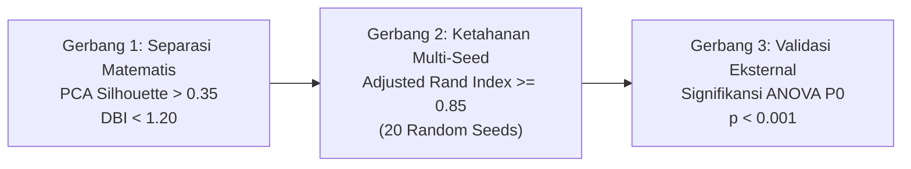

# PovertyRadar SDGs: Unsupervised Clustering Protocol

## DOKUMEN PROTOKOL PEMODELAN KLASTER SOSIO-EKONOMI DAERAH
**Versi:** 2.0 (Standardized Technical SOP) | 31 Oktober 2026  
**Dokumen Terkait:** [`docs/clustering_rationale_and_findings.md`](file:///d:/ARFI/Kuliah/Project/project-semester5/PovertyRadar/docs/clustering_rationale_and_findings.md) *(Justifikasi Metodologis & Temuan Empiris)* • [`docs/02-desain-rekomendasi-kebijakan-berbasis-clustering-povertyradar.md`](file:///d:/ARFI/Kuliah/Project/project-semester5/PovertyRadar/docs/02-desain-rekomendasi-kebijakan-berbasis-clustering-povertyradar.md) *(Master Rekomendasi Kebijakan)*  
**Tujuan Dokumen:** Menetapkan standar operasional prosedur (SOP) pemilihan fitur, pra-pemrosesan (*scaling*), algoritma pemodelan, penentuan $k$ optimal, kriteria evaluasi matematis, dan format artefak keluaran sistem klasterisasi PovertyRadar SDGs.

---

## 1. Landasan Metodologis Pemodelan Unsupervised

Dalam proyek PovertyRadar SDGs, pemodelan klaster dirancang untuk mengidentifikasi **tipologi struktural sosio-ekonomi daerah secara murni tanpa supervisi (*unsupervised learning*)**.

### 1.1 Aturan Non-Supervisi & Pemisahan Variabel
1. **Eliminasi Label Biner (Pencegahan Target Leakage):** Kolom `poverty_class_target` (0/1) dari dataset mentah dilarang keras dimasukkan ke dalam model. Prediksi label biner bawaan ditolak karena memuat kebocoran target (*target leakage*) dan cacat mutu pelabelan di kawasan Indonesia Timur.
2. **Eksklusi Persentase Kemiskinan ($P_0$, Pencegahan Penalaran Melingkar):** Kolom `poverty_rate_p0` **dikeluarkan dari vektor fitur klastering** agar menjadi variabel pembanding eksternal (*external benchmark*) independen pasca-klaster tanpa menciptakan tautologi (*circular reasoning*).
3. **Pencegahan Multikolinearitas Komposit IPM:** Indikator `human_dev_index` (IPM) dikeluarkan dari fitur jarak Euclidean karena berkorelasi tinggi ($r > 0.86$) dengan komponen pembangunnya (RLS, UHH, pengeluaran), yang berisiko melipatgandakan bobot dimensi manusia secara artifisial (*double-counting*).

> [!NOTE]
> **Rujukan Bukti Audit Statistik:**  
> Bukti empiris korelasi multikolinearitas IPM dan telaah 7 daerah anomali pelabelan Papua didokumentasikan lengkap pada:  
> 👉 [`docs/data_audit_and_understanding.md`](file:///d:/ARFI/Kuliah/Project/project-semester5/PovertyRadar/docs/data_audit_and_understanding.md).

---

## 2. Seleksi Fitur & Matriks Rekayasa Input

Model klaster dilatih menggunakan **vektor 7 fitur independen** yang mencakup empat pilar pembangunan daerah:

| Pilar Pembangunan | Fitur Model | Nama Kolom Standar | Skala Asli | Transformasi Matematika |
| :--- | :--- | :--- | :---: | :---: |
| **Modal Manusia** | Rata-rata Lama Sekolah | `avg_school_years` | Tahun (1.42 – 12.83) | Standarisasi |
| **Derajat Kesehatan**| Umur Harapan Hidup | `life_expectancy` | Tahun (55.43 – 77.73) | Standarisasi |
| **Standar Hidup** | Pengeluaran Riil per Kapita| `expenditure_per_capita`| Ribu Rp (3.98M – 23.89M)| Standarisasi |
| **Layanan Dasar** | Akses Sanitasi Layak | `sanitation_access_pct` | % (0.00% – 99.97%) | Standarisasi |
| **Layanan Dasar** | Akses Air Minum Layak | `clean_water_access_pct` | % (0.00% – 100.00%) | Standarisasi |
| **Pasar Kerja** | Tingkat Pengangguran Terbuka | `unemployment_rate_tpt` | % (0.00% – 13.37%) | Standarisasi |
| **Skala Ekonomi** | PDRB Konstan 2010 | `grdp_constant_million_idr`| Juta Rp (147M – 460T) | $\log(1 + x)$ $\rightarrow$ Standarisasi |

> [!NOTE]
> *Tingkat Partisipasi Angkatan Kerja (`labor_participation_tpak`)* dieksklusikan dari konfigurasi produksi final untuk mencegah redundansi sektor tenaga kerja dan menjaga ketajaman separasi model.

---

## 3. Protokol Pra-Pemrosesan & Pemilihan Scaler

### 3.1 Normalisasi Skewness PDRB
Sebelum diskalakan, variabel PDRB riil **wajib ditransformasi** menggunakan logaritma natural plus satu:
$$x_{\text{pdrb\_log}} = \log(1 + x_{\text{pdrb}})$$
Transformasi ini menekan *skewness* distribusi dari **+5.85** menjadi **+0.23**.

### 3.2 Algoritma Penskalaan (Scaler Selection)
Data sosio-ekonomi Indonesia memiliki 26 anomali multivariat ekstrem (daerah 3T di satu sisi dan megapolitan Jakarta di sisi lain). Oleh karena itu:
* **Pilihan Utama (Default Pipeline): `RobustScaler`**
  Menstandarkan fitur dengan menghapus median dan menskalakan data berdasarkan rentang interkuartil ($IQR = Q_3 - Q_1$):
  $$z = \frac{x - \text{median}(x)}{IQR}$$
  *Keunggulan:* Kebal terhadap distorsi pencilan ekstrem wilayah 3T maupun PDRB Jakarta Pusat, sehingga separasi klaster pada kelompok mayoritas kabupaten/kota tetap tajam.
* **Pilihan Pembanding Sensitivitas: `StandardScaler`**
  Digunakan untuk audit komparasi stabilitas metrik jarak Euclidean.

---

## 4. Algoritma Klastering & Strategi Penentuan $k$

### 4.1 Algoritma Primer & Sekunder
* **Algoritma Primer: K-Means Clustering (`sklearn.cluster.KMeans`)**
  * Konfigurasi: `n_clusters=4`, `init='k-means++'`, `n_init=25`, `max_iter=300`, `random_state=42`.
* **Algoritma Validasi Struktural: Agglomerative Hierarchical Clustering**
  * Konfigurasi: `n_clusters=4`, `linkage='ward'`, metrik jarak Euclidean.

### 4.2 Prosedur Penentuan Jumlah Klaster ($k$) Optimal
Eksplorasi nilai $k$ diuji pada rentang $k \in [3, 7]$ menggunakan instrumen:
1. **Elbow Method (Inersia WCSS):** Mencari titik infleksi penurunan *diminishing returns*.
2. **Silhouette Analysis:** Mengukur kohesi internal dan separasi antarklaster.
3. **Davies-Bouldin Index (DBI):** Mengukur rasio kesamaan antarklaster.
4. **Kriteria Kelayakan Kebijakan Publik (Policy Viability):** Menghindari pembentukan klaster raksasa tunggal (*The Giant Blob*) yang mencampurkan daerah heterogen ke dalam 1 paket kebijakan.

---

## 5. Protokol Evaluasi & Standar Ambang Batas Kualitas

Setiap eksperimen klasterisasi wajib memenuhi 3 gerbang verifikasi (*verification gates*):

1. **Gerbang 1: Separasi Matematis & Proyeksi Dimensionalitas:**
   * Pada ruang proyeksi 2D PCA esensial: Target $\text{Silhouette} > 0.35$ dan $\text{DBI} < 1.20$.
   * Pada ruang 7D asli: Target $\text{Silhouette} \ge 0.18$ dan tidak menghasilkan partisi cacat (*pathological clustering* di mana $>90\%$ observasi menumpuk di 1 kelompok).
2. **Gerbang 2: Uji Ketahanan Multi-Seed (Robustness Check):**
   * Menjalankan K-Means sebanyak 20 kali dengan inisialisasi random seed acak (`seed=1` s.d. `20`).
   * Ambang batas kelulusan: Rata-rata Adjusted Rand Index $(\text{ARI}) \ge 0.85$ terhadap model acuan (`seed=42`).
3. **Gerbang 3: Uji Inferensial Eksternal ($P_0$ ANOVA & Kruskal-Wallis):**
   * Penugasan klaster diuji terhadap variabel kemiskinan aktual ($P_0$) yang tidak dimasukkan dalam pelatihan.
   * Ambang batas kelulusan: $p\text{-value} < 0.001$ pada uji parametrik (ANOVA) dan non-parametrik (Kruskal-Wallis).

> [!TIP]
> **Rujukan Hasil Pengujian Empiris Lengkap:**  
> Untuk tabel perbandingan 20+ model, data A/B testing TPAK vs TPT, pembuktian ilusi matematis $k=3$, dan visualisasi profil z-score, lihat laporan lengkap pada [`docs/clustering_rationale_and_findings.md`](file:///d:/ARFI/Kuliah/Project/project-semester5/PovertyRadar/docs/clustering_rationale_and_findings.md).

---

## 6. Protokol Penyimpanan & Artefak Keluaran

Setelah klasterisasi selesai dan tervalidasi, sistem wajib mengekspor artefak terstandarisasi:
1. **Dataset Mikro Wilayah:**
   [`data/processed/poverty_clusters.csv`](file:///d:/ARFI/Kuliah/Project/project-semester5/PovertyRadar/data/processed/poverty_clusters.csv) (514 baris × 21 kolom) yang memuat `cluster_id`, `cluster_name`, `vulnerability_score`, dan `vulnerability_quadrant`.
2. **Dataset Ringkasan Agregat:**
   [`data/processed/poverty_cluster_summary.csv`](file:///d:/ARFI/Kuliah/Project/project-semester5/PovertyRadar/data/processed/poverty_cluster_summary.csv) (4 baris × 30 kolom) yang memuat agregasi mean, median, dan proporsi per klaster.
3. **Dataset Acuan Kebijakan:**
   [`data/processed/policy_recommendations_matrix.csv`](file:///d:/ARFI/Kuliah/Project/project-semester5/PovertyRadar/data/processed/policy_recommendations_matrix.csv) (8 baris × 13 kolom) yang memuat pemetaan instrumen APBN/TKD dan instansi pengampu.
