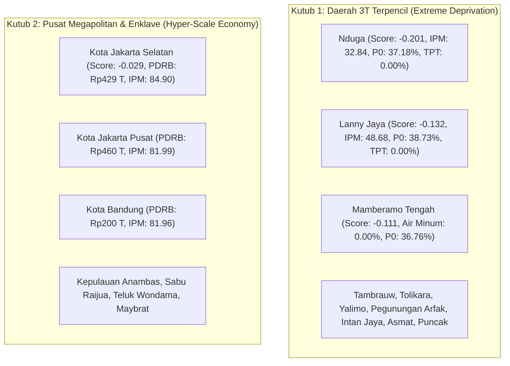

# PovertyRadar SDGs: Laporan Audit Data, Karakteristik Statistik, dan Data Understanding

## DOKUMEN AUDIT KUALITAS DATA, ANALISIS STATISTIK, & PEMETAAN ANOMALI
**Versi:** 3.0 (Dedicated Data Audit & Understanding)  
**Tanggal Pembaruan:** 28 Oktober 2026  
**Mata Kuliah:** Presentasi Data dan Storytelling  
**Dataset Utama:** `Klasifikasi Tingkat Kemiskinan di Indonesia.csv`  
**Dataset Interim:** `data/interim/poverty_data_cleaned.csv`  
**Sumber Data:** Publikasi Resmi Badan Pusat Statistik (BPS) RI via [Kaggle Dataset oleh ldausl](https://www.kaggle.com/datasets/ldausl/klasifikasi-tingkat-kemiskinan-di-indonesia)  
**Dokumen Pendamping:** [`docs/problem_framing_and_objectives.md`](file:///d:/ARFI/Kuliah/Project/project-semester5/PovertyRadar/docs/problem_framing_and_objectives.md)  

---

## Daftar Isi
1. [Metadata & Integritas Dataset Lapangan](#1-metadata--integritas-dataset-lapangan)
   - 1.1 [Spesifikasi Berkas Mentah & Olahan](#11-spesifikasi-berkas-mentah--olahan)
   - 1.2 [Cakupan Geografis & Unit Analisis](#12-cakupan-geografis--unit-analisis)
   - 1.3 [Pembuktian & Verifikasi Periode Tahun Data BPS 2021](#13-pembuktian--verifikasi-periode-tahun-data-bps-2021)
2. [Inventaris Variabel Semantik & Kamus Data](#2-inventaris-variabel-semantik--kamus-data)
   - 2.1 [Variabel Asli Berkas Mentah](#21-variabel-asli-berkas-mentah)
   - 2.2 [Variabel Hasil Rekayasa Fitur pada Dataset Interim](#22-variabel-hasil-rekayasa-fitur-pada-dataset-interim)
3. [Statistik Deskriptif & Analisis Outlier Univariat (1.5x IQR Tukey)](#3-statistik-deskriptif--analisis-outlier-univariat-15x-iqr-tukey)
   - 3.1 [Tabel Ringkasan Statistik 514 Daerah](#31-tabel-ringkasan-statistik-514-daerah)
   - 3.2 [Analisis Skewness Ekstrem & Normalisasi Log1p pada PDRB](#32-analisis-skewness-ekstrem--normalisasi-log1p-pada-pdrb)
4. [Deteksi Anomali Multivariat (Isolation Forest & PCA)](#4-deteksi-anomali-multivariat-isolation-forest--pca)
   - 4.1 [Metodologi Deteksi Anomali Multidimensi](#41-metodologi-deteksi-anomali-multidimensi)
   - 4.2 [Dua Kutub Anomali Faktual (Daerah 3T vs. Megapolitan)](#42-dua-kutub-anomali-faktual-daerah-3t-vs-megapolitan)
   - 4.3 [Kebijakan Penanganan Anomali (Treatment Policy: Strictly DO NOT DROP)](#43-kebijakan-penanganan-anomali-treatment-policy-strictly-do-not-drop)
5. [Analisis Disparitas Struktural Daerah](#5-analisis-disparitas-struktural-daerah)
   - 5.1 [Disparitas Dualistik: Kabupaten vs. Kota](#51-disparitas-dualistik-kabupaten-vs-kota)
   - 5.2 [Disparitas Geografis Antar-Kepulauan (Regional Disparity)](#52-disparitas-geografis-antar-kepulauan-regional-disparity)
6. [Audit Kualitas Teknis & Mitigasi Pipeline Preprocessing](#6-audit-kualitas-teknis--mitigasi-pipeline-preprocessing)
   - 6.1 [Matriks Temuan Audit Teknis & Tindak Lanjut](#61-matriks-temuan-audit-teknis--tindak-lanjut)
   - 6.2 [Audit Khusus Nilai Batas 0.00% di Wilayah 3T](#62-audit-khusus-nilai-batas-000-di-wilayah-3t)
   - 6.3 [Koreksi Semantik Skala Satuan PDRB](#63-koreksi-semantik-skala-satuan-pdrb)
7. [Korelasi Bivariat & Paradoks Ketenagakerjaan](#7-korelasi-bivariat--paradoks-ketenagakerjaan)
   - 7.1 [Matriks Korelasi terhadap Kemiskinan Aktual (P0)](#71-matriks-korelasi-terhadap-kemiskinan-aktual-p0)
   - 7.2 [Dekomposisi Paradoks Ketenagakerjaan (TPAK & TPT)](#72-dekomposisi-paradoks-ketenagakerjaan-tpak--tpt)
   - 7.3 [Asosiasi Lemah PDRB Riil Makro terhadap Kemiskinan](#73-asosiasi-lemah-pdrb-riil-makro-terhadap-kemiskinan)
8. [Kuantifikasi Multikolinearitas & Risiko Double-Counting](#8-kuantifikasi-multikolinearitas--risiko-double-counting)
   - 8.1 [Korelasi Antar-Fitur Penjelas (Inter-Feature Multicollinearity)](#81-korelasi-antar-fitur-penjelas-inter-feature-multicollinearity)
   - 8.2 [Justifikasi Matematis Larangan Menggabungkan IPM dengan Komponennya](#82-justifikasi-matematis-larangan-menggabungkan-ipm-dengan-komponennya)
9. [Audit Khusus Label Bawaan Kaggle (“Klasifikasi Kemiskinan”)](#9-audit-khusus-label-bawaan-kaggle-klasifikasi-kemiskinan)
   - 9.1 [Distribusi Empiris & Ketidakseimbangan Kelas](#91-distribusi-empiris--ketidakseimbangan-kelas)
   - 9.2 [Identifikasi 7 Daerah Anomali Pelabelan di Kawasan Papua](#92-identifikasi-7-daerah-anomali-pelabelan-di-kawasan-papua)
   - 9.3 [Implikasi Metodologis: Eliminasi Kolom Target](#93-implikasi-metodologis-eliminasi-kolom-target)
10. [Akses Berkas & Catatan Reproduksibilitas](#10-akses-berkas--catatan-reproduksibilitas)

---

## 1. Metadata & Integritas Dataset Lapangan

### 1.1 Spesifikasi Berkas Mentah & Olahan

| Parameter | Berkas Mentah (*Raw*) | Berkas Terstandar (*Interim*) |
| :--- | :--- | :--- |
| **Path Berkas** | [`data/raw/Klasifikasi Tingkat Kemiskinan di Indonesia.csv`](file:///d:/ARFI/Kuliah/Project/project-semester5/PovertyRadar/data/raw/Klasifikasi%20Tingkat%20Kemiskinan%20di%20Indonesia.csv) | [`data/interim/poverty_data_cleaned.csv`](file:///d:/ARFI/Kuliah/Project/project-semester5/PovertyRadar/data/interim/poverty_data_cleaned.csv) |
| **Izin Akses** | **Read-Only** (Ketat; dilarang dimodifikasi) | Read-Write (Hasil keluaran pipeline) |
| **Jumlah Baris** | 514 baris observasi | 514 baris observasi |
| **Jumlah Kolom** | 13 kolom | 16 kolom (setelah rekayasa fitur & tagging anomali) |
| **Format & Encoding**| CSV, UTF-8 | CSV, UTF-8 |
| **Kelengkapan** | 0 nilai kosong (*null*) | 0 nilai kosong (*null*) |
| **Keunikan** | 0 baris duplikat; 0 pasangan wilayah duplikat | 0 baris duplikat; 0 pasangan wilayah duplikat |

### 1.2 Cakupan Geografis & Unit Analisis
Dataset mencakup **100% unit administratif tingkat II** di Indonesia pada baseline nasional tahun 2021 (sebelum pemekaran 4 provinsi baru di Papua pada akhir 2022):
* **Total Provinsi:** 34 Provinsi.
* **Total Kabupaten/Kota:** 514 unit analisis unik:
  * **Kabupaten:** 413 wilayah (80.35%).
  * **Kota / Kota Administrasi:** 101 wilayah (19.65%, termasuk 5 kota administrasi dan 1 kabupaten administrasi di Provinsi DKI Jakarta).

### 1.3 Pembuktian & Verifikasi Periode Tahun Data BPS 2021
File sumber mentah dari Kaggle tidak memuat atribut tahun. Melalui audit komparasi silang (*cross-referencing*) dengan repositori Sistem Rujukan Statistik (SIRUSA) dan publikasi resmi BPS, **terbukti secara definitif bahwa dataset ini merepresentasikan data resmi BPS Tahun 2021**:

| Kabupaten / Kota | Indikator | Nilai di Dataset Proyek | Publikasi Resmi BPS RI 2021 | Status Kesesuaian |
| :--- | :--- | :---: | :---: | :---: |
| **Kota Surakarta** (Jawa Tengah) | Persentase Penduduk Miskin ($P_0$) | **9.40%** | **9.40%** | **Identik 100%** |
| | Indeks Pembangunan Manusia (IPM) | **82.62** | **82.62** | **Identik 100%** |
| **Kab. Cilacap** (Jawa Tengah) | Persentase Penduduk Miskin ($P_0$) | **11.67%** | **11.67%** | **Identik 100%** |
| | Indeks Pembangunan Manusia (IPM) | **70.42** | **70.42** | **Identik 100%** |
| **Kab. Banyumas** (Jawa Tengah) | Persentase Penduduk Miskin ($P_0$) | **13.66%** | **13.66%** | **Identik 100%** |
| | Indeks Pembangunan Manusia (IPM) | **72.44** | **72.44** | **Identik 100%** |

---

## 2. Inventaris Variabel Semantik & Kamus Data

### 2.1 Variabel Asli Berkas Mentah

| No | Nama Kolom Asli | Nama Kolom Standar | Tipe Data | Satuan | Rentang Nilai (Min — Max) | Deskripsi Semantik & Catatan Lapangan |
| :-: | :--- | :--- | :---: | :---: | :---: | :--- |
| 1 | `Provinsi` | `provinsi` | String | - | 34 Provinsi | Nama provinsi tempat kabupaten/kota berada. Digunakan untuk agregasi dan filter spasial. |
| 2 | `Kab/Kota` | `kab_kota` | String | - | 514 Wilayah | Identitas unit analisis tingkat II. Karakter asterisk footnote pada `Nduga *` telah dinormalisasi menjadi `Nduga`. |
| 3 | `Persentase Penduduk Miskin (P0)...` | `poverty_rate_p0` | Float | % | 2.38% — 41.66% | **Headcount Index ($P_0$):** Persentase penduduk di bawah Garis Kemiskinan (GK) BPS. |
| 4 | `Rata-rata Lama Sekolah Penduduk 15+` | `avg_school_years` | Float | Tahun | 1.42 — 12.83 | **Modal Manusia (SDG 4):** Rata-rata tahun menempuh pendidikan formal penduduk usia $\ge 15$ tahun. |
| 5 | `Pengeluaran per Kapita Disesuaikan` | `expenditure_per_capita` | Integer | Ribu Rp/Thn | 3,976 — 23,888 | **Standar Hidup Layak:** Pengeluaran riil per kapita disesuaikan paritas daya beli (PPP). Nilai setara Rp3,98 juta s.d. Rp23,89 juta/tahun. |
| 6 | `Indeks Pembangunan Manusia` | `human_dev_index` | Float | Indeks | 32.84 — 87.18 | **Capaian Pembangunan Komposit:** Indeks agregat kesehatan, pendidikan, dan daya beli. *Multikolinier tinggi dengan komponennya.* |
| 7 | `Umur Harapan Hidup (Tahun)` | `life_expectancy` | Float | Tahun | 55.43 — 77.73 | **Derajat Kesehatan (SDG 3):** Perkiraan rata-rata tahun hidup sejak lahir (*Angka Harapan Hidup* / AHH). |
| 8 | `Persentase... sanitasi layak` | `sanitation_access_pct` | Float | % | 0.00% — 99.97% | **Infrastruktur WASH (SDG 6):** Akses jamban leher angsa dan tangki septik. *Nilai 0.00% riil di Deiyai.* |
| 9 | `Persentase... air minum layak` | `clean_water_access_pct` | Float | % | 0.00% — 100.00% | **Infrastruktur WASH (SDG 6):** Sumber air minum terlindung/perpipaan. *Nilai 0.00% riil di Mamberamo Tengah.* |
| 10 | `Tingkat Pengangguran Terbuka` | `unemployment_rate_tpt` | Float | % | 0.00% — 13.37% | **Ketenagakerjaan Formal (SDG 8):** Angkatan kerja yang menganggur. *Nilai 0.00% riil di Nduga & Lanny Jaya.* |
| 11 | `Tingkat Partisipasi Angkatan Kerja` | `labor_participation_tpak` | Float | % | 56.39% — 97.93% | **Ketenagakerjaan Agregat:** Proporsi angkatan kerja aktif. *Memuat spasi tersembunyi pada berkas mentah.* |
| 12 | `PDRB atas Dasar Harga Konstan...` | `grdp_constant_million_idr` | Integer | Juta Rp | 147,485 — 460,081,046 | **Kapasitas Ekonomi Makro:** PDRB riil konstan 2010. Header tertulis `(Rupiah)`, namun satuan faktual BPS adalah **Juta Rupiah**. |
| 13 | `Klasifikasi Kemiskinan` | `poverty_class_target` | Integer | 0 / 1 | 0 atau 1 | **Label Bawaan:** Kelas 0 (87.94%) vs Kelas 1 (12.06%). **Dikeluarkan sepenuhnya dari analisis modeling.** |

---

### 2.2 Variabel Hasil Rekayasa Fitur pada Dataset Interim

Pada berkas [`data/interim/poverty_data_cleaned.csv`](file:///d:/ARFI/Kuliah/Project/project-semester5/PovertyRadar/data/interim/poverty_data_cleaned.csv), ditambahkan atribut kontekstual dan flag audit:

| Nama Variabel | Tipe Data | Domain Nilai | Deskripsi & Tujuan Rekayasa |
| :--- | :---: | :--- | :--- |
| `tipe_wilayah` | String | `Kabupaten` (413), `Kota` (101) | Klasifikasi tipe administratif dari prefiks nama daerah untuk analisis perbandingan urban vs. rural. |
| `region_pulau` | String | `Sumatera`, `Jawa`, `Bali & Nusa Tenggara`, `Kalimantan`, `Sulawesi`, `Maluku & Papua` | Pengelompokan geografis 6 kepulauan besar untuk analisis disparitas regional. |
| `is_multivariate_anomaly` | Boolean | `True` (26 daerah), `False` (488 daerah) | Penanda hasil deteksi anomali multivariat menggunakan algoritma *Isolation Forest* (`contamination=0.05`). |
| `anomaly_score` | Float | Kontinu ($-0.201$ s.d. $+0.165$) | Skor kejanggalan multidimensi dari Isolation Forest (skor semakin negatif menandakan anomali semakin ekstrem). |

---

## 3. Statistik Deskriptif & Analisis Outlier Univariat (1.5x IQR Tukey)

### 3.1 Tabel Ringkasan Statistik 514 Daerah

Berdasarkan komputasi matematis presisi terhadap 514 baris observasi:

| Indikator | Satuan | Min | Q1 (25%) | Median | Q3 (75%) | Max | Skewness | Outlier Tukey IQR (N / %) |
| :--- | :---: | :---: | :---: | :---: | :---: | :---: | :---: | :---: |
| **Kemiskinan ($P_0$)** | % | 2.38 | 7.15 | 10.46 | 14.89 | 41.66 | +1.51 | 36 (7.00%) |
| **Rata-rata Lama Sekolah** | Tahun | 1.42 | 7.51 | 8.31 | 9.34 | 12.83 | -0.35 | 14 (2.72%) |
| **Pengeluaran per Kapita** | Ribu Rp | 3,976 | 8,574 | 10,196 | 11,719 | 23,888 | +0.73 | 15 (2.92%) |
| **IPM** | Indeks | 32.84 | 66.64 | 69.61 | 73.11 | 87.18 | -0.78 | 27 (5.25%) |
| **Umur Harapan Hidup** | Tahun | 55.43 | 67.39 | 69.98 | 72.04 | 77.73 | -0.47 | 8 (1.56%) |
| **Sanitasi Layak** | % | 0.00 | 70.22 | 81.80 | 89.88 | 99.97 | -1.82 | 25 (4.86%) |
| **Air Minum Layak** | % | 0.00 | 79.04 | 89.80 | 96.40 | 100.00 | -2.04 | 23 (4.47%) |
| **Pengangguran (TPT)** | % | 0.00 | 3.18 | 4.56 | 6.53 | 13.37 | +0.79 | 12 (2.33%) |
| **Partisipasi Kerja (TPAK)** | % | 56.39 | 65.07 | 68.96 | 72.34 | 97.93 | +1.19 | 20 (3.89%) |
| **PDRB Konstan** | Juta Rp | 147,485 | 3,654,291 | 8,814,926 | 19,735,101 | 460,081,046 | **+5.85** | 56 (10.89%) |
| *Log1p(PDRB)* | Log Nilai | 11.90 | 15.11 | 16.00 | 16.80 | 19.95 | **+0.23** | 12 (2.33%) |

---

### 3.2 Analisis Skewness Ekstrem & Normalisasi Log1p pada PDRB

Variabel Produk Domestik Regional Bruto (`grdp_constant_million_idr`) memiliki kemencengan positif (*right-skewed*) yang sangat ekstrem dengan koefisien kemiringan **+5.85**. 
* Nilai maksimum (Kota Jakarta Pusat = Rp460,08 triliun) mencapai **52 kali lipat** dari nilai median nasional (Rp8,81 triliun).
* Sebanyak 56 daerah (10.89%) terdeteksi sebagai outlier univariat sisi atas.

> [!NOTE]
> **Dampak Matematika Transformasi Logaritmik:**  
> Penerapan fungsi $y = \log(1 + x)$ menekan *skewness* dari **+5.85** menjadi **+0.23** (mendekati distribusi normal Gaussian simetris). Hal ini krusial untuk algoritma clustering berbasis jarak Euclidean (seperti K-Means) agar jarak antar-wilayah tidak didominasi mutlak oleh skala PDRB Jakarta.

---

## 4. Deteksi Anomali Multivariat (Isolation Forest & PCA)

### 4.1 Metodologi Deteksi Anomali Multidimensi
Untuk mendeteksi observasi yang memiliki kombinasi nilai ekstrem secara simultan di lintas variabel, diterapkan algoritma *Isolation Forest* dengan parameter:
* `n_estimators = 200`
* `contamination = 0.05` (menetapkan batas ambang 5% daerah paling menyimpang secara multidimensi, menghasilkan tepat 26 anomali)
* `random_state = 42` (menjamin reproduksibilitas deterministik)
* Fitur masukan: Seluruh 10 variabel sosial-ekonomi numerik terstandarisasi.  
  *(Catatan Metodologis: Input deteksi anomali Isolation Forest sengaja menggunakan seluruh 10 variabel numerik untuk mendeteksi pencilan multidimensi di seluruh spektrum data. Hal ini berbeda dari vektor fitur K-Means yang dibatasi pada 7 fitur independen demi mencegah penalaran melingkar dan multikolinearitas).*

### 4.2 Dua Kutub Anomali Faktual (Daerah 3T vs. Megapolitan)

Proyeksi dua dimensi menggunakan *Principal Component Analysis* (PCA) mengungkap bahwa 26 wilayah anomali terbagi ke dalam **dua kutub polaritas ekstrem** yang memiliki makna substantif:



#### Rincian 10 Anomali Paling Ekstrem Berdasarkan Skor Isolasi:
1. **Kabupaten Nduga** (Papua) — Skor $-0.2008$ (IPM 32.84 terendah nasional, $P_0$ 37.18%, TPT 0.00%).
2. **Kabupaten Lanny Jaya** (Papua) — Skor $-0.1321$ (IPM 48.68, $P_0$ 38.73%, TPT 0.00%).
3. **Kabupaten Mamberamo Tengah** (Papua) — Skor $-0.1105$ (Akses air minum 0.00%, $P_0$ 36.76%).
4. **Kabupaten Tambrauw** (Papua Barat) — Skor $-0.0865$ (PDRB Rp147 miliar terendah nasional, $P_0$ 33.86%).
5. **Kabupaten Tolikara** (Papua) — Skor $-0.0853$ (IPM 49.60, $P_0$ 32.60%).
6. **Kabupaten Yalimo** (Papua) — Skor $-0.0815$ (IPM 49.01, $P_0$ 33.25%).
7. **Kabupaten Pegunungan Arfak** (Papua Barat) — Skor $-0.0738$ ($P_0$ 34.70%, RLS 5.86 tahun).
8. **Kabupaten Intan Jaya** (Papua) — Skor $-0.0714$ ($P_0$ 41.66% tertinggi se-Indonesia).
9. **Kabupaten Asmat** (Papua) — Skor $-0.0663$ (Sanitasi layak rendah 9.17%, IPM 51.29).
10. **Kabupaten Puncak** (Papua) — Skor $-0.0626$ (IPM 43.17, $P_0$ 36.26%).

---

### 4.3 Kebijakan Penanganan Anomali (Treatment Policy: Strictly DO NOT DROP)

> [!IMPORTANT]
> **Kebijakan Tegas: Dilarang Menghapus Data Outlier / Anomali (Do Not Drop)**  
> Seluruh 26 entitas wilayah anomali multivariat **wajib dipertahankan sepenuhnya di dalam dataset**.  
> **Justifikasi:**
> 1. Wilayah seperti Nduga, Deiyai, dan Mamberamo Tengah bukanlah *input error*, melainkan representasi riil dari ketimpangan geografis dan kondisi 3T di Indonesia.
> 2. Menghapus observasi ini akan menghapus wilayah paling miskin dan paling membutuhkan perhatian dari analisis — bertentangan langsung dengan prinsip inklusivitas **SDG 1: Leave No One Behind**.
> 3. Pengendalian dampak numerik dilakukan melalui penggunaan algoritma penstandaran yang kuat terhadap outlier (`RobustScaler` berbasis median dan IQR) dan transformasi $\log(1+x)$.

---

## 5. Analisis Disparitas Struktural Daerah

### 5.1 Disparitas Dualistik: Kabupaten vs. Kota

Analisis menunjukkan kesenjangan struktural sistemik antara unit administrasi perdesaan (Kabupaten) dan perkotaan (Kota/Kota Administrasi):

| Indikator Sosio-Ekonomi | Kabupaten (N = 413) | Kota / Kota Adm (N = 101) | Selisih / Rasio Disparitas |
| :--- | :---: | :---: | :--- |
| **Persentase Kemiskinan ($P_0$)**| **13.51%** | **7.22%** | Kabupaten hampir **2 kali lipat** lebih miskin |
| **Indeks Pembangunan Manusia** | **67.99** | **77.85** | Kota unggul signifikan (+9.86 poin indeks) |
| **Pengeluaran Riil per Kapita** | Rp9,540,000/thn | Rp13,533,000/thn | Pengeluaran warga kota 41.8% lebih tinggi |
| **Rata-rata Lama Sekolah (RLS)** | 7.91 tahun | 10.57 tahun | Perkotaan mencapai standar tamat SMA |
| **Akses Sanitasi Layak** | 74.59% | 87.87% | Perkotaan unggul +13.28% |
| **Akses Air Minum Layak** | 82.53% | 95.81% | Perkotaan mendekati akses universal |
| **Tingkat Pengangguran (TPT)** | 4.36% | **7.92%** | **Kota lebih tinggi** (pasar kerja sektor formal) |
| **Partisipasi Kerja (TPAK)** | **70.44%** | 65.46% | **Kabupaten lebih tinggi** (pertanian subsistensi) |

---

### 5.2 Disparitas Geografis Antar-Kepulauan (Regional Disparity)

Pengelompokan 514 daerah ke dalam 6 kawasan kepulauan besar memperlihatkan ketimpangan barat-timur yang nyata:

| Wilayah Kepulauan | Jumlah Kab/Kota | Rata-rata $P_0$ | Rentang $P_0$ (Min — Max) | Rata-rata IPM | Jumlah Daerah Kelas 1 (Bawaan) |
| :--- | :---: | :---: | :---: | :---: | :---: |
| **Maluku & Papua** | 63 | **23.31%** | 3.55% — 41.66% | 62.12 | **39 wilayah** (62.9% dari total Kelas 1) |
| **Bali & Nusa Tenggara** | 41 | **16.23%** | 2.62% — 34.27% | 67.92 | **15 wilayah** (terkonsentrasi di NTT) |
| **Sulawesi** | 81 | **11.20%** | 4.77% — 19.00% | 69.93 | 0 wilayah |
| **Sumatera** | 154 | **10.94%** | 2.38% — 26.42% | 70.95 | 5 wilayah (Kepulauan Nias) |
| **Jawa** | 119 | **10.34%** | 2.57% — 23.76% | 73.03 | 3 wilayah (Madura: Bangkalan, Sampang, Sumenep) |
| **Kalimantan** | 56 | **6.30%** | 2.89% — 12.01% | 70.76 | **0 wilayah (kemiskinan terendah nasional)** |

---

## 6. Audit Kualitas Teknis & Mitigasi Pipeline Preprocessing

### 6.1 Matriks Temuan Audit Teknis & Tindak Lanjut

| Parameter Audit | Temuan Faktual | Tindak Lanjut pada Pipeline [`notebooks/01_data_audit_and_understanding.ipynb`](file:///d:/ARFI/Kuliah/Project/project-semester5/PovertyRadar/notebooks/01_data_audit_and_understanding.ipynb) |
| :--- | :--- | :--- |
| **Kelengkapan Data** | 0 nilai kosong (*null*) di seluruh dataset. | Data utuh tanpa imputasi sintetik. |
| **Keunikan Entitas** | 0 baris duplikat; 514 pasangan unik. | Integritas identitas wilayah terverifikasi. |
| **Spasi Tersembunyi** | Nilai TPAK memuat spasi (`' 71.15 '`). | Diterapkan `str.strip()` dan konversi numerik otomatis. |
| **Karakter Khusus** | Tanda asterisk footnote pada `Nduga *`. | Dinormalisasi menjadi `Nduga` untuk menjaga keselarasan dengan shapefile GeoJSON. |
| **Nilai Batas Nol** | Nilai 0.00% pada sanitasi, air minum, dan TPT. | Dikonfirmasi kondisi riil daerah 3T; dipertahankan dalam data. |
| **Koreksi Satuan PDRB** | Header tertulis `(Rupiah)` berskala 460 juta. | Satuan dikoreksi menjadi **Juta Rupiah** dan diterapkan $\log(1+x)$. |
| **Tahun Pengamatan** | Tidak ada kolom tahun di file sumber. | Dikonfirmasi dan didokumentasikan resmi sebagai **Data BPS 2021**. |

---

### 6.2 Audit Khusus Nilai Batas 0.00% di Wilayah 3T

Nilai 0.00% terverifikasi tercatat pada beberapa unit wilayah Papua:
* **Akses Sanitasi Layak = 0.00%** di **Kabupaten Deiyai** (Papua): Mengindikasikan belum tersedianya fasilitas jamban leher angsa dengan tangki septik terstandar BPS di wilayah permukiman survei.
* **Akses Air Minum Layak = 0.00%** di **Kabupaten Mamberamo Tengah** (Papua): Menunjukkan ketergantungan penuh masyarakat pada sumber air alam tak terlindung (sungai terbuka/hujan tanpa instalasi perpipaan).
* **Tingkat Pengangguran Terbuka = 0.00%** di **Kabupaten Nduga** dan **Kabupaten Lanny Jaya** (Papua): Merefleksikan struktur ekonomi pedalaman murni subsisten di mana konsep "mencari kerja formal" tidak berlaku; seluruh warga usia kerja terlibat dalam aktivitas pertanian subsisten keluarga untuk bertahan hidup.

---

### 6.3 Koreksi Semantik Skala Satuan PDRB

Header berkas sumber mencantumkan `PDRB atas Dasar Harga Konstan menurut Pengeluaran (Rupiah)`. Namun, nilai maksimum yang tercatat adalah `460,081,046` (Kota Jakarta Pusat) dan nilai minimum adalah `147,485` (Kabupaten Tambrauw).

Jika diinterpretasikan sebagai Rupiah tunggal, maka total PDRB Jakarta Pusat hanya Rp460 juta per tahun — nilai yang secara ekonomi mustahil bagi pusat bisnis metropolitan ibu kota. Sesuai metodologi publikasi Produk Domestik Regional Bruto BPS, **angka tersebut berskala Juta Rupiah**. Dengan demikian:
* PDRB riil Kota Jakarta Pusat adalah **Rp460,08 triliun**.
* PDRB riil Kabupaten Tambrauw adalah **Rp147,48 miliar**.

---

## 7. Korelasi Bivariat & Paradoks Ketenagakerjaan

### 7.1 Matriks Korelasi terhadap Kemiskinan Aktual (P0)

Hasil pengujian koefisien korelasi Pearson ($r$) terhadap tingkat kemiskinan ($P_0$):

| Indikator Penjelas | Koefisien Korelasi ($r$) | Arah & Makna Sosio-Ekonomi |
| :--- | :---: | :--- |
| **Indeks Pembangunan Manusia** | **-0.707** | Asosiasi negatif sangat kuat (IPM tinggi berbanding terbalik dengan kemiskinan). |
| **Pengeluaran per Kapita** | **-0.644** | Asosiasi negatif kuat (kapasitas konsumsi riil menjadi peredam kemiskinan). |
| **Akses Sanitasi Layak** | **-0.562** | Asosiasi negatif moderat (sanitasi mencerminkan mutu kelayakan lingkungan). |
| **Rata-rata Lama Sekolah** | **-0.544** | Asosiasi negatif moderat (pendidikan memperbesar peluang kerja produktif). |
| **Umur Harapan Hidup** | **-0.541** | Asosiasi negatif moderat (akses kesehatan mengurangi beban morbiditas). |
| **Partisipasi Kerja (TPAK)** | **+0.462** | **Asosiasi Positif (Paradoks Ketenagakerjaan):** Korelasi searah dengan kemiskinan. |
| **Pengangguran Terbuka (TPT)**| **-0.401** | **Asosiasi Negatif (Paradoks Ketenagakerjaan):** Korelasi terbalik dengan kemiskinan. |
| **Akses Air Minum Layak** | **-0.374** | Asosiasi negatif moderat. |
| **PDRB Riil Agregat** | **-0.242** | Asosiasi negatif lemah (besarnya PDRB daerah tidak otomatis mengentaskan kemiskinan). |

---

### 7.2 Dekomposisi Paradoks Ketenagakerjaan (TPAK & TPT)

Terdapat temuan paradoks yang berlawanan dengan intuisi ekonomi makro konvensional:

#### A. Paradoks Partisipasi Angkatan Kerja (TPAK Positif terhadap Kemiskinan: $r = +0.462$)
* Di negara maju atau wilayah perkotaan, tingginya TPAK diasosiasikan dengan produktivitas ekonomi. Namun di Indonesia, daerah dengan kemiskinan tinggi (seperti kabupaten pedalaman di Papua dan NTT) mencatatkan TPAK yang sangat tinggi ($> 75-80\%$).
* **Penjelasan Fenomena:** Di daerah tertinggal, ketiadaan tabungan dan tidak adanya jaring pengaman sosial formal memaksa seluruh anggota keluarga (termasuk lansia dan remaja) untuk bekerja di sektor informal/pertanian subsisten guna bertahan hidup (*survival employment*). Tidak ada kemewahan untuk menganggur.

#### B. Paradoks Pengangguran Terbuka (TPT Negatif terhadap Kemiskinan: $r = -0.401$)
* Wilayah dengan tingkat pengangguran terbuka tertinggi di Indonesia justru berada di kota-kota besar dengan kemiskinan terendah (misalnya Kota Bekasi, Kota Depok, Kota Bandung dengan TPT 8–11% namun kemiskinan $< 5\%$).
* **Penjelasan Fenomena:** TPT menurut definisi BPS hanya mencatat orang yang aktif mencari kerja formal. Di perkotaan maju, angkatan kerja terdidik memiliki bantalan ekonomi keluarga yang memungkinkan mereka untuk "memilih dan menunggu" pekerjaan yang sesuai, sehingga tercatat sebagai penganggur terbuka.

---

### 7.3 Asosiasi Lemah PDRB Riil Makro terhadap Kemiskinan
Koefisien korelasi PDRB riil terhadap tingkat kemiskinan hanya **$r = -0.242$** (sangat lemah). Hal ini membuktikan keterbatasan teori efek tetesan ke bawah (*trickle-down effect*): besarnya kapasitas ekonomi makro suatu daerah (terutama daerah industri ekstraktif seperti tambang migas/mineral) seringkali terkonsentrasi pada industri padat modal yang repatriasi keuntungannya keluar dari daerah dan tidak terserap secara inklusif oleh masyarakat lokal.

---

## 8. Kuantifikasi Multikolinearitas & Risiko Double-Counting

### 8.1 Korelasi Antar-Fitur Penjelas (Inter-Feature Multicollinearity)

Pengujian korelasi bivariat antar-variabel independen mendeteksi redundansi statistik yang sangat tinggi:

```text
                  Matriks Korelasi Pilar Pembangunan Manusia
               ┌───────────────────────┬──────────┬──────────┬──────────┐
               │ Indikator             │   IPM    │   RLS    │ Pengel.  │
               ├───────────────────────┼──────────┼──────────┼──────────┤
               │ IPM                   │  1.0000  │  0.8688  │  0.8715  │
               │ Rata-rata Lama Sek.   │  0.8688  │  1.0000  │  0.6688  │
               │ Pengeluaran per Kap.  │  0.8715  │  0.6688  │  1.0000  │
               │ Umur Harapan Hidup    │  0.7071  │  0.5472  │  0.5960  │
               └───────────────────────┴──────────┴──────────┴──────────┘
```

- $\text{IPM} \leftrightarrow \text{Pengeluaran per Kapita}$: **$r = +0.8715$**
- $\text{IPM} \leftrightarrow \text{Rata-rata Lama Sekolah}$: **$r = +0.8688$**
- $\text{IPM} \leftrightarrow \text{Umur Harapan Hidup}$: **$r = +0.7071$**
- $\text{RLS} \leftrightarrow \text{Pengeluaran per Kapita}$: **$r = +0.6688$**

---

### 8.2 Justifikasi Matematis Larangan Menggabungkan IPM dengan Komponennya

> [!WARNING]
> **Larangan Penggabungan IPM dan Komponennya dalam Pemodelan Berbasis Jarak:**  
> Secara definisi metodologis BPS, `Indeks Pembangunan Manusia` (IPM) adalah rata-rata geometrik dari indeks kesehatan (UHH), indeks pendidikan (RLS & HLS), dan indeks pengeluaran riil per kapita.  
> Jika IPM dimasukkan bersama-sama dengan RLS, UHH, dan Pengeluaran per Kapita ke dalam algoritma clustering berbasis jarak Euclidean (seperti K-Means atau Hierarchical Clustering), maka:
> 1. Dimensi pendidikan, kesehatan, dan pengeluaran akan menerima **bobot implisit ganda (double-counting)** sebesar 2 hingga 3 kali lipat dibandingkan dimensi WASH (sanitasi/air minum) dan ketenagakerjaan.
> 2. Klaster yang terbentuk akan mengalami distorsi parah yang hanya mencerminkan IPM, bukan profil sosial-ekonomi berimbang.  
> **Keputusan:** IPM diposisikan sebagai variabel evaluasi eksternal (*contextual benchmark*), dan **dikeluarkan dari vektor fitur pelatihan klaster**.

---

## 9. Audit Khusus Label Bawaan Kaggle (“Klasifikasi Kemiskinan”)

### 9.1 Distribusi Empiris & Ketidakseimbangan Kelas
Kolom `Klasifikasi Kemiskinan` pada dataset mentah memiliki distribusi biner yang sangat tidak seimbang (*class imbalance*):
* **Kelas 0 (Rendah / Sedang):** 452 wilayah (**87.94%**), rata-rata $P_0 = 10.19\%$ (median 9.64%).
* **Kelas 1 (Tinggi):** 62 wilayah (**12.06%**), rata-rata $P_0 = 27.49\%$ (median 26.59%).

Analisis komputasi menunjukkan bahwa pembuat dataset asal di Kaggle mencoba menerapkan batas ambang $P_0 \ge 20\%$ untuk Kelas 1. Pola ini konsisten pada **507 dari 514 daerah (98.6%)**.

---

### 9.2 Identifikasi 7 Daerah Anomali Pelabelan di Kawasan Papua

Terdapat **7 kabupaten/kota di Provinsi Papua dan Papua Barat** yang melanggar logika ambang batas tersebut:

| Provinsi | Kabupaten/Kota | $P_0$ Riil BPS (%) | Label CSV Mentah | Aturan $P_0 \ge 20\%$ | Deskripsi Anomali Pelabelan |
| :--- | :--- | :---: | :---: | :---: | :--- |
| **PAPUA BARAT** | Sorong Selatan | 18.55% | **1** | 0 | $P_0 < 20\%$, tetapi dilabeli Kelas 1 |
| **PAPUA BARAT** | Raja Ampat | 17.50% | **1** | 0 | $P_0 < 20\%$, tetapi dilabeli Kelas 1 |
| **PAPUA** | Merauke | 10.16% | **1** | 0 | $P_0$ sangat rendah, tetapi dilabeli Kelas 1 |
| **PAPUA** | Jayapura | 12.13% | **1** | 0 | $P_0$ relatif rendah, tetapi dilabeli Kelas 1 |
| **PAPUA BARAT** | Sorong | 27.78% | **0** | 1 | $P_0$ tinggi, tetapi dilabeli Kelas 0 |
| **PAPUA BARAT** | Pegunungan Arfak | 34.70% | **0** | 1 | $P_0$ sangat tinggi, tetapi dilabeli Kelas 0 |
| **PAPUA** | Jayawijaya | 37.09% | **0** | 1 | $P_0$ sangat tinggi, tetapi dilabeli Kelas 0 |

---

### 9.3 Implikasi Metodologis: Eliminasi Kolom Target

Temuan 7 anomali pelabelan ini memberikan bukti ilmiah tak terbantahkan bahwa:
1. Label biner bawaan **bukanlah data resmi (*ground truth*) BPS**, melainkan label sintetis dengan cacat kualitas pelabelan di wilayah kepulauan timur.
2. Melatih algoritma klasifikasi terawasi pada label cacat ini akan menghasilkan model yang bias, tidak dapat dipertanggungjawabkan secara akademis, dan menyesatkan rekomendasi kebijakan.
3. Kolom `poverty_class_target` **dieliminasi secara permanen dari seluruh alur analisis modeling** proyek PovertyRadar SDGs.

---

## 10. Akses Berkas & Catatan Reproduksibilitas

Seluruh komputasi audit, pengujian statistik, kalkulasi outlier, dan deteksi anomali pada dokumen ini dapat direproduksi secara deterministik menggunakan sumber daya internal proyek:

* **Notebook Audit & Komputasi:** [`notebooks/01_data_audit_and_understanding.ipynb`](file:///d:/ARFI/Kuliah/Project/project-semester5/PovertyRadar/notebooks/01_data_audit_and_understanding.ipynb)
* **Dataset Mentah Asli:** [`data/raw/Klasifikasi Tingkat Kemiskinan di Indonesia.csv`](file:///d:/ARFI/Kuliah/Project/project-semester5/PovertyRadar/data/raw/Klasifikasi%20Tingkat%20Kemiskinan%20di%20Indonesia.csv)
* **Dataset Olahan Interim Bersih:** [`data/interim/poverty_data_cleaned.csv`](file:///d:/ARFI/Kuliah/Project/project-semester5/PovertyRadar/data/interim/poverty_data_cleaned.csv)
* **Kamus Data Ringkas:** [`data/README.md`](file:///d:/ARFI/Kuliah/Project/project-semester5/PovertyRadar/data/README.md)
* **Dokumen Problem Framing Proyek:** [`docs/problem_framing_and_objectives.md`](file:///d:/ARFI/Kuliah/Project/project-semester5/PovertyRadar/docs/problem_framing_and_objectives.md)

