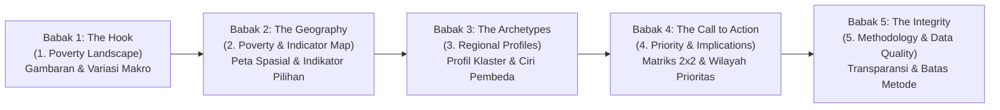

# PovertyRadar SDGs: Dashboard Design Document
## Desain Dashboard Interaktif untuk Presentasi Data dan Data Storytelling

**Mata Kuliah:** Presentasi Data dan Storytelling  
**Topik / Tema:** Analisis Multidimensi Kemiskinan Daerah di Indonesia (SDG 1 — *No Poverty*)  
**Judul Produk:** **PovertyRadar SDGs: Sistem Pemetaan Klaster dan Skrining Kerentanan Kemiskinan Daerah Indonesia**  
**Standar Desain:** *Storytelling with Data* (Knaflic) · *Information Dashboard Design* (Few) · *Practical Dashboards* (Desbarats)  
**Versi Dokumen:** 2.0 (Aligned with Dashboard Design Guide) | 28 Oktober 2026  

---

## 1. Klasifikasi Fungsi, Visi, & Alur Cerita Data

### 1.1 Klasifikasi Fungsi Dashboard (Taksonomi Desbarats)
Berdasarkan taksonomi Nick Desbarats, dashboard ini diklasifikasikan sebagai **Communication & Analytical Exploration Dashboard**:
* **Bukan Operational Monitoring Dashboard:** Dashboard ini tidak dirancang untuk pemantauan real-time status cepat tanpa scroll yang padat 5–9 metrik operasional, melainkan media presentasi tematik komprehensif.
* **Fungsi Utama:** Mengomunikasikan pesan data kunci (*explanatory storytelling*) mengenai ketimpangan kemiskinan daerah di Indonesia, sekaligus memberikan keleluasaan bagi audiens/pembuat kebijakan untuk menelusuri (*exploratory drill-down*) profil sosial-ekonomi 514 kabupaten/kota secara mandiri dan transparan.
* **Disiplin Kontrol Interaktif:** Filter dan navigasi hanya disediakan jika melayani pertanyaan analitis spesifik audiens (*task-driven interactivity*); tidak ada filter atau tombol hiasan yang mubazir.

### 1.2 Premis Utama Cerita (*Core Premise*)
> *"Dua daerah dengan tingkat kemiskinan yang sama belum tentu memiliki akar permasalahan yang sama. Kebijakan 'satu ukuran untuk semua' (one-size-fits-all) terbukti gagal mengentaskan kemiskinan secara berkelanjutan. PovertyRadar SDGs mengurai arketipe struktural sosial-ekonomi daerah agar intervensi tepat sasaran."*

### 1.3 Alur Narasi 5 Babak (*5-Act Narrative Arc*)



1. **Babak 1 — *The Hook* (`1. Poverty Landscape`):**  
   *Pertanyaan yang Dijawab:* Apa gambaran kemiskinan pada wilayah yang tercakup dan pola penting apa yang terlihat?  
   Menggugah audiens dengan realitas ketimpangan ekstrem di 514 kabupaten/kota (rentang lebar 2.38% di Sawahlunto hingga 41.66% di Intan Jaya — disparitas 17.5x lipat).
2. **Babak 2 — *The Geography* (`2. Poverty & Indicator Map`):**  
   *Pertanyaan yang Dijawab:* Di mana pola geografis atau perbedaan indikator paling terlihat?  
   Menjelajahi dimensi spasial 34 provinsi dengan filter indikator dan menyingkap **jurang dualistik Kabupaten vs Kota** (kemiskinan kabupaten 2x lipat lebih tinggi) serta paradoks ketenagakerjaan daerah pedesaan vs perkotaan.
3. **Babak 3 — *The Archetypes* (`3. Regional Profiles`):**  
   *Pertanyaan yang Dijawab:* Apa karakteristik setiap kelompok daerah dan apa yang membedakannya?  
   Menjawab profil pembeda melalui visualisasi **Small Multiples Bar Charts (Z-Score)** atau **Heatmap Matrix** yang membedah arketipe profil sosial-ekonomi hasil *unsupervised clustering* murni (bebas distorsi radar chart).
4. **Babak 4 — *The Call to Action* (`4. Priority & Implications`):**  
   *Pertanyaan yang Dijawab:* Wilayah mana yang layak dianalisis lebih lanjut berdasarkan kondisi yang teramati?  
   Puncak rekomendasi praktis melalui **Matriks Kuadran 2x2** ($P_0$ Aktual vs Indeks Kerentanan Struktural) dengan garis referensi median tegas untuk menyaring wilayah prioritas tindakan beserta implikasi kebijakannya.
5. **Babak 5 — *The Integrity* (`5. Methodology & Data Quality`):**  
   *Pertanyaan yang Dijawab:* Bagaimana temuan diperoleh dan apa yang tidak dapat disimpulkan?  
   Menutup cerita dengan kredibilitas ilmiah: membuktikan data resmi BPS 2021, menegaskan penolakan klasifikasi terawasi (*No Supervised Classification*), dan membeberkan batasan interpretasi secara jujur.

---

## 2. Tata Letak & Hierarki Visual (Few & Knaflic)

### 2.1 Aturan Sudut Kiri Atas (*Top-Left Anchor*) & Pola F/Z
Sesuai temuan Stephen Few mengenai pola pemindaian mata (*F-Pattern* dan *Z-Pattern*):
* **Top-Left (Sudut Kiri Atas):** Selalu menjadi tempat bagi metrik/angka paling penting (*Highest Priority Metric*) dan kalimat kesimpulan utama (*The One Key Takeaway*).
* **Aliran Baca:** Dari ringkasan makro (kiri atas) $\rightarrow$ grafik perbandingan utama (tengah) $\rightarrow$ kontrol filter atau tabel rincian (kanan / bawah).
* **Grid Konsisten:** Seluruh kartu visualisasi menggunakan grid terstruktur dengan batas kontainer sejajar (*aligned edges*). Tidak ada penyebaran metrik secara acak demi "keseimbangan semu".

### 2.2 Aturan 3 Detik – 30 Detik – 3 Menit
* **3 Detik:** Audiens menangkap pesan inti melalui *Headline Hero Banner* dan *KPI Cards* beranotasi di sudut kiri atas.
* **30 Detik:** Audiens memahami pola komparatif melalui grafik utama beranotasi garis referensi (*Reference Line*) dan teks *Callout*.
* **3 Menit:** Audiens yang ingin mendalami dapat berinteraksi dengan filter multi-level dan membaca tabel rincian detail per kabupaten.

---

## 3. Standar Pemilihan Grafik & Prinsip Decluttering

### 3.1 Matriks Pemilihan Tipe Grafik Sesuai Kaidah Desain
Mengikuti pedoman Cole Nussbaumer Knaflic dan Stephen Few:

| Kebutuhan Komparasi Data | Tipe Grafik Terpilih | Yang DILARANG / DIHINDARI | Alasan Ilmiah (*Justification*) |
| :--- | :--- | :--- | :--- |
| **Profil Multidimensi Klaster** | **Small Multiples Horizontal Bar Charts (Z-Score)** atau **Heatmap Matrix** | **DILARANG: Radar / Spider Chart** | Few & Knaflic: Luas area poligon radar chart mendistorsi persepsi nilai karena sangat bergantung pada urutan sumbu melingkar. Small Multiples Bar Chart berbasis panjang garis (*length encoding*) terbukti jauh lebih presisi dibaca. |
| **Perbandingan Antarkategori (Kab vs Kota, Antarpulau)** | **Horizontal Bar Chart** (diurutkan dari terbesar) | Pie / Donut Chart (>3 slice) | Mata manusia sulit membandingkan sudut/luas irisan pie chart. Sumbu nilai batang **wajib selalu dimulai dari nol (*zero-baseline*)**. |
| **Korelasi 2 Variabel Kontinu (TPAK vs $P_0$)** | **Scatter Plot 2D** dengan garis tren linear | Grafik Garis (Line Chart) untuk kategori non-waktu | Line chart hanya untuk data waktu kontinu (*time series*). Variabel bivariat cross-section wajib menggunakan scatter plot. |
| **Distribusi & Sebaran Data (Storytelling)** | **Histogram + KDE (Garis Median)** dan **Jittered Strip Plot (Dot Density)** | Boxplot pada halaman cerita utama; Diagram 3 Dimensi (3D) | Knaflic & Few: Boxplot memicu beban kognitif tinggi bagi audiens umum (menyembunyikan bentuk sebaran & menuntut pemahaman kuartil). Jittered Strip Plot memperlihatkan kerumunan nyata 514 titik kabupaten/kota secara intuitif. Boxplot dibatasi HANYA untuk Halaman Metodologi/Teknis. |
| **Skrining Prioritas Wilayah** | **Matriks Kuadran 2x2** dengan garis potong Median | Dual Y-Axis Chart | Dual y-axis membingungkan skala; matriks kuadran 2 sumbu ortogonal mempermudah segmentasi tindakan. |

### 3.2 Prinsip Decluttering & Data-Ink Ratio (Few & Knaflic)
Setiap elemen visual yang tidak merepresentasikan data **wajib dihilangkan**:
1. **Hapus Ornamen Non-Data:** Hilangkan border tebal kotak grafik, drop-shadow, efek gradasi mencolok, dan latar belakang gelap.
2. **Ringankan Gridlines:** Garis kisi (*gridlines*) hanya ditampilkan jika sangat mendukung pembacaan nilai exact, diwarnai abu-abu sangat redup (`#E2E8F0`), atau dihilangkan jika nilai sudah tertera langsung.
3. **Direct Data Labeling:** Utamakan pelabelan data langsung pada ujung batang atau titik data penting (*direct labeling*) alih-alih menggunakan kotak legenda terpisah yang memaksa mata bolak-balik.
4. **Satu Satuan Pengukuran:** Jangan mengulang teks satuan pada setiap angka (misalnya cantumkan `"Satuan: % Penduduk"` sekali pada judul/subjudul sumbu).

---

## 4. Desain Kartu Metrik (KPI) & Kontekstualisasi (Desbarats)

Sesuai aturan Nick Desbarats, **tidak boleh ada angka mentah yang berdiri sendiri tanpa konteks (*no bare numbers*)**:

### 4.1 Format Baku Setiap KPI Card
```
┌──────────────────────────────────────────────┐
│ Rata-rata Kemiskinan Nasional                │  <- Label Jelas
│ 12.3%                                        │  <- Angka Utama (Bold, 32px, maks 1 desimal)
│ ▲ +1.8% vs Median Nasional (10.5%)           │  <- Benchmark Kontekstual & Delta
│ Rentang: 2.4% (Sawahlunto) – 41.7% (Intan J.)│  <- Konteks Ekstrem
└──────────────────────────────────────────────┘
```

### 4.2 Aturan Pembulatan Angka
* Persentase kemiskinan, IPM, dan pengangguran dibulatkan maksimal **1 angka di belakang koma** (misal `12.3%`, bukan `12.27315%`). Kelebihan desimal menambah kebisingan visual (*noise*), bukan nilai keputusan.
* Nilai moneter besar disajikan dalam satuan yang mudah dicerna (misal: `Rp10.2 Juta/thn`, `Rp460.1 Triliun`).

---

## 5. Sistem Warna & Aksesibilitas (Desbarats & Few)

### 5.1 Disiplin *Neutral-plus-Single-Accent* (Mencegah Alarm Fatigue)
Menghindari "sindrom lampu lalu lintas" (*traffic light RYG*) yang disematkan sembarangan pada semua metrik:
* **Warna Dasar Netral:** Default seluruh latar, batang, dan titik data menggunakan warna abu-abu/slate netral (`#64748B`, `#CBD5E1`, `#F8FAFC`).
* **Satu Warna Aksen Utama (SDG 1 Crimson Red `#E5243B`):** Direservasi secara hemat **hanya untuk menarik perhatian pada satu hal terpenting**: daerah miskin ekstrem dan Kuadran I (Prioritas Kritis).
* **Warna Aksen Pendukung (SDG 6 Water Blue `#26BDE2`):** Digunakan terbatas untuk dimensi sanitasi dan air bersih.

### 5.2 Palet Klaster Ramah Buta Warna (*Colorblind-Safe*)
Untuk membedakan klaster profil sosial-ekonomi, digunakan palet **Okabe-Ito**:
* Klaster 1: Navy Blue (`#0072B2`)
* Klaster 2: Warm Amber / Orange (`#E69F00`)
* Klaster 3: Bluish Green / Teal (`#009E73`)
* Klaster 4: Vermillion (`#D55E00`)

### 5.3 Redundansi Visual
Tidak pernah mengandalkan warna sebagai satu-satunya pembeda status genting. Setiap status darurat wajib dipasangkan dengan **posisi kuadran**, **simbol/ikon eksplisit (⚠️)**, atau **label teks tertulis**.

---

## 6. Anotasi Naratif & Garis Referensi (*In-Chart Annotations*)

### 6.1 Garis Referensi Eksplisit (*Reference Lines*)
Setiap visualisasi yang memuat sebaran nilai wajib dilengkapi garis patokan:
* Pada histogram $P_0$: Garis putus-putus hitam vertikal di titik **Median Nasional (10.46%)**.
* Pada scatter plot kuadran: Garis silang vertikal dan horizontal di titik median masing-masing sumbu.

### 6.2 Anotasi Naratif Singkat (*The "So What?" Callout*)
Setiap visualisasi utama disertai anotasi naratif langsung (maksimal 1–2 kalimat terfokus):
```
💡 INSIGHT KUNCI: Jurang Pemisah Kabupaten vs Perkotaan
Rata-rata kemiskinan kabupaten (13.5%) hampir dua kali lipat dibanding kota (7.2%). 
Akses sanitasi layak di perkotaan mencapai 87.9%, sementara kabupaten masih tertinggal di angka 74.6%.
```

---

## 7. Storyboard & Spesifikasi Halaman Dashboard

Dashboard dibangun menggunakan arsitektur multi-halaman modular Streamlit:

```
PovertyRadar SDGs
├── 01_🏠_Poverty_Landscape.py           (Halaman 1: Gambaran & Variasi Makro Kemiskinan)
├── 02_🗺️_Poverty_and_Indicator_Map.py   (Halaman 2: Peta Spasial & Indikator Pilihan)
├── 03_🎯_Regional_Profiles.py          (Halaman 3: Profil Klaster & Ciri Pembeda)
├── 04_🧭_Priority_and_Implications.py  (Halaman 4: Matriks 2x2 & Wilayah Prioritas)
└── 05_📋_Methodology_and_Data_Quality.py (Halaman 5: Metodologi, Mutu Data, & Keterbatasan)
```

---

### Halaman 1: 01. Poverty Landscape (Lanskap Makro Kemiskinan)
* **Pertanyaan Kunci yang Dijawab:** *Apa gambaran kemiskinan pada wilayah yang tercakup dan pola penting apa yang terlihat?*
* **Fokus Storytelling:** Menggugah kesadaran audiens bahwa di balik angka agregat nasional tersimpan rentang disparitas kemiskinan yang sangat lebar antardaerah.
* **Layout & Komposisi F-Pattern:**
  1. **Top-Left Anchor (KPI Cards Berkonteks):**
     * *Rerata Kemiskinan Nasional:* `12.3%` (Benchmark: `Median 10.5%`).
     * *Wilayah Terendah:* `2.4%` (Kota Sawahlunto, Sumbar).
     * *Wilayah Tertinggi:* `41.7%` (Kab. Intan Jaya, Papua).
     * *Rasio Disparitas:* `17.5x` lipat antara titik ekstrem.
  2. **Top-Right (Distribusi Kemiskinan):**  
     Histogram $P_0$ dengan garis referensi median nasional. Menunjukkan ekor panjang wilayah tertinggal (*right-skewed distribution*).
  3. **Middle-Bottom (Komparasi 6 Kepulauan Besar — Jittered Strip Plot / Dot Density):**  
     Jittered Strip Plot interaktif: Sumbu Y = Persentase Kemiskinan ($P_0$), Sumbu X = 6 Wilayah Kepulauan. Setiap titik mewakili 1 kabupaten/kota (514 titik transparan) dengan garis tebal horizontal Median per pulau. Audiens langsung melihat kerumunan titik di Maluku & Papua melayang tinggi di atas ($>25\%$), sedangkan Kalimantan berjejal padat di bawah ($<10\%$) tanpa perlu memikirkan rumus kuartil/whisker.
  4. **Bottom (Leaderboard Rinci):** Tabel interaktif Top-10 Daerah Termiskin vs Top-10 Tersejahtera.

---

### Halaman 2: 02. Poverty & Indicator Map (Peta Spasial & Indikator Pilihan)
* **Pertanyaan Kunci yang Dijawab:** *Di mana pola geografis atau perbedaan indikator paling terlihat?*
* **Fokus Storytelling:** Menjelajahi dimensi spasial dan membuktikan adanya jurang struktural dualistik antara desa-kota serta fenomena paradoks kerja.
* **Layout & Komposisi:**
  1. **Top Control Bar:** Dropdown pemilihan indikator tematik (Kemiskinan, Sanitasi, Air Minum, Pendidikan, Pengeluaran, TPAK, TPT) dan filter kepulauan/provinsi.
  2. **Choropleth Spatial Map (Visual Utama):**  
     Peta 34 provinsi dengan 514 poligon kabupaten/kota (skala warna sequential). Tooltip informatif: *Nama Wilayah, Nilai Indikator, Deviasi vs Median Nasional, dan Ranking*.
  3. **Bottom Two-Column Layout:**
     * **Kolom Kiri (Disparitas Desa vs Kota):** Horizontal Bar Chart komparasi Kabupaten (13.5%) vs Kota (7.2%) di seluruh dimensi (kemiskinan, IPM, pengeluaran, sanitasi).
     * **Kolom Kanan (Paradoks Ketenagakerjaan):** Scatter plot TPAK vs Kemiskinan ($P_0$) dengan garis regresi positif ($r = +0.46$), disertai anotasi in-chart: *"Di daerah miskin, partisipasi kerja tinggi karena keharusan bertahan hidup di sektor informal subsistensi."*

---

### Halaman 3: 03. Regional Profiles (Profil Klaster Sosial-Ekonomi)
* **Pertanyaan Kunci yang Dijawab:** *Apa karakteristik setiap kelompok daerah dan apa yang membedakannya?*
* **Fokus Storytelling:** Membuktikan secara ilmiah bahwa daerah miskin memiliki masalah struktural yang berbeda melalui *Unsupervised Clustering* murni (*No Target Leakage*).
* **Layout & Komposisi:**
  1. **Top Header & Model Summary:** Ringkasan jumlah klaster ($k$) teruji dengan metrik *Silhouette Score* dan *Elbow Method*.
  2. **Visual Utama (Bebas Radar Chart):**  
     **Small Multiples Horizontal Bar Charts (Z-Score Standardized):**  
     Satu panel grafik batang horizontal untuk setiap klaster yang menampilkan deviasi rata-rata indikator (Pendidikan, Kesehatan, Sanitasi, Air, Pengeluaran, TPAK, TPT) terhadap rata-rata nasional (Z = 0).
  3. **Cluster Archetype Cards (Data-Driven Personas):**
     * *Klaster 1: Perkotaan Maju & Berpendidikan Tinggi* (Z-Score positif di pendidikan & sanitasi).
     * *Klaster 2: Pedesaan Agraris Tertinggal Pendidikan* (TPAK tinggi, RLS rendah).
     * *Klaster 3: Wilayah 3T Tertinggal Ekstrem* (Sanitasi & air sangat minim).
  4. **Bottom Validation Chart (Jittered Strip Plot per Klaster):**  
     Jittered Strip Plot (Dot Density) sebaran kemiskinan aktual ($P_0$) pada masing-masing klaster dengan penanda garis Median per klaster, membuktikan secara visual bagaimana arketipe sosial-ekonomi yang berbeda menghasilkan konsentrasi kemiskinan yang berbeda tanpa kebingungan rumus kuartil.

---

### Halaman 4: 04. Priority & Implications (Prioritas Intervensi & Matriks Kuadran)
* **Pertanyaan Kunci yang Dijawab:** *Wilayah mana yang layak dianalisis lebih lanjut berdasarkan kondisi yang teramati?*
* **Fokus Storytelling:** Menyajikan puncak rekomendasi praktis (*Call to Action*): memilah daerah ke dalam 4 kuadran prioritas tindakan beserta implikasi kebijakannya.
* **Layout & Komposisi:**
  1. **Visual Utama (Matriks Kuadran 2x2):**  
     Scatter plot interaktif dengan:
     * Sumbu Y = Persentase Kemiskinan Aktual ($P_0$).
     * Sumbu X = Indeks Kerentanan Struktural Relatif (Komposit tertimbang ketertinggalan WASH, RLS, UHH).
     * Garis Potong = Dua garis referensi tegas pada Median Nasional sumbu X dan sumbu Y.
  2. **Pelabelan Langsung 4 Kuadran:**
     * **Kuadran I (Prioritas Kritis / Double Burden - Aksen Oranye `#D55E00`):** Kemiskinan Tinggi + Kerentanan Tinggi. Butuh intervensi infrastruktur dasar sekaligus jaring pengaman sosial darurat.
     * **Kuadran II (Rentan Tersembunyi):** Kemiskinan Rendah tetapi Kerentanan Tinggi. Daerah rentan jatuh miskin jika terjadi syok ekonomi/bencana.
     * **Kuadran III (Kantong Kemiskinan Spesifik):** Kemiskinan Tinggi padahal Infrastruktur Baik. Akar masalah pada penyerapan tenaga kerja dan upah.
     * **Kuadran IV (Kondisi Kuat / Resilien):** Kemiskinan Rendah + Kerentanan Rendah.
  3. **Side Inspector Panel:** Klik salah satu titik pada scatter plot untuk membuka kartu profil detail kabupaten (seluruh indikator, peringkat provinsi, dan kuadran aksi).

---

### Halaman 5: 05. Methodology & Data Quality (Metodologi, Mutu Data, & Keterbatasan)
* **Pertanyaan Kunci yang Dijawab:** *Bagaimana temuan diperoleh dan apa yang tidak dapat disimpulkan?*
* **Fokus Storytelling:** Mempertahankan integritas dan kejujuran akademis penuh di hadapan dosen penguji dan audiens teknis.
* **Layout & Komposisi:**
  1. **Bukti Verifikasi BPS 2021:** Rekonsiliasi angka riil BPS (Surakarta, Cilacap, Banyumas) dan penjelasan penggunaan peta 34 provinsi (kondisi pra-pemekaran DOB Papua).
  2. **Alert Box Penegasan "No Supervised Classification":**  
     Penjelasan ilmiah mengapa kolom label bawaan `Klasifikasi Kemiskinan` dibuang (mencegah *target leakage* dan penyederhanaan semu 0/1).
  3. **Penjelasan Fakta Lapangan Nilai Nol (0.00%):**  
     Dokumentasi kondisi riil sanitasi Deiyai, air minum Mamberamo Tengah, dan TPT Nduga.
  4. **Analisis Outlier Teknis (Boxplot Tukey 1.5x IQR):**  
     Boxplot statistik dihadirkan secara khusus di halaman metodologi ini bagi dosen/audiens teknis untuk membedah perhitungan kuartil, IQR, dan batas outlier 36 daerah kemiskinan secara mendalam.
  5. **Kamus Data & Akses Unduh:** Tabel kamus data interaktif dan tombol unduh file bersih [`data/interim/poverty_data_cleaned.csv`](file:///d:/ARFI/Kuliah/Project/project-semester5/PovertyRadar/data/interim/poverty_data_cleaned.csv).

---

## 8. Spesifikasi Teknis & Implementasi (*Tech Stack*) — Diskusi Lebih Lanjut Tim

> [!NOTE]
> **Status: Menunggu Diskusi & Kesepakatan Internal Tim**  
> Penentuan teknologi pengembang (*tech stack*) untuk implementasi dashboard akhir (apakah menggunakan framework Python seperti Streamlit / Dash / Shiny for Python, atau berbasis web modern seperti React / Vue / Next.js dengan D3.js / Plotly / Leaflet) **akan didiskusikan dan disepakati lebih lanjut bersama seluruh anggota tim**, dengan mempertimbangkan:
> 1. **Keahlian & Kenyamanan Tim:** Pembagian peran antara pengolah data (*data science*) dan pengembang antarmuka (*frontend/UI*).
> 2. **Kinerja Peta Geospasial:** Kelancaran rendering 514 poligon kabupaten/kota di 34 provinsi secara interaktif.
> 3. **Interaktivitas State:** Kemudahan sinkronisasi filter antarkomponen (misal filter pulau/provinsi ke scatter kuadran dan kartu detail).
> 4. **Kecepatan Deployment & Demo:** Kemudahan akses saat demonstrasi langsung dan presentasi di hadapan dosen penguji.

---

## 9. Rubrik Evaluasi Presentasi Data & Storytelling

Dashboard ini dievaluasi berhasil memenuhi standar nilai tertinggi jika:
1. **Kejelasan Narasi (*Narrative Clarity*):** Mampu mengantarkan cerita dari fenomena makro hingga rekomendasi kuadran tanpa membingungkan audiens.
2. **Kesesuaian Tipe Grafik (*Chart Choice Precision*):** Tidak menggunakan radar chart atau pie chart berlebihan; mematuhi aturan zero-baseline pada bar chart.
3. **Data-Ink Ratio Tinggi (*Decluttering*):** Bersih dari ornamen visual non-data, garis kisi tidak mengganggu, dan pelabelan data efisien.
4. **Kontekstualisasi Metrik (*No Bare Numbers*):** Setiap KPI memuat nilai pembanding/benchmark yang jelas.
5. **Kejujuran Ilmiah (*Academic Integrity*):** Tidak memalsukan model klasifikasi, mengakui batasan satu periode waktu, dan menyertakan dokumentasi metodologi terbuka.

---

## 10. Kriteria Penerimaan Produk Dashboard (*Acceptance Criteria*)

Sesuai dokumen acuan *Problem Framing & Objektif Explanatory Dashboard*, dashboard PovertyRadar SDGs dinyatakan memenuhi kriteria penerimaan jika:
1. **Konsistensi Angka 100%:** Seluruh statistik ringkas, KPI, dan visualisasi dashboard konsisten dengan file analisis/notebook olahan.
2. **Transparansi Spasial (Zero Silent Drops):** Jumlah observasi (514 kabupaten/kota) dan wilayah yang tidak terpetakan (jika ada ketidakcocokan layer GeoJSON) dilaporkan secara eksplisit di layar.
3. **Dokumentasi Pipeline:** Daftar fitur, cara preprocessing, seleksi jumlah klaster, dan metrik evaluasi matematis terdokumentasi rapi.
4. **Penamaan Klaster Berbasis Bukti (Data-Driven Personas):** Klaster diberi nama dan interpretasi berdasarkan profil empiris hasil pemodelan, bukan nama yang ditetapkan sebelum analisis.
5. **Transparansi Skrining Prioritas:** Setiap penandaan wilayah pada halaman prioritas/skrining dapat dijelaskan secara deterministik dari indikator dan kriteria yang ditampilkan (bukan model black-box).
6. **Kredibilitas Batasan:** Periode data resmi BPS 2021, sumber repositori Kaggle ldausl, definisi variabel, dan batas interpretasi (non-prediktif) dicantumkan secara jelas dan terbuka.
