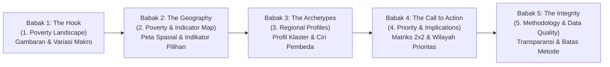
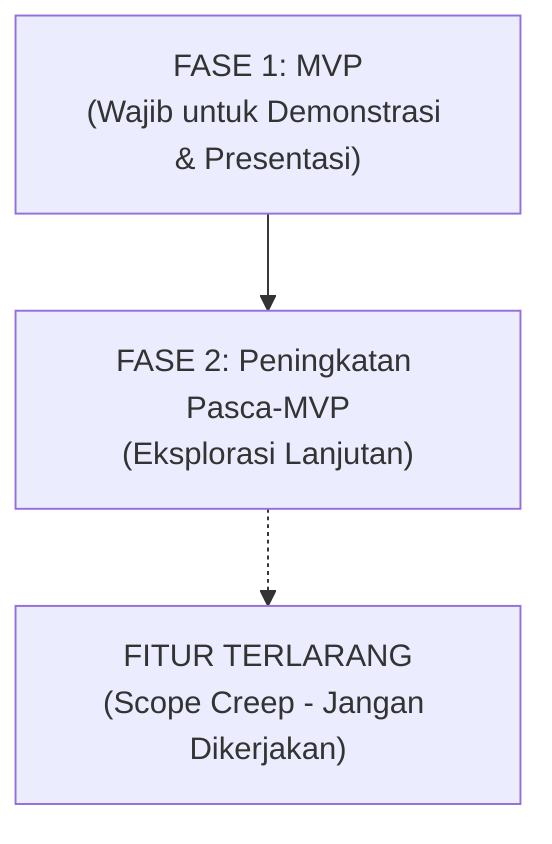

# PovertyRadar SDGs: Dashboard Design Document
## Desain Dashboard Interaktif untuk Presentasi Data dan Data Storytelling

**Mata Kuliah:** Presentasi Data dan Storytelling  
**Topik / Tema:** Analisis Multidimensi Kemiskinan Daerah di Indonesia (SDG 1 — *No Poverty*)  
**Judul Produk:** **PovertyRadar SDGs: Sistem Pemetaan Klaster dan Skrining Kerentanan Kemiskinan Daerah Indonesia**  
**Standar Desain:** *Storytelling with Data* (Knaflic) · *Information Dashboard Design* (Few) · *Practical Dashboards* (Desbarats)  
**Versi Dokumen:** 3.0 (Master Design Specification & Engineering Guardrails) | 31 Oktober 2026  

---

## 1. Klasifikasi Fungsi, Visi, & Alur Cerita Data

### 1.1 Klasifikasi Fungsi Dashboard (Taksonomi Desbarats)
Berdasarkan taksonomi Nick Desbarats, dashboard ini diklasifikasikan sebagai **Communication & Analytical Exploration Dashboard**:
* **Bukan Operational Monitoring Dashboard:** Dashboard ini tidak dirancang untuk pemantauan real-time status cepat tanpa scroll yang padat 5–9 metrik operasional, melainkan media presentasi tematik komprehensif.
* **Fungsi Utama:** Mengomunikasikan pesan data kunci (*explanatory storytelling*) mengenai ketimpangan kemiskinan daerah di Indonesia, sekaligus memberikan keleluasaan bagi audiens/pembuat kebijakan untuk menelusuri (*exploratory drill-down*) profil sosial-ekonomi 514 kabupaten/kota secara mandiri dan transparan.
* **Disiplin Kontrol Interaktif:** Filter dan navigasi hanya disediakan jika melayani pertanyaan analitis spesifik audiens (*task-driven interactivity*); tidak ada filter atau tombol hiasan yang mubazir.

### 1.2 Premis Utama Cerita (*Core Premise*)
> *"Dua daerah dengan tingkat kemiskinan moneter ($P_0$) yang sama belum tentu memiliki konfigurasi defisit sosial-ekonomi yang serupa. Kebijakan seragam ('one-size-fits-all') tidak memadai untuk mengurai disparitas struktural. PovertyRadar SDGs mengurai arketipe profil sosial-ekonomi daerah agar skrining intervensi lebih kontekstual dan berbasis bukti empiris."*

> [!NOTE]
> **Janji & Batasan Produk:**  
> • **Janji Produk:** Membantu analis kebijakan, perencana pembangunan daerah, dan akademisi menyusun hipotesis eksplorasi yang berbasis integrasi data multidimensi, bukan intuisi semata.  
> • **Batasan Produk:** Bukan pengganti verifikasi faktual lapangan, ini bukan membuktikan penyebab kemiskinan (bukan instrumen pembuktian kausalitas), tidak menghasilkan keputusan intervensi/bantuan secara otomatis, dan tidak memprediksi tren masa depan tanpa tersedianya data longitudinal multi-tahun.

### 1.3 Alur Narasi 5 Babak (*5-Act Narrative Arc*)



1. **Babak 1 — *The Hook* (`1. Poverty Landscape`):**  
   *Pertanyaan yang Dijawab:* Apa gambaran kemiskinan pada wilayah yang tercakup dan pola penting apa yang terlihat?  
   Menggugah audiens dengan realitas ketimpangan ekstrem di 514 kabupaten/kota (rentang lebar 2.38% di Sawahlunto hingga 41.66% di Intan Jaya — disparitas 17.5x lipat).
2. **Babak 2 — *The Geography* (`2. Poverty & Indicator Map`):**  
   *Pertanyaan yang Dijawab:* Di mana pola geografis atau perbedaan indikator paling terlihat?  
   Menjelajahi dimensi spasial 34 provinsi dengan filter indikator dan menyingkap **jurang dualistik Kabupaten vs Kota** (kemiskinan kabupaten 2x lipat lebih tinggi) serta paradoks ketenagakerjaan daerah pedesaan vs perkotaan.
3. **Babak 3 — *The Archetypes* (`3. Regional Profiles`):**  
   *Pertanyaan yang Dijawab:* Apa karakteristik setiap kelompok daerah dan apa yang membedakannya?  
   Menjawab profil pembeda melalui visualisasi **Small Multiples Bar Charts (Z-Score)** atau **Heatmap Matrix** yang membedah arketipe profil sosial-ekonomi hasil *unsupervised clustering* murni (bebas distorsi radar chart).
4. **Babak 4 — *The Call to Action* (`4. Priority & Implications`):**  
   *Pertanyaan yang Dijawab:* Wilayah mana yang layak dianalisis lebih lanjut berdasarkan kondisi yang teramati?  
   Puncak rekomendasi praktis melalui **Matriks Kuadran 2x2** ($P_0$ Aktual vs Indeks Kerentanan Fasilitas Dasar $V_{struc}$) dengan garis referensi median tegas untuk menyaring wilayah prioritas tindakan beserta implikasi kebijakannya.
5. **Babak 5 — *The Integrity* (`5. Methodology & Data Quality`):**  
   *Pertanyaan yang Dijawab:* Bagaimana temuan diperoleh dan apa yang tidak dapat disimpulkan?  
   Menutup cerita dengan kredibilitas ilmiah: membuktikan data resmi BPS 2021, menegaskan penolakan klasifikasi terawasi (*No Supervised Classification*), dan membeberkan batasan interpretasi secara jujur.

---

## 2. Tata Letak, Prinsip Desain, & Standar Antarmuka

### 2.1 Aturan Sudut Kiri Atas (*Top-Left Anchor*) & Pola F/Z
Sesuai temuan Stephen Few mengenai pola pemindaian mata (*F-Pattern* dan *Z-Pattern*):
* **Top-Left (Sudut Kiri Atas):** Selalu menjadi tempat bagi metrik/angka paling penting (*Highest Priority Metric*) dan kalimat kesimpulan utama (*The One Key Takeaway*).
* **Aliran Baca:** Dari ringkasan makro (kiri atas) $\rightarrow$ grafik perbandingan utama (tengah) $\rightarrow$ kontrol filter atau tabel rincian (kanan / bawah).
* **Grid Konsisten:** Seluruh kartu visualisasi menggunakan grid terstruktur dengan batas kontainer sejajar (*aligned edges*). Tidak ada penyebaran metrik secara acak demi "keseimbangan semu".

### 2.2 Aturan Waktu Pemahaman (3 Detik – 30 Detik – 3 Menit)
* **3 Detik:** Audiens menangkap pesan inti melalui *Headline Hero Banner* dan *KPI Cards* beranotasi di sudut kiri atas.
* **30 Detik:** Audiens memahami pola komparatif melalui grafik utama beranotasi garis referensi (*Reference Line*) dan teks *Callout*.
* **3 Menit:** Audiens yang ingin mendalami dapat berinteraksi dengan filter multi-level dan membaca tabel rincian detail per kabupaten.

### 2.3 10 Prinsip Desain yang Tidak Boleh Dilanggar
1. **Insight Lebih Penting daripada Dekorasi:** Setiap visualisasi harus menjawab pertanyaan analitis spesifik; hindari grafik pajangan yang tidak membawa pesan data.
2. **Satu Layar, Satu Pekerjaan Utama:** Setiap halaman dashboard memiliki 1 pertanyaan inti, 1 visual primer dominan, dan 1 aksi eksplorasi lanjutan yang jelas.
3. **Pemisahan Tegas Data Mentah vs Hasil Model:** Indikator $P_0$ adalah data observasional lapangan; klaster adalah hasil algoritma unsupervised; skor kerentanan kuadran adalah instrumen skrining analitis. Ketiganya tidak boleh dicampuradukkan.
4. **Pencegahan Target Leakage ($P_0$ sebagai Tolok Ukur Eksternal):** Indikator $P_0$ tidak disertakan dalam pembentukan fitur klastering utama, melainkan difungsikan sebagai tolok ukur pengujian eksternal (*external benchmark*) pasca-klaster.
5. **Disiplin Bahasa Asosiasi (Bukan Kausalitas):** Gunakan frasa *"beriringan dengan"*, *"berkorelasi"*, atau *"menunjukkan konfigurasi defisit"*. Dilarang keras menggunakan kata *"menyebabkan"* atau *"akar masalah"* untuk data observasional potong lintang.
6. **Tidak Menyamakan Klaster dengan Kategori Resmi Pemerintah:** Penamaan persona klaster merupakan ringkasan deskriptif interpretatif tim analis, bukan status yuridis resmi daerah.
7. **Transparansi Ketidakpastian:** Periode data, batas definisi, satuan, coverage layer geospasial, dan missing values ditampilkan secara terbuka, tidak disembunyikan.
8. **Anti-Hardcoded Snapshot:** Seluruh metrik agregat, nilai KPI, dan kartu ringkasan wajib dihitung secara dinamis saat runtime dari dataset aktif di memori.
9. **Bebas Klaim Prediksi Temporal:** Istilah risiko selalu didefinisikan sebagai *skrining kerentanan relatif*, bukan ramalan masa depan.
10. **Peta Bukan Satu-Satunya Cara Membaca Data:** Setiap insight spasial wajib memiliki representasi alternatif berupa tabel yang dapat diurutkan atau grafik batang ranking.

### 2.4 Spesifikasi Kanvas Desktop & Breakpoint Responsif
* **Kanvas Acuan Utama:** Desktop `1440 × 900 px` (rasio ~16:10) dengan layout *fluid* (konten dapat di-scroll vertikal, dilarang mengunci halaman kaku seperti poster atau slide). Wajib diuji pada resolusi laptop `1366 × 768 px` agar tidak ada elemen esensial yang terpotong.
* **Posisi Navigasi:** Sidebar vertikal tetap (*sticky*) di sisi kiri dengan lebar `224–240 px`.
* **Area Konten Utama:** Dimulai di sisi kanan sidebar dengan padding `24–32 px` dan grid 12 kolom dengan *gutter* `16–24 px`.
* **Proporsi Area per Halaman:**
  * *Halaman 1 (Overview):* Rasio area distribusi P0 dan visualisasi perbandingan makro sekitar `5:7` atau `6:6`.
  * *Halaman 2 (Map & Explorer):* Peta/ranking sekitar `60–65%`, panel kontrol/detail wilayah `35–40%`; tabel di bagian bawah.
  * *Halaman 3 (Profiles):* Heatmap dan small multiples mendominasi area utama; panel diagnostik model di bagian bawah.
  * *Halaman 4 (Matrix):* Scatterplot kuadran `60–65%`, ringkasan interpretasi kuadran `35–40%`.
  * *Halaman 5 (Method):* Kolom teks berstruktur rapi dengan tabel metadata memenuhi lebar kontainer.
* **Panduan Rasio Komponen Visual:**
  * *Scatterplot Matriks 2x2:* Wajib mendekati rasio `1:1` atau `4:3` agar sebaran kuadran tidak tampak lonjong atau terdistorsi secara visual.
  * *Histogram Distribusi:* Rasio area sekitar `16:9`.
  * *Peta Geospasial:* Rasio `4:3` hingga `16:10`.
  * *Heatmap Klaster:* Proporsi dinamis mengikuti jumlah fitur dan klaster agar label tidak terpotong.

| Breakpoint Layar | Perilaku Layout & Navigasi |
| :--- | :--- |
| **$\ge 1280\text{ px}$ (Desktop Luas)** | Sidebar penuh `224–240 px`, grid 12 kolom, KPI strip 4 kolom sejajar. |
| **$1024–1279\text{ px}$ (Laptop Standar)** | Sidebar dipersempit `200–216 px`, padding dikurangi menjadi 16–20 px, chart utama tetap dominan. |
| **$768–1023\text{ px}$ (Tablet / Layar Kecil)** | Sidebar menciut menjadi ikon navigasi ringkas; layout chart bertumpuk 2 kolom jika label tetap nyaman. |
| **$< 768\text{ px}$ (Mobile / Kompak)** | Navigasi drawer/hamburger; panel ditumpuk 1 kolom; KPI strip 2 kolom lalu 1 kolom. Tabel scrollable horizontal di dalam kontainernya (halaman tidak boleh ikut melebar). |

### 2.5 Standar State Antarmuka & Defensive UX
Sistem antarmuka wajib merancang 6 state defensif:
1. **Loading State:** Skeleton loader halus pada kontainer chart tanpa sentakan layout mendadak (*no layout shift*).
2. **Empty Result State:** Pesan ramah ketika kombinasi filter menghasilkan 0 baris observasi, dilengkapi tombol tindakan `Reset filters`.
3. **Data Unavailable State:** Pesan spesifik pada indikator yang kosong, bukan membiarkan grafik kosong seolah nilainya 0.
4. **Geospatial Fallback State:** Jika pencocokan poligon GeoJSON belum lengkap atau belum tervalidasi, dashboard secara otomatis menampilkan visualisasi alternatif *Ranking Bar Chart* disertai label cakupan data terbuka.
5. **Screening Fallback State:** Jika asumsi pembobotan indeks gabungan dipertanyakan, sediakan mode pemilihan 1 indikator nonmoneter eksplisit (misal akses sanitasi layak) pada sumbu Y.
6. **Small Sample Warning State:** Label konteks otomatis jika hasil penyaringan menghasilkan subset wilayah sangat kecil ($N < 10$).

### 2.6 Pola Interaksi Antarmuka Wajib
* **Filter Lintas Halaman Konsisten:** Filter global (`Provinsi`, `Klaster`, `Rentang P0`) berlaku seragam antar-halaman.
* **Klik-ke-Filter (*Click-to-Filter*):** Mengklik elemen batang atau titik scatterplot langsung memfilter tabel wilayah dan memperbarui kartu detail.
* **Hover Tooltip Informatif:** Menampilkan identitas wilayah, nilai indikator aktual beserta satuan, deviasi vs median nasional, dan label kuadran/klaster.
* **Pencarian Toleran:** Kotak pencarian nama kabupaten/kota bersifat *case-insensitive* dan menangani variasi penulisan administratif (Kab. / Kota).
* **Reset Filter Eksplisit:** Tombol `Reset filters` yang selalu terlihat jelas saat subset filter sedang aktif.
* **Ekspor CSV Terkendali:** Tombol ekspor hanya mengunduh baris yang sedang difilter aktif, dengan nama file deskriptif dan label `Ekspor daftar skrining` (bukan daftar bantuan).

---

## 3. Standar Pemilihan Grafik & Prinsip Decluttering

### 3.1 Matriks Pemilihan Tipe Grafik Sesuai Kaidah Desain
Mengacu pada prinsip visualisasi data komparatif pada [`dashboard_guide.md`](file:///d:/ARFI/Kuliah/Project/project-semester5/PovertyRadar/dashboard_guide.md):

| Kebutuhan Analitis | Tipe Grafik Terpilih | Yang DILARANG / DIHINDARI | Alasan Ilmiah (*Justification*) |
| :--- | :--- | :--- | :--- |
| **Distribusi Makro $P_0$** | **Histogram / Density Bar** | Pie Chart, Donut Chart | Distribusi 514 titik data bersifat kontinu dan menceng kanan; pie chart gagal total memperlihatkan bentuk ekor ketimpangan (*skewness*). |
| **Komparasi 6 Kepulauan** | **Jittered Strip Plot (Dot Density)** | Boxplot biasa (pada layar utama) | Menghindari miskonsepsi audiens non-teknis mengenai rumus kuartil/whisker; menampilkan 514 titik data riil dengan garis median tegas. |
| **Pola Spasial & Dualistik** | **Choropleth Map & Horizontal Bar** | 3D Globe, Bubble Map ukuran raksasa | Poligon choropleth mempertahankan batas administratif 34 provinsi; horizontal bar memberikan ruang teks label daerah yang panjang tanpa miring. |
| **Profil Indikator Klaster** | **Small Multiples Bar / Heatmap Matrix** | **STRICTLY FORBIDDEN: Radar / Spider Chart** | Radar chart mendistorsi proporsi luas area akibat urutan sumbu aksial buatan dan memicu bias visual. Bar chart Z-score memiliki sumbu linear yang terukur objektif. |
| **Skrining Kerentanan 2x2** | **Scatterplot Kuadran Kartesius (1:1)** | Dual-Axis Line Chart | Menghindari korelasi palsu sumbu ganda; dua sumbu dengan garis referensi median membentuk 4 kuadran skrining prioritas yang intuitif. |
| **Metodologi Teknis** | **Boxplot Tukey 1.5x IQR** | Tabel mentah tanpa agregasi | Disediakan khusus di halaman metodologi bagi penguji teknis untuk memeriksa rumus sebaran pencilan 36 daerah secara matematis. |

### 3.2 Prinsip Decluttering & Rasio Tinta-Data (Data-Ink Ratio)
* **Hilangkan Garis Kisi Berat:** Gunakan garis kisi abu-abu sangat tipis (`#E2E8F0`) hanya pada sumbu bernilai, atau hilangkan total jika label batang langsung tersedia.
* **Direct Data Labeling:** Tempatkan angka nilai langsung pada ujung batang penting (*direct labeling*), bukan memaksa audiens menoleh bolak-balik ke sumbu vertikal.
* **Hapus Elemen Hiasan:** Dilarang menggunakan efek drop-shadow tebal, gradien mencolok, ornamen 3D, atau ikon dekoratif yang tidak merepresentasikan data.

---

## 4. Desain Kartu Metrik (KPI) & Kontekstualisasi

### 4.1 Format Baku Setiap KPI Card
Mengikuti aturan Nick Desbarats (*Practical Dashboards*), **dilarang menampilkan angka telanjang (*no bare numbers*)**:

$$\text{Label Metrik (13px Muted)} \quad \rightarrow \quad \mathbf{\text{Angka Utama (32px Bold)}} \quad \rightarrow \quad \text{Konteks / Benchmark (12px)}$$

Format visual kartu KPI terstandarisasi:
```text
┌──────────────────────────────────────────────┐
│ PERSENTASE KEMISKINAN (P0)                   │  <-- Label jelas & spesifik
│ 10.46%                                       │  <-- Angka utama (runtime)
│ ▲ +0.32% vs Median Target SDG 1 (10.14%)     │  <-- Arah perubahan & pembanding
│ Rentang: 2.38% (Sawahlunto) – 41.66% (Intan) │  <-- Konteks sebaran ekstrem
└──────────────────────────────────────────────┘
```

### 4.2 Aturan Pembulatan & Presisi Angka
* **Persentase ($P_0$, TPT, TPAK, Air, Sanitasi):** Dibulatkan tepat 2 desimal (misal: `10.46%`).
* **Tahun (RLS, UHH):** Dibulatkan 1 atau 2 desimal (misal: `8.34 tahun`).
* **Rupiah Pengeluaran:** Diformat ke satuan juta dengan pemisah ribuan lokal (misal: `Rp10,90 juta/tahun`).
* **PDRB Riil:** Diformat ke skala Triliun / Miliar Rupiah (misal: `Rp460,20 Triliun`).

---

## 5. Sistem Visual, Warna, & Aksesibilitas

### 5.1 Disiplin *Neutral-plus-Single-Accent*
Untuk mencegah kelelahan visual (*alarm fatigue*):
* **Latar Belakang (*Background*):** `#F8FAFC` (Slate sangat terang, bersih dan tidak silau).
* **Permukaan Kartu (*Card Surface*):** `#FFFFFF` dengan garis tepi tipis `1px solid #E2E8F0` dan sudut membulat moderat (`border-radius: 8–12px`).
* **Teks Utama (*Ink*):** `#1E293B` (Slate gelap, rasio kontras $> 7:1$ terhadap latar).
* **Teks Sekunder (*Muted*):** `#64748B` (Abu-abu netral).
* **Aksen Tunggal Kritis (SDG 1 Red):** `#E5243B` — **HANYA** digunakan untuk menyorot kondisi kemiskinan ekstrem atau wilayah prioritas kritis Kuadran I.

### 5.2 Palet Klaster Ramah Buta Warna (*Okabe-Ito Colorblind-Safe*)
Sesuai standar `AGENTS.md`, pewarnaan 4 klaster sosio-ekonomi wajib menggunakan palet Okabe-Ito:

| Entitas | Nama Klaster Persona | Kode Hex | Karakteristik Visual |
| :---: | :--- | :---: | :--- |
| **Klaster 1** | Perkotaan Modern & Formal | `#0072B2` | Biru Tua (Aman untuk protanopia/deuteranopia) |
| **Klaster 2** | Kabupaten Penyangga Mapan | `#E69F00` | Warm Amber / Oranye Hangat |
| **Klaster 3** | Perdesaan Agraris Rentan | `#009E73` | Hijau Teal Lembut |
| **Klaster 4** | Wilayah 3T Deprivasi Akut | `#D55E00` | Vermillion / Merah Bata Tegas |

### 5.3 Redundansi Visual (*Double Encoding*)
Warna tidak boleh menjadi satu-satunya pembeda informasi. Setiap kategori wajib disertai:
* Pelabelan teks eksplisit pada legenda atau kontainer.
* Bentuk penanda (*symbol shape*) yang berbeda jika diplot berdampingan pada grafik sebaran monokrom.

---

## 6. Anotasi Naratif & Garis Referensi (*In-Chart Annotations*)

### 6.1 Garis Referensi Eksplisit (*Reference Lines*)
Setiap grafik wajib memiliki jangkar pembanding objektif:
* Garis putus-putus abu-abu tua (`#475569`) pada **Median Nasional ($P_0 = 10.46\%$)**.
* Garis ambang batas pada **Rata-rata Lama Sekolah 9 Tahun (Wajib Belajar Pendidikan Dasar)**.
* Garis $Z = 0$ pada Small Multiples Z-Score untuk menegaskan posisi di atas/bawah rata-rata nasional.

### 6.2 Anotasi Naratif Singkat (*The "So What?" Callout*)
Setiap visualisasi utama disertai kotak anotasi ringkas 1–2 kalimat bertanda 💡 yang menjelaskan makna data bagi kebijakan:
> *\"💡 INSIGHT: Kabupaten memiliki tingkat kemiskinan rata-rata hampir 2x lipat dibanding kota. Di wilayah pedesaan agraris, partisipasi kerja tinggi bukan tanda kesejahteraan, melainkan keharusan warga bekerja subsisten untuk bertahan hidup.\"*

---

## 7. Storyboard & Spesifikasi 5 Halaman Dashboard

```text
PovertyRadar SDGs
├── 01_🏠_Poverty_Landscape.py           (Halaman 1: Gambaran & Variasi Makro Kemiskinan)
├── 02_🗺️_Poverty_and_Indicator_Map.py   (Halaman 2: Peta Spasial & Indikator Pilihan)
├── 03_🎯_Regional_Profiles.py          (Halaman 3: Profil Klaster & Ciri Pembeda)
├── 04_🧭_Priority_and_Implications.py  (Halaman 4: Matriks 2x2 & Wilayah Prioritas)
└── 05_📋_Methodology_and_Data_Quality.py (Halaman 5: Metodologi, Mutu Data, & Keterbatasan)
```

---

### Halaman 1: 01. Poverty Landscape (Lanskap Makro Kemiskinan)
* **Pertanyaan Kunci:** *Apa gambaran kemiskinan pada wilayah yang tercakup dan pola penting apa yang terlihat?*
* **Fokus Storytelling:** Menggugah audiens bahwa di balik agregat nasional tersimpan rentang ketimpangan ekstrem antardaerah.
* **Komponen & Layout:**
  1. *Top-Left Hero & KPI Strip (Runtime-Calculated):*
     * Total Observasi: `514 kabupaten/kota`.
     * Median Kemiskinan ($P_0$): `10.46%`.
     * Rentang Disparitas: `2.38% (Sawahlunto) – 41.66% (Intan Jaya)`.
     * Rasio Disparitas Ekstrem: `17.5x lipat`.
  2. *Visual Primer (Histogram Distribusi $P_0$):* Menampilkan skewness positif dengan garis median putus-putus.
  3. *Visual Sekunder (Jittered Strip Plot 6 Kepulauan):* Sebaran 514 titik wilayah per pulau dengan garis median tebal per pulau (menonjolkan tingginya sebaran Maluku & Papua).
  4. *Tabel Leaderboard:* Top-10 Kabupaten Termiskin vs Top-10 Tersejahtera.

---

### Halaman 2: 02. Poverty & Indicator Map (Peta Spasial & Indikator Pilihan)
* **Pertanyaan Kunci:** *Di mana pola geografis atau perbedaan indikator paling terlihat?*
* **Fokus Storytelling:** Menjelajahi dimensi spasial, jurang dualistik kabupaten-kota, dan paradoks ketenagakerjaan.
* **Komponen & Layout:**
  1. *Toolbar Kontrol:* Dropdown pemilihan indikator (Kemiskinan, Sanitasi, Air Minum, Pendidikan, Pengeluaran, TPAK, TPT) dan filter provinsi/pulau.
  2. *Visual Utama (Choropleth Spatial Map):* Peta 34 provinsi dengan 514 poligon kabupaten/kota.
     * *Fallback Geospasial:* Jika file GeoJSON belum tervalidasi atau tidak lengkap, otomatis sediakan mode tampilan alternatif **Horizontal Bar Chart Ranking** beranotasi status coverage terbuka.
  3. *Panel Komparasi Bawah:*
     * Bar Chart Disparitas Kabupaten (`13.5%`) vs Kota (`7.2%`).
     * Scatterplot Paradoks Kerja (TPAK vs $P_0$, regresi positif $r = +0.462$).

---

### Halaman 3: 03. Regional Profiles (Profil Klaster Sosial-Ekonomi)
* **Pertanyaan Kunci:** *Apa karakteristik setiap kelompok daerah dan apa yang membedakannya?*
* **Fokus Storytelling:** Membuktikan secara ilmiah bahwa konfigurasi defisit fasilitas dasar antardaerah berbeda-beda melalui *Unsupervised Clustering* murni (*Zero Target Leakage*).
* **Komponen & Layout:**
  1. *Header Diagnostik Model:* Ringkasan k=4, Silhouette Score empiris ($0.2028$), Davies-Bouldin ($1.4522$), dan stabilitas multi-seed ARI ($0.9803$).
  2. *Visual Utama (STRICTLY NO RADAR CHART):*
     * **Small Multiples Bar Charts (Z-Score):** Deviasi 7 indikator terhadap mean nasional.
     * **Heatmap Matrix Divergen:** Matriks 28 sel z-score indikator (Biru = Unggul, Oranye/Merah = Defisit).
  3. *Kartu Narasi Arketipe Persona Klaster:*
     * **Klaster 1:** *Perkotaan Modern & Formal (N=78)* — Dominan kota, RLS tinggi, layanan dasar universal, $P_0$ rendah ($5.54\%$).
     * **Klaster 2:** *Kabupaten Penyangga Mapan (N=187)* — Layanan dasar di atas median, derajat kesehatan tinggi, $P_0$ rata-rata ($9.68\%$).
     * **Klaster 3:** *Perdesaan Agraris Rentan (N=216)* — Partisipasi kerja tinggi subsisten, defisit sanitasi/air di bawah median, $P_0$ moderat-tinggi ($13.13\%$).
     * **Klaster 4:** *Wilayah 3T Deprivasi Akut (N=33)* — Defisit kritis air minum, sanitasi, dan RLS, kemiskinan ekstrem ($31.39\%$).
  4. *Validasi Inferensial Eksternal:* Jittered Strip Plot distribusi $P_0$ antarklaster beranotasi hasil ANOVA ($F=155.94, p < 0.001$) dan Kruskal-Wallis ($H=167.52, p < 0.001$).

---

### Halaman 4: 04. Priority & Implications (Prioritas Intervensi & Matriks Kuadran)
* **Pertanyaan Kunci:** *Wilayah mana yang layak dianalisis lebih lanjut berdasarkan kondisi yang teramati?*
* **Fokus Storytelling:** Menyajikan puncak rekomendasi kebijakan berupa penyaringan wilayah prioritas tindakan berbasis matriks ortogonal 2x2.
* **Komponen & Layout:**
  1. *Visual Utama (Matriks Kuadran 2x2, Aspek Rasio ~1:1):*
     * Sumbu X = Tingkat Kemiskinan Moneter Aktual ($P_0$ %).
     * Sumbu Y = Indeks Kerentanan Struktural Relatif ($V_{struc}$).
     * Garis referensi median nasional berpotongan di ($P_0 = 10.46\%, V_{struc} = 0.2720$).
     * **Kuadran I (Kanan Atas / Vermillion `#D55E00`, N=162):** *Prioritas Utama (Beban Ganda)*.
     * **Kuadran II (Kiri Atas / Warm Amber `#E69F00`, N=95):** *Kerentanan Tersembunyi*.
     * **Kuadran III (Kanan Bawah / Muted Blue `#56B4E9`, N=95):** *Kantong Kemiskinan Daya Beli*.
     * **Kuadran IV (Kiri Bawah / Navy Blue `#0072B2`, N=162):** *Wilayah Terbina / Mapan*.
  2. *Syarat Skor Komposit Nonmoneter ($V_{struc}$):*
     * Wajib mendokumentasikan indikator yang dimasukkan (defisit sanitasi, air minum, RLS terbalik, dan UHH terbalik secara equal-weighted 25%), pembobotan terstandar, dan arah indikator (skor tinggi = kondisi lebih buruk/rentan).
     * *Fallback Mode:* Jika pengguna menginginkan transparansi indikator tunggal tanpa pembobotan komposit, sediakan opsi beralih ke indikator tunggal eksplisit pada Sumbu Y (misal: persentase rumah tangga tanpa sanitasi layak).
  3. *Tabel Daftar Skrining Interaktif:*
     * Menampilkan daftar kabupaten/kota yang tersinkronisasi saat kuadran diklik.
     * Menggunakan tombol unduh berlabel **`Ekspor daftar skrining`** (bukan `Daftar penerima bantuan`).
  4. *Lookup Rekomendasi Kebijakan:* Mengintegrasikan dataset acuan `data/processed/policy_recommendations_matrix.csv` untuk menampilkan menu program APBN/TKD dan instansi pengampu secara kontekstual.

---

### Halaman 5: 05. Methodology & Data Quality (Metodologi, Mutu Data, & Keterbatasan)
* **Pertanyaan Kunci:** *Bagaimana temuan diperoleh dan apa yang tidak dapat disimpulkan?*
* **Fokus Storytelling:** Menjaga transparansi akademis dan integritas metodologi di hadapan dosen penguji dan audiens teknis.
* **Komponen & Layout:**
  1. *Bukti Verifikasi BPS 2021:* Rekonsiliasi angka riil BPS 2021 (Surakarta, Cilacap, Banyumas) dan penjelasan cakupan 34 nama provinsi pada file sumber.
  2. *Penegasan Mutlak Tanpa Supervisi:* Menguraikan alasan ilmiah mengapa kolom label bawaan `Klasifikasi Kemiskinan` dibuang (mencegah target leakage dan ilusi biner 0/1) serta ditegaskan bahwa kolom tersebut **bukan ground truth resmi BPS**.
  3. *Dokumentasi Nilai Ekstrem & Nol:* Transparansi kondisi riil sanitasi Deiyai ($0.00\%$), air minum Mamberamo Tengah ($0.00\%$), dan TPT Nduga ($0.00\%$).
  4. *Inspeksi Outlier Teknis (Boxplot Tukey 1.5x IQR):* Visualisasi boxplot khusus dihadirkan di halaman ini bagi audiens teknis untuk memeriksa sebaran pencilan 36 daerah secara matematis.
  5. *Akses Unduh & Kamus Data:* Tabel kamus data interaktif dan tombol unduh file bersih [`data/interim/poverty_data_cleaned.csv`](file:///d:/ARFI/Kuliah/Project/project-semester5/PovertyRadar/data/interim/poverty_data_cleaned.csv).

---

## 8. Panduan Teknis & Statistik untuk Pengembang (*Engineering Guardrails*)

### 8.1 Aturan Pengolahan Data
* **Akses Kolom Berdasarkan Nama (*By Name, Not Position*):** Seluruh pemanggilan fitur dalam kode wajib merujuk nama kolom eksplisit (menggunakan modul konfigurasi `poverty_radar.config`), bukan indeks kolom berbasis integer.
* **Zero Trend Claims (Ketiadaan Dimensi Waktu):** Dataset BPS 2021 merupakan data potong lintang tunggal (*single cross-section*). Dilarang keras membuat kontrol tahun, grafik garis tren multi-tahun, atau narasi perkembangan waktu.
* **Penanganan Transformasi Logaritmik PDRB:** Karena PDRB memiliki skewness tinggi ($+5.85$), kode visualisasi wajib membedakan penyajian nilai asli rupiah pada tooltip vs nilai terstandarisasi logaritmik pada model.

### 8.2 Disiplin Statistik
* **P0 adalah Rate (%):** Indikator $P_0$ adalah rasio persentase penduduk miskin, bukan jumlah absolut orang miskin. Dilarang menyebut daerah dengan $P_0$ tertinggi sebagai daerah dengan orang miskin terbanyak.
* **Pembedaan *Percentage Point* vs *Percent Change*:** Ketika membandingkan dua angka kemiskinan (misal 12% vs 10%), gunakan istilah "selisih 2 poin persentase", bukan "berbeda 2%".
* **Korelasi Bukan Kausalitas:** Tampilkan koefisien korelasi bersama ukuran sampel ($N=514$) dan peringatan tegas bahwa korelasi tidak membuktikan hubungan sebab-akibat.
* **Batas Uji ANOVA:** Nilai $p < 0.001$ pada uji beda rata-rata membuktikan keberhasilan algoritma memisahkan profil daerah, bukan bukti keberhasilan program intervensi di lapangan.

---

## 9. Standar Bahasa Produk & Penulisan Narasi (*Copywriting Guide*)

### 9.1 Matriks Pilihan Diksi
Untuk menjamin objektivitas ilmiah dan mencegah overclaiming:

| Diksi yang DISARANKAN | Diksi yang DILARANG / DIHINDARI | Alasan Ilmiah |
| :--- | :--- | :--- |
| "Profil sosial-ekonomi" | "Tingkat kemakmuran mutlak" | Menghindari klaim status tunggal yang menyederhanakan realitas. |
| "Konfigurasi defisit fasilitas dasar" | "Akar penyebab kemiskinan" | Mencegah klaim kausalitas yang belum diuji secara eksperimental/longitudinal. |
| "P0 relatif tinggi dalam dataset" | "Daerah paling miskin di Indonesia" | Mengakui batasan cakupan dataset potong lintang 2021. |
| "Indikator yang beriringan" | "Faktor yang memicu/menimbulkan" | Hubungan data observasional bersifat korelasional. |
| "Skrining kerentanan relatif" | "Prediksi risiko masa depan" | Model tidak memiliki komponen waktu/prediktif. |
| "Daftar skrining telaah lanjut" | "Daftar penerima bantuan sosial" | Dashboard adalah alat bantu analisis, bukan eksekutor program bansos. |

### 9.2 Format Baku Narasi Insight (Template 4 Elemen)
Setiap kartu insight pada dashboard wajib mengikuti pola 4 struktur:
1. **Temuan:** [Pola numerik spesifik yang terhitung saat runtime].
2. **Pembanding:** Dibandingkan dengan [median / rentang / kelompok wilayah acuan].
3. **Makna Terbatas:** Pola ini mengindikasikan [interpretasi deskriptif], bukan [klaim kausalitas atau prediksi].
4. **Langkah Eksplorasi:** Telusuri [wilayah / indikator / metodologi terkait] untuk memeriksa detailnya.

---

## 10. Prioritas Pengembangan Antarmuka (Scoping & Roadmap)



### A. Fitur MVP (Wajib Ada untuk Demonstrasi Presentasi)
1. Overview makro dengan KPI strip yang dihitung dinamis dari data aktif.
2. Histogram sebaran P0 dan ranking kabupaten/kota.
3. Filter provinsi, pencarian toleran nama daerah, dan tabel wilayah yang dapat diurutkan.
4. Panel detail satu wilayah dengan benchmark median nasional.
5. Halaman Data & Method dengan transparansi metadata dan batasan variabel.
6. Visualisasi Small Multiples / Heatmap profil 4 klaster.
7. Matriks skrining 2x2 dengan garis median dan tabel daftar skrining.
8. Tombol ekspor CSV hasil filter aktif.
9. Penanganan state kosong (*empty state*) dan state pemuatan (*loading skeleton*).

### B. Fitur Peningkatan Pasca-MVP
1. Peta choropleth interaktif berbasis poligon GeoJSON terverifikasi.
2. Fitur perbandingan berdampingan (*side-by-side comparison*) antara dua kabupaten.
3. Kontrol analisis sensitivitas ambang batas matriks (median vs kuartil).
4. Riwayat unduh profil lengkap format ringkasan laporan PDF/Markdown.

### C. Fitur Terlarang (Scope Creep — Dilarang Dikerjakan)
1. Prediksi tren masa depan tanpa dataset longitudinal.
2. Sistem otomatisasi penetapan penerima bantuan bansos.
3. Narasi teks otomatis AI generatif tanpa sitasi angka terverifikasi.
4. Grafik 3D, animasi globe, atau hiasan visual yang mengaburkan data.

---

## 11. Spesifikasi Teknis & Implementasi (*Tech Stack*) — Diskusi Tim

> [!NOTE]
> **Status: Menunggu Diskusi & Kesepakatan Internal Tim**  
> Penentuan framework dashboard (Python Streamlit / Dash / Shiny for Python, atau React/Next.js dengan Plotly/D3) diputuskan bersama tim dengan mempertimbangkan kesiapan teknis, latensi interaksi filter, dan kelancaran rendering visualisasi.

---

## 12. Rubrik Evaluasi Presentasi Data & Storytelling

Dashboard ini dievaluasi berhasil memenuhi standar nilai tertinggi jika:
1. **Kejelasan Narasi (*Narrative Clarity*):** Mampu mengantarkan cerita dari fenomena makro hingga rekomendasi kuadran tanpa membingungkan audiens.
2. **Kesesuaian Tipe Grafik (*Chart Choice Precision*):** Tidak menggunakan radar chart atau pie chart; mematuhi aturan zero-baseline pada bar chart.
3. **Rasio Tinta-Data Tinggi (*Decluttering*):** Bersih dari ornamen non-data, garis kisi tidak mengganggu, pelabelan data efisien.
4. **Kontekstualisasi Metrik (*No Bare Numbers*):** Setiap KPI memuat nilai pembanding/benchmark yang jelas.
5. **Kejujuran Ilmiah (*Academic Integrity*):** Tidak memalsukan model klasifikasi, mengakui batasan satu periode waktu, dan menyertakan dokumentasi metodologi terbuka.

---

## 13. Kriteria Penerimaan Produk Dashboard (*Definition of Done*)

Dashboard dinyatakan layak didemokan dan memenuhi standar mutu penuh jika:
- [ ] Dalam 10–15 detik pertama, audiens dapat menjelaskan tujuan dashboard dan apa yang diukur oleh $P_0$.
- [ ] Seluruh angka ringkasan dan KPI dihitung secara dinamis saat runtime dari dataset aktif di memori (zero hardcoded values).
- [ ] Periode data BPS 2021 dan sumber resmi dicantumkan tanpa klaim cakupan tahun berjalan jika belum terverifikasi.
- [ ] Pengguna dapat mencari wilayah, memfilter provinsi, dan memeriksa detail indikator secara lancar.
- [ ] Setiap grafik memiliki judul informatif, satuan ukuran eksplisit, legenda/sumbu yang tepat, tooltip informatif, dan teks *So What?*.
- [ ] Peta geospasial menampilkan status coverage join dan memiliki visualisasi alternatif berupa tabel/ranking.
- [ ] Visual profil klaster menampilkan fitur input, jumlah anggota, deviasi indikator, dan metrik kualitas matematis.
- [ ] $P_0$ ditampilkan sebagai variabel pembanding eksternal pasca-klaster, bukan fitur input klastering.
- [ ] Matriks 2x2 memiliki definisi sumbu, garis median, dan label kuadran yang mudah dipahami.
- [ ] Kolom `Klasifikasi Kemiskinan` tidak digunakan sebagai ground truth atau target model.
- [ ] Bersih dari klaim kausalitas, ramalan prediktif, atau rekomendasi bantuan otomatis.
- [ ] Filter lintas halaman, reset filter, dan ekspor CSV berjalan secara konsisten.
- [ ] Dashboard dapat digunakan dengan nyaman pada resolusi laptop `1366 × 768 px` maupun desktop `1440 × 900 px`.
- [ ] Informasi visual dapat dipahami dengan baik tanpa bergantung pada warna saja (*colorblind-friendly*).
- [ ] Halaman Data & Method dapat diakses dengan mudah dari seluruh layar dashboard.

---

## 14. Catatan Implementasi untuk Developer / Coding Agent

Urutan kerja pre-coding bagi developer:
1. **Validasi Data Ingest:** Periksa nama kolom aktual pada file olahan; petakan variabel menggunakan `poverty_radar.config`.
2. **Pemisahan Lapisan:** Pisahkan secara tegas antara lapisan pipeline data (`src/poverty_radar/data/`), model analitis, dan antarmuka visual.
3. **Audit Otomatis Awal:** Pastikan shape (514 observasi), non-null, dan sebaran rentang data valid sebelum merender chart.
4. **Struktur Halaman Bersama:** Bangun navigasi sidebar sticky dan state filter global terlebih dahulu sebelum mengisi komponen halaman.
5. **Implementasi Bertahap:** Bangun halaman secara berurutan: Landscape $\rightarrow$ Map $\rightarrow$ Profiles $\rightarrow$ Priority $\rightarrow$ Method.
6. **Uji Konsistensi Metrik:** Cocokkan angka yang tampil di antarmuka terhadap kalkulasi langsung dari dataset acuan `data/processed/`.
7. **Hierarki Kualitas Implementasi:**
   $$\text{Ketepatan Semantik Data} \quad \rightarrow \quad \text{Insight Teruji} \quad \rightarrow \quad \text{Interaksi Konsisten} \quad \rightarrow \quad \text{Polesan Visual}$$
