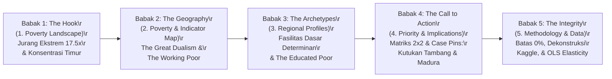
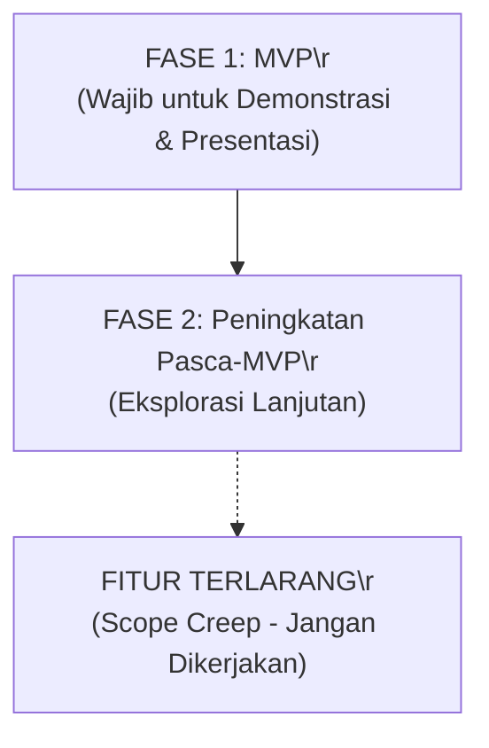

# PovertyRadar SDGs: Dashboard Design Document
## Desain Dashboard Interaktif untuk Presentasi Data dan Data Storytelling

**Mata Kuliah:** Presentasi Data dan Storytelling  
**Topik / Tema:** Analisis Multidimensi Kemiskinan Daerah di Indonesia (SDG 1 — *No Poverty*)  
**Judul Produk:** **PovertyRadar SDGs: Sistem Pemetaan Klaster dan Skrining Kerentanan Kemiskinan Daerah Indonesia**  
**Standar Desain:** *Storytelling with Data* (Knaflic) · *Information Dashboard Design* (Few) · *Practical Dashboards* (Desbarats)  
**Versi Dokumen:** 4.0 (Integrasi Temuan 9 Paradoks Sosioekonomi untuk Memperkuat Storytelling) | November 2026  

---

## 1. Klasifikasi Fungsi, Visi, & Alur Cerita Data

### 1.1 Klasifikasi Fungsi Dashboard (Taksonomi Desbarats)
Berdasarkan taksonomi Nick Desbarats, dashboard ini diklasifikasikan sebagai **Communication & Analytical Exploration Dashboard**:
* **Bukan Operational Monitoring Dashboard:** Dashboard ini tidak dirancang untuk pemantauan real-time status cepat tanpa scroll yang padat 5–9 metrik operasional, melainkan media presentasi tematik komprehensif.
* **Fungsi Utama:** Mengomunikasikan pesan data kunci (*explanatory storytelling*) mengenai ketimpangan kemiskinan daerah di Indonesia, sekaligus memberikan keleluasaan bagi audiens/pembuat kebijakan untuk menelusuri (*exploratory drill-down*) profil sosial-ekonomi 514 kabupaten/kota secara mandiri dan transparan.
* **Disiplin Kontrol Interaktif:** Filter dan navigasi hanya disediakan jika melayani pertanyaan analitis spesifik audiens (*task-driven interactivity*); tidak ada filter atau tombol hiasan yang mubazir.

### 1.2 Premis Utama Cerita (*Core Premise*)
> *"Kemiskinan di Indonesia bukan sekadar fenomena kekurangan uang moneter, melainkan wujud kegagalan struktural konektivitas geografis, jebakan ekonomi ekstraktif enclave, dan defisit fasilitas dasar. Dua daerah dengan tingkat kemiskinan moneter ($P_0$) yang sama dapat memiliki konfigurasi kerentanan yang bertolak belakang. Kebijakan seragam ('one-size-fits-all') tidak memadai untuk mengurai jurang ketimpangan ekstrem 17.5x lipat antardaerah. PovertyRadar SDGs mengintegrasikan temuan 9 paradoks sosioekonomi ke dalam dashboard untuk memperkuat storytelling, mengurai arketipe profil daerah, serta menyaring portofolio intervensi secara kontekstual berbasis bukti empiris."*

> [!NOTE]
> **Janji & Batasan Produk:**  
> • **Janji Produk:** Membantu analis kebijakan, perencana pembangunan daerah, dan akademisi menyusun hipotesis eksplorasi yang berbasis integrasi data multidimensi, bukan intuisi semata.  
> • **Batasan Produk:** Bukan pengganti verifikasi faktual lapangan, tidak membuktikan kausalitas deterministik tunggal tanpa uji longitudinal, tidak menghasilkan keputusan penyaluran bantuan secara otomatis, dan tidak memprediksi tren masa depan tanpa tersedianya data time-series multi-tahun.

### 1.3 Target Pengguna & Persona Utama (*Target Audience*)
Spesifikasi dashboard ini dirancang selaras dengan perumusan masalah pada [`docs/problem_framing_and_objectives.md`](problem_framing_and_objectives.md) serta arsitektur kebijakan fiskal dan perlindungan sosial nasional pada [`docs/01-sistem-kebijakan-dan-intervensi-pemerintah-indonesia-2026.md`](01-sistem-kebijakan-dan-intervensi-pemerintah-indonesia-2026.md). Dashboard difokuskan melayani 3 kelompok persona pengguna utama:

| Persona Pengguna | Profil & Latar Belakang | Kebutuhan Informasi & Alur Interaksi Utama | Keputusan / Aksi yang Didukung |
| :--- | :--- | :--- | :--- |
| **1. Perencana Bappeda / Analis Kebijakan Pemda** | Praktisi perencanaan anggaran pembangunan daerah dan pengentasan kemiskinan yang membutuhkan landasan empiris objektif. | • Memeriksa posisi kuadran wilayahnya pada Matriks 2x2 (Halaman 4).<br>• Melakukan *drill-down* profil indikator defisit spesifik pada Halaman 2 & 3.<br>• Menguji kasus wilayahnya melalui *Case-Study Pins* (Halaman 4).<br>• Mengunduh daftar indikator untuk penyusunan dokumen RPJMD. | Menentukan alokasi belanja modal infrastruktur fisik dasar (sanitasi/air) vs stimulus ekonomi produktif agar intervensi tepat sasaran. |
| **2. Dosen Penguji & Akademisi (Auditor Metodologi)** | Evaluator teknis yang menguji kepatuhan metodologi data science, pencegahan target leakage, dan validitas statistika. | • Memeriksa kebenaran pemisahan $P_0$ dari klastering di Halaman 3.<br>• Membuka Halaman 5 untuk memeriksa pengujian outlier 1.5x IQR, ketiadaan supervisi, verifikasi nilai batas 0%, dan elastisitas OLS. | Menilai integritas ilmiah, kejujuran model unsupervised, dan keterandalan bukti inferensial (ANOVA/Kruskal-Wallis). |
| **3. Peneliti / Analis Kebijakan Publik Nasional** | Analis sosial-ekonomi makro yang mengeksplorasi fenomena disparitas regional Indonesia dan pencapaian target SDG 1 (*No Poverty*). | • Mengamati ketimpangan lanskap makro dan jurang 17.5x di Halaman 1.<br>• Menganalisis anomali spasial The Great Dualism dan The Working Poor (TPAK vs $P_0$) di Halaman 2. | Menyusun advokasi kebijakan diferensiasi regional berbasis bukti (*evidence-based policy advocacy*). |

### 1.4 Alur Narasi 5 Babak (*5-Act Narrative Arc*)



1. **Babak 1 — *The Hook* (`01. Poverty Landscape`):**  
   *Pertanyaan yang Dijawab:* Apa gambaran kemiskinan pada wilayah yang tercakup dan pola penting apa yang terlihat?  
   Menggugah audiens dengan realitas ketimpangan ekstrem di 514 kabupaten/kota: median nasional $10.46\%$ menutupi jurang 17.5x lipat antardaerah (Sawahlunto 2.38% vs Intan Jaya 41.66%) dan fakta bahwa 87.1% kantong kemiskinan akut ($P_0 \ge 20\%$) menumpuk di Indonesia Timur (Maluku, Papua, NTT), sementara kawasan barat hanya menyumbang 12.9% di kepulauan terisolir (Nias & Mentawai).
2. **Babak 2 — *The Geography* (`02. Poverty & Indicator Map`):**  
   *Pertanyaan yang Dijawab:* Di mana pola geografis atau perbedaan indikator paling terlihat?  
   Menjelajahi dimensi spasial 34 provinsi dan menyingkap dua paradoks mendasar: **The Great Dualism** (kabupaten 1.8x lebih miskin dari kota, namun kota 1.8x lebih menganggur) serta paradoks **The Working Poor** (korelasi positif $P_0$ vs TPAK $r = +0.462$, di mana warga miskin 3T wajib bekerja subsistensi bertahan hidup sehingga TPT tercatat mendekati $0.00\%$).
3. **Babak 3 — *The Archetypes* (`03. Regional Profiles`):**  
   *Pertanyaan yang Dijawab:* Apa karakteristik setiap kelompok daerah dan apa yang membedakannya?  
   Menjawab profil pembeda melalui visualisasi **Small Multiples Bar Charts (Z-Score)** dan **Heatmap Matrix** yang membuktikan bahwa fasilitas dasar (sanitasi $r = -0.56$) merupakan determinan struktural yang beriringan 2.3x lebih kuat dibanding PDRB nominal daerah ($r = -0.24$), serta menyajikan paradoks **The Educated Poor** di kepulauan terpencil (RLS tinggi namun kemiskinan tetap kritis).
4. **Babak 4 — *The Call to Action* (`04. Priority & Implications`):**  
   *Pertanyaan yang Dijawab:* Wilayah mana yang layak dianalisis lebih lanjut berdasarkan kondisi yang teramati?  
   Puncak rekomendasi praktis melalui **Matriks Kuadran 2x2** ($P_0$ Aktual vs Indeks Kerentanan Struktural $V_{struc}$) dilengkapi fitur **Interactive Case-Study Pins** (Kutukan Sumber Daya Enclave dan Disparitas Madura) untuk menguji efektivitas penapisan intervensi.
5. **Babak 5 — *The Integrity* (`05. Methodology & Data Quality`):**  
   *Pertanyaan yang Dijawab:* Bagaimana temuan diperoleh dan apa yang tidak dapat disimpulkan?  
   Menutup cerita dengan transparansi ilmiah penuh: membuktikan data resmi BPS 2021, memverifikasi nilai batas ekstrem $0.00\%$ pada wilayah 3T, membongkar formula heuristik label biner Kaggle (akurasi rekonstruksi 98.8%), dan memaparkan grafik koefisien baku OLS.

### 1.5 Matriks Integrasi 9 Paradoks Sosioekonomi ke Komponen Dashboard
Untuk memperkuat daya pikat cerita (*data storytelling impact*) tanpa menimbulkan kepadatan teks (*decluttering*), 9 temuan paradoks sosioekonomi dipetakan langsung ke komponen fungsional pada masing-masing halaman:

| Paradoks Sosioekonomi | Temuan Data Kunci | Halaman Dashboard | Bentuk Komponen UI Terintegrasi |
| :--- | :--- | :---: | :--- |
| **Paradoks 1: The Working Poor** | Kemiskinan akut di wilayah 3T mencatat TPT $\approx 0.00\%$ & TPAK $> 85\%$; sebaliknya kota kaya mencatat TPT tinggi ($8\%–10\%$). | **Halaman 2** | *Action Title* & Anotasi garis regresi scatterplot TPAK vs $P_0$ ($r = +0.462$). |
| **Paradoks 2: The Great Dualism** | Kabupaten 1.8x lebih miskin dari Kota (13.51% vs 7.22%), namun Kota 1.8x lebih menganggur (7.92% vs 4.36%). | **Halaman 2** | Grouped Bar Chart komparasi dualistik Kabupaten vs Kota berlabel rasio 1.8x. |
| **Paradoks 3: The Resource Curse** | 17 daerah dengan PDRB $\ge \text{Rp } 25\text{ Triliun}$ tetap memiliki kemiskinan di atas median nasional (Mimika, Bojonegoro, Morowali, Bintuni). | **Halaman 4** | **[Pin: Kutukan Sumber Daya]** pada Matriks 2x2 yang mengisolasi titik PDRB raksasa di Kuadran III. |
| **Paradoks 4: Sanitasi Dasar vs PDRB** | Variasi akses sanitasi beriringan $2.3\text{x}$ lebih kuat ($r = -0.56$) dibanding PDRB nominal daerah ($r = -0.24$). | **Halaman 3** | *Callout Badge* Determinan Struktural pada Small Multiples Z-Score dan Heatmap Klaster. |
| **Paradoks 5: Disparitas Madura** | Jarak $5.4\text{ km}$ Jembatan Suramadu memisahkan Surabaya ($P_0 = 5.2\%$, RLS 10.5 thn) dengan Sampang ($P_0 = 23.8\%$, RLS 4.86 thn). | **Halaman 4** | **[Pin: Disparitas Madura]** pada Matriks 2x2 yang mengisolasi 4 kabupaten Madura vs Ring-1 Jatim. |
| **Paradoks 6: 3T di Kawasan Barat** | Kemiskinan akut melintasi bujur timur-barat; Kepulauan Nias dan Mentawai memiliki sanitasi $38.9\%$ dan RLS $6.4\text{ thn}$. | **Halaman 1 & 3** | Label anomali spasial pada Jittered Strip Plot Kepulauan & Klaster 3T Terisolir. |
| **Paradoks 7: The Educated Poor** | Daerah kepulauan terpencil mencatat RLS setara SMP/SMA ($8.2–9.2\text{ thn}$) namun $P_0$ tetap kritis ($27\%–38\%$). | **Halaman 3** | Anotasi titik anomali pada visualisasi profil klaster (Supiori, Waropen, Bintuni). |
| **Paradoks 8: Dekonstruksi Label Kaggle** | Label biner Kaggle terbukti merupakan aturan heuristik sederhana ($P_0 > 20\%$ atau pengeluaran rendah), membenarkan penolakan model klasifikasi. | **Halaman 5** | Kotak Transparansi Metodologi: Pembuktian Target Leakage & Rekonstruksi Aturan 98.8%. |
| **Paradoks 9: Elastisitas OLS Baku** | Daya beli ($\beta = -0.32$) dan sanitasi ($\beta = -0.21$) mendominasi elastisitas multivariat; TPAK ($\beta = +0.18$) positif signifikan. | **Halaman 5** | Visualisasi Horizontal Bar Chart Koefisien Baku Regresi OLS untuk Auditor Ekonometrika. |

---

## 2. Tata Letak, Prinsip Desain, & Standar Antarmuka

### 2.1 Aturan Sudut Kiri Atas (*Top-Left Anchor*) & Pola F/Z
Sesuai temuan Stephen Few mengenai pola pemindaian mata (*F-Pattern* dan *Z-Pattern*):
* **Top-Left (Sudut Kiri Atas):** Selalu menjadi tempat bagi metrik/angka paling penting (*Highest Priority Metric*) dan kalimat kesimpulan utama (*The One Key Takeaway / Action Title*).
* **Aliran Baca:** Dari ringkasan makro (kiri atas) $\rightarrow$ grafik perbandingan utama (tengah) $\rightarrow$ kontrol filter atau tabel rincian (kanan / bawah).
* **Grid Konsisten:** Seluruh kartu visualisasi menggunakan grid terstruktur dengan batas kontainer sejajar (*aligned edges*). Tidak ada penyebaran metrik secara acak demi "keseimbangan semu".

### 2.2 Aturan Waktu Pemahaman (3 Detik – 30 Detik – 3 Menit)
* **3 Detik:** Audiens menangkap pesan inti melalui *Action Headline Hero Banner* dan *KPI Cards* beranotasi di sudut kiri atas.
* **30 Detik:** Audiens memahami pola komparatif melalui grafik utama beranotasi garis referensi (*Reference Line*) dan teks *Action Callout*.
* **3 Menit:** Audiens yang ingin mendalami dapat berinteraksi dengan *Case-Study Pins*, filter multi-level, dan membaca tabel rincian detail per kabupaten.

### 2.3 10 Prinsip Desain yang Tidak Boleh Dilanggar
1. **Insight Lebih Penting daripada Dekorasi:** Setiap visualisasi harus menjawab pertanyaan analitis spesifik; hindari grafik pajangan yang tidak membawa pesan data.
2. **Satu Layar, Satu Pekerjaan Utama:** Setiap halaman dashboard memiliki 1 pertanyaan inti, 1 visual primer dominan, dan 1 aksi eksplorasi lanjutan yang jelas.
3. **Penerjemahan Narasi ke Komponen Visual:** Dilarang menempelkan esai atau artikel panjang di layar; seluruh pesan analitis diterjemahkan ke dalam *Action Titles*, anotasi langsung, dan tombol penyorot kasus interaktif.
4. **Pencegahan Target Leakage ($P_0$ sebagai Tolok Ukur Eksternal):** Indikator $P_0$ tidak disertakan dalam pembentukan fitur klastering utama, melainkan difungsikan sebagai tolok ukur pengujian eksternal (*external benchmark*) pasca-klaster.
5. **Disiplin Bahasa Determinan Struktural & Asosiasi Statistik:**
   * Dalam kerangka teori pembangunan dan perencanaan sosial, fasilitas dasar (sanitasi, air, pendidikan) diakui sebagai **determinan struktural langsung (*underlying structural determinants*)**.
   * Dalam konteks analisis data kuantitatif BPS 2021, data disajikan secara disiplin sebagai **asosiasi empiris potong lintang (*cross-sectional statistical association*)**.
6. **Tidak Menyamakan Klaster dengan Kategori Resmi Pemerintah:** Penamaan persona klaster merupakan ringkasan deskriptif interpretatif tim analis, bukan status yuridis resmi daerah.
7. **Transparansi Nilai Batas Lapangan (*Boundary Values*):** Nilai minimum $0.00\%$ pada wilayah 3T ditampilkan secara terbuka sebagai fakta lapangan faktual, bukan disembunyikan atau dibuang (*no data dropping*).
8. **Anti-Hardcoded Snapshot:** Seluruh metrik agregat, nilai KPI, dan kartu ringkasan wajib dihitung secara dinamis saat runtime dari dataset aktif di memori.
9. **Bebas Klaim Prediksi Temporal:** Istilah risiko selalu didefinisikan sebagai *skrining kerentanan relatif*, bukan ramalan masa depan.
10. **Peta Bukan Satu-Satunya Cara Membaca Data:** Setiap insight spasial wajib memiliki representasi alternatif berupa tabel yang dapat diurutkan atau grafik batang ranking.

### 2.4 Spesifikasi Kanvas Desktop & Breakpoint Responsif
* **Kanvas Acuan Utama:** Desktop `1440 × 900 px` (rasio ~16:10) dengan layout *fluid* (konten dapat di-scroll vertikal, dilarang mengunci halaman kaku seperti poster atau slide). Wajib diuji pada resolusi laptop `1366 × 768 px` agar tidak ada elemen esensial yang terpotong.
* **Posisi Navigasi:** Sidebar vertikal tetap (*sticky*) di sisi kiri dengan lebar `224–240 px`.
* **Area Konten Utama:** Dimulai di sisi kanan sidebar dengan padding `24–32 px` dan grid 12 kolom dengan *gutter* `16–24 px`.
* **Proporsi Area per Halaman:**
  * *Halaman 1 (Overview):* Rasio area distribusi P0 dan visualisasi perbandingan makro sekitar `5:7` atau `6:6`.
  * *Halaman 2 (Map & Explorer):* Peta/ranking sekitar `60–65%`, panel komparasi dualisme bawah `35–40%`.
  * *Halaman 3 (Profiles):* Heatmap dan small multiples mendominasi area utama; panel arketipe di bagian samping/bawah.
  * *Halaman 4 (Matrix):* Scatterplot kuadran `60–65%`, panel rekomendasi & case pin `35–40%`.
  * *Halaman 5 (Method):* Tab terstruktur rapi dengan tabel metadata dan grafik koefisien OLS.

| Breakpoint Layar | Perilaku Layout & Navigasi |
| :--- | :--- |
| **$\ge 1280\text{ px}$ (Desktop Luas)** | Sidebar penuh `224–240 px`, grid 12 kolom, KPI strip 3–4 kolom sejajar. |
| **$1024–1279\text{ px}$ (Laptop Standar)** | Sidebar dipersempit `200–216 px`, padding dikurangi menjadi 16–20 px, chart utama tetap dominan. |
| **$768–1023\text{ px}$ (Tablet / Layar Kecil)** | Sidebar menciut menjadi ikon navigasi ringkas; layout chart bertumpuk 2 kolom. |
| **$< 768\text{ px}$ (Mobile / Kompak)** | Navigasi drawer/hamburger; panel ditumpuk 1 kolom; KPI strip bertumpuk vertikal. Tabel scrollable horizontal di dalam kontainernya. |

### 2.5 Standar State Antarmuka & Defensive UX
Sistem antarmuka wajib merancang 6 state defensif:
1. **Loading State:** Skeleton loader halus pada kontainer chart tanpa sentakan layout mendadak (*no layout shift*).
2. **Empty Result State:** Pesan ramah ketika kombinasi filter menghasilkan 0 baris observasi, dilengkapi tombol tindakan `Reset filters`.
3. **Data Unavailable State:** Pesan spesifik pada indikator yang kosong, bukan membiarkan grafik kosong seolah nilainya 0.
4. **Geospatial Fallback State:** Jika pencocokan poligon GeoJSON belum lengkap atau belum tervalidasi, dashboard secara otomatis menampilkan visualisasi alternatif *Ranking Bar Chart* disertai label cakupan data terbuka.
5. **Case-Study Pin Highlight State:** Ketika tombol pin studi kasus aktif, titik target disorot membesar dengan garis tepi kontras, sementara titik lainnya meredup (*dimmed opacity 0.15*).
6. **Small Sample Warning State:** Label konteks otomatis jika hasil penyaringan menghasilkan subset wilayah sangat kecil ($N < 10$).

### 2.6 Pola Interaksi Antarmuka Wajib
* **Filter Lintas Halaman Konsisten:** Filter global (`Wilayah Pulau`, `Provinsi`, `Klaster`, `Rentang P0`) berlaku seragam antar-halaman.
* **Klik-ke-Filter (*Click-to-Filter*):** Mengklik elemen batang atau titik scatterplot langsung memfilter tabel wilayah dan memperbarui kartu detail.
* **Hover Tooltip Informatif:** Menampilkan identitas wilayah, nilai indikator aktual beserta satuan, deviasi vs median nasional, dan label kuadran/klaster.
* **Pencarian Toleran:** Kotak pencarian nama kabupaten/kota bersifat *case-insensitive* dan menangani variasi penulisan administratif (Kab. / Kota).
* **Reset Filter Eksplisit:** Tombol `Reset filters` yang selalu terlihat jelas saat subset filter sedang aktif.
* **Ekspor CSV Terkendali:** Tombol ekspor hanya mengunduh baris yang sedang difilter aktif, dengan nama file deskriptif dan label `Ekspor daftar skrining`.

---

## 3. Standar Pemilihan Grafik & Prinsip Decluttering

### 3.1 Matriks Pemilihan Tipe Grafik Sesuai Kaidah Desain
Mengacu pada prinsip visualisasi data komparatif pada [`dashboard_guide.md`](file:///d:/ARFI/Kuliah/Project/project-semester5/PovertyRadar/dashboard_guide.md):

| Kebutuhan Analitis & Storytelling | Tipe Grafik Terpilih | Yang DILARANG / DIHINDARI | Alasan Ilmiah & Justifikasi |
| :--- | :--- | :--- | :--- |
| **Distribusi Makro & Jurang 17.5x** | **Histogram Distribusi & Ranking Bar Chart** | Pie Chart, Donut Chart | Distribusi 514 titik data kontinu dan menceng kanan; pie chart gagal memperlihatkan bentuk ekor ketimpangan (*skewness*). |
| **Sebaran Regional & Anomali 3T Barat**| **Jittered Strip Plot (Dot Density)** | Boxplot biasa (pada layar utama) | Menghindari kebingungan kuartil non-teknis; menampilkan 514 titik data riil dengan garis median tebal per pulau. |
| **Dikotomi The Great Dualism** | **Grouped Horizontal Bar Chart** | Dual-axis Bar Chart | Membandingkan rasio kemiskinan (13.51% vs 7.22%) dan pengangguran (7.92% vs 4.36%) kabupaten vs kota secara berdampingan. |
| **Paradoks The Working Poor** | **Scatterplot Regresi (TPAK vs $P_0$)** | Tabel angka mentah | Menunjukkan tren korelasi positif ($r = +0.462$) dan posisi anomali wilayah 3T subsisten vs kota terdidik. |
| **Profil Multidimensi Klaster** | **Small Multiples Bar / Heatmap Matrix** | **STRICTLY FORBIDDEN: Radar / Spider Chart** | Radar chart mendistorsi luas area akibat urutan sumbu buatan. Bar chart Z-score memiliki sumbu linear objektif dengan zero baseline. |
| **Skrining Kerentanan & Case Pins** | **Scatterplot Kuadran Kartesius (1:1)** | Dual-Axis Line Chart | Menghindari korelasi palsu sumbu ganda; dua sumbu dengan garis referensi median membentuk 4 kuadran skrining prioritas yang intuitif. |
| **Audit Ekonometrika & Nilai Batas** | **Horizontal Bar Chart Koefisien Baku OLS** | Tabel regresi teks mentah | Menyajikan nilai elastisitas $\beta$ secara visual dengan tingkat signifikansi yang mudah dipahami. |

### 3.2 Prinsip Decluttering & Rasio Tinta-Data (Data-Ink Ratio)
* **Hilangkan Garis Kisi Berat:** Gunakan garis kisi abu-abu sangat tipis (`#E2E8F0`) hanya pada sumbu bernilai, atau hilangkan total jika label batang langsung tersedia.
* **Direct Data Labeling:** Tempatkan angka nilai langsung pada ujung batang penting (*direct labeling*), bukan memaksa audiens menoleh bolak-balik ke sumbu vertikal.
* **Hapus Elemen Hiasan:** Dilarang menggunakan efek drop-shadow tebal, gradien mencolok, ornamen 3D, atau ikon dekoratif yang tidak merepresentasikan data.

---

## 4. Desain Kartu Metrik (KPI) & Kontekstualisasi

### 4.1 Format Baku Setiap KPI Card
Mengikuti aturan Nick Desbarats (*Practical Dashboards*), **dilarang menampilkan angka telanjang (*no bare numbers*)**:

$$\text{Action Label (13px Muted)} \quad \rightarrow \quad \mathbf{\text{Angka Utama (32px Bold)}} \quad \rightarrow \quad \text{Konteks Pembanding / Benchmark (12px)}$$

Format visual kartu KPI terstandarisasi untuk metrik kunci:

```text
┌──────────────────────────────────────────────┐
│ RASIO DISPARITAS EKSTREM (SDG 1)             │  <-- Label jelas & spesifik
│ 17.50x Lipat                                 │  <-- Angka utama (runtime)
│ Sawahlunto (2.38%) vs Intan Jaya (41.66%)    │  <-- Konteks sebaran ekstrem
│ Jurang Kemiskinan Terendah vs Tertinggi      │  <-- Makna analitis (Vermillion Accent)
└──────────────────────────────────────────────┘
```

```text
┌──────────────────────────────────────────────┐
│ KONSENTRASI KEMISKINAN AKUT (P0 >= 20%)      │  <-- Label jelas & spesifik
│ 87.1% di Kawasan Timur                       │  <-- Angka utama (runtime)
│ 53 dari 61 kantong akut di Maluku, Papua, NTT│  <-- Konteks wilayah riil
│ Kawasan barat menyumbang 12.9% (pulau 3T)    │  <-- Pembeda spasial
└──────────────────────────────────────────────┘
```

### 4.2 Aturan Pembulatan & Presisi Angka
* **Persentase ($P_0$, TPT, TPAK, Air, Sanitasi):** Dibulatkan tepat 2 desimal (misal: `10.46%`, `17.50x`).
* **Tahun (RLS, UHH):** Dibulatkan 1 atau 2 desimal (misal: `8.34 tahun`, `4.86 tahun`).
* **Rupiah Pengeluaran:** Diformat ke satuan juta dengan pemisah ribuan lokal (misal: `Rp10,90 juta/tahun`).
* **PDRB Riil:** Diformat ke skala Triliun Rupiah (misal: `Rp69,62 Triliun`).

---

## 5. Sistem Visual, Warna, & Aksesibilitas

### 5.1 Disiplin *Neutral-plus-Single-Accent*
Untuk mencegah kelelahan visual (*alarm fatigue*):
* **Latar Belakang (*Background*):** `#F8FAFC` (Slate sangat terang, bersih dan tidak silau).
* **Permukaan Kartu (*Card Surface*):** `#FFFFFF` dengan garis tepi tipis `1px solid #E2E8F0` dan sudut membulat moderat (`border-radius: 8–12px`).
* **Teks Utama (*Ink*):** `#1E293B` (Slate gelap, rasio kontras $> 7:1$ terhadap latar).
* **Teks Sekunder (*Muted*):** `#64748B` (Abu-abu netral).
* **Aksen Tunggal Kritis (SDG 1 Red):** `#E5243B` — digunakan untuk menyorot kondisi kemiskinan ekstrem atau badge SDG 1.

### 5.2 Palet Klaster Ramah Buta Warna (*Okabe-Ito Colorblind-Safe*)
Sesuai standar `AGENTS.md`, pewarnaan 4 klaster sosio-ekonomi wajib menggunakan palet Okabe-Ito:

| Entitas | Nama Klaster Persona | Kode Hex | Karakteristik Visual & Aksesibilitas |
| :---: | :--- | :---: | :--- |
| **Klaster 1** | Perkotaan Modern & Formal | `#0072B2` | Biru Tua (Aman untuk protanopia/deuteranopia) |
| **Klaster 2** | Kabupaten Penyangga Mapan | `#E69F00` | Warm Amber / Oranye Hangat |
| **Klaster 3** | Perdesaan Agraris Rentan | `#009E73` | Hijau Teal Lembut |
| **Klaster 4** | Wilayah 3T Deprivasi Akut | `#D55E00` | Vermillion / Merah Bata Tegas |

### 5.3 Redundansi Visual (*Double Encoding*)
Warna tidak boleh menjadi satu-satunya pembeda informasi. Setiap kategori wajib disertai:
* Pelabelan teks eksplisit pada legenda atau kontainer.
* Bentuk penanda (*symbol shape*) yang berbeda jika diplot berdampingan pada grafik sebaran monokrom.

### 5.4 Skala & Hierarki Tipografi Web (*Typography Scale*)

* **Font-Family Stack:** `'Inter', -apple-system, BlinkMacSystemFont, 'Segoe UI', Roboto, Helvetica, Arial, sans-serif`.
* **Standar Aksesibilitas Kontras:** Seluruh kombinasi warna teks dan latar belakang wajib memenuhi standar **WCAG 2.1 Level AA** (kontras $\ge 4.5:1$ untuk teks reguler, dan $\ge 7:1$ untuk teks utama `#1E293B` di atas latar `#FFFFFF` / `#F8FAFC`).

| Tingkat Hierarki | Elemen UI | Ukuran Font (px / rem) | Font Weight | Line Height | Warna Teks (Hex) | Contoh Penggunaan |
| :--- | :--- | :---: | :---: | :---: | :---: | :--- |
| **Display / H1** | Judul Halaman Utama | `28–32 px` (`1.75–2.0 rem`) | Bold (700) | 1.25 | `#0F172A` | `01. Lanskap Kemiskinan Makro Daerah` |
| **Action Title / H2**| Judul Aktif Grafik | `20–22 px` (`1.25–1.375 rem`)| Semi-Bold (600) | 1.3 | `#1E293B` | `The Great Dualism: Kabupaten 1.8x Lebih Miskin` |
| **Card Title / H3**| Judul Kontainer / Kartu | `15–16 px` (`0.95–1.0 rem`)| Semi-Bold (600) | 1.4 | `#334155` | `Matriks Skrining Kerentanan 2x2` |
| **KPI Value** | Angka Utama Kartu Metrik | `32–36 px` (`2.0–2.25 rem`) | Extra-Bold (800)| 1.1 | `#0F172A` / `#D55E00` | `10.46%`, `17.5x Lipat` |
| **KPI Context** | Pembanding / Benchmark | `12–13 px` (`0.75–0.81 rem`)| Medium (500) | 1.3 | `#64748B` | `Sawahlunto (2.38%) vs Intan Jaya (41.66%)` |
| **Body Text** | Paragraf Narasi Insight | `14–15 px` (`0.875–0.95 rem`)| Regular (400) | 1.55 | `#334155` | Penjelasan wawasan kebijakan di bawah visual |
| **Caption / Footnote**| Catatan Metodologi & Sumbu | `11–12 px` (`0.70–0.75 rem`)| Italic / Reg (400)| 1.4 | `#64748B` | `*Sumber: BPS Susenas 2021 (N=514 daerah)` |
| **Table Data** | Sel Data Tabel Drill-down | `13–14 px` (`0.81–0.875 rem`)| Regular (400) | 1.4 | `#1E293B` | Baris data kabupaten, persentase kuadran |

---

## 6. Anotasi Naratif & Garis Referensi (*In-Chart Annotations*)

### 6.1 Garis Referensi Eksplisit (*Reference Lines*)
Setiap grafik wajib memiliki jangkar pembanding objektif:
* Garis putus-putus abu-abu tua (`#475569`) pada **Median Nasional ($P_0 = 10.46\%$)**.
* Garis ambang batas pada **Rata-rata Lama Sekolah 9 Tahun (Wajib Belajar Pendidikan Dasar)**.
* Garis $Z = 0$ pada Small Multiples Z-Score untuk menegaskan posisi di atas/bawah rata-rata nasional.
* Garis pemisah median indeks kerentanan ($V_{\text{struc}} = 0.2720$).

### 6.2 Anotasi Naratif Singkat (*The "So What?" Callout*)
Setiap visualisasi utama disertai kotak anotasi ringkas 1–2 kalimat bertanda 💡 yang menjelaskan makna data bagi kebijakan:
* **The Working Poor Callout:**  
  > *\"💡 DIKOTOMI KETENAGAKERJAAN: Angka pengangguran rendah di wilayah 3T (~0.00%) bukan mencerminkan kemakmuran, melainkan keharusan mutlak warga bekerja subsistensi harian demi bertahan hidup. Sebaliknya, pengangguran terbuka perkotaan didominasi pencari kerja terdidik (search unemployment).\"*
* **The Resource Curse Callout:**  
  > *\"💡 DISTORSI EKSTRAKTIF: Daerah tambang dan migas raksasa (Mimika PDRB Rp69.6T, Bojonegoro Rp65.8T) tetap mencatat kemiskinan di atas median nasional, membuktikan terjadinya enclave economy tanpa penyerapan tenaga kerja lokal yang memadai.\"*
* **Disparitas Madura Callout:**  
  > *\"💡 KETERBATASAN KONEKTIVITAS FISIK: Jembatan Suramadu menghubungkan Surabaya (P0 5.2%, RLS 10.5 thn) dengan Sampang (P0 23.8%, RLS 4.86 thn), membuktikan infrastruktur fisik gagal memutus kemiskinan tanpa intervensi pendidikan dan sanitasi mendasar.\"*

---

## 7. Storyboard & Spesifikasi 5 Halaman Dashboard

### Halaman 1: `01. Poverty Landscape` (The Hook — Skala Makro & Disparitas 17.5x)
* **Pertanyaan Kunci:** *Seberapa parah jurang disparitas kemiskinan antardaerah di Indonesia, dan di mana konsentrasi terbesarnya?*
* **Fokus Storytelling:** Menghentak perhatian audiens pada detik pertama dengan membongkar realitas bahwa angka rata-rata nasional menutupi jurang ketimpangan ekstrem 17.5x lipat.
* **Komponen & Layout:**
  1. *Action Headline Hero Banner:*
     * Judul Utama: *"Lanskap Kemiskinan Daerah BPS 2021"*.
     * *Action Sub-headline:* *"Di balik angka median nasional 10.46%, tersembunyi jurang ketimpangan ekstrem 17.5x antardaerah (Sawahlunto 2.38% vs Intan Jaya 41.66%)."*
  2. *Top-Left KPI Strip (Runtime-Calculated):*
     * **Kartu 1 (Benchmark Nasional):** Median $P_0$ `10.46%` | Rentang `2.38% – 41.66%` (514 daerah).
     * **Kartu 2 (Rasio Ekstrem):** Jurang Disparitas `17.50x Lipat` (Aksen Vermillion `#D55E00`).
     * **Kartu 3 (Konsentrasi Spasial):** `87.1% di Kawasan Timur` (53 dari 61 kantong akut di Maluku, Papua, NTT).
  3. *Visual Primer (Jittered Strip Plot 6 Kepulauan):*
     * Sebaran 514 titik wilayah per pulau dengan garis median tebal per pulau.
     * *Anotasi Visual Langsung:* Penanda panah ke titik-titik Kepulauan Nias dan Mentawai di Sumatera (*"Anomali Barat: Daerah kepulauan terisolir dengan profil kerentanan menyerupai wilayah timur"*).
  4. *Visual Sekunder:* Ranking Bar Chart (Top 10 Kabupaten Kemiskinan Tertinggi vs Top 10 Terendah).

---

### Halaman 2: `02. Poverty & Indicator Map` (The Geography — The Great Dualism & The Working Poor)
* **Pertanyaan Kunci:** *Bagaimana wajah ketimpangan geografis kabupaten vs kota, dan mengapa angka pengangguran tidak berkorelasi lurus dengan kemiskinan?*
* **Fokus Storytelling:** Menjelajahi dimensi spasial 34 provinsi dan menumbangkan miskonsepsi bahwa daerah miskin identik dengan banyak penganggur terbuka.
* **Komponen & Layout:**
  1. *Visual Primer Atas (Choropleth Spatial Map 514 Daerah):*
     * *Action Title:* *"Konsentrasi Spasial: Polarisasi Poros Barat yang Mapan vs Wilayah Kepulauan & Pegunungan Rentan"*.
     * Layer Selector: [Tingkat Kemiskinan $P_0$ %], [Sanitasi Layak %], [Air Bersih %], [Pengeluaran Riil], [TPT %], [TPAK %].
     * *Geospatial Fallback:* Mode alternatif Horizontal Bar Chart jika file GeoJSON tidak termuat.
  2. *Komparasi Kiri Bawah (The Great Dualism):*
     * *Action Title:* **"The Great Dualism: Kabupaten 1.8x Lebih Miskin, Namun Kota 1.8x Lebih Menganggur"**.
     * Grouped Bar Chart: Kemiskinan (Kabupaten 13.51% vs Kota 7.22%) dan Pengangguran (Kota 7.92% vs Kabupaten 4.36%).
  3. *Komparasi Kanan Bawah (The Working Poor Paradox):*
     * *Action Title:* **"The Working Poor: Tekanan Kerja Subsistensi Menekan Angka Pengangguran di Daerah Miskin"**.
     * Scatterplot TPAK vs $P_0$ dengan garis tren korelasi positif ($r = +0.462$).
     * *Anotasi Titik Ekstrem:* Nduga & Lanny Jaya (TPT 0.00%, TPAK > 95%) vs Kota Depok (TPT 9.76%, kemiskinan 2.58%).

---

### Halaman 3: `03. Regional Profiles` (The Archetypes — Determinan Fasilitas Dasar)
* **Pertanyaan Kunci:** *Apa karakteristik setiap kelompok daerah dan apa yang membedakannya?*
* **Fokus Storytelling:** Membuktikan secara ilmiah bahwa konfigurasi defisit fasilitas dasar antardaerah berbeda-beda melalui *Unsupervised Clustering* murni (*Zero Target Leakage*).
* **Komponen & Layout:**
  1. *Action Title & Banner Determinan Struktural:*
     * Judul: *"Profil 4 Arketipe: Defisit Fasilitas Dasar Menjadi Determinan Struktural Antar-Klaster"*.
     * *Banner Insight:* *"Sebagai determinan struktural kebutuhan dasar, defisit sanitasi layak ($r = -0.56$) dan air bersih ($r = -0.42$) beriringan sangat kuat dengan tingginya kemiskinan, jauh melampaui variasi PDRB nominal ($r = -0.24$) yang sering kali terkonsentrasi pada industri padat modal."*
  2. *Header Diagnostik Model:* Ringkasan $k=4$, Silhouette Score ($0.2028$), Davies-Bouldin ($1.4522$), dan stabilitas multi-seed ARI ($0.9803$).
  3. *Visual Primer (STRICTLY NO RADAR CHART):*
     * **Small Multiples Horizontal Bar Charts (Z-Score):** Deviasi 7 indikator terhadap mean nasional pada 4 klaster persona.
     * **Heatmap Matrix Karakteristik:** Matriks 28 sel z-score indikator (Biru = Unggul, Oranye/Merah = Defisit).
  4. *Anotasi Kasus "The Educated Poor":*
     * Penandaan khusus pada anomali Kab. Supiori (RLS 8.87 thn, $P_0 = 37.91\%$) dan Kab. Waropen (RLS 9.21 thn, $P_0 = 29.85\%$) yang menunjukkan bahwa pendidikan tanpa serapan pasar kerja formal tidak mampu mengentaskan kemiskinan.
  5. *Validasi Inferensial Eksternal:* Jittered Strip Plot distribusi $P_0$ antarklaster beranotasi hasil ANOVA ($F=155.94, p < 0.001$).

---

### Halaman 4: `04. Priority & Implications` (The Call to Action — Matriks 2x2 & Case Pins)
* **Pertanyaan Kunci:** *Wilayah mana yang layak dianalisis lebih lanjut berdasarkan kondisi yang teramati?*
* **Fokus Storytelling:** Menyajikan puncak rekomendasi kebijakan berupa penyaringan wilayah prioritas tindakan berbasis matriks ortogonal 2x2 dilengkapi penyorot kasus interaktif.
* **Komponen & Layout:**
  1. *Action Title:* **"Matriks Skrining Kerentanan 2x2: Penapisan 514 Daerah Menuju Portofolio Intervensi Spesifik"**.
  2. *Interactive Case-Study Pins (Toolbar Penyorot Kasus):*
     * **[Semua Daerah (514)]**: Kondisi default (seluruh titik tampil normal).
     * **[Pin: Kutukan Sumber Daya]**: Mengisolasi 17 kabupaten berpdrb jumbo ($\ge \text{Rp } 25\text{T}$) yang memiliki $P_0 > 10.46\%$ (Mimika Rp69.6T, Bojonegoro Rp65.8T, Morowali Rp54.9T, Musi Banyuasin Rp46.1T, Teluk Bintuni Rp25.1T). Titik target membesar, titik lain meredup (*opacity 0.15*).
     * **[Pin: Disparitas Madura]**: Mengisolasi 4 kabupaten Pulau Madura (khususnya Sampang RLS 4.86 thn, $P_0 = 23.8\%$) vis-a-vis Kota Surabaya ($P_0 = 5.2\%$).
  3. *Visual Primer: Scatterplot Kuadran 2x2 (Aspek Rasio ~1:1):*
     * Sumbu X = Tingkat Kemiskinan Moneter Aktual ($P_0$ %).
     * Sumbu Y = Indeks Kerentanan Struktural Relatif ($V_{\text{struc}}$).
     * Garis referensi median nasional berpotongan di ($P_0 = 10.46\%, V_{\text{struc}} = 0.2720$).
     * **Kuadran I (Prioritas Beban Ganda | 162 Daerah / 31.5%):** Vermillion `#D55E00`.
     * **Kuadran II (Kerentanan Tersembunyi | 95 Daerah / 18.5%):** Warm Amber `#E69F00`.
     * **Kuadran III (Kantong Kemiskinan Daya Beli | 95 Daerah / 18.5%):** Reddish Purple `#CC79A7`.
     * **Kuadran IV (Wilayah Terbina / Mapan | 162 Daerah / 31.5%):** Dark Blue `#0072B2`.
  4. *Panel Rekomendasi Samping & Lookup Kebijakan:*
     * Terintegrasi dengan [`data/processed/policy_recommendations_matrix.csv`](file:///d:/ARFI/Kuliah/Project/project-semester5/PovertyRadar/data/processed/policy_recommendations_matrix.csv) untuk menampilkan menu intervensi APBN/TKD dan instansi pengampu secara dinamis saat kuadran atau titik dipilih.
     * Tombol aksi berlabel **`Ekspor daftar skrining`** (bukan `Daftar penerima bantuan`).

---

### Halaman 5: `05. Methodology & Data Quality` (The Integrity — Transparansi Batas Data & OLS)
* **Pertanyaan Kunci:** *Bagaimana temuan diperoleh dan apa yang tidak dapat disimpulkan?*
* **Fokus Storytelling:** Menjaga transparansi akademis, membongkar dekonstruksi model biner Kaggle, dan membuktikan keabsahan angka ekstrem di hadapan auditor data.
* **Komponen & Layout:**
  1. *Action Title:* **"Integritas Metodologi: Rekonsiliasi Data BPS 2021, Dekonstruksi Model, & Verifikasi Nilai Batas"**.
  2. *Tab 1: Transparansi Nilai Batas Lapangan Ekstrem:*
     * Tabel verifikasi angka $0.00\%$ pada wilayah 3T: Sanitasi Deiyai ($0.00\%$, $P_0 = 40.59\%$), Air Bersih Mamberamo Tengah ($0.00\%$, $P_0 = 36.76\%$), dan TPT Nduga ($0.00\%$, TPAK $97.93\%$).
     * *Catatan Integritas Data:* Nilai tersebut mencerminkan potret faktual lapangan keterisolasian geografis 3T, bukan kesalahan pengetikan/entri data (*not data entry errors*).
  3. *Tab 2: Dekonstruksi Reverse-Engineering Label Kaggle:*
     * Menampilkan bukti matematis formula heuristik aturan biner:
       $$\text{Class 1} \iff (P_0 > 20.0\%) \lor (\text{Pengeluaran} \le 6.25 \text{ Juta} \land \text{Sanitasi} \le 56.0\%)$$
     * Akurasi rekonstruksi formula terhadap 514 data: **98.8%** (508 dari 514 daerah identik).
     * Membuktikan secara ilmiah mengapa label biner Kaggle ditolak untuk mencegah *target leakage* dan *circular reasoning*.
  4. *Tab 3: Ekonometrika Multivariat OLS & Koefisien Elastisitas Relatif:*
     * Horizontal Bar Chart koefisien regresi linier berganda baku ($\beta$):
       * Pengeluaran Riil ($\beta = -0.317$, $t = -5.82$, $p < 0.0001$)
       * Akses Sanitasi Layak ($\beta = -0.209$, $t = -4.66$, $p < 0.0001$)
       * $\log_{10}(\text{PDRB})$ ($\beta = -0.197$, $t = -4.30$, $p < 0.0001$)
       * TPAK ($\beta = +0.183$, $t = +4.44$, $p < 0.0001$)
       * Rata-rata Lama Sekolah ($\beta = -0.118$, $t = -2.36$, $p = 0.0186$)
       * Pengangguran Terbuka TPT ($\beta = +0.093$, $t = +2.04$, $p = 0.0415$)
  5. *Inspeksi Outlier Teknis & Kamus Data:*
     * Boxplot Tukey 1.5x IQR untuk memeriksa 36 pencilan numerik.
     * Tabel kamus data interaktif dan tombol unduh file bersih [`data/interim/poverty_data_cleaned.csv`](file:///d:/ARFI/Kuliah/Project/project-semester5/PovertyRadar/data/interim/poverty_data_cleaned.csv).

---

## 8. Panduan Teknis & Statistik untuk Pengembang (*Engineering Guardrails*)

### 8.1 Aturan Pengolahan Data
* **Akses Kolom Berdasarkan Nama (*By Name, Not Position*):** Seluruh pemanggilan fitur dalam kode wajib merujuk nama kolom eksplisit (menggunakan modul konfigurasi `poverty_radar.config`), bukan indeks kolom integer.
* **Zero Trend Claims (Ketiadaan Dimensi Waktu):** Dataset BPS 2021 merupakan data potong lintang tunggal (*single cross-section*). Dilarang keras membuat kontrol tahun, grafik garis tren multi-tahun, atau narasi perkembangan waktu.
* **Penanganan Transformasi Logaritmik PDRB:** Karena PDRB memiliki skewness tinggi ($+5.85$), kode visualisasi wajib membedakan penyajian nilai asli rupiah pada tooltip vs nilai terstandarisasi logaritmik pada model.

### 8.2 Disiplin Statistik
* **P0 adalah Rate (%):** Indikator $P_0$ adalah rasio persentase penduduk miskin, bukan jumlah absolut orang miskin. Dilarang menyebut daerah dengan $P_0$ tertinggi sebagai daerah dengan orang miskin terbanyak.
* **Pembedaan *Percentage Point* vs *Percent Change*:** Ketika membandingkan dua angka kemiskinan (misal 12% vs 10%), gunakan istilah "selisih 2 poin persentase", bukan "berbeda 2%".
* **Korelasi vs Determinan:** Sajikan koefisien korelasi bersama konteks teori kebutuhan dasar (sanitasi dan pendidikan sebagai determinan struktural mendasar) tanpa klaim kausalitas deterministik tunggal pada data potong lintang.
* **Batas Uji ANOVA:** Nilai $p < 0.001$ pada uji beda rata-rata membuktikan keberhasilan algoritma memisahkan profil daerah, bukan bukti keberhasilan program intervensi di lapangan.

### 8.3 Matriks Sumber Data & Sinkronisasi State Filter (*Data Flow & State Management*)
Setiap halaman dashboard mengonsumsi berkas data terstandardisasi dari lapisan data olahan kanonik (`data/processed/` dan `data/interim/`) tanpa melakukan kalkulasi pemodelan ulang saat runtime:

| Halaman Dashboard | File Sumber Data Masukan | Format Data & Ukuran | Komponen / State yang Digunakan |
| :--- | :--- | :---: | :--- |
| **Halaman 1**<br>(*Poverty Landscape*) | [`data/processed/poverty_clusters.csv`](file:///d:/ARFI/Kuliah/Project/project-semester5/PovertyRadar/data/processed/poverty_clusters.csv) | CSV (514 baris, 21 kolom) | Mengagregasi metrik nasional ($P_0$ median 10.46%, rentang, rasio 17.5x), histogram sebaran, dan ranking pulau. |
| **Halaman 2**<br>(*Poverty & Indicator Map*) | [`data/processed/poverty_clusters.csv`](file:///d:/ARFI/Kuliah/Project/project-semester5/PovertyRadar/data/processed/poverty_clusters.csv)<br>*(Opsi GeoJSON: Poligon 514 Daerah)* | CSV (514 baris)<br>+ GeoJSON FeatureCollection | Menampilkan choropleth map indikator terpilih, rasio dualistik kabupaten vs kota (1.8x), dan scatter TPAK vs $P_0$. |
| **Halaman 3**<br>(*Regional Profiles*) | [`data/processed/poverty_clusters.csv`](file:///d:/ARFI/Kuliah/Project/project-semester5/PovertyRadar/data/processed/poverty_clusters.csv)<br>[`data/processed/poverty_cluster_summary.csv`](file:///d:/ARFI/Kuliah/Project/project-semester5/PovertyRadar/data/processed/poverty_cluster_summary.csv) | CSV (514 baris)<br>CSV (4 baris, 30 kolom) | Memuat ringkasan rata-rata 7 fitur Z-Score per klaster, profil persona, metrik evaluasi model, dan ANOVA $P_0$. |
| **Halaman 4**<br>(*Priority & Implications*) | [`data/processed/poverty_clusters.csv`](file:///d:/ARFI/Kuliah/Project/project-semester5/PovertyRadar/data/processed/poverty_clusters.csv)<br>[`data/processed/policy_recommendations_matrix.csv`](file:///d:/ARFI/Kuliah/Project/project-semester5/PovertyRadar/data/processed/policy_recommendations_matrix.csv) | CSV (514 baris)<br>CSV (8 baris, 13 kolom) | Merender scatterplot kuadran 2x2 ($P_0$ vs $V_{struc}$), toolbar Case-Study Pins, tabel daftar skrining, dan lookup rekomendasi kebijakan. |
| **Halaman 5**<br>(*Methodology & Data Quality*) | [`data/interim/poverty_data_cleaned.csv`](file:///d:/ARFI/Kuliah/Project/project-semester5/PovertyRadar/data/interim/poverty_data_cleaned.csv)<br>[`data/README.md`](file:///d:/ARFI/Kuliah/Project/project-semester5/PovertyRadar/data/README.md) | CSV (514 baris, 18 kolom)<br>Markdown data dictionary | Menyajikan kamus data, verifikasi rekonsiliasi BPS 2021, visualisasi Tukey boxplot outlier, tabel nilai batas 0%, dan tombol unduh dataset. |

#### Aturan Sinkronisasi State Global Antar-Halaman (*Global Filter State Management*):
Untuk menjamin pengalaman eksplorasi yang kohesif (*seamless UX*), status filter dikelola secara terpusat (*centralized application state*) agar perubahan pilihan filter di satu layar otomatis tersinkronisasi ke layar lainnya:

1. **Parameter Filter Global & Nilai Standar Sistem:**
   * **Wilayah Pulau:** Pilihan wilayah pulau utama (Jawa, Sumatera, Kalimantan, Sulawesi, Maluku-Papua, Bali-Nusa Tenggara) dengan nilai standar: *Semua Wilayah*.
   * **Provinsi:** Pilihan 34 provinsi (tersaring secara hierarkis sesuai pulau yang aktif) dengan nilai standar: *Semua Provinsi*.
   * **Klaster Sosio-Ekonomi:** Pilihan 4 klaster persona dengan nilai standar: *Semua Klaster*.
   * **Kuadran Skrining 2x2:** Pilihan 4 kuadran prioritas penapisan portofolio dengan nilai standar: *Semua Kuadran*.
   * **Rentang Tingkat Kemiskinan ($P_0$):** Kontrol interval persentase kemiskinan dengan nilai standar: *Rentang Penuh (2,38% s.d. 41,66%)*.
   * **Pin Studi Kasus Aktif (*Case-Study Pin*):** Pilihan studi kasus khusus (None, Kutukan Sumber Daya, Disparitas Madura) dengan nilai standar: *None (Non-Aktif)*.
   * **Pencarian Nama Daerah:** Kontrol pencarian nama kabupaten/kota dengan nilai standar: *Kosong (tanpa filter teks)*.
2. **Persistensi Lintas Halaman:** Jika pengguna memilih filter Provinsi *"Jawa Timur"* di Halaman 2, parameter filter tersebut tetap aktif dan tersimpan saat berpindah ke Halaman 3 atau Halaman 4, dengan indikator status filter aktif yang terlihat jelas pada panel navigasi/sidebar.
3. **Aksi Reset Menyeluruh:** Kontrol *Reset Filters* pada panel navigasi mengembalikan seluruh parameter filter global di atas kembali ke nilai standar awal dalam satu kali interaksi tanpa menimbulkan anomali render antarmuka.

---

## 9. Standar Bahasa Produk & Penulisan Narasi (*Copywriting Guide*)

### 9.1 Matriks Pilihan Diksi
Untuk menjamin objektivitas ilmiah, kepatuhan teoritis, dan mencegah overclaiming:

| Diksi Terpilih (Direkomendasikan) | Diksi yang DILARANG / DIHINDARI | Justifikasi Ilmiah & Kebijakan |
| :--- | :--- | :--- |
| **"Determinan struktural kebutuhan dasar"** | "Akar penyebab kemiskinan mutlak" | Mengakui teori kemiskinan multidimensi tanpa klaim kausalitas deterministik tunggal pada data potong lintang. |
| **"Tekanan kerja subsistensi"** | "Bukan pengangguran sejati / pura-pura" | Menghormati fakta sosiologis bahwa warga miskin wajib bekerja informal setiap hari demi bertahan hidup. |
| **"Disparitas ekstrem antardaerah"** | "Daerah paling tertinggal / gagal" | Objektivitas netral tanpa konotasi peyoratif terhadap wilayah 3T. |
| **"Search unemployment kelas menengah"** | "Pengangguran perkotaan adalah hak istimewa" | Terminologi formal ekonomi ketenagakerjaan yang lebih tepat bagi perencana kebijakan. |
| **"Distorsi ekonomi ekstraktif enclave"** | "Tambang tidak ada gunanya sama sekali" | Menjelaskan keterisolasian rantai pasok lokal secara akademis. |
| **"Penapisan portofolio intervensi"** | "Daftar penentuan penerima bansos" | Menegaskan bahwa dashboard adalah instrumen penapisan kebijakan makro, bukan eksekutor program bansos. |

### 9.2 Format Baku Narasi Insight (Template 4 Elemen)
Setiap kartu insight pada dashboard wajib mengikuti pola 4 struktur:
1. **Temuan:** [Pola numerik spesifik yang terhitung saat runtime].
2. **Pembanding:** Dibandingkan dengan [median / rentang / kelompok wilayah acuan].
3. **Makna Terbatas:** Pola ini mengindikasikan [interpretasi deskriptif / determinan struktural], bukan [klaim prediksi masa depan].
4. **Langkah Eksplorasi:** Telusuri [wilayah / indikator / kuadran terkait] untuk memeriksa detailnya.

---

## 10. Prioritas Pengembangan Antarmuka (Scoping & Roadmap)



### A. Fitur MVP (Wajib Ada untuk Demonstrasi Presentasi)
1. Overview makro dengan KPI strip dinamis (Median 10.46%, Disparitas 17.5x, Konsentrasi Timur 87.1%).
2. Histogram sebaran $P_0$ dan ranking kabupaten/kota.
3. Filter provinsi, pencarian toleran nama daerah, dan tabel wilayah yang dapat diurutkan.
4. Komparasi The Great Dualism (bar chart 1.8x) dan scatterplot The Working Poor ($r = +0.462$).
5. Visualisasi Small Multiples / Heatmap profil 4 klaster dengan banner fasilitas dasar determinan.
6. Matriks skrining 2x2 dengan garis median dan toolbar Case-Study Pins (Kutukan Tambang & Madura).
7. Halaman Data & Method dengan transparansi metadata, tabel nilai batas 0%, dekonstruksi label Kaggle 98.8%, dan OLS elastisitas baku.
8. Tombol ekspor CSV hasil filter aktif berlabel `Ekspor daftar skrining`.
9. Penanganan state kosong (*empty state*) dan state pemuatan (*loading skeleton*).

### B. Fitur Peningkatan Pasca-MVP
1. Peta choropleth interaktif berbasis poligon GeoJSON terverifikasi.
2. Fitur perbandingan berdampingan (*side-by-side comparison*) antara dua kabupaten.
3. Kontrol analisis sensitivitas ambang batas matriks (median vs kuartil).
4. Riwayat unduh profil lengkap format ringkasan laporan PDF/Markdown.

### C. Fitur Terlarang (Scope Creep — Dilarang Dikerjakan)
1. Prediksi tren masa depan tanpa dataset longitudinal.
2. Sistem otomatisasi penetapan penerima bantuan bansos.
3. Narasi teks otomatis AI generatif tanpa sitasi angka terverifikasi.
4. Grafik 3D, animasi globe, atau hiasan visual yang mengaburkan data.

---

## 11. Spesifikasi Teknis & Implementasi (*Tech Stack*) — Diskusi Tim

> [!NOTE]
> **Status: Menunggu Diskusi & Kesepakatan Internal Tim**  
> Penentuan framework dashboard diputuskan bersama tim dengan mempertimbangkan kesiapan teknis, latensi interaksi filter, dan kelancaran rendering visualisasi.  
> Untuk kajian komparasi arsitektur komprehensif (Python-First Plotly Dash vs Hybrid Python + React/Vite), rujuk dokumen acuan [`docs/tech_stack_recommendation.md`](tech_stack_recommendation.md).

---

## 12. Rubrik Evaluasi Presentasi Data & Storytelling

Dashboard ini dievaluasi berhasil memenuhi standar nilai tertinggi jika:
1. **Kejelasan Narasi (*Narrative Clarity*):** Mampu mengantarkan cerita dari fenomena makro hingga rekomendasi kuadran tanpa membingungkan audiens.
2. **Kesesuaian Tipe Grafik (*Chart Choice Precision*):** Tidak menggunakan radar chart atau pie chart; mematuhi aturan zero-baseline pada bar chart.
3. **Rasio Tinta-Data Tinggi (*Decluttering*):** Bersih dari ornamen non-data, garis kisi tidak mengganggu, pelabelan data efisien.
4. **Kontekstualisasi Metrik (*No Bare Numbers*):** Setiap KPI memuat nilai pembanding/benchmark yang jelas.
5. **Kejujuran Ilmiah (*Academic Integrity*):** Tidak memalsukan model klasifikasi, mengakui batasan satu periode waktu, dan menyertakan dokumentasi metodologi terbuka.
6. **Kekuatan Daya Cerita (*Storytelling Impact*):** Berhasil menyingkap 9 temuan paradoks sosioekonomi secara proporsional melalui *Action Titles*, anotasi visual, dan studi kasus interaktif.

---

## 13. Kriteria Penerimaan Produk Dashboard (*Definition of Done*)

Dashboard dinyatakan layak didemokan dan memenuhi standar mutu penuh jika:
- [ ] Dalam 10–15 detik pertama, audiens dapat menjelaskan tujuan dashboard dan apa yang diukur oleh $P_0$.
- [ ] Seluruh angka ringkasan dan KPI dihitung secara dinamis saat runtime dari dataset aktif di memori (zero hardcoded values).
- [ ] Periode data BPS 2021 dan sumber resmi dicantumkan tanpa klaim cakupan tahun berjalan jika belum terverifikasi.
- [ ] Pengguna dapat mencari wilayah, memfilter provinsi, dan memeriksa detail indikator secara lancar.
- [ ] Setiap grafik utama menggunakan *Action Title* yang menyatakan temuan analitis inti.
- [ ] Peta geospasial menampilkan status coverage join dan memiliki visualisasi alternatif berupa tabel/ranking.
- [ ] Visual profil klaster menampilkan fitur input, jumlah anggota, deviasi indikator, dan metrik kualitas matematis.
- [ ] $P_0$ ditampilkan sebagai variabel pembanding eksternal pasca-klaster, bukan fitur input klastering.
- [ ] Matriks 2x2 memiliki garis median tegas dan toolbar Case-Study Pins berfungsi mulus menyorot kasus anomali (Kutukan Tambang dan Disparitas Madura).
- [ ] Transparansi nilai batas lapangan 0.00% dan pembuktian dekonstruksi label Kaggle 98.8% disajikan terbuka pada Halaman 5.
- [ ] Kolom `Klasifikasi Kemiskinan` tidak digunakan sebagai ground truth atau target model.
- [ ] Bersih dari klaim kausalitas deterministik tunggal, ramalan prediktif, atau rekomendasi bantuan otomatis.
- [ ] Filter lintas halaman, reset filter, dan ekspor CSV berjalan secara konsisten.
- [ ] Dashboard dapat digunakan dengan nyaman pada resolusi laptop `1366 × 768 px` maupun desktop `1440 × 900 px`.
- [ ] Informasi visual dapat dipahami dengan baik tanpa bergantung pada warna saja (*colorblind-friendly*).
- [ ] Halaman Data & Method dapat diakses dengan mudah dari seluruh layar dashboard.

---

## 14. Catatan Implementasi untuk Developer / Coding Agent

Urutan kerja pre-coding bagi developer:
1. **Validasi Data Ingest:** Periksa nama kolom aktual pada file olahan; petakan variabel menggunakan `poverty_radar.config`.
2. **Pemisahan Lapisan (*Separation of Concerns*):** Pisahkan secara tegas antara lapisan pipeline data (`src/poverty_radar/`), model analitis, dan antarmuka visual.
3. **Audit Otomatis Awal:** Pastikan shape (514 observasi), non-null, dan sebaran rentang data valid sebelum merender chart.
4. **Struktur Halaman Bersama:** Bangun navigasi sidebar sticky dan state filter global (termasuk parameter pin studi kasus) terlebih dahulu sebelum mengisi komponen halaman.
5. **Implementasi Bertahap:** Bangun halaman secara berurutan: Landscape $\rightarrow$ Map $\rightarrow$ Profiles $\rightarrow$ Priority $\rightarrow$ Method.
6. **Uji Konsistensi Metrik:** Cocokkan angka yang tampil di antarmuka terhadap kalkulasi langsung dari dataset acuan `data/processed/`.
7. **Hierarki Kualitas Implementasi:**
   $$\text{Ketepatan Semantik Data} \quad \rightarrow \quad \text{Insight Teruji} \quad \rightarrow \quad \text{Interaksi Konsisten} \quad \rightarrow \quad \text{Polesan Visual}$$
