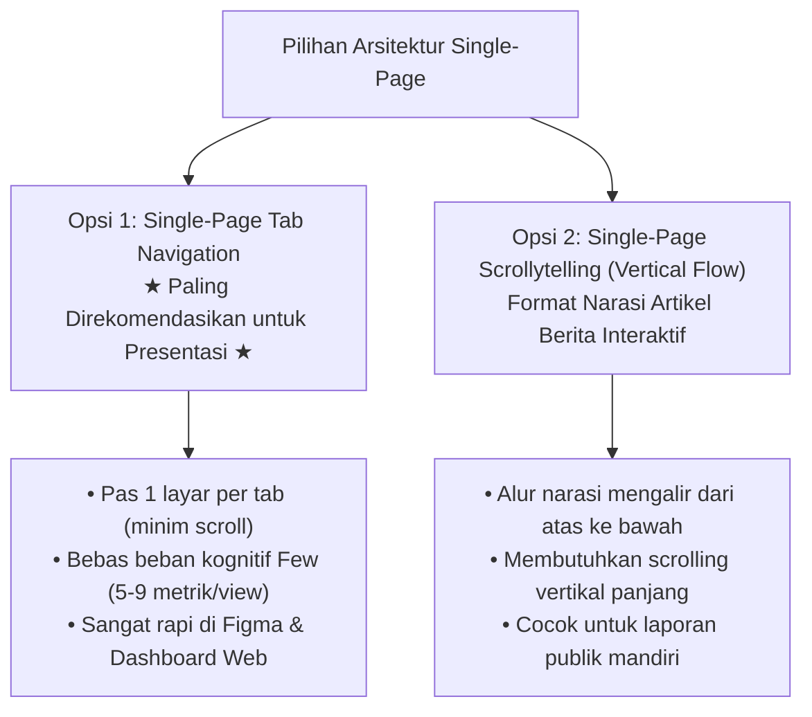

# PovertyRadar SDGs: Desain Dashboard Alternatif Satu Halaman (Single-Page)
## Spesifikasi Desain & Wireframe Terintegrasi untuk Presentasi Data dan Storytelling

**Mata Kuliah:** Presentasi Data dan Storytelling  
**Topik / Tema:** Analisis Multidimensi Kemiskinan Daerah di Indonesia (SDG 1 — *No Poverty*)  
**Judul Produk:** **PovertyRadar SDGs: Sistem Pemetaan Klaster dan Skrining Kerentanan Kemiskinan Daerah Indonesia**  
**Standar Desain:** *Storytelling with Data* (Knaflic) · *Information Dashboard Design* (Few) · *Practical Dashboards* (Desbarats)  
**Versi Dokumen:** 1.0 (Single-Page Alternative) | 28 Oktober 2026  

---

## 1. Visi & Rasionalitas Format Satu Halaman (*Single-Page*)

### 1.1 Mengapa Format Satu Halaman (*Single-Page*)?
Format **Single-Page Dashboard** dirancang untuk menghadirkan pengalaman pengguna (*User Experience*) yang mulus, cepat, dan fokus bagi audiens presentasi:
* **Tanpa Pindah Halaman/URL (*Zero Page Reload*):** Pengguna tidak perlu menunggu aplikasi memuat ulang halaman terpisah.
* **Filter Tetap Aktif (*Persistent Interactive State*):** Pilihan filter (misalnya: filter provinsi atau wilayah kepulauan) tetap tersimpan saat pengguna berpindah antar-babak cerita.
* **Fokus Presentasi Tinggi:** Presenter dapat mendemonstrasikan keseluruhan cerita data dari pengenalan masalah hingga solusi dalam satu kanvas terpadu.

### 1.2 Pilihan Arsitektur Single-Page



> [!TIP]
> **Rekomendasi Utama untuk Mockup & Presentasi Kelas: Opsi 1 (Tab Navigation)**.  
> Opsi Tab mematuhi aturan Stephen Few: setiap tab pas di satu layar (*one viewport*) dengan 5–9 metrik/grafik, tanpa memaksa audiens melakukan scroll panjang saat presentasi di depan dosen.

---

## 2. Tata Letak Global & Wireframe Single-Page Tab

### 2.1 Spesifikasi Kanvas (Desktop First)
* **Target Resolusi:** Desktop Web Viewport standar (**1440 × 900 px** atau **1920 × 1080 px**).
* **Header Tetap (Sticky Topbar):** Memuat Brand Title, Tagline SDG 1, status dataset BPS 2021, dan **Tab Menu Horizontal**.
* **Area Konten (Main Tab Viewport):** Area visualisasi dengan layout grid 12 kolom sejajar, bebas drop-shadow tebal, berlatar netral `#F8FAFC`.

### 2.2 Wireframe Layout Kanvas Utama

```
┌────────────────────────────────────────────────────────────────────────────────────────┐
│  POVERTYRADAR SDGs  |  Pemetaan Klaster & Skrining Kerentanan Daerah Indonesia        │
│  Dataset: BPS 2021 (34 Provinsi / 514 Kab-Kota) • SDG 1: No Poverty                   │
├────────────────────────────────────────────────────────────────────────────────────────┤
│  [1. POVERTY LANDSCAPE] [2. POVERTY & INDICATOR MAP] [3. REGIONAL PROFILES]            │
│  [4. PRIORITY & IMPLICATIONS] [5. METHODOLOGY & DATA QUALITY]                          │
├────────────────────────────────────────────────────────────────────────────────────────┤
│                                                                                        │
│   TOP-LEFT ANCHOR:                                                                     │
│   ┌──────────────────┐ ┌──────────────────┐ ┌──────────────────┐ ┌──────────────────┐  │
│   │ Rata-rata P0     │ │ Titik Terendah   │ │ Titik Tertinggi  │ │ Rasio Disparitas │  │
│   │ 12.3%            │ │ 2.4%             │ │ 41.7%            │ │ 17.5x            │  │
│   │ ▲ +1.8% vs Med.  │ │ Sawahlunto, SB   │ │ Intan Jaya, Pua  │ │ Antartitik Eks.  │  │
│   └──────────────────┘ └──────────────────┘ └──────────────────┘ └──────────────────┘  │
│                                                                                        │
│   ┌─────────────────────────────────────────┐ ┌────────────────────────────────────┐   │
│   │ Visual Kiri:                            │ │ Visual Kanan:                      │   │
│   │ (Peta Koroplet / Small Multiples Bar /  │ │ (Scatter Plot Paradoks Kerja /     │   │
│   │ Jittered Strip Plot Antarpulau)         │ │ Matriks Kuadran Prioritas Tindakan)│   │
│   └─────────────────────────────────────────┘ └────────────────────────────────────┘   │
│                                                                                        │
│   ┌────────────────────────────────────────────────────────────────────────────────┐   │
│   │ 💡 INSIGHT KUNCI: [1-2 Kalimat Padat Menjelaskan Makna Data / Temuan Kunci]    │   │
│   └────────────────────────────────────────────────────────────────────────────────┘   │
│                                                                                        │
│   [Tabel Interaktif Drill-Down / Rincian Kabupaten / Metadata & Keterbatasan]          │
└────────────────────────────────────────────────────────────────────────────────────────┘
```

---

## 3. Detail Konten per Tab (Alur Cerita 5 Babak)

Seluruh konten 5 babak disajikan secara intuitif melalui 5 tab horizontal yang tidak pernah berpindah halaman:

### Tab 1: 🏠 Poverty Landscape (Babak 1: *The Hook*)
* **Pertanyaan Kunci yang Dijawab:** *Apa gambaran kemiskinan pada wilayah yang tercakup dan pola penting apa yang terlihat?*
* **Komponen & Visualisasi:**
  1. **Top-Left Anchor (4 KPI Cards Berkonteks):**
     * *Rata-rata Nasional:* `12.3%` (Benchmark: `▲ +1.8% vs Median Nasional 10.5%`).
     * *Titik Terendah:* `2.4%` (Kota Sawahlunto, Sumatera Barat).
     * *Titik Tertinggi:* `41.7%` (Kabupaten Intan Jaya, Papua — Aksen Merah `#E5243B`).
     * *Rasio Disparitas:* `17.5x` lipat antara daerah terendah dan tertinggi.
  2. **Histogram Distribusi Kemiskinan ($P_0$):** Memperlihatkan sebaran condong ke kanan (*right-skewed*) dengan garis referensi putus-putus tegak di titik Median Nasional (10.5%).
  3. **Jittered Strip Plot (Dot Density) Antarpulau:**  
     Menampilkan 514 titik kabupaten/kota yang dikelompokkan dalam 6 pulau besar dengan garis penanda Median per pulau. Audiens langsung melihat titik-titik Maluku & Papua berkumpul melayang di atas ($>25\%$), sementara titik-titik Kalimantan berjejal padat di bawah ($<10\%$) tanpa bingung rumus boxplot.
  4. **Tabel Interaktif:** Top-10 Daerah Termiskin vs Top-10 Daerah Tersejahtera.

---

### Tab 2: 🗺️ Poverty & Indicator Map (Babak 2: *The Geography*)
* **Pertanyaan Kunci yang Dijawab:** *Di mana pola geografis atau perbedaan indikator paling terlihat?*
* **Komponen & Visualisasi:**
  1. **Filter Kontrol Atas:** Dropdown pemilihan indikator tematik (Kemiskinan $P_0$, Sanitasi, Air Minum, Pendidikan, Pengeluaran, TPAK, TPT) + Filter Pulau.
  2. **Peta Koroplet 34 Provinsi (514 Poligon):** Peta interaktif dengan gradasi warna teratur (*sequential color ramp*). Tooltip menampilkan: *Nama Wilayah, Nilai Indikator, Deviasi vs Median, dan Ranking*.
  3. **Horizontal Bar Chart Komparasi Desa vs Kota:**  
     Menampilkan jurang pemisah dualistik: Kemiskinan Kabupaten (`13.5%`) hampir 2x lipat lebih tinggi dari Kota (`7.2%`), sanitasi kota unggul (`87.9%` vs `74.6%`), namun pengangguran perkotaan lebih tinggi (`7.9%` vs `4.4%`).
  4. **Scatter Plot "Paradoks Ketenagakerjaan":** Sumbu X = TPAK, Sumbu Y = Kemiskinan ($P_0$). Dilengkapi garis tren positif ($r = +0.46$) dan anotasi: *"Di wilayah miskin, partisipasi kerja tinggi karena keharusan bertahan hidup di sektor informal subsistensi."*

---

### Tab 3: 🎯 Regional Profiles (Babak 3: *The Archetypes*)
* **Pertanyaan Kunci yang Dijawab:** *Apa karakteristik setiap kelompok daerah dan apa yang membedakannya?*
* **Komponen & Visualisasi (BEBAS DARI RADAR / SPIDER CHART):**
  1. **Header Evaluasi Model:** Ringkasan hasil *Unsupervised Clustering* murni (*K-Means & Hierarchical*) dengan metrik *Silhouette Score > 0.35*.
  2. **Visual Utama — Small Multiples Horizontal Bar Charts (Z-Score):**  
     Tiga atau empat panel grafik batang kecil berjajar (satu panel per klaster).  
     * Sumbu X = Nilai Standar Deviasi (Z-Score dari -2 s.d. +2).
     * Sumbu Y = 6 Pilar Indikator (Pendidikan, Kesehatan, Sanitasi, Air Minum, Pengeluaran, Ketenagakerjaan).
  3. **Kartu Narasi Arketipe Klaster (Data-Driven Personas):**
     * *Klaster 1: Perkotaan Maju & Berpendidikan Tinggi* (Z-Score positif di pendidikan & sanitasi).
     * *Klaster 2: Pedesaan Agraris Tertinggal Pendidikan* (TPAK tinggi, RLS rendah).
     * *Klaster 3: Wilayah 3T Tertinggal Ekstrem* (Sanitasi & air sangat minim).
  4. **Jittered Strip Plot Validasi ($P_0$ Antarklaster):** Membuktikan secara visual bahwa arketipe sosial-ekonomi yang berbeda menghasilkan konsentrasi kemiskinan aktual ($P_0$) yang berbeda tanpa distorsi *target leakage*.

---

### Tab 4: 🧭 Priority & Implications (Babak 4: *The Call to Action*)
* **Pertanyaan Kunci yang Dijawab:** *Wilayah mana yang layak dianalisis lebih lanjut berdasarkan kondisi yang teramati?*
* **Komponen & Visualisasi:**
  1. **Matriks Kuadran Interaktif 2x2 (Visual Utama):**  
     Scatter plot dua sumbu ortogonal:
     * Sumbu Y = Persentase Kemiskinan Aktual ($P_0$).
     * Sumbu X = Indeks Kerentanan Struktural Relatif (Komposit tertimbang ketertinggalan fasilitas dasar WASH, RLS, UHH).
     * Garis Potong = Dua garis referensi tegas berpotongan di Median Nasional sumbu X dan sumbu Y.
  2. **Pelabelan Langsung 4 Kuadran Kebijakan:**
     * **Kuadran I (Kanan Atas / Aksen Oranye `#D55E00`):** *"Prioritas Kritis (Double Burden)"*. Butuh intervensi infrastruktur dasar sekaligus bantuan sosial darurat.
     * **Kuadran II (Kanan Bawah):** *"Rentan Tersembunyi"*. Kemiskinan saat ini rendah tetapi infrastruktur buruk (rentan jatuh miskin jika terjadi syok).
     * **Kuadran III (Kiri Atas):** *"Kantong Kemiskinan Spesifik"*. Kemiskinan tinggi padahal infrastruktur baik (fokus pada upah dan lapangan kerja).
     * **Kuadran IV (Kiri Bawah):** *"Kondisi Kuat / Resilien"*. Kemiskinan rendah dan kerentanan rendah.
  3. **Panel Detail Wilayah (Side Inspector):** Klik titik pada scatter plot untuk menampilkan kartu profil lengkap kabupaten bersangkutan (peringkat provinsi, nilai indikator, dan kuadran aksi).

---

### Tab 5: 📋 Methodology & Data Quality (Babak 5: *The Integrity*)
* **Pertanyaan Kunci yang Dijawab:** *Bagaimana temuan diperoleh dan apa yang tidak dapat disimpulkan?*
* **Komponen & Visualisasi:**
  1. **Bukti Validasi BPS 2021:** Rekonsiliasi angka riil BPS (Surakarta, Cilacap, Banyumas) dan justifikasi batas 34 provinsi (pra-pemekaran 4 DOB Papua).
  2. **Banner Penegasan "No Classification":**  
     Penjelasan ilmiah mengapa proyek menolak pemodelan klasifikasi terawasi (*No Supervised Classification*) dan membuang kolom label biner bawaan (mencegah *target leakage* dan dikotomi semu 0/1).
  3. **Penjelasan Fakta Lapangan Nilai Nol (0.00%):** Dokumentasi kondisi riil sanitasi Deiyai, air minum Mamberamo Tengah, dan TPT Nduga.
  4. **Analisis Outlier Teknis (Boxplot Tukey 1.5x IQR):** Boxplot statistik dihadirkan secara khusus di tab ini bagi dosen penguji untuk membedah perhitungan batas pencilan 36 daerah secara matematis.
  5. **Tabel Kamus Data & Tombol Unduh Dataset Bersih (`poverty_data_cleaned.csv`).**

---

## 4. Opsi Alternatif 2: Single-Page *Scrollytelling* (Vertical Flow)

Bila rekan tim desainer lebih menyukai format satu kanvas panjang vertikal yang digulir (*continuous scroll*):

```
┌──────────────────────────────────────────────────────────────┐
│  HERO SECTION:                                               │
│  Judul Besar PovertyRadar SDGs + 4 KPI Cards Top-Left Anchor │
├──────────────────────────────────────────────────────────────┤
│  SECTION 1: IKHTISAR & DISPARITAS REGIONAL                   │
│  Histogram Kemiskinan + Jittered Strip Plot 6 Kepulauan      │
├──────────────────────────────────────────────────────────────┤
│  SECTION 2: PETA TEMATIK & JURANG DESA-KOTA                  │
│  Peta Koroplet Indonesia 34P + Bar Chart Kabupaten vs Kota   │
├──────────────────────────────────────────────────────────────┤
│  SECTION 3: MEMBEDAH PROFIL KLASTER SOSIAL-EKONOMI           │
│  Small Multiples Horizontal Bar Charts (Z-Score) per Klaster │
├──────────────────────────────────────────────────────────────┤
│  SECTION 4: MATRIKS SKRINING KUADRAN PRIORITAS TINDAKAN      │
│  Scatter Plot 2x2 (Kemiskinan vs Kerentanan) + Detail Kartu  │
├──────────────────────────────────────────────────────────────┤
│  FOOTER: METODOLOGI, INTEGRITAS BPS 2021, & UNDUH DATA       │
└──────────────────────────────────────────────────────────────┘
```

---

## 5. Panduan Praktis untuk Desainer Mockup di Figma

Jika rekan tim Anda membuat mockup di **Figma / Canva**:
1. **Gunakan 1 Master Frame (Ukuran 1440 × 900 px)**.
2. Tempatkan Header dan **Tab Bar horizontal di bagian atas**.
3. Buat variasi isi kanvas untuk masing-masing tab sebagai **Component Variants** (misal: Variant `Tab = Overview`, Variant `Tab = Map`, Variant `Tab = Clusters`, Variant `Tab = Quadrant`).
4. Pastikan kartu KPI di sudut kiri atas selalu konsisten posisinya.
5. Gunakan palet warna yang telah ditentukan:
   * Background: `#F8FAFC`
   * Surface Card: `#FFFFFF` (border `1px solid #E2E8F0`)
   * Aksen Merah Kritis: `#E5243B` (khusus Kuadran I & wilayah termiskin)
   * Aksen Biru: `#26BDE2`
   * Teks: `#1E293B`

---

## 6. Spesifikasi Teknis & Implementasi (*Tech Stack*) — Diskusi Lebih Lanjut Tim

> [!NOTE]
> **Status: Menunggu Diskusi & Kesepakatan Internal Tim**  
> Penentuan teknologi pengembang (*tech stack*) untuk implementasi dashboard akhir (apakah menggunakan framework Python seperti Streamlit / Dash / Shiny for Python, atau berbasis web modern seperti React / Vue / Next.js dengan D3.js / Plotly / Leaflet) **akan didiskusikan dan disepakati lebih lanjut bersama seluruh anggota tim**, dengan mempertimbangkan:
> 1. **Keahlian & Kenyamanan Tim:** Pembagian peran antara pengolah data (*data science*) dan pengembang antarmuka (*frontend/UI*).
> 2. **Kinerja Peta Geospasial:** Kelancaran rendering 514 poligon kabupaten/kota di 34 provinsi secara interaktif.
> 3. **Interaktivitas State:** Kemudahan sinkronisasi filter antarkomponen (misal filter pulau/provinsi ke scatter kuadran dan kartu detail).
> 4. **Kecepatan Deployment & Demo:** Kemudahan akses saat demonstrasi langsung dan presentasi di hadapan dosen penguji.

