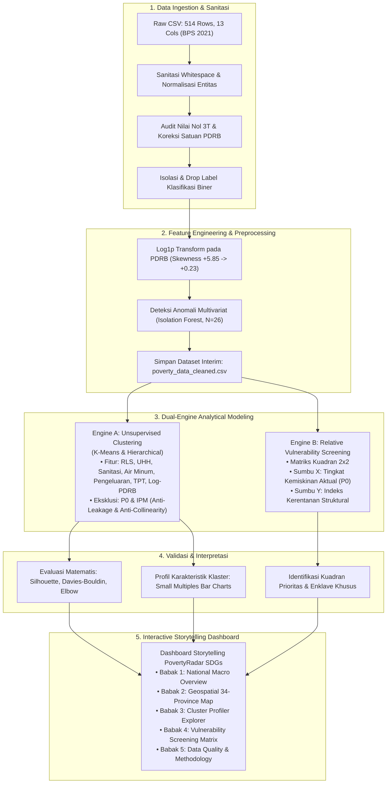
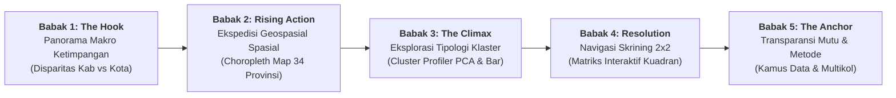

# PovertyRadar SDGs: Problem Framing, Objektif Proyek, dan Arsitektur Analisis

## DOKUMEN PROBLEM FRAMING, OBJEKTIF, & METODOLOGI ANALISIS
**Versi:** 3.0 (Dedicated Problem Framing & Architecture)  
**Tanggal Pembaruan:** 28 Oktober 2026  
**Mata Kuliah:** Presentasi Data dan Storytelling  
**Dataset Utama:** `Klasifikasi Tingkat Kemiskinan di Indonesia.csv` ([Kaggle Dataset oleh ldausl](https://www.kaggle.com/datasets/ldausl/klasifikasi-tingkat-kemiskinan-di-indonesia), BPS 2021)  
**Fokus Metodologis:** Pemetaan Spasial Deskriptif • Unsupervised Profiling Clustering • Skrining Kerentanan Relatif 2x2 • Storytelling Interaktif  
**Dokumen Pendamping:** [`docs/data_audit_and_understanding.md`](file:///d:/ARFI/Kuliah/Project/project-semester5/PovertyRadar/docs/data_audit_and_understanding.md)  

---

## Daftar Isi
1. [Ringkasan Eksekutif & Paradigma Analisis](#1-ringkasan-eksekutif--paradigma-analisis)
   - 1.1 [Penegasan Metodologis: Tanpa Klasifikasi Terawasi (No Supervised Classification)](#11-penegasan-metodologis-tanpa-klasifikasi-terawasi-no-supervised-classification)
   - 1.2 [Keputusan Desain & Perubahan Kerangka Analisis](#12-keputusan-desain--perubahan-kerangka-analisis)
   - 1.3 [Snapshot Integritas Data Lapangan (Terverifikasi)](#13-snapshot-integritas-data-lapangan-terverifikasi)
2. [Konteks Masalah & Latar Belakang SDG 1](#2-konteks-masalah--latar-belakang-sdg-1)
   - 2.1 [Dilema Kebijakan Seragam (One-Size-Fits-All)](#21-dilema-kebijakan-seragam-one-size-fits-all)
   - 2.2 [Kesenjangan Analitis (Analytical Gap)](#22-kesenjangan-analitis-analytical-gap)
3. [Rumusan Masalah, Pertanyaan Riset, & Objektif](#3-rumusan-masalah-pertanyaan-riset--objektif)
   - 3.1 [Rumusan Masalah Utama](#31-rumusan-masalah-utama)
   - 3.2 [Pertanyaan Analitis Kunci](#32-pertanyaan-analitis-kunci)
   - 3.3 [Objektif Umum](#33-objektif-umum)
   - 3.4 [Objektif Khusus](#34-objektif-khusus)
4. [Alur Metodologi Proyek & Ruang Lingkup Sistem](#4-alur-metodologi-proyek--ruang-lingkup-sistem)
   - 4.1 [Diagram Alur Metodologi Proyek](#41-diagram-alur-metodologi-proyek)
   - 4.2 [Batasan Ruang Lingkup (In-Scope vs. Out-of-Scope)](#42-batasan-ruang-lingkup-in-scope-vs-out-of-scope)
   - 4.3 [Kandidat Fitur Clustering Bebas Target Leakage](#43-kandidat-fitur-clustering-bebas-target-leakage)
5. [Konseptualisasi Skrining Kerentanan Struktural Relatif](#5-konseptualisasi-skrining-kerentanan-struktural-relatif)
   - 5.1 [Operasionalisasi Konsep: Kerentanan Relatif vs. Prediksi Risiko](#51-operasionalisasi-konsep-kerentanan-relatif-vs-prediksi-risiko)
   - 5.2 [Matriks Skrining Kuadran 2x2](#52-matriks-skrining-kuadran-2x2)
   - 5.3 [Karakteristik & Arah Kebijakan Empat Kuadran](#53-karakteristik--arah-kebijakan-empat-kuadran)
6. [Protokol Evaluasi & Validasi Model Unsupervised](#6-protokol-evaluasi--validasi-model-unsupervised)
   - 6.1 [Metrik Separasi Matematis](#61-metrik-separasi-matematis)
   - 6.2 [Uji Stabilitas Penugasan Klaster (Multi-Seed Robustness)](#62-uji-stabilitas-penugasan-klaster-multi-seed-robustness)
   - 6.3 [Uji Interpretabilitas Substantif Kebijakan](#63-uji-interpretabilitas-substantif-kebijakan)
7. [Arsitektur Dashboard Storytelling & Standar Visualisasi](#7-arsitektur-dashboard-storytelling--standar-visualisasi)
   - 7.1 [Struktur 5 Babak Naratif (Multi-Page Primary Architecture)](#71-struktur-5-babak-naratif-multi-page-primary-architecture)
   - 7.2 [Pedoman Visualisasi Knaflic & Few (Larangan Radar Chart & Kebijakan Boxplot)](#72-pedoman-visualisasi-knaflic--few-larangan-radar-chart--kebijakan-boxplot)
8. [Status Gerbang Keputusan Pra-Pemodelan (Decision Gates)](#8-status-gerbang-keputusan-pra-pemodelan-decision-gates)
9. [Rujukan Resmi & Berkas Terkait](#9-rujukan-resmi--berkas-terkait)

---

## 1. Ringkasan Eksekutif & Paradigma Analisis

Dokumen ini memformalkan kerangka kerja analitis, perumusan masalah kebijakan, sasaran proyek, dan arsitektur visualisasi untuk platform **PovertyRadar SDGs**. Platform ini dirancang sebagai instrumen eksplorasi analitis dan komunikasi data interaktif yang memetakan variasi struktural sosio-ekonomi 514 kabupaten/kota di Indonesia guna mendukung akselerasi pencapaian **SDG 1 — Tanpa Kemiskinan (*No Poverty*)**.

### 1.1 Penegasan Metodologis: Tanpa Klasifikasi Terawasi (No Supervised Classification)

> [!IMPORTANT]
> **Pernyataan Integritas Metodologi: Proyek Ini TIDAK Melakukan Supervised Classification**  
> Walaupun berkas data mentah bernama `Klasifikasi Tingkat Kemiskinan di Indonesia.csv` dan memuat kolom biner `Klasifikasi Kemiskinan` (0/1), **proyek ini secara tegas TIDAK melatih model klasifikasi terawasi** (seperti Logistic Regression, Decision Tree, Random Forest Classifier, atau Naive Bayes).
> 
> **Tiga Landasan Penolakan Klasifikasi Terawasi:**
> 1. **Pencegahan Penalaran Melingkar (*Circular Reasoning / Target Leakage*):** Memprediksi status kemiskinan dari indikator pengeluaran, pendidikan, dan kesehatan yang merupakan komponen pembentuk garis kemiskinan dan IPM adalah bentuk *leakage* matematis yang tidak menghasilkan wawasan kebijakan baru.
> 2. **Inkonsistensi & Cacat Validitas Label Bawaan:** Kolom label biner bawaan bukan indikator resmi Badan Pusat Statistik (BPS), melainkan hasil penyekatan *ad-hoc* yang terbukti memuat anomali pelabelan di lapangan (lihat audit 7 anomali wilayah pada [`docs/data_audit_and_understanding.md`](file:///d:/ARFI/Kuliah/Project/project-semester5/PovertyRadar/docs/data_audit_and_understanding.md#4-audit-khusus-label-bawaan-klasifikasi-kemiskinan)).
> 3. **Paradigma Solusi Berbasis Profiling:** Solusi kebijakan penanggulangan kemiskinan membutuhkan pemahaman akar ketertinggalan struktural daerah, bukan sekadar prediksi label hitam-putih. Oleh karena itu, fokus analitis diarahkan pada **Unsupervised Profiling Clustering** dan **Matriks Skrining Kerentanan Struktural 2x2**. Kolom label bawaan **dikeluarkan sepenuhnya (*dropped*)**.

---

### 1.2 Keputusan Desain & Perubahan Kerangka Analisis

| Dimensi Komponen | Keputusan Desain yang Ditetapkan | Justifikasi Metodologis & Rekayasa |
| :--- | :--- | :--- |
| **Pemodelan Prediktif** | **Ditiadakan Sepenuhnya.** Tidak ada klasifikasi terawasi maupun regresi peramalan masa depan. | Menghindari ilusi prediktif; dataset merupakan data *cross-section* satu titik waktu (2021) tanpa dimensi runtun waktu (*time series*). |
| **Label Bawaan (0/1)** | **Diabaikan / Dieliminasi dari Seluruh Analisis.** | Label biner memiliki anomali pelabelan di Papua/Papua Barat yang merusak reliabilitas pelatihan algoritma terawasi. |
| **Konsep Risiko Kemiskinan**| **Dioperasionalkan sebagai Skrining Kerentanan Relatif (2x2 Matrix).** | Menghindari klaim keliru bahwa sistem memperkirakan probabilitas masa depan; memposisikan kerentanan sebagai ketertinggalan modal dasar. |
| **Pilar Analisis Utama** | **Unsupervised Clustering Profil Sosio-Ekonomi Daerah.** | Memetakan tipologi daerah (misal: klaster agraris subsisten vs perkotaan padat modal) tanpa menyertakan persentase kemiskinan $P_0$ dalam proses pembentukan klaster. |
| **Luaran Komunikasi** | **Dashboard Interaktif 5 Babak Naratif (Storytelling).** | Menyajikan temuan kompleks secara komunikatif sesuai kaidah Cole Nussbaumer Knaflic dan Stephen Few. |

---

### 1.3 Snapshot Integritas Data Lapangan (Terverifikasi)

Hasil audit komputasi menyeluruh yang dipublikasikan pada [`docs/data_audit_and_understanding.md`](file:///d:/ARFI/Kuliah/Project/project-semester5/PovertyRadar/docs/data_audit_and_understanding.md):

* **Unit Analisis:** 514 kabupaten/kota (413 Kabupaten dan 101 Kota/Kota Administrasi).
* **Cakupan Spasial:** 34 Provinsi (format nasional tahun 2021 sebelum pemekaran Papua).
* **Kelengkapan Nilai:** **0 Missing Values** di seluruh baris dan kolom.
* **Duplikasi Data:** **0 Duplikasi Baris Penuh; 0 Duplikasi Entitas Wilayah.**
* **Tahun Pengamatan:** **Terverifikasi Resmi: Tahun 2021 (BPS)** melalui *cross-check* presisi IPM dan $P_0$ Kota Surakarta (IPM: 82.62, $P_0$: 9.40%), Cilacap (IPM: 70.42, $P_0$: 11.67%), dan Banyumas (IPM: 72.44, $P_0$: 13.66%).
* **Skala Satuan PDRB:** Terverifikasi berskala **Juta Rupiah** (Rp147 miliar di Tambrauw s.d. Rp460 triliun di Jakarta Pusat).

---

## 2. Konteks Masalah & Latar Belakang SDG 1

### 2.1 Dilema Kebijakan Seragam (One-Size-Fits-All)
Upaya penanggulangan kemiskinan di Indonesia sering terhambat oleh generalisasi intervensi program. Seringkali pengambil kebijakan memperlakukan daerah miskin secara seragam hanya berdasarkan persentase kemiskinan headcount index ($P_0$).

Secara faktual, dua daerah dengan tingkat kemiskinan yang identik (misalnya 15%) dapat memiliki konfigurasi struktural yang bertolak belakang:
* **Daerah A (Perdesaan/3T):** Mengalami kemiskinan ekstrem akibat keterisolasian geografis, ketiadaan akses sanitasi dan air minum layak, serta minimnya fasilitas pendidikan formal.
* **Daerah B (Perkotaan/Transisi):** Memiliki infrastruktur dasar yang lengkap dan IPM tinggi, namun warganya miskin akibat rendahnya kapasitas penyerapan tenaga kerja formal, upah riil yang rendah, dan beban biaya hidup yang tinggi.

Penerapan program bantuan sosial tunai standar pada Daerah A tidak akan menyelesaikan akar masalah tanpa pembangunan infrastruktur sanitasi fisik. Sebaliknya, pembangunan fisik pada Daerah B tidak menyentuh masalah pengangguran perkotaan.

### 2.2 Kesenjangan Analitis (Analytical Gap)
Kesenjangan utama yang dijembatani oleh PovertyRadar SDGs adalah:
1. **Ketiadaan Pemisahan Masalah:** Menguraikan angka kemiskinan agregat menjadi dimensi-dimensi penyusunnya (pendidikan, kesehatan, infrastruktur air/sanitasi, dan ketenagakerjaan).
2. **Ketiadaan Tipologi Profil Daerah:** Membentuk kelompok daerah dengan kesamaan karakteristik akar masalah melalui *unsupervised clustering*.
3. **Ketiadaan Instrumen Skrining Intervensi 2 Dimensi:** Menggabungkan status kemiskinan aktual dengan tingkat kerentanan fasilitas dasar dalam matriks kuadran 2x2.

---

## 3. Rumusan Masalah, Pertanyaan Riset, & Objektif

### 3.1 Rumusan Masalah Utama
> *"Bagaimana data indikator kemiskinan dan karakteristik sosial-ekonomi 514 kabupaten/kota di Indonesia tahun 2021 dapat dipetakan secara spasial, dikelompokkan ke dalam tipologi profil struktural melalui unsupervised clustering tanpa target leakage, serta divisualisasikan ke dalam dashboard interaktif yang komunikatif untuk mendukung skrining prioritas intervensi SDG 1 tanpa mengklaim prediksi risiko masa depan?"*

### 3.2 Pertanyaan Analitis Kunci
1. **Distribusi Spasial:** Bagaimana pola sebaran spasial tingkat kemiskinan ($P_0$) antarkabupaten/kota di Indonesia pada tahun referensi 2021?
2. **Korelasi Multidimensi:** Bagaimana pola asosiasi antara modal manusia, derajat kesehatan, akses sanitasi/air minum, skala ekonomi, dan dinamika ketenagakerjaan terhadap kemiskinan?
3. **Tipologi Klaster Murni:** Klaster profil sosial-ekonomi apa yang terbentuk ketika daerah dikelompokkan secara murni tanpa menyertakan variabel kemiskinan $P_0$?
4. **Karakteristik Pembeda:** Apa faktor penentu yang paling membedakan masing-masing klaster dan bagaimana variasi sebaran tingkat kemiskinan ($P_0$) pada masing-masing klaster tersebut?
5. **Skrining Prioritas 2x2:** Wilayah mana saja yang masuk ke dalam kuadran prioritas intervensi mendesak (*High Poverty, High Vulnerability*) vs wilayah kantong kemiskinan khusus (*Enclave Poverty*)?
6. **Validitas & Stabilitas:** Seberapa stabil, teruji, dan mudah diinterpretasikan hasil klasterisasi terhadap perubahan acak (*random seed*)?

### 3.3 Objektif Umum
Mengembangkan **PovertyRadar SDGs** sebagai dashboard interaktif berbasis *data storytelling* untuk memetakan tingkat kemiskinan kabupaten/kota, mengelompokkan profil sosial-ekonomi daerah melalui *unsupervised clustering*, dan menyajikan instrumen skrining kerentanan struktural 2x2 yang transparan dalam rangka mendukung penetapan kebijakan **SDG 1 — Tanpa Kemiskinan**.

### 3.4 Objektif Khusus
1. Melakukan audit integritas teknis, sanitasi data, dan penanganan nilai batas anomali terhadap 514 kabupaten/kota di Indonesia.
2. Mengeksplorasi hubungan statistik bivariat/multivariat dan mendokumentasikan paradoks ketenagakerjaan (korelasi positif TPAK dan korelasi negatif TPT).
3. Membangun model *unsupervised clustering* (K-Means dan Hierarchical Clustering) menggunakan indikator sosial-ekonomi terstandardisasi bebas *target leakage*.
4. Mengevaluasi kualitas pemodelan klaster secara matematis (*Silhouette Score*, *Davies-Bouldin Index*, *Elbow Method*) dan menyusun profil visual komparatif antarklaster.
5. Merancang instrumen skrining dua dimensi ($P_0$ aktual vs Indeks Kerentanan Struktural Relatif) ke dalam matriks kuadran 2x2.
6. Menyajikan hasil analisis melalui dashboard interaktif lengkap dengan peta tematik 34 provinsi, filter multi-level, visualisasi komparatif bebas *radar chart*, dan transparansi metodologi.

---

## 4. Alur Metodologi Proyek & Ruang Lingkup Sistem

### 4.1 Diagram Alur Metodologi Proyek



---

### 4.2 Batasan Ruang Lingkup (In-Scope vs. Out-of-Scope)

| Termasuk dalam Ruang Lingkup (In-Scope) | Di Luar Ruang Lingkup Proyek (Out-of-Scope) |
| :--- | :--- |
| Pemetaan spasial deskriptif tingkat kemiskinan ($P_0$) dan indikator sosial-ekonomi 2021. | **Pemodelan klasifikasi terawasi (*Supervised Classification*)** seperti Logistic Regression, Decision Tree, Random Forest, SVM. |
| Deteksi anomali multivariat berbasis *Isolation Forest* dan proyeksi PCA 2D. | Prediksi deret waktu atau peramalan kemiskinan tahun berikutnya (*Time Series Forecasting*). |
| *Unsupervised clustering* tipologi daerah menggunakan algoritma K-Means & Hierarchical. | Klaim sebab-akibat deterministik (*Causal Inference*). |
| Skrining kerentanan struktural relatif berbasis matriks kuadran 2x2 transparan. | Pengambilan keputusan alokasi anggaran otomatis tanpa telaah manusia. |
| Dashboard interaktif dengan struktur narasi 5 babak (*Freytag's Pyramid*). | Penggunaan label klasifikasi biner bawaan `Klasifikasi Kemiskinan`. |
| Evaluasi komparatif tingkat kemiskinan kontinu ($P_0$) antarklaster. | Penggunaan visualisasi *Radar / Spider Chart* yang mendistorsi persepsi data. |

---

### 4.3 Kandidat Fitur Clustering Bebas Target Leakage

Untuk mencegah bias dan penipuan evaluasi (*data leakage*), variabel dibagi secara tegas:

| Nama Indikator | Peran dalam Pemodelan | Justifikasi Metodologis & Konsep |
| :--- | :---: | :--- |
| `Rata-rata Lama Sekolah` | **Fitur Utama Clustering** | Modal manusia dan kapasitas kognitif tenaga kerja (SDG 4). |
| `Umur Harapan Hidup` | **Fitur Utama Clustering** | Derajat kesehatan dasar dan ketahanan fisik masyarakat (SDG 3). |
| `Akses Sanitasi Layak` | **Fitur Utama Clustering** | Kelayakan sanitasi lingkungan hunian (SDG 6). |
| `Akses Air Minum Layak` | **Fitur Utama Clustering** | Ketersediaan kebutuhan hidup pokok terlindung (SDG 6). |
| `Pengeluaran per Kapita` | **Fitur Utama Clustering** | Proksi daya beli riil per kapita masyarakat. |
| `Tingkat Pengangguran (TPT)` | **Fitur Utama Clustering** | Efisiensi penyerapan angkatan kerja formal (SDG 8). |
| `Partisipasi Kerja (TPAK)` | **Fitur Tambahan / Eksplorasi** | Karakteristik struktur ketenagakerjaan (formal vs informal). |
| `Log1p(PDRB Harga Konstan)` | **Fitur Tambahan (Scaled)** | Skala kapasitas ekonomi makro daerah setelah normalisasi logaritmik. |
| `Indeks Pembangunan Manusia` | **Variabel Konteks / Evaluasi Eksternal** | **Dikeluarkan dari fitur clustering** untuk menghindari *double-counting* akibat multikolinearitas tinggi ($r > 0.86$) dengan RLS, UHH, dan Pengeluaran. |
| `Persentase Kemiskinan (P0)` | **Variabel Pembanding Pasca-Klaster** | **Dikeluarkan dari fitur clustering** untuk mencegah *circular reasoning*; digunakan untuk membandingkan sebaran kemiskinan antar-klaster. |
| `Klasifikasi Kemiskinan` | **Dieliminasi Sepenuhnya** | Label biner buatan non-resmi yang memiliki inkonsistensi ambang batas. |

---

## 5. Konseptualisasi Skrining Kerentanan Struktural Relatif

### 5.1 Operasionalisasi Konsep: Kerentanan Relatif vs. Prediksi Risiko
PovertyRadar SDGs secara tegas membedakan istilah **"risiko"** dari **prediksi probabilitas masa depan**:
* **Bukan Prediksi:** Sistem tidak menghitung probabilitas bahwa suatu daerah akan menjadi miskin di masa depan, karena dataset tidak memiliki data longitudinal/historis.
* **Skrining Kerentanan Relatif:** Sistem mengukur **kerentanan fondasi struktural** saat ini berdasarkan defisit pada indikator fasilitas dasar (sanitasi, air minum), modal manusia (lama sekolah), dan kesehatan.

### 5.2 Matriks Skrining Kuadran 2x2

Matriks skrining memadukan dua dimensi independen pada bidang kartesius:
* **Sumbu X (Tingkat Kemiskinan Aktual $P_0$):** Persentase penduduk miskin resmi BPS 2021 (garis batas: median nasional = $10.46\%$).
* **Sumbu Y (Indeks Kerentanan Struktural $V_{\text{struc}}$):** Skor komposit tertimbang dari defisit fasilitas sanitasi, air bersih, RLS, dan UHH (garis batas: median indeks).

```text
                  Indeks Kerentanan Struktural (Tinggi)
                                    ▲
                                    │
           KUADRAN II               │              KUADRAN I
   (Potensi Rentan Tersembunyi)     │          (Prioritas Utama)
   P0 Rendah, Kerentanan Tinggi     │      P0 Tinggi, Kerentanan Tinggi
                                    │
────────────────────────────────────┼────────────────────────────────────► Tingkat Kemiskinan
                                    │                                      Aktual (P0)
           KUADRAN IV               │             KUADRAN III
       (Kondisi Tangguh)            │       (Kantong Kemiskinan / Enklave)
   P0 Rendah, Kerentanan Rendah     │      P0 Tinggi, Kerentanan Rendah
                                    │
                                    ▼
                  Indeks Kerentanan Struktural (Rendah)
```

### 5.3 Karakteristik & Arah Kebijakan Empat Kuadran

1. **Kuadran I — Prioritas Utama (*High Poverty, High Vulnerability*):**
   * *Karakteristik:* Daerah mengalami kemiskinan ekonomi parah sekaligus ketertinggalan fasilitas dasar dan modal manusia yang kritis (mayoritas wilayah 3T di Papua, Papua Barat, dan NTT).
   * *Arah Kebijakan:* Intervensi terpadu komprehensif (bantuan sosial langsung dibarengi percepatan infrastruktur air/sanitasi dan fasilitas pendidikan).
2. **Kuadran II — Kerentanan Tersembunyi (*Low Poverty, High Vulnerability*):**
   * *Karakteristik:* Angka kemiskinan saat ini relatif rendah, namun fondasi infrastruktur dasar dan pendidikannya sangat rapuh.
   * *Arah Kebijakan:* Pembangunan infrastruktur dasar preventif guna mencegah kerentanan jatuh miskin saat terjadi syok ekonomi atau bencana.
3. **Kuadran III — Kantong Kemiskinan Daya Beli (*High Poverty, Low Vulnerability*):**
   * *Karakteristik:* Fasilitas dasar dan mutu modal manusia memadai, namun tingkat kemiskinan tetap tinggi akibat keterbatasan daya beli dan pasar kerja formal.
   * *Arah Kebijakan:* Reformasi pasar tenaga kerja, peningkatan produktivitas industri lokal, dan penciptaan lapangan kerja formal bernilai tambah.
4. **Kuadran IV — Wilayah Terbina/Mapan (*Low Poverty, Low Vulnerability*):**
   * *Karakteristik:* Kemiskinan rendah dan infrastruktur dasar kuat (mayoritas kota-kota besar di Jawa dan pusat ekonomi regional).
   * *Arah Kebijakan:* Menjaga stabilitas ekonomi dan dijadikan percontohan (*benchmarking*) tata kelola bagi daerah lain.

---

## 6. Protokol Evaluasi & Validasi Model Unsupervised

### 6.1 Metrik Separasi Matematis
Kualitas pemodelan klaster dinilai melalui kriteria matematis kuantitatif:
1. **Silhouette Coefficient:** Mengukur seberapa dekat suatu titik dengan titik di klasternya dibandingkan dengan titik di klaster tetangga. Target skor rata-rata $> 0.35$ (mengingat kompleksitas multidimensi data sosio-ekonomi riil).
2. **Davies-Bouldin Index (DBI):** Mengukur rasio jarak dalam klaster terhadap jarak antarklaster. Nilai yang lebih rendah mengindikasikan klaster yang lebih kompak dan terpisah dengan baik.
3. **Calinski-Harabasz Index (Variance Ratio Criterion):** Mengukur rasio dispersi antarklaster terhadap dispersi dalam klaster. Nilai yang lebih tinggi menandakan pemisahan yang lebih tegas.
4. **Elbow Method (Inertia):** Digunakan untuk mengidentifikasi titik belok penurunan *Within-Cluster Sum of Squares* (WCSS) guna memvalidasi jumlah $k$ optimal.

### 6.2 Uji Stabilitas Penugasan Klaster (Multi-Seed Robustness)
Untuk memastikan klaster yang terbentuk bukan merupakan artefak acak:
* Algoritma K-Means diuji dengan 10 inisialisasi *random seed* berbeda (`random_state` dari 1 hingga 10).
* Dihitung *Adjusted Rand Index* (ARI) antar-penugasan klaster; stabilitas diterima jika rata-rata ARI $> 0.85$.

### 6.3 Uji Interpretabilitas Substantif Kebijakan
Model klaster dengan metrik matematis tertinggi belum tentu merupakan model terbaik jika hasilnya tidak memiliki makna substantif. Setiap klaster yang terbentuk harus memiliki ciri khas pembeda yang logis secara ekonomi, yang disajikan melalui grafik batang komparatif (*Small Multiples Bar Charts*).

---

## 7. Arsitektur Dashboard Storytelling & Standar Visualisasi

### 7.1 Struktur 5 Babak Naratif (Multi-Page Primary Architecture)

Sesuai spesifikasi pada [`docs/design.md`](file:///d:/ARFI/Kuliah/Project/project-semester5/PovertyRadar/docs/design.md), dashboard interaktif disusun mengikuti busur narasi dramatik 5 babak (*Freytag's Pyramid*):



1. **Halaman 1: Poverty Landscape (*The Hook / Context*):**
   * *Pertanyaan Kunci yang Dijawab:* Apa gambaran kemiskinan pada wilayah yang tercakup dan pola penting apa yang terlihat?
   * *KPI Banner:* Rata-rata kemiskinan nasional (10.46%), rentang kemiskinan (2.38% s.d. 41.66%), total 514 wilayah.
   * *Visualisasi Utama:* Dual-Facet Strip Plot memperlihatkan jurang struktural antara Kabupaten ($13.51\%$) dan Kota ($7.22\%$).
2. **Halaman 2: Poverty & Indicator Map (*Rising Action*):**
   * *Pertanyaan Kunci yang Dijawab:* Di mana pola geografis atau perbedaan indikator paling terlihat?
   * *Peta Tematik Interaktif:* Choropleth Map 34 provinsi dengan kontrol filter indikator sosial-ekonomi dan pencarian wilayah.
   * *Narasi Tematik:* Mengungkap ketimpangan regional barat (Kalimantan $6.30\%$) vs timur (Maluku & Papua $23.31\%$).
3. **Halaman 3: Regional Profiles (*The Core Discovery / Climax*):**
   * *Pertanyaan Kunci yang Dijawab:* Apa karakteristik setiap kelompok daerah dan apa yang membedakannya?
   * *Visualisasi Profil Klaster:* **Small Multiples Bar Charts** atau **Heatmap Matrix** yang memperlihatkan profil z-score per indikator untuk tiap klaster (bebas radar chart).
   * *Sebaran Kemiskinan Antarklaster:* Jittered Strip Plot dengan median kemiskinan per klaster.
4. **Halaman 4: Priority & Implications (*Falling Action / Resolution*):**
   * *Pertanyaan Kunci yang Dijawab:* Wilayah mana yang layak dianalisis lebih lanjut berdasarkan kondisi yang teramati?
   * *Matriks Interaktif Kuadran 2x2:* Bidang interaktif $P_0$ vs Indeks Kerentanan Struktural.
   * *Tabel Drill-Down:* Pencarian interaktif kabupaten/kota prioritas beserta kartu profil intervensi dan batas interpretasi.
5. **Halaman 5: Methodology & Data Quality (*The Anchor / Epilogue*):**
   * *Pertanyaan Kunci yang Dijawab:* Bagaimana temuan diperoleh dan apa yang tidak dapat disimpulkan?
   * Dokumentasi kamus data, verifikasi tahun BPS 2021, penanganan anomali 3T, visualisasi korelasi multikolinearitas, dan batasan interpretasi model.

### 7.2 Pedoman Visualisasi Knaflic & Few (Larangan Radar Chart & Kebijakan Boxplot)

Berdasarkan pedoman visualisasi data pada [`dashboard_guide.md`](file:///d:/ARFI/Kuliah/Project/project-semester5/PovertyRadar/dashboard_guide.md):

> [!CAUTION]
> **Larangan Mutlak Penggunaan Radar / Spider Chart:**  
> Radar chart **dilarang keras** untuk menyajikan perbandingan profil klaster sosial-ekonomi.  
> **Alasan Ilmiah:** Radar chart menciptakan ilusi luas poligon buatan yang bergantung pada urutan variabel di sumbu radial, menyulitkan perbandingan nilai antarklaster, dan mendistorsi persepsi audiens non-teknis.  
> **Alternatif Wajib:** Gunakan **Small Multiples Bar Charts** yang diurutkan secara konsisten atau **Heatmap Matrix** dengan skala warna seragam.

> [!NOTE]
> **Kebijakan Penggunaan Boxplot:**  
> Boxplot **tidak digunakan pada layar utama narasi publik/storytelling** karena sering disalahpahami oleh audiens umum.  
> **Alternatif Wajib:** Gunakan **Jittered Strip Plot** yang dilengkapi penanda garis median untuk memperlihatkan distribusi titik data riil 514 daerah. Boxplot hanya diizinkan di Babak 5 (Metodologi Teknis).

* **Aksesibilitas Warna (Okabe-Ito Colorblind-Safe Palette):**
  * Biru Tua (`#0072B2`): Layanan Dasar, Standar Hidup Layak, & Klaster Maju.
  * Oranye Kejora (`#D55E00`): Tingkat Kemiskinan Tinggi, Kuadran Prioritas, & Indikator Risiko.
  * Abu-abu Netral (`#999999`): Latar belakang dan elemen perbandingan pasif.

---

## 8. Status Gerbang Keputusan Pra-Pemodelan (Decision Gates)

Seluruh gerbang keputusan metodologis telah diaudit dan diselesaikan:

| Gerbang Keputusan Pra-Modeling | Status Verifikasi | Hasil Tindakan & Bukti Faktual |
| :--- | :---: | :--- |
| **1. Verifikasi Periode Tahun Data** | **SELESAI (RESOLVED)** | Terverifikasi data resmi BPS Tahun 2021 (pencocokan Surakarta, Cilacap, Banyumas). |
| **2. Verifikasi Skala & Satuan PDRB** | **SELESAI (RESOLVED)** | Terverifikasi berskala Juta Rupiah. Transformasi $\log(1+x)$ sukses menekan skewness menjadi +0.23. |
| **3. Verifikasi Nilai Batas Nol (0.00%)**| **SELESAI (RESOLVED)** | Terverifikasi sebagai kondisi faktual lapangan 3T Papua (Deiyai, Mamberamo Tengah, Nduga). |
| **4. Isolasi Label Klasifikasi Biner** | **SELESAI (RESOLVED)** | Label biner resmi dikeluarkan dari pipeline untuk mencegah *target leakage*. |
| **5. Preprocessing & Sanitasi Data** | **SELESAI (RESOLVED)** | Dataset interim bersih diekspor ke [`data/interim/poverty_data_cleaned.csv`](file:///d:/ARFI/Kuliah/Project/project-semester5/PovertyRadar/data/interim/poverty_data_cleaned.csv). |
| **6. Deteksi Anomali Multivariat** | **SELESAI (RESOLVED)** | 26 daerah terisolasi via *Isolation Forest* dan ditandai tanpa menghapus baris data. |

---

## 9. Luaran Utama & Kriteria Penerimaan Proyek (*Acceptance Criteria*)

### 9.1 Luaran Utama (Deliverables)
1. **Explanatory Dashboard Interaktif PovertyRadar SDGs** dengan alur cerita terarah dan visualisasi pendukung.
2. **Notebook Analisis Idempoten & Terdokumentasi** (`notebooks/01_data_audit_and_understanding.ipynb`) yang dapat dieksekusi ulang tanpa error.
3. **Dataset Terstandar & Hasil Klasterisasi** (`data/interim/poverty_data_cleaned.csv` dan `data/processed/poverty_clusters.csv`).
4. **Dokumentasi Metodologi & Kontrak Data** (`docs/`).

### 9.2 Kriteria Penerimaan (Acceptance Criteria)
Sesuai rujukan resmi *Problem Framing & Objektif Explanatory Dashboard*:
* **Konsistensi Data Penuh:** Statistik dan visualisasi dashboard wajib konsisten dengan file analisis olahan; jumlah observasi (514) dan wilayah yang tidak terpetakan (jika ada nama mismatch GeoJSON) wajib dilaporkan secara eksplisit (*zero silent drops*).
* **Transparansi Metodologi Pipeline:** Daftar fitur, cara preprocessing, pemilihan jumlah cluster, dan metrik evaluasi matematis terdokumentasi lengkap.
* **Penamaan Klaster Berbasis Bukti (Data-Driven Personas):** Klaster diberi interpretasi berdasarkan profil empiris hasil analisis, bukan nama praduga yang ditetapkan sebelum pemodelan.
* **Transparansi Kriteria Skrining:** Setiap penandaan wilayah pada matriks kuadran skrining dapat dijelaskan secara logis dari indikator dan kriteria yang ditampilkan (bukan model *black-box*).
* **Kredibilitas Batasan:** Periode data resmi BPS 2021, sumber data Kaggle ldausl, definisi variabel, dan batas interpretasi (non-prediktif) dicantumkan dengan jelas.

---

## 10. Rujukan Resmi & Berkas Terkait

1. **Publikasi Data Sumber:** Ldausl / Ermila, *Klasifikasi Tingkat Kemiskinan di Indonesia*, Repositori Publik Kaggle: [kaggle.com/datasets/ldausl/klasifikasi-tingkat-kemiskinan-di-indonesia](https://www.kaggle.com/datasets/ldausl/klasifikasi-tingkat-kemiskinan-di-indonesia).
2. **Badan Pusat Statistik (BPS) RI:** *Indikator Kemiskinan dan Pembangunan Manusia Kabupaten/Kota Tahun 2021*, Metadata Sistem Rujukan Statistik (SIRUSA) BPS RI.
3. **Pustaka Prinsip Desain:**
   * Knaflic, C. N. (2015). *Storytelling with Data: A Data Visualization Guide for Business Professionals*. Wiley.
   * Few, S. (2006). *Information Dashboard Design: The Effective Visual Communication of Data*. O'Reilly.
4. **Dokumen & Artefak Terkait di Repositori:**
   * Laporan Audit Data & Karakteristik Statistik: [`docs/data_audit_and_understanding.md`](file:///d:/ARFI/Kuliah/Project/project-semester5/PovertyRadar/docs/data_audit_and_understanding.md)
   * Kamus Data & Catatan Kualitas: [`data/README.md`](file:///d:/ARFI/Kuliah/Project/project-semester5/PovertyRadar/data/README.md)
   * Notebook Audit & Preprocessing: [`notebooks/01_data_audit_and_understanding.ipynb`](file:///d:/ARFI/Kuliah/Project/project-semester5/PovertyRadar/notebooks/01_data_audit_and_understanding.ipynb)
   * Dataset Interim Terstandar: [`data/interim/poverty_data_cleaned.csv`](file:///d:/ARFI/Kuliah/Project/project-semester5/PovertyRadar/data/interim/poverty_data_cleaned.csv)
   * Desain Dashboard Storytelling 5 Babak: [`docs/design.md`](file:///d:/ARFI/Kuliah/Project/project-semester5/PovertyRadar/docs/design.md)
   * Panduan Visualisasi Data: [`dashboard_guide.md`](file:///d:/ARFI/Kuliah/Project/project-semester5/PovertyRadar/dashboard_guide.md)

