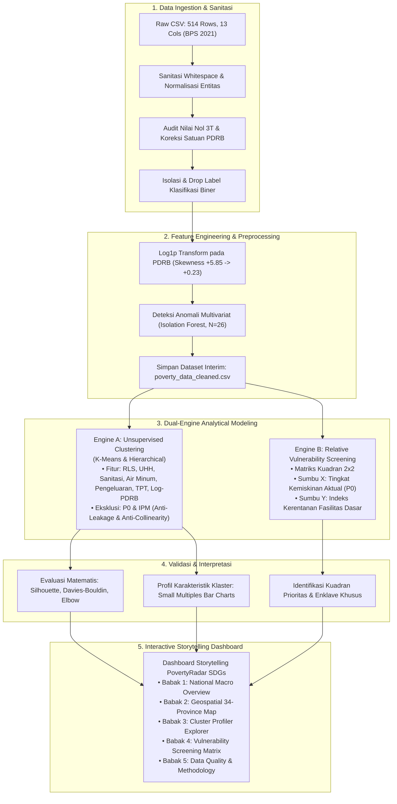

# PovertyRadar SDGs: Problem Framing, Objektif Proyek, dan Arsitektur Analisis

## DOKUMEN PROBLEM FRAMING, OBJEKTIF, & METODOLOGI ANALISIS
**Versi:** 4.0 (Consolidated Problem Framing & Architecture) | 31 Oktober 2026  
**Mata Kuliah:** Presentasi Data dan Storytelling  
**Dataset Utama:** `Klasifikasi Tingkat Kemiskinan di Indonesia.csv` ([Kaggle Dataset oleh ldausl](https://www.kaggle.com/datasets/ldausl/klasifikasi-tingkat-kemiskinan-di-indonesia), BPS 2021)  
**Fokus Metodologis:** Pemetaan Spasial Deskriptif • Unsupervised Profiling Clustering • Skrining Kerentanan Relatif 2x2 • Storytelling Interaktif  
**Dokumen Terkait:** [`docs/data_audit_and_understanding.md`](file:///d:/ARFI/Kuliah/Project/project-semester5/PovertyRadar/docs/data_audit_and_understanding.md) • [`docs/clustering_protocol.md`](file:///d:/ARFI/Kuliah/Project/project-semester5/PovertyRadar/docs/clustering_protocol.md) • [`docs/design.md`](file:///d:/ARFI/Kuliah/Project/project-semester5/PovertyRadar/docs/design.md) • [`docs/02-desain-rekomendasi-kebijakan-berbasis-clustering-povertyradar.md`](file:///d:/ARFI/Kuliah/Project/project-semester5/PovertyRadar/docs/02-desain-rekomendasi-kebijakan-berbasis-clustering-povertyradar.md)  

---

## Daftar Isi
1. [Ringkasan Eksekutif & Paradigma Analisis](#1-ringkasan-eksekutif--paradigma-analisis)
2. [Konteks Masalah & Latar Belakang SDG 1](#2-konteks-masalah--latar-belakang-sdg-1)
3. [Rumusan Masalah, Pertanyaan Riset, & Objektif](#3-rumusan-masalah-pertanyaan-riset--objektif)
4. [Alur Metodologi Proyek & Ruang Lingkup Sistem](#4-alur-metodologi-proyek--ruang-lingkup-sistem)
5. [Konseptualisasi Skrining Kerentanan Struktural Relatif](#5-konseptualisasi-skrining-kerentanan-struktural-relatif)
6. [Protokol Evaluasi & Validasi Model Unsupervised](#6-protokol-evaluasi--validasi-model-unsupervised)
7. [Arsitektur Dashboard Storytelling & Standar Visualisasi](#7-arsitektur-dashboard-storytelling--standar-visualisasi)
8. [Status Gerbang Keputusan Pra-Pemodelan (Decision Gates)](#8-status-gerbang-keputusan-pra-pemodelan-decision-gates)
9. [Luaran Utama & Kriteria Penerimaan Proyek](#9-luaran-utama--kriteria-penerimaan-proyek-acceptance-criteria)
10. [Rujukan Resmi & Berkas Terkait](#10-rujukan-resmi--berkas-terkait)

---

## 1. Ringkasan Eksekutif & Paradigma Analisis

Dokumen ini memformalkan kerangka kerja analitis, perumusan masalah kebijakan, sasaran proyek, dan arsitektur visualisasi untuk platform **PovertyRadar SDGs**. Platform ini dirancang sebagai instrumen eksplorasi analitis dan komunikasi data interaktif yang memetakan variasi struktural sosio-ekonomi 514 kabupaten/kota di Indonesia guna mendukung akselerasi pencapaian **SDG 1 — Tanpa Kemiskinan (*No Poverty*)**.

### 1.1 Penegasan Metodologis: Tanpa Klasifikasi Terawasi (No Supervised Classification)

> [!IMPORTANT]
> **Pernyataan Integritas Metodologi: Proyek Ini TIDAK Melakukan Supervised Classification**  
> Walaupun berkas data mentah bernama `Klasifikasi Tingkat Kemiskinan di Indonesia.csv` dan memuat kolom biner `Klasifikasi Kemiskinan` (0/1), **proyek ini secara tegas TIDAK melatih model klasifikasi terawasi** (seperti Logistic Regression, Decision Tree, Random Forest Classifier, atau Naive Bayes).
> 
> **Tiga Landasan Penolakan Klasifikasi Terawasi:**
> 1. **Pencegahan Penalaran Melingkar (*Circular Reasoning / Target Leakage*):** Memprediksi status kemiskinan dari indikator pengeluaran, pendidikan, dan kesehatan yang merupakan komponen pembentuk garis kemiskinan dan IPM adalah bentuk *leakage* matematis yang tidak menghasilkan wawasan kebijakan baru.
> 2. **Inkonsistensi & Cacat Validitas Label Bawaan:** Kolom label biner bawaan bukan indikator resmi Badan Pusat Statistik (BPS), melainkan hasil penyekatan *ad-hoc* yang terbukti memuat anomali pelabelan di lapangan.
> 3. **Paradigma Solusi Berbasis Profiling:** Solusi kebijakan penanggulangan kemiskinan membutuhkan pemahaman konfigurasi defisit fasilitas dasar daerah, bukan sekadar prediksi label hitam-putih. Oleh karena itu, fokus analitis diarahkan pada **Unsupervised Profiling Clustering** dan **Matriks Skrining Kerentanan Struktural 2x2**. Kolom label bawaan **dikeluarkan sepenuhnya (*dropped*)**.

### 1.2 Keputusan Desain & Perubahan Kerangka Analisis
1. Mengubah orientasi proyek dari "klasifikasi biner semu" menjadi **eksplorasi tipologi sosio-ekonomi multidimensi**.
2. Mengisolasi variabel $P_0$ (Persentase Penduduk Miskin) dari proses klastering agar dapat digunakan sebagai variabel evaluasi eksternal independen (*unbiased benchmark*).
3. Menerapkan matriks skrining 2x2 yang memadukan dimensi kemiskinan moneter aktual ($P_0$) dengan Indeks Kerentanan Fasilitas Dasar ($V_{\text{struc}}$).

### 1.3 Snapshot Integritas Data Lapangan (Terverifikasi)
* **Jumlah Observasi:** Tepat 514 baris kabupaten/kota di 34 provinsi (kondisi administrasi BPS 2021).
* **Missing Values & Duplikasi:** 0 missing values (100% lengkap) dan 0 baris duplikat.
* **Tingkat Kemiskinan Moneter ($P_0$):** Rerata nasional $12.32\%$, median $10.46\%$, rentang $2.38\%$ (Sawahlunto) s.d. $41.66\%$ (Intan Jaya).

---

## 2. Konteks Masalah & Latar Belakang SDG 1

### 2.1 Dilema Kebijakan Seragam (One-Size-Fits-All)
Penanganan kemiskinan di Indonesia kerap terbentur pada kebijakan yang disamaratakan (*blanket policy*). Padahal, daerah dengan tingkat kemiskinan setara sering kali memiliki kendala mendasar yang bertolak belakang:
* Suatu daerah mungkin miskin karena **defisit infrastruktur fisik dasar** (ketiadaan akses air minum dan sanitasi di daerah 3T).
* Daerah lain mungkin memiliki fasilitas dasar memadai, namun miskin karena **ketiadaan lapangan kerja formal bernilai tambah** (kantong kemiskinan agraris/daya beli).

### 2.2 Kesenjangan Analitis (Analytical Gap)
PovertyRadar SDGs hadir untuk menjembatani 3 kesenjangan:
1. Mengurai angka kemiskinan agregat menjadi dimensi-dimensi penyusunnya (pendidikan, kesehatan, sanitasi, air minum, pengeluaran, ketenagakerjaan).
2. Membentuk tipologi profil daerah melalui *unsupervised clustering* murni tanpa target leakage.
3. Menyediakan instrumen skrining 2 dimensi ($P_0$ vs Kerentanan Fasilitas Dasar) yang transparan dan dapat ditindaklanjuti.

---

## 3. Rumusan Masalah, Pertanyaan Riset, & Objektif

### 3.1 Rumusan Masalah Utama
> *"Bagaimana data indikator kemiskinan dan karakteristik sosial-ekonomi 514 kabupaten/kota di Indonesia tahun 2021 dapat dipetakan secara spasial, dikelompokkan ke dalam tipologi profil struktural melalui unsupervised clustering tanpa target leakage, serta divisualisasikan ke dalam dashboard interaktif yang komunikatif untuk mendukung skrining prioritas intervensi SDG 1 tanpa mengklaim prediksi risiko masa depan?"*

### 3.2 Pertanyaan Analitis Kunci
1. **Distribusi Spasial:** Bagaimana pola sebaran spasial tingkat kemiskinan ($P_0$) antarkabupaten/kota di Indonesia pada tahun referensi 2021?
2. **Korelasi Multidimensi:** Bagaimana pola asosiasi antara modal manusia, derajat kesehatan, akses sanitasi/air minum, skala ekonomi, dan dinamika ketenagakerjaan terhadap kemiskinan?
3. **Tipologi Klaster Murni:** Klaster profil sosial-ekonomi apa yang terbentuk ketika daerah dikelompokkan secara murni tanpa menyertakan variabel kemiskinan $P_0$?
4. **Karakteristik Pembeda:** Apa faktor penentu yang paling membedakan masing-masing klaster dan bagaimana variasi sebaran tingkat kemiskinan ($P_0$) pada masing-masing klaster tersebut?
5. **Skrining Prioritas 2x2:** Wilayah mana saja yang masuk ke dalam kuadran prioritas intervensi mendesak (*Prioritas Utama*) vs wilayah kantong kemiskinan daya beli (*Enclave*)?
6. **Validitas & Stabilitas:** Seberapa stabil, teruji, dan mudah diinterpretasikan hasil klasterisasi terhadap perubahan acak (*random seed*)?

### 3.3 Objektif Umum & Khusus
Mengembangkan **PovertyRadar SDGs** sebagai dashboard interaktif berbasis *data storytelling* untuk memetakan tingkat kemiskinan kabupaten/kota, mengelompokkan profil sosial-ekonomi daerah melalui *unsupervised clustering*, dan menyajikan instrumen skrining kerentanan struktural 2x2 yang transparan dalam rangka mendukung penetapan kebijakan **SDG 1 — Tanpa Kemiskinan**.

---

## 4. Alur Metodologi Proyek & Ruang Lingkup Sistem

### 4.1 Diagram Alur Metodologi Proyek



### 4.2 Batasan Ruang Lingkup (In-Scope vs. Out-of-Scope)

| Termasuk dalam Ruang Lingkup (In-Scope) | Di Luar Ruang Lingkup Proyek (Out-of-Scope) |
| :--- | :--- |
| Pemetaan spasial deskriptif tingkat kemiskinan ($P_0$) dan indikator sosial-ekonomi 2021. | **Pemodelan klasifikasi terawasi (*Supervised Classification*)** seperti Logistic Regression, Decision Tree, Random Forest, SVM. |
| Deteksi anomali multivariat berbasis *Isolation Forest* dan proyeksi PCA 2D. | Prediksi deret waktu atau peramalan kemiskinan tahun berikutnya (*Time Series Forecasting*). |
| *Unsupervised clustering* tipologi daerah menggunakan algoritma K-Means & Hierarchical. | Klaim sebab-akibat deterministik (*Causal Inference*). |
| Skrining kerentanan fasilitas dasar relatif berbasis matriks kuadran 2x2 transparan. | Pengambilan keputusan alokasi anggaran otomatis tanpa telaah manusia. |
| Dashboard interaktif dengan struktur narasi 5 babak (*Freytag's Pyramid*). | Penggunaan label klasifikasi biner bawaan `Klasifikasi Kemiskinan`. |
| Evaluasi komparatif tingkat kemiskinan kontinu ($P_0$) antarklaster. | Penggunaan visualisasi *Radar / Spider Chart* yang mendistorsi persepsi data. |

### 4.3 Kandidat Fitur Clustering Bebas Target Leakage
* **Fitur Model (7 Variabel Independen):** RLS, UHH, Sanitasi Layak, Air Minum Layak, Pengeluaran Riil per Kapita, Tingkat Pengangguran Terbuka (TPT), dan $\log(1+\text{PDRB})$.
* **Variabel Konteks Eksternal:** IPM (dieksklusi demi mencegah multikolinearitas $r > 0.86$).
* **Variabel Benchmark Pasca-Klaster:** $P_0$ (dieksklusi dari fitur demi mencegah *circular reasoning*).
* **Kolom Tereliminasi:** `Klasifikasi Kemiskinan` (label biner non-resmi).

---

## 5. Konseptualisasi Skrining Kerentanan Struktural Relatif

### 5.1 Operasionalisasi Konsep: Kerentanan Relatif vs. Prediksi Risiko
PovertyRadar SDGs secara tegas membedakan istilah **"kerentanan relatif"** dari **prediksi probabilitas masa depan**:
* **Bukan Prediksi:** Sistem tidak menghitung probabilitas bahwa suatu daerah akan menjadi miskin di masa depan, karena dataset tidak memiliki data longitudinal/historis.
* **Skrining Kerentanan Relatif:** Sistem mengukur **kerentanan fondasi fasilitas dasar** saat ini berdasarkan defisit pada indikator sanitasi, air minum, dan modal manusia.

### 5.2 Matriks Skrining Kuadran 2x2
Matriks memadukan dua dimensi independen pada bidang Kartesius:
* **Sumbu X:** Tingkat Kemiskinan Moneter Aktual ($P_0$ %, median nasional = $10.46\%$).
* **Sumbu Y:** Indeks Kerentanan Fasilitas Dasar ($V_{\text{struc}}$, median nasional = $0.2721$).

```text
                  Indeks Kerentanan Fasilitas Dasar (V_struc)
                                    ▲
                                    │
           KUADRAN II               │              KUADRAN I
     (Kerentanan Tersembunyi)       │          (Prioritas Utama)
     P0 Rendah, V_struc Tinggi      │       P0 Tinggi, V_struc Tinggi
             (N = 95)               │               (N = 162)
────────────────────────────────────┼────────────────────────────────────► Tingkat Kemiskinan
                                    │                                      Aktual (P0 %)
           KUADRAN IV               │             KUADRAN III
     (Wilayah Terbina / Mapan)      │     (Kantong Kemiskinan Daya Beli)
     P0 Rendah, V_struc Rendah      │       P0 Tinggi, V_struc Rendah
             (N = 162)              │               (N = 95)
                                    ▼
```

> [!NOTE]
> **Rujukan Kebijakan & Tangga Bukti:**  
> Rincian arah kebijakan, instrumen fiskal APBN/TKD, dan protokol Tangga Bukti Kebijakan 4 Tingkat untuk keempat kuadran di atas didokumentasikan secara lengkap pada:  
> 👉 [`docs/02-desain-rekomendasi-kebijakan-berbasis-clustering-povertyradar.md`](file:///d:/ARFI/Kuliah/Project/project-semester5/PovertyRadar/docs/02-desain-rekomendasi-kebijakan-berbasis-clustering-povertyradar.md) dan dataset [`data/processed/policy_recommendations_matrix.csv`](file:///d:/ARFI/Kuliah/Project/project-semester5/PovertyRadar/data/processed/policy_recommendations_matrix.csv).

---

## 6. Protokol Evaluasi & Validasi Model Unsupervised

Evaluasi model unsupervised dilakukan secara objektif melalui 3 pilar pengujian:
1. **Kualitas Separasi Matematis:** Diukur menggunakan *Silhouette Coefficient*, *Davies-Bouldin Index (DBI)*, dan *Elbow Method (WCSS)* pada ruang PCA dan ruang fitur asli.
2. **Uji Ketahanan Multi-Seed (Robustness Check):** Pengujian 20 random seeds dengan ambang batas kelulusan $\text{ARI} \ge 0.85$ (capaian empiris: $\text{ARI} = 0.9873$).
3. **Uji Validasi Inferensial Eksternal ($P_0$):** Menguji signifikansi perbedaan kemiskinan aktual antarklaster via One-Way ANOVA ($F=155.94, p < 0.001$) dan Kruskal-Wallis ($H=167.52, p < 0.001$).

> [!TIP]
> **Rujukan Protokol Teknis & Temuan Empiris:**  
> Untuk SOP teknis pemodelan, lihat [`docs/clustering_protocol.md`](file:///d:/ARFI/Kuliah/Project/project-semester5/PovertyRadar/docs/clustering_protocol.md). Untuk analisis benchmark 20+ model dan dekonstruksi empiris $k=4$, lihat [`docs/clustering_rationale_and_findings.md`](file:///d:/ARFI/Kuliah/Project/project-semester5/PovertyRadar/docs/clustering_rationale_and_findings.md).

---

## 7. Arsitektur Dashboard Storytelling & Standar Visualisasi

Dashboard PovertyRadar SDGs dirancang sebagai media komunikasi data interaktif yang memandu audiens melalui alur narasi 5 babak (*5-Act Narrative Arc*):
1. **Babak 1 — *The Hook* (`Poverty Landscape`):** Gambaran makro dan rentang disparitas 17.5x lipat antardaerah.
2. **Babak 2 — *The Geography* (`Poverty & Indicator Map`):** Dimensi spasial 34 provinsi, disparitas kabupaten-kota, dan paradoks kerja.
3. **Babak 3 — *The Archetypes* (`Regional Profiles`):** Arketipe profil sosio-ekonomi 4 klaster melalui Small Multiples Bar dan Heatmap Matrix.
4. **Babak 4 — *The Call to Action* (`Priority & Implications`):** Skrining wilayah prioritas tindakan berbasis Matriks Kuadran 2x2.
5. **Babak 5 — *The Integrity* (`Methodology & Data Quality`):** Transparansi mutu data BPS 2021, ketiadaan supervisi, dan batasan metode.

> [!IMPORTANT]
> **Rujukan Master Desain & Visualisasi:**  
> Seluruh tata letak kanvas desktop, sistem warna Okabe-Ito, larangan mutlak radar chart, standar defensive UX, copywriting guide, dan 15 butir checklist Definition of Done didokumentasikan secara rinci pada:  
> 👉 [`docs/design.md`](file:///d:/ARFI/Kuliah/Project/project-semester5/PovertyRadar/docs/design.md) dan panduan visual [`dashboard_guide.md`](file:///d:/ARFI/Kuliah/Project/project-semester5/PovertyRadar/dashboard_guide.md).

---

## 8. Status Gerbang Keputusan Pra-Pemodelan (Decision Gates)

Seluruh gerbang keputusan metodologis telah diaudit dan diselesaikan:

| Gerbang Keputusan Pra-Modeling | Status Verifikasi | Hasil Tindakan & Bukti Faktual |
| :--- | :---: | :--- |
| **1. Verifikasi Periode Tahun Data** | **SELESAI (RESOLVED)** | Terverifikasi data resmi BPS Tahun 2021 (pencocokan Surakarta, Cilacap, Banyumas). |
| **2. Verifikasi Skala & Satuan PDRB** | **SELESAI (RESOLVED)** | Terverifikasi berskala Juta Rupiah. Transformasi $\log(1+x)$ sukses menekan skewness menjadi +0.23. |
| **3. Verifikasi Nilai Batas Nol (0.00%)**| **SELESAI (RESOLVED)** | Terverifikasi sebagai kondisi faktual lapangan 3T Papua (Deiyai, Mamberamo Tengah, Nduga). |
| **4. Isolasi Label Klasifikasi Biner** | **SELESAI (RESOLVED)** | Label biner resmi dikeluarkan dari pipeline untuk mencegah *target leakage*. |
| **5. Preprocessing & Sanitasi Data** | **SELESAI (RESOLVED)** | Dataset interim bersih diekspor ke [`data/interim/poverty_data_cleaned.csv`](file:///d:/ARFI/Kuliah/Project/project-semester5/PovertyRadar/data/interim/poverty_data_cleaned.csv). |
| **6. Deteksi Anomali Multivariat** | **SELESAI (RESOLVED)** | 26 daerah terisolasi via *Isolation Forest* dan ditandai tanpa menghapus baris data. |

---

## 9. Luaran Utama & Kriteria Penerimaan Proyek (*Acceptance Criteria*)

### 9.1 Luaran Utama (Deliverables)
1. **Interactive Storytelling Dashboard PovertyRadar SDGs** dengan alur cerita terarah 5 babak dan visualisasi pendukung.
2. **Notebook Analisis Idempoten & Terdokumentasi** (`notebooks/01_...`, `notebooks/02_...`, `notebooks/03_...`).
3. **Dataset Terstandar & Hasil Klasterisasi** (`poverty_data_cleaned.csv`, `poverty_clusters.csv`, `poverty_cluster_summary.csv`, `policy_recommendations_matrix.csv`).
4. **Paket Modul Python Terintegrasi & Test Suite** (`src/poverty_radar/` dan `tests/`).
5. **Dokumentasi Metodologi & Kebijakan** (`docs/`).

### 9.2 Kriteria Penerimaan Proyek (Acceptance Criteria)
* **Konsistensi Data Penuh:** Statistik dan visualisasi dashboard wajib konsisten dengan dataset olahan (514 observasi, zero silent drops).
* **Transparansi Metodologi Pipeline:** Daftar fitur, transformasi data, dan metrik evaluasi matematis terdokumentasi lengkap.
* **Penamaan Klaster Berbasis Bukti:** Klaster diberi interpretasi deskriptif berdasarkan profil empiris, bukan praduga subjektif.
* **Transparansi Skrining Prioritas:** Setiap penandaan wilayah pada matriks kuadran skrining dapat dijelaskan secara deterministik dari indikator yang terukur.
* **Kredibilitas Batasan:** Periode data resmi BPS 2021, definisi variabel, dan batas interpretasi (non-prediktif) dicantumkan dengan jelas.

---

## 10. Rujukan Resmi & Berkas Terkait

1. **Publikasi Data Sumber:** Ldausl / Ermila, *Klasifikasi Tingkat Kemiskinan di Indonesia*, Repositori Publik Kaggle: [kaggle.com/datasets/ldausl/klasifikasi-tingkat-kemiskinan-di-indonesia](https://www.kaggle.com/datasets/ldausl/klasifikasi-tingkat-kemiskinan-di-indonesia).
2. **Badan Pusat Statistik (BPS) RI:** *Indikator Kemiskinan dan Pembangunan Manusia Kabupaten/Kota Tahun 2021*, Metadata Sistem Rujukan Statistik (SIRUSA) BPS RI.
3. **Pustaka Prinsip Desain:**
   * Knaflic, C. N. (2015). *Storytelling with Data: A Data Visualization Guide for Business Professionals*. Wiley.
   * Few, S. (2006). *Information Dashboard Design: The Effective Visual Communication of Data*. O'Reilly.
4. **Dokumen Terkait di Repositori:**
   * Laporan Audit Data & Statistik: [`docs/data_audit_and_understanding.md`](file:///d:/ARFI/Kuliah/Project/project-semester5/PovertyRadar/docs/data_audit_and_understanding.md)
   * Protokol Klastering Teknis: [`docs/clustering_protocol.md`](file:///d:/ARFI/Kuliah/Project/project-semester5/PovertyRadar/docs/clustering_protocol.md)
   * Justifikasi Metodologis & Temuan: [`docs/clustering_rationale_and_findings.md`](file:///d:/ARFI/Kuliah/Project/project-semester5/PovertyRadar/docs/clustering_rationale_and_findings.md)
   * Master Rekomendasi Kebijakan: [`docs/02-desain-rekomendasi-kebijakan-berbasis-clustering-povertyradar.md`](file:///d:/ARFI/Kuliah/Project/project-semester5/PovertyRadar/docs/02-desain-rekomendasi-kebijakan-berbasis-clustering-povertyradar.md)
   * Master Desain Dashboard: [`docs/design.md`](file:///d:/ARFI/Kuliah/Project/project-semester5/PovertyRadar/docs/design.md)
   * UI Brief & Wireframe Sheet: [`docs/ui_brief_mockup.md`](file:///d:/ARFI/Kuliah/Project/project-semester5/PovertyRadar/docs/ui_brief_mockup.md)
