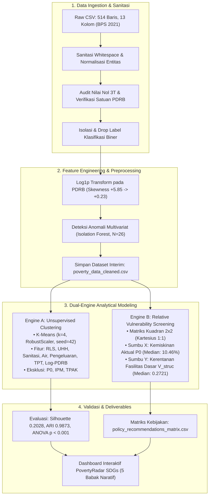

# PovertyRadar SDGs: Problem Framing, Objektif Proyek, dan Arsitektur Analisis

> **Dokumen Rujukan Metodologis & Konseptual Proyek**  
> **Mata Kuliah:** Presentasi Data dan Storytelling  
> **Tema / Fokus:** Analisis Multidimensi Disparitas Kemiskinan Daerah di Indonesia (UN SDG 1: *No Poverty*)  
> **Dataset Utama:** `Klasifikasi Tingkat Kemiskinan di Indonesia.csv` ([Kaggle Dataset oleh ldausl](https://www.kaggle.com/datasets/ldausl/klasifikasi-tingkat-kemiskinan-di-indonesia), BPS 2021)  
> **Versi Dokumen:** 5.0 (Restructured & Streamlined Architectural Blueprint) | 31 Oktober 2026  

---

## Daftar Isi

1. [Konteks Masalah & Latar Belakang Kebijakan SDG 1](#1-konteks-masalah--latar-belakang-kebijakan-sdg-1)
   - 1.1 [Dilema Kebijakan Seragam (One-Size-Fits-All)](#11-dilema-kebijakan-seragam-one-size-fits-all)
   - 1.2 [Tiga Kesenjangan Analitis (Analytical Gaps)](#12-tiga-kesenjangan-analitis-analytical-gaps)
   - 1.3 [Snapshot Integritas Data BPS 2021](#13-snapshot-integritas-data-bps-2021)
2. [Perumusan Masalah, Pertanyaan Riset, & Objektif](#2-perumusan-masalah-pertanyaan-riset--objektif)
   - 2.1 [Rumusan Masalah Utama](#21-rumusan-masalah-utama)
   - 2.2 [Enam Pertanyaan Analitis Kunci (Research Questions)](#22-enam-pertanyaan-analitis-kunci-research-questions)
   - 2.3 [Objektif Umum & Khusus](#23-objektif-umum--khusus)
3. [Paradigma Metodologi & Batasan Integritas Data](#3-paradigma-metodologi--batasan-integritas-data)
   - 3.1 [Penolakan Tegas Klasifikasi Terawasi (No Supervised Classification)](#31-penolakan-tegas-klasifikasi-terawasi-no-supervised-classification)
   - 3.2 [Isolasi Variabel & Pencegahan Penalaran Melingkar (P0 & IPM)](#32-isolasi-variabel--pencegahan-penalaran-melingkar-p0--ipm)
   - 3.3 [Batasan Ruang Lingkup Sistem (In-Scope vs. Out-of-Scope)](#33-batasan-ruang-lingkup-sistem-in-scope-vs-out-of-scope)
4. [Arsitektur Metodologi Analisis](#4-arsitektur-metodologi-analisis)
   - 4.1 [Diagram Alur Pipeline End-to-End](#41-diagram-alur-pipeline-end-to-end)
   - 4.2 [Matriks 7 Fitur Independen (Bebas Penalaran Melingkar)](#42-matriks-7-fitur-independen-bebas-penalaran-melingkar)
   - 4.3 [Konseptualisasi Skrining Kerentanan Fasilitas Dasar (Matriks 2x2)](#43-konseptualisasi-skrining-kerentanan-fasilitas-dasar-matriks-2x2)
5. [Gerbang Keputusan, Validasi, & Luaran Proyek](#5-gerbang-keputusan-validasi--luaran-proyek)
   - 5.1 [Status 6 Gerbang Keputusan Pra-Pemodelan (Decision Gates)](#51-status-6-gerbang-keputusan-pra-pemodelan-decision-gates)
   - 5.2 [Tiga Pilar Validasi Model Unsupervised](#52-tiga-pilar-validasi-model-unsupervised)
   - 5.3 [Luaran Utama & Kriteria Penerimaan Proyek (Acceptance Criteria)](#53-luaran-utama--kriteria-penerimaan-proyek-acceptance-criteria)
6. [Peta Ekosistem Dokumen & Rujukan Resmi](#6-peta-ekosistem-dokumen--rujukan-resmi)
   - 6.1 [Hubungan Antardokumen di Repositori (Single Responsibility Map)](#61-hubungan-antardokumen-di-repositori-single-responsibility-map)
   - 6.2 [Rujukan Resmi & Literatur Pustaka](#62-rujukan-resmi--literatur-pustaka)

---

## 1. Konteks Masalah & Latar Belakang Kebijakan SDG 1

### 1.1 Dilema Kebijakan Seragam (One-Size-Fits-All)
Penanggulangan kemiskinan di Indonesia sering kali terkendala oleh pendekatan bantuan yang diseragamkan (*blanket policy*). Padahal, data empiris menunjukkan bahwa dua daerah dengan persentase penduduk miskin ($P_0$) yang setara dapat memiliki konfigurasi masalah yang bertolak belakang:
* **Daerah A (Defisit Infrastruktur Fisik):** Kemiskinan dipicu oleh ketiadaan sarana air minum layak dan sanitasi (umum terjadi di wilayah 3T dan pedalaman luar Jawa).
* **Daerah B (Defisit Pasar Kerja / Daya Beli):** Infrastruktur fisik, sekolah, dan sanitasi telah terbangun baik, namun warganya miskin karena keterbatasan lapangan kerja formal dan rendahnya upah riil (kantong kemiskinan perdesaan agraris padat penduduk).

Pendekatan seragam—misalnya sekadar menyalurkan bantuan sosial tunai tanpa intervensi sanitasi di Daerah A, atau membangun MCK di Daerah B yang membutuhkan lapangan kerja—menghasilkan inefisiensi anggaran dan gagal mengurai akar disparitas.

### 1.2 Fokus & Kebutuhan Pendekatan Analitis Proyek
Dalam mengeksplorasi dataset kemiskinan daerah pada proyek ini, analisis diarahkan untuk memenuhi tiga kebutuhan pendekatan komparatif:
1. **Dekomposisi Multidimensi:** Melampaui pembacaan angka tunggal $P_0$ dengan menguraikan dimensi-dimensi penyusun profil daerah (modal manusia, derajat kesehatan, akses air minum dan sanitasi, pengeluaran riil, serta dinamika ketenagakerjaan).
2. **Tipologi Sosio-Ekonomi Independen:** Menyusun pengelompokan daerah berbasis profil struktural tanpa mengikutsertakan variabel kemiskinan moneter ke dalam model clustering, guna mencegah penalaran melingkar (*circular reasoning*).
3. **Instrumen Skrining 2 Dimensi:** Menghadirkan penapisan visual komparatif yang memadukan tingkat kemiskinan moneter ($P_0$) dan kerentanan fasilitas dasar ($V_{\text{struc}}$) sebagai sarana penapisan awal sebelum investigasi lapangan.

### 1.3 Snapshot Integritas Data BPS 2021
Analisis ini bertumpu pada dataset resmi BPS Tahun 2021 yang telah diverifikasi:
* **Cakupan Wilayah:** Tepat 514 observasi (413 Kabupaten dan 101 Kota) di 34 provinsi (kondisi administrasi pra-pemekaran DOB Papua).
* **Kebersihan Data:** 0 nilai kosong (*zero missing values*) dan 0 duplikasi entitas.
* **Sebaran Kemiskinan Moneter ($P_0$):** Rata-rata nasional $12.32\%$, median $10.46\%$, dengan rentang disparitas mencapai 17.5x lipat antara Kota Sawahlunto ($2.38\%$) dan Kabupaten Intan Jaya ($41.66\%$).

---

## 2. Perumusan Masalah, Pertanyaan Riset, & Objektif

### 2.1 Rumusan Masalah Utama
> *"Bagaimana data indikator kemiskinan dan karakteristik sosial-ekonomi 514 kabupaten/kota di Indonesia tahun 2021 dapat dipetakan secara spasial, dikelompokkan ke dalam tipologi profil struktural melalui unsupervised clustering yang bebas dari penalaran melingkar (circular reasoning), serta divisualisasikan ke dalam dashboard interaktif yang komunikatif untuk mendukung skrining prioritas intervensi SDG 1 tanpa mengklaim prediksi risiko masa depan?"*

### 2.2 Enam Pertanyaan Analitis Kunci (Research Questions)
1. **RQ-1 (Distribusi Spasial):** Bagaimana pola sebaran spasial tingkat kemiskinan moneter ($P_0$) antarkabupaten/kota di Indonesia pada tahun 2021?
2. **RQ-2 (Asosiasi Multidimensi):** Bagaimana pola korelasi antara dimensi modal manusia, kesehatan, air/sanitasi, skala ekonomi, dan ketenagakerjaan terhadap kemiskinan?
3. **RQ-3 (Tipologi Klaster Murni):** Profil sosio-ekonomi apa yang terbentuk ketika daerah dikelompokkan secara murni tanpa menyertakan variabel kemiskinan $P_0$?
4. **RQ-4 (Karakteristik Pembeda):** Indikator apa yang paling membedakan antarklaster, dan bagaimana variasi sebaran kemiskinan ($P_0$) pada masing-masing klaster?
5. **RQ-5 (Skrining Matriks 2x2):** Wilayah mana saja yang masuk ke dalam kuadran prioritas tindakan (*Prioritas Utama*) vs wilayah kantong kemiskinan daya beli (*Enclave*)?
6. **RQ-6 (Stabilitas Model):** Seberapa stabil dan teruji partisi klasterisasi terhadap variasi acak (*random seed*) dan metode klastering alternatif?

### 2.3 Objektif Umum & Khusus
* **Objektif Umum:** Mengembangkan **PovertyRadar SDGs** sebagai dashboard interaktif berbasis *data storytelling* untuk memetakan disparitas kemiskinan kabupaten/kota, menyusun tipologi daerah melalui *unsupervised clustering*, dan menyajikan instrumen skrining kerentanan 2x2 guna mendukung percepatan **SDG 1 — Tanpa Kemiskinan**.
* **Objektif Khusus:**
  1. Melakukan audit mutu data, sanitasi, dan penanganan nilai batas pada 514 kabupaten/kota.
  2. Mengeksplorasi hubungan bivariat dan membuktikan paradoks pasar kerja (korelasi positif TPAK vs korelasi negatif TPT).
  3. Membangun model *unsupervised clustering* berbasis fitur independen yang bebas dari penalaran melingkar (*circular reasoning*) dengan algoritma K-Means ($k=4$) dan validasi Hierarchical Clustering.
  4. Merancang instrumen skrining dua dimensi ($P_0$ aktual vs Indeks Kerentanan Fasilitas Dasar) ke dalam matriks kuadran 2x2.
  5. Mengomunikasikan temuan ke dalam dashboard interaktif 5 babak naratif (*Freytag's Pyramid*) yang mematuhi kaidah visualisasi Knaflic, Few, dan Desbarats.

---

## 3. Paradigma Metodologi & Batasan Integritas Data

### 3.1 Penolakan Tegas Klasifikasi Terawasi (No Supervised Classification)

> [!IMPORTANT]
> **Pernyataan Integritas Ilmiah: Proyek Ini TIDAK Melatih Model Klasifikasi Terawasi**  
> Meskipun berkas mentah bernama `Klasifikasi Tingkat Kemiskinan di Indonesia.csv` dan memuat kolom biner `Klasifikasi Kemiskinan` (0/1), **proyek ini secara tegas membuang kolom tersebut dan TIDAK melatih model klasifikasi terawasi**.
> 
> **Tiga Landasan Penolakan Klasifikasi Terawasi:**
> 1. **Pencegahan Kebocoran Target (*Target Leakage*) & Penalaran Melingkar (*Circular Reasoning*):** Dalam supervised learning, memprediksi status kemiskinan dari indikator pengeluaran, pendidikan, dan kesehatan yang merupakan komponen pembentuk garis kemiskinan adalah bentuk kebocoran target (*target leakage*). Sementara pada klastering, memasukkan variabel yang sama untuk membentuk kelompok sekaligus membuktikan keabsahan kelompok adalah bentuk penalaran melingkar (*tautology*) yang tidak menghasilkan wawasan baru.
> 2. **Cacat Validitas Label Bawaan:** Kolom label biner bawaan bukan indikator resmi BPS, melainkan hasil penyekatan *ad-hoc* yang terbukti memuat anomali fatal (misal: Jayawijaya dengan $P_0 = 36.70\%$ diberi label 0 "tidak miskin", sedangkan daerah dengan $P_0 = 6.30\%$ diberi label 1 "miskin").
> 3. **Orientasi Solusi Berbasis Tipologi:** Pengambil kebijakan membutuhkan pemahaman konfigurasi defisit fasilitas dasar, bukan klasifikasi hitam-putih.

### 3.2 Isolasi Variabel & Pencegahan Penalaran Melingkar (P0 & IPM)
* **Eksklusi Persentase Kemiskinan ($P_0$):** $P_0$ dikeluarkan dari pembentukan fitur klastering agar menjadi tolok ukur pengujian eksternal independen (*unbiased external benchmark*).
* **Eksklusi Indeks Pembangunan Manusia (IPM):** IPM dikeluarkan dari fitur jarak Euclidean karena berkorelasi $> 0.86$ dengan komponen pembangunnya (RLS, UHH, pengeluaran). Memasukkan IPM akan melipatgandakan bobot dimensi manusia secara artifisial (*double-counting*).
* **Eksklusi Partisipasi Kerja (TPAK):** TPAK dan TPT berkorelasi $-0.582$. Memasukkan keduanya membuat dimensi tenaga kerja mendominasi 25% bobot model dan menurunkan skor Silhouette sebesar ~10%.

### 3.3 Batasan Ruang Lingkup Sistem (In-Scope vs. Out-of-Scope)

| Termasuk dalam Ruang Lingkup (In-Scope) | Di Luar Ruang Lingkup Proyek (Out-of-Scope) |
| :--- | :--- |
| Pemetaan spasial deskriptif tingkat kemiskinan ($P_0$) dan indikator sosial-ekonomi 2021. | **Pemodelan klasifikasi terawasi (*Supervised Classification*)** seperti Logistic Regression, Decision Tree, Random Forest. |
| Deteksi 26 anomali multivariat ekstrem via *Isolation Forest* tanpa membuang baris data. | Prediksi deret waktu atau peramalan tren tahunan (*Time Series Forecasting*). |
| *Unsupervised clustering* tipologi daerah menggunakan K-Means ($k=4$) dan validasi Ward. | Klaim sebab-akibat deterministik tanpa eksperimen acak (*Causal Inference*). |
| Skrining kerentanan fasilitas dasar relatif berbasis matriks kuadran 2x2 yang transparan. | Pengambilan keputusan otomatisasi penerima bantuan sosial (bansos). |
| Dashboard interaktif dengan alur narasi 5 babak (*Freytag's Pyramid*). | Penggunaan label klasifikasi biner bawaan `Klasifikasi Kemiskinan`. |
| Visualisasi komparatif Small Multiples Z-Score dan Heatmap Matrix. | Penggunaan grafik *Radar / Spider Chart* yang mendistorsi persepsi data. |

---

## 4. Arsitektur Metodologi Analisis

### 4.1 Diagram Alur Pipeline End-to-End



### 4.2 Matriks 7 Fitur Independen (Bebas Penalaran Melingkar)

Model klastering dilatih menggunakan **vektor 7 fitur terstandardisasi** yang merepresentasikan empat pilar utama pembangunan:

| Pilar Pembangunan | Fitur Model | Nama Kolom Teknis | Transformasi Pra-Model | Justifikasi Metodologis |
| :--- | :--- | :--- | :---: | :--- |
| **Modal Manusia** | Rata-rata Lama Sekolah | `avg_school_years` | `RobustScaler` | Proksi kapasitas kognitif tenaga kerja (SDG 4). |
| **Derajat Kesehatan**| Umur Harapan Hidup | `life_expectancy` | `RobustScaler` | Proksi ketahanan fisik dan derajat hidup (SDG 3). |
| **Layanan Dasar** | Akses Sanitasi Layak | `sanitation_access_pct` | `RobustScaler` | Proksi kelayakan lingkungan hunian (SDG 6). |
| **Layanan Dasar** | Akses Air Minum Layak | `clean_water_access_pct` | `RobustScaler` | Proksi pemenuhan kebutuhan primer (SDG 6). |
| **Standar Hidup** | Pengeluaran per Kapita| `expenditure_per_capita`| `RobustScaler` | Proksi daya beli riil ekonomi rumah tangga. |
| **Pasar Kerja** | Pengangguran Terbuka | `unemployment_rate_tpt` | `RobustScaler` | Pembeda struktur pasar kerja formal vs subsisten (SDG 8). |
| **Skala Ekonomi** | PDRB Riil 2010 | `grdp_constant_million_idr`| $\log(1+x)$ $\rightarrow$ `RobustScaler` | Skala kapasitas ekonomi makro daerah setelah normalisasi. |

### 4.3 Konseptualisasi Skrining Kerentanan Fasilitas Dasar (Matriks 2x2)
PovertyRadar SDGs memadukan dua dimensi independen ke dalam bidang Kartesius:
* **Sumbu X:** Tingkat Kemiskinan Moneter Aktual ($P_0$ %, garis potong median nasional = $10.46\%$).
* **Sumbu Y:** Indeks Kerentanan Fasilitas Dasar ($V_{\text{struc}}$, garis potong median nasional = $0.2721$).

```text
                  Indeks Kerentanan Fasilitas Dasar (V_struc)
                                    ▲
                                    │
           KUADRAN II               │              KUADRAN I
     (Kerentanan Tersembunyi)       │          (Prioritas Utama)
     P0 Rendah, V_struc Tinggi      │       P0 Tinggi, V_struc Tinggi
             (N = 95)               │               (N = 162)
────────────────────────────────────┼────────────────────────────────────► Tingkat Kemiskinan
                                    │                                      Aktual (P0 %)
           KUADRAN IV               │             KUADRAN III
     (Wilayah Terbina / Mapan)      │     (Kantong Kemiskinan Daya Beli)
     P0 Rendah, V_struc Rendah      │       P0 Tinggi, V_struc Rendah
             (N = 162)              │               (N = 95)
                                    ▼
```

> [!NOTE]
> **Rujukan Dokumen Master Rekomendasi Kebijakan:**  
> Dekonstruksi mendalam tiap kuadran, rincian daerah, panduan instrumen fiskal APBN/TKD, dan protokol Tangga Bukti Kebijakan didokumentasikan secara lengkap pada:  
> 👉 [`docs/02-desain-rekomendasi-kebijakan-berbasis-clustering-povertyradar.md`](file:///d:/ARFI/Kuliah/Project/project-semester5/PovertyRadar/docs/02-desain-rekomendasi-kebijakan-berbasis-clustering-povertyradar.md).

---

## 5. Gerbang Keputusan, Validasi, & Luaran Proyek

### 5.1 Status 6 Gerbang Keputusan Pra-Pemodelan (Decision Gates)

Seluruh gerbang keputusan integritas telah diaudit dan diselesaikan secara tuntas:

| Gerbang Keputusan | Status | Tindakan & Bukti Faktual |
| :--- | :---: | :--- |
| **1. Periode Tahun Data** | **TERSELESAIKAN** | Terverifikasi data resmi BPS Tahun 2021 (validasi silang Surakarta, Cilacap, Banyumas). |
| **2. Satuan & Skala PDRB** | **TERSELESAIKAN** | Terverifikasi berskala Juta Rupiah. Transformasi $\log(1+x)$ sukses menekan skewness ke +0.23. |
| **3. Nilai Batas Nol (0.00%)**| **TERSELESAIKAN** | Terverifikasi kondisi riil 3T Papua (Deiyai, Mamberamo Tengah, Nduga). |
| **4. Isolasi Label Biner** | **TERSELESAIKAN** | Kolom label biner dibuang dari pipeline untuk mencegah *target leakage* pada klasifikasi dan penalaran melingkar (*circular reasoning*) pada klastering. |
| **5. Preprocessing & Sanitasi** | **TERSELESAIKAN** | Berkas bersih diekspor ke [`data/interim/poverty_data_cleaned.csv`](file:///d:/ARFI/Kuliah/Project/project-semester5/PovertyRadar/data/interim/poverty_data_cleaned.csv). |
| **6. Deteksi Anomali Multivariat** | **TERSELESAIKAN** | 26 daerah anomali ditandai via *Isolation Forest* tanpa membuang baris data. |

### 5.2 Tiga Pilar Validasi Model Unsupervised
Kualitas pemodelan diuji melalui tiga instrumen objektif:
1. **Separasi Matematis:** $\text{Silhouette} = 0.2028$ dan $\text{DBI} = 1.4522$ pada 7 fitur asli ($\text{Silhouette} = 0.3589$ pada proyeksi 2D PCA).
2. **Ketahanan Multi-Seed:** Simulasi 20 inisialisasi *random seed* acak menghasilkan rata-rata **Adjusted Rand Index (ARI) = 0.9873** (stabilitas $98.7\%$).
3. **Validasi Inferensial Eksternal ($P_0$):** Uji beda rata-rata membuktikan pemisahan nilai $P_0$ yang sangat signifikan antarklaster via ANOVA ($F = 155.94, p < 0.001$) dan Kruskal-Wallis ($H = 167.52, p < 0.001$).

### 5.3 Luaran Utama & Kriteria Penerimaan Proyek (Acceptance Criteria)
* **Paket Luaran (*Deliverables*):**
  1. Interactive Storytelling Dashboard 5 Babak Naratif.
  2. Modul Python Terintegrasi (`src/poverty_radar/`) dan Otomasi Uji (`tests/`).
  3. Empat Dataset Terstruktur (`poverty_data_cleaned.csv`, `poverty_clusters.csv`, `poverty_cluster_summary.csv`, `policy_recommendations_matrix.csv`).
  4. Notebook Analisis Terdokumentasi (`notebooks/01_...`, `02_...`, `03_...`).
* **Kriteria Penerimaan (*Definition of Done*):**
  - Konsistensi data 100% (514 observasi, *zero silent drops*).
  - Ketiadaan klaim kausalitas deterministik atau ramalan masa depan.
  - Dokumentasi pipeline terbuka dan dapat direproduksi ulang secara mandiri.

---

## 6. Peta Ekosistem Dokumen & Rujukan Resmi

### 6.1 Hubungan Antardokumen di Repositori (Single Responsibility Map)

Untuk menghindari tumpang-tindih, setiap dokumen dalam repositori memegang tanggung jawab tunggal:

```text
docs/
├── problem_framing_and_objectives.md  --> (DOKUMEN INI) Problem framing, rumusan riset, batasan paradigma
├── data_audit_and_understanding.md    --> Audit statistik lengkap, dekomposisi variabel, telaah 26 anomali
├── data_contracts.md                  --> Kontrak teknis validasi skema, batasan nilai, dan unit test invariants
├── clustering_protocol.md             --> SOP teknis pemodelan, konfigurasi K-Means, rumus RobustScaler
├── clustering_rationale_and_findings.md --> Pembuktian empiris benchmark 20+ model, data A/B test, validasi ANOVA
├── 01-sistem-kebijakan-dan-intervensi-pemerintah-indonesia-2026.md --> Master tata kelola publik, UU 23/2014, fiskal HKPD
├── 02-desain-rekomendasi-kebijakan-berbasis-clustering-povertyradar.md --> Master rekomendasi kebijakan & Tangga Bukti 4 Tingkat
├── design.md                          --> MASTER SPESIFIKASI DESAIN DASHBOARD (Storytelling, State, Guardrails, DoD)
└── ui_brief_mockup.md                 --> LEMBAR WIREFRAME VISUAL (Diagram ASCII, Grid Dimensi px, Card Kit)
```

### 6.2 Rujukan Resmi & Literatur Pustaka
1. **Publikasi Data Mentah:** Ldausl / Ermila, *Klasifikasi Tingkat Kemiskinan di Indonesia*, Repositori Publik Kaggle: [kaggle.com/datasets/ldausl/klasifikasi-tingkat-kemiskinan-di-indonesia](https://www.kaggle.com/datasets/ldausl/klasifikasi-tingkat-kemiskinan-di-indonesia).
2. **Badan Pusat Statistik (BPS) RI:** *Indikator Kemiskinan dan Pembangunan Manusia Kabupaten/Kota Tahun 2021*, Metadata Sistem Rujukan Statistik (SIRUSA) BPS RI.
3. **Pustaka Metodologi Visualisasi & Storytelling:**
   * Knaflic, C. N. (2015). *Storytelling with Data: A Data Visualization Guide for Business Professionals*. Wiley.
   * Few, S. (2006). *Information Dashboard Design: The Effective Visual Communication of Data*. O'Reilly.
   * Desbarats, N. (2022). *Practical Dashboards: Designing Visualization for Understanding and Action*.
