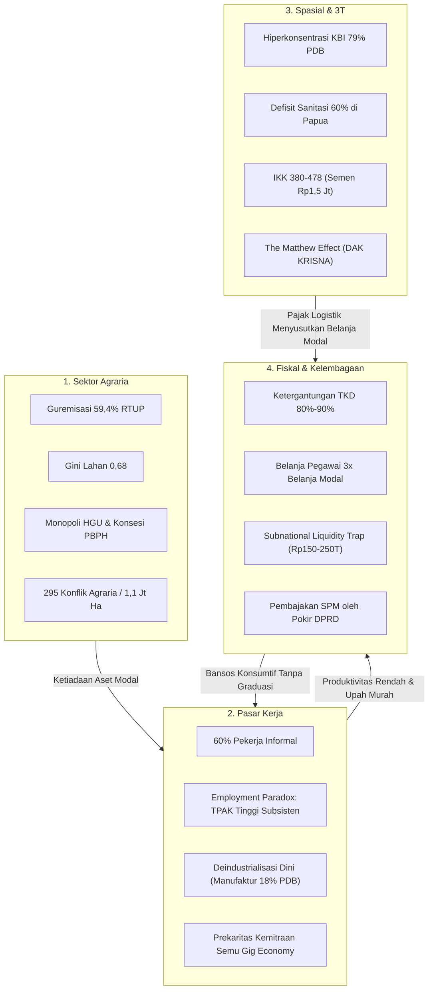

# LAPORAN RISET MENDALAM: ANATOMI PENYEBAB KEMISKINAN STRUKTURAL DI INDONESIA
## Penyelidikan Komprehensif Dimensi Agraria, Pasar Tenaga Kerja, Kesenjangan Spasial, dan Tata Kelola Fiskal-Kelembagaan

**Platform Referensi:** PovertyRadar SDGs (Sistem Klastering & Skrining Kerentanan Relatif 514 Kabupaten/Kota)  
**Metodologi:** *Parallel Multi-Agent Deep Research Orchestration*  
**Prinsip Epistemik:** Anti-Overclaim (*Strict Superlative Ban*), Pemisahan Asosiasi Statistik dari Kausalitas (*Cum hoc non est propter hoc*), dan Penandaan Bukti Terverifikasi (`[Fakta Terverifikasi]`, `[Hipotesis]`, `[Asumsi]`).  
**Tahun Analisis:** 2026 (Konteks Kerangka Regulasi UU No. 1/2022 HKPD, UU No. 59/2024 RPJPN 2025–2045, Inpres No. 4/2025 DTSEN, BPS Sensus Pertanian ST2023, dan Sakernas).

---

## 1. RINGKASAN EKSEKUTIF

Kemiskinan di Indonesia pada level kabupaten/kota bukan sekadar persoalan pilihan individual atau etos kerja, melainkan hasil dari **perangkap struktural multidimensi (*multidimensional structural traps*)** yang membatasi akses masyarakat terhadap modal produksi, pasar kerja formal, konektivitas spasial, dan tata kelola anggaran publik yang emansipatif. Penyelidikan mendalam melalui 4 investigasi paralel mengonfirmasi bahwa kemiskinan struktural direproduksi melalui konvergensi empat determinan: (1) **Dualisme dan ketimpangan penguasaan lahan ekstrem** (Gini penguasaan lahan 0,58–0,68; 59,4% rumah tangga tani berstatus gurem <0,5 ha) yang berbenturan dengan konsesi skala besar; (2) **Segmentasi pasar tenaga kerja informal** (~58%–60% angkatan kerja) yang terperangkap dalam deindustrialisasi dini dan anomali *The Employment Paradox* (TPAK tinggi di desa karena *distress labor supply* vs TPT tinggi di kota karena *luxury unemployment*); (3) **Isolasi spasial dan defisit layanan dasar di Kawasan Timur Indonesia (KTI/3T)** di mana koefisien Indeks Kemahalan Konstruksi (IKK > 350–470) memicu *fiscal deadweight loss* sebesar 65%–75% atas belanja publik serta memunculkan *The Matthew Effect* dalam alokasi transfer DAK; dan (4) **Ketergantungan fiskal subnasional akut** (88% daerah belum mandiri; belanja pegawai mendominasi 32%–40% APBD) yang diperparah oleh pembajakan perencanaan teknokratis oleh Pokir DPRD transaksi politik dan rendahnya kapasitas graduasi mandiri bantuan sosial (<4%).

---

## 2. TEMUAN KUNCI LINTAS TEMA (*KEY FINDINGS*)

```
┌────────────────────────────────────────────────────────────────────────────────────────┐
│               ARSITEKTUR EMPAT PILAR KEMISKINAN STRUKTURAL DI INDONESIA                │
├────────────────────────────┬─────────────────────────────┬─────────────────────────────┤
│ 1. STRUKTUR AGRARIA        │ 2. PASAR KERJA & PREKARITAS │ 3. SPASIAL & INFRASTRUKTUR  │
│ • Gini Lahan 0,58 – 0,68   │ • 58%–60% Sektor Informal   │ • Hiperkonsentrasi KBI 79%  │
│ • 16,89 Juta Petani Gurem  │ • Employment Paradox        │ • IKK 380–478 di 3T Papua   │
│ • 8,37 Jt Ha Wilayah Adat  │ • Deindustrialisasi Dini    │ • Pajak Logistik 65%–75%    │
│   Tumpang Tindih Konsesi   │ • Skor Fairwork Rendah      │ • Matthew Effect DAK Krisna │
├────────────────────────────┴─────────────────────────────┴─────────────────────────────┤
│ 4. FISKAL & TATA KELOLA BIROKRASI                                                      │
│ • 88% Pemda Belum Mandiri (PAD < 5%–15%) | Belanja Pegawai 32%–40% vs Modal 12%–18%   │
│ • Subnational Liquidity Trap (Dana Kasda Rp150T–250T Mengendap)                        │
│ • Graduasi Mandiri Bansos < 4% | Planning-Budgeting Disconnect oleh Pokir DPRD          │
└────────────────────────────────────────────────────────────────────────────────────────┘
```

### Tema 1: Penguasaan Aset Produktif, Guremisasi, dan Dualisme Agraria
* `[Fakta Terverifikasi]` **Gini Lahan Ekstrem:** Gini Rasio Penguasaan Lahan Pertanian berada pada level **0,58 hingga 0,68** (BPS ST2013 / ST2023), jauh melampaui ketimpangan konsumsi moneter nasional (Gini pengeluaran 0,379–0,388). Sekitar 68% kekayaan berbasis daratan dikuasai oleh 1% entitas korporasi pemodal besar (KPA).
* `[Fakta Terverifikasi]` **Ledakan Petani Gurem:** Sensus Pertanian BPS 2023 (ST2023) mencatat kenaikan jumlah Rumah Tangga Usaha Pertanian (RTUP) Gurem (<0,5 ha) menjadi **16,89 juta rumah tangga (59,4% dari total RTUP pengguna lahan)**, melonjak +18,5% (bertambah 2,64 juta rumah tangga) dibandingkan tahun 2013. Di Pulau Jawa, proporsi guremisasi melampaui **>75%**.
* `[Fakta Terverifikasi]` **Penyempitan Ruang Hidup & Konflik:** Luas perkebunan kelapa sawit mencapai **±16,8 juta hektare** (>55% HGU swasta/BUMN), konsesi kehutanan (PBPH) >30 juta hektare. Dari 36,6 juta hektare peta partisipatif Badan Registrasi Wilayah Adat (BRWA), **8,37 juta hektare bertumpang tindih langsung dengan izin konsesi**. Sepanjang 2024, KPA mencatat **295 letusan konflik agraria** seluas 1,11 juta hektare yang berdampak pada 67.436 kepala keluarga.
* `[Fakta Terverifikasi]` **Asimetri Reforma Agraria:** Program PTSL (legalisasi aset) telah menerbitkan puluhan juta sertifikat atas tanah yang *memang sudah dikuasai warga*, namun redistribusi tanah sejati dari pelepasan eks-HGU dan tanah terlantar skala besar terhambat resistensi pemilik konsesi.

### Tema 2: Distorsi Pasar Kerja, Prekaritas, dan Paradoks Produktivitas
* `[Fakta Terverifikasi]` **Informalitas Kronis & Defisit Jaminan Sosial:** Sebanyak **57,95%–60,80% tenaga kerja Indonesia (~83,8–86,2 juta orang)** bekerja di sektor informal (BPS Sakernas 2021–2024). Partisipasi aktif pekerja Bukan Penerima Upah (BPU) di BPJS Ketenagakerjaan hanya mencapai **11,0%–11,8%** (~9,9 juta orang), mengonfirmasi bahwa **~88% pekerja informal tidak memiliki jaminan perlindungan kerja formal** (JKK, JKM, JHT).
* `[Fakta Terverifikasi]` **Dekonstruksi "The Employment Paradox":** Analisis data 514 Kabupaten/Kota membuktikan:
  - Partisipasi Angkatan Kerja (TPAK) berkorelasi linear positif dengan kemiskinan perdesaan ($r = +0.462$). `[Hipotesis]` Terjadi *distress labor supply* dan keharusan bertahan hidup (*subsistence*): ketiadaan aset memaksa seluruh anggota keluarga (termasuk lansia/anak) bekerja serabutan dengan produktivitas marjinal mendekati nol (*working poor*).
  - Pengangguran Terbuka (TPT) berkorelasi linear negatif dengan kemiskinan agregat ($r = -0.401$). `[Hipotesis]` Mengonfirmasi *luxury unemployment hypothesis*: pengangguran terbuka adalah fenomena perkotaan terdidik (SMK, SMA, Diploma/PT) dari kelas menengah-atas yang mampu mengantre (*job queuing*) untuk posisi formal dan menolak pekerjaan kasar informal.
* `[Fakta Terverifikasi]` **Deindustrialisasi Dini (*The Missing Middle*):** Kontribusi sektor manufaktur terhadap PDB merosot dari puncaknya ~30% (2001–2004) menjadi **18,34%–19,2% (2022–2024)** (BPS / LPEM FEB UI). Terjadi anomali transmisi tenaga kerja: tenaga kerja yang keluar dari sektor pertanian terlempar ke sektor jasa informal bernilai tambah rendah. Bank Dunia mencatat **hanya 15% (13 juta pekerja) yang menghasilkan pendapatan standar kelas menengah**, dan hanya 3,5 juta pekerja upahan yang menikmati kontrak formal permanen dengan jaminan sosial lengkap.
* `[Fakta Terverifikasi]` **Prekaritas Gig Economy:** Ekspansi 2,5–4 juta pekerja platform berbasis kemitraan semu (*bogus self-employment*) menghasilkan skor kelayakan kerja *Fairwork Indonesia* (CfDS UGM-Oxford) sangat rendah (**0–5 dari 10**), di mana pendapatan bersih riil pasca-biaya operasional berada di bawah UMR serta menjebak pekerja dalam kelelahan kronis (*skill lock-in*).

### Tema 3: Kesenjangan Spasial, Kemahalan Ekstrem, dan Defisit Layanan Dasar 3T
* `[Fakta Terverifikasi]` **Ketimpangan Spasial KBI vs KTI:** Kawasan Barat Indonesia (Jawa 57,05% + Sumatera 22,01%) menguasai **79,06% PDB nasional**, sementara Maluku dan Papua hanya menyumbang **2,58% PDB** meskipun luas daratannya mencakup >22% wilayah RI. Rasio PDRB per kapita DKI Jakarta (Rp322–344 juta) mencapai **14 hingga 15 kali lipat** PDRB per kapita NTT (Rp23 juta).
* `[Fakta Terverifikasi]` **Defisit Layanan Dasar Primer:** Di Papua, akses sanitasi layak hanya **40,81%–43,00%** (hampir 60% populasi mempraktikkan BABS); Puskesmas tanpa dokter tetap mencapai **62%–66% di Papua Pegunungan** dan **33%–45% di Papua Tengah** (vs mendekati 0% di Jawa). Rata-Rata Lama Sekolah (RLS) di Kabupaten Nduga hanya **2,19 tahun** (kelas 2 SD) dan Lanny Jaya **3,87 tahun**, dengan tingkat ketidakhadiran guru (*absenteeism*) mencapai 30%–50%.
* `[Fakta Terverifikasi]` **Pajak Logistik Ekstrem (*Fiscal Deadweight Loss*):** Indeks Kemahalan Konstruksi (IKK BPS) di pegunungan Papua (Puncak 383,61–478,12; Intan Jaya 376,04–447,97) mencerminkan biaya konstruksi fisik 3,8–4,8 kali lipat lebih mahal dibanding Makassar atau Jawa. Harga semen sak 50 kg di Distrik Ilaga (Kab. Puncak) menembus **Rp950.000 s.d. Rp1.500.000 per sak**, didorong oleh monopoli kargo udara perintis (tarif Rp20.000–Rp35.000/kg). Pada setiap alokasi belanja infrastruktur publik (DAK/APBD), **65% hingga 75% nilai anggaran habis tergerus untuk sewa pesawat kargo perintis**.
* `[Fakta Terverifikasi]` **The Matthew Effect dalam Platform KRISNA:** Filter administratif *Readiness Criteria* DAK Fisik (kewajiban melampirkan DED, AMDAL, dan Sertifikat Hak Pakai BPN) mendiskualifikasi pemda 3T yang defisit kapasitas teknis APBD T-1 dan terbentur hukum tanah adat ulayat, sehingga dana alokasi infrastruktur tersedot kembali ke kabupaten mapan di Pulau Jawa (*the rich get richer*).

### Tema 4: Kapasitas Fiskal Daerah, Ketergantungan Transfer, dan Distorsi Tata Kelola
* `[Fakta Terverifikasi]` **Kemandirian Fiskal Terkikis:** Reviu BPK RI atas Indeks Kemandirian Fiskal (IKF) mencatat **443 dari 503 pemda (88,07%) berstatus "Belum Mandiri"**, dengan >100 daerah mengandalkan PAD kurang dari 5% APBD. Rata-rata kabupaten luar Jawa bergantung 80%–90%+ pada Transfer ke Daerah (TKD: DAU, DBH, DAK).
* `[Fakta Terverifikasi]` **Dominasi Belanja Birokrasi:** Belanja pegawai menyerap **32%–40% total belanja APBD**. Pada pagu belanja 2026 berjalan, belanja pegawai mencapai **Rp506,41 triliun**, berbanding belanja modal yang hanya **Rp159,25 triliun** (rasio lebih dari 3 banding 1).
* `[Fakta Terverifikasi]` **Subnational Liquidity Trap:** Dana simpanan pemda di perbankan secara persisten mengendap tinggi (**Rp 150 triliun hingga >Rp 200 triliun** pada kuartal II–III) akibat pola belanja lambat di awal tahun (*hockey-stick curve*), kehati-hatian berlebih (*risk aversion*) dari ancaman audit APH, dan kekakuan *earmarked DAU* UU HKPD yang melarang peminjaman sementara kas antar-sub-alokasi (*cash pooling*).
* `[Fakta Terverifikasi]` **Keterbatasan Bansos & Planning-Budgeting Disconnect:**
  - Evaluasi Bank Dunia & Kemensos: Graduasi mandiri sejahtera program PKH hanya mencapai **~26,7% dari total keluarga yang keluar** (sekitar ~3,5% dari seluruh populasi penerima PKH); 73,3% sisanya keluar karena faktor alami (anak lulus sekolah) dengan risiko jatuh miskin kembali (*churning*).
  - Pembahasan KUA-PPAS di Banggar DPRD kerap mendistorsi perencanaan teknokratis RKPD melalui kompromi ratusan paket **Pokir DPRD (< Rp 200 juta pengadaan langsung)** dan praktik uang ketok palu (KPK), memangkas ruang fiskal belanja modal Standar Pelayanan Minimal (SPM) hingga 30%–40%.
  - Beban kepatuhan digital yang terfragmentasi (SIPD-RI, OMSPAN, SAKTI, KRISNA, SIKS-NG) membebani aparatur daerah dengan input data transaksi berulang (*digital compliance overload*), mengalihkan jam kerja birokrasi dari monitoring lapangan ke administrasi kuitansi SPJ formalitas.

---

## 3. ANALISIS MENDALAM PER SEKSI (*DETAILED ANALYSIS*)



### 3.1. Sektor Agraria: Dualisme Penguasaan dan Jebakan Petani Gurem

Struktur agraria Indonesia menampilkan dualisme tajam antara **konsentrasi modal raksasa pada segmen korporasi** dan **involusi gurem pada segmen petani rakyat**:
1. **Dinamika Guremisasi (Sensus Pertanian ST2023):**
   * Peningkatan jumlah petani gurem menjadi 16,89 juta rumah tangga (+18,5% dalam satu dekade) merupakan cerminan dari tiga faktor struktural: (a) Fragmentasi hukum waris adat yang membelah bidang tanah keluarga; (b) Alih fungsi lahan sawah produktif ke kawasan industri/perumahan sebesar 100.000–150.000 ha/tahun; dan (c) `[Hipotesis]` Kegagalan sektor formal perkotaan menyerap surplus tenaga kerja, memaksa angkatan kerja bertahan di perdesaan dengan luasan lahan yang semakin terkompresi.
   * `[Asumsi]` Ambang batas skala ekonomi usahatani pangan agar menghasilkan pendapatan di atas garis kemiskinan BPS untuk keluarga 4 jiwa adalah **0,5 hingga 1,0 hektare**. Lahan di bawah 0,5 ha secara matematis menempatkan petani pada posisi *sub-economic*, di mana kenaikan harga sarana produksi (pupuk non-subsidi, pestisida, benih) menghapus marjin keuntungan operasional.
2. **Keterbatasan Aset Agunan & Jebakan Ijon:**
   * Ketiadaan sertifikat hak milik atau sertifikat yang *bankable* mengunci petani gurem dari akses kredit perbankan formal (seperti KUR mikro). Akibatnya, pembiayaan modal kerja harian bergantung pada tengkulak dan sistem ijon, di mana hasil panen telah dibeli di muka dengan diskon harga signifikan, menjadikan petani sebagai *price takers* permanen.
3. **Monopoli Konsesi vs Wilayah Adat:**
   * Alokasi jutaan hektare konsesi perkebunan (HGU) dan kehutanan (PBPH) menciptakan enklave ekologis yang membatasi ruang jelajah ekonomi masyarakat adat. Dari 36,6 juta ha wilayah adat yang dipetakan BRWA, 8,37 juta ha mengalami tumpang tindih perizinan, sementara realisasi pengakuan legal melalui SK Hutan Adat KLHK per 2024 baru menjangkau ±333.000–400.000 ha (~1%). Situasi ini memicu 295 konflik agraria terbuka sepanjang 2024 (KPA).
4. **Anomali Kebijakan TORA dan PTSL:**
   * Program sertifikasi massal (PTSL) berhasil meningkatkan kuantitas sertifikat tanah warga, namun mayoritas tanah yang disertifikasi adalah tanah pekarangan atau lahan yang telah lama dikuasai. Kebijakan ini tidak mengoreksi ketimpangan struktur agraria (Gini rasio lahan tetap di atas 0,58). `[Hipotesis]` Tanpa penguatan kelembagaan proteksi komunal, formalisasi kepemilikan individu melalui sertifikat justru meningkatkan risiko pelepasan tanah (*adverse formalisation*) kepada pemilik modal saat rumah tangga terdesak kebutuhan darurat.

---

### 3.2. Pasar Kerja: Informalitas, Prekaritas, dan Deindustrialisasi Dini

Struktur pasar tenaga kerja Indonesia menjadi saluran transmisi utama reproduksi kemiskinan:
1. **Anatomi 60% Sektor Informal:**
   * Dari 144,6 juta penduduk bekerja (Sakernas Agustus 2024), 57,95%–60,10% berstatus informal. Mayoritas terkonsentrasi pada status *berusaha sendiri* (20%–22%), *berusaha dibantu buruh tidak tetap* (13%–15%), *pekerja bebas pertanian dan non-pertanian* (7%–9%), serta *pekerja keluarga tidak dibayar* (14%–16%).
   * Karakteristik upah: Pekerja informal menerima rata-rata pendapatan Rp1,2 juta–Rp2,5 juta/bulan, jauh di bawah rata-rata pekerja formal (Rp3,0 juta–Rp3,4 juta) dan tidak terlindungi regulasi UMK/UMP.
   * Kesenjangan jaminan sosial: Kepesertaan Bukan Penerima Upah (BPU) di BPJS Ketenagakerjaan baru mencakup ~9,9 juta orang dari total ~84 juta pekerja informal, meninggalkan **~88% angkatan kerja informal rentan terhadap guncangan kecelakaan kerja, disabilitas, atau kematian tanpa kompensasi**.
2. **Dekonstruksi Empiris "The Employment Paradox":**
   * Pada level agregat 514 kabupaten/kota, Tingkat Partisipasi Angkatan Kerja (TPAK) berkorelasi **positif** dengan kemiskinan ($r = +0.462$), sedangkan Tingkat Pengangguran Terbuka (TPT) berkorelasi **negatif** dengan kemiskinan ($r = -0.401$).
   * Perbandingan spasial menunjukkan bahwa kabupaten rata-rata memiliki angka kemiskinan 13,51% dengan TPT hanya 4,36% (dan TPAK 70,44%). Sebaliknya, kota memiliki angka kemiskinan jauh lebih rendah (7,22%) namun TPT jauh lebih tinggi (7,92%).
   * Pada klaster ekstrem PovertyRadar, Klaster 4 (3T Papua) memiliki kemiskinan 31,39% dengan TPT 1,91% (Nduga dan Lanny Jaya 0,00%), sementara Klaster 1 (Kota Metropolitan) memiliki kemiskinan 5,54% dengan TPT 8,68%.
   * `[Hipotesis]` Mekanisme: Di perdesaan miskin berlaku *subsistence survival* di mana seluruh anggota keluarga harus bekerja serabutan (*distress labor supply*). Sebaliknya, di perkotaan berlaku *luxury unemployment hypothesis* di mana lulusan SMK/Diploma dari keluarga berkecukupan memilih mengantre pekerjaan formal kerah putih dan menolak sektor informal.
3. **Deindustrialisasi Dini dan "The Missing Middle" (Bank Dunia):**
   * Penurunan kontribusi sektor manufaktur dari ~30% menjadi 18%–19% PDB memutus rantai eskalasi mobilitas sosial. Transformasi struktural tidak memindahkan petani ke pabrik modern, melainkan ke sektor perdagangan eceran dan jasa mikro berproduktivitas rendah.
   * Laporan Bank Dunia (*Pathways to Middle-Class Jobs in Indonesia*) mengonfirmasi bahwa dari 85 juta pekerja berpenghasilan, hanya 15% (13 juta) yang berpenghasilan standar kelas menengah, dan hanya 3,5 juta pekerja upahan yang memiliki kontrak permanen serta jaminan sosial lengkap. Struktur usaha Indonesia pincang: unit usaha mikro (>98%) tidak mampu tumbuh membesar, sementara segmen usaha skala menengah (*middle-sized enterprises*) langka.
4. **Prekaritas Platform Digital (Gig Economy):**
   * Penetrasi 2,5–4 juta pekerja gig transportasi dan logistik tidak menciptakan mobilitas vertikal. Hasil audit *Fairwork Indonesia* (CfDS UGM-Oxford) memberi skor rendah (0–5/10) pada platform terkemuka karena ketiadaan kontrak kerja normatif (*bogus self-employment*), beban biaya operasional dibebankan ke mitra, dan penghasilan bersih riil di bawah UMR. Jam kerja panjang (12–16 jam/hari) memicu fenomena *skill lock-in*, mengunci pekerja dari peluang peningkatan keterampilan (*upskilling*).

---

### 3.3. Kesenjangan Spasial: Defisit Layanan Dasar dan Pajak Logistik 3T

Dimensi spasial kemiskinan di Kawasan Timur Indonesia (KTI) mencerminkan kegagalan integrasi geografi ekonomi:
1. **Hiper-Konsentrasi PDB vs Marginalisasi KTI:**
   * Struktur PDB Indonesia didominasi oleh Pulau Jawa (57,05%) dan Sumatera (22,01%), membentuk 79,06% kue ekonomi nasional. Wilayah Maluku dan Papua hanya menyerap 2,58% PDB meskipun mencakup 22% luas daratan nasional.
   * Disparitas PDRB per kapita antara DKI Jakarta (Rp322–344 juta) dengan NTT (Rp23,08 juta) mencapai 14–15 kali lipat.
   * Pertumbuhan PDRB tinggi di sebagian daerah Papua (Mimika) atau Maluku Utara (nikel) merupakan *extractive enclave paradox*: industri padat modal mentransfer nilai tambah ke pusat dan pemodal luar, tanpa menyerap tenaga kerja lokal dalam skala luas.
2. **Defisit Ekstrem Modal Manusia & Layanan Dasar:**
   * Sektor WASH: Di Papua, akses sanitasi layak hanya 40,81%–43,00% (60% populasi tidak bersanitasi layak). Hal ini berbanding lurus dengan tingginya infeksi enteropati lingkungan dan menempatkan prevalensi stunting balita NTT (37,9%) dan Papua (34,6%) sebagai yang tertinggi di Indonesia (SSGI Kemenkes).
   * Sektor Kesehatan Primer: Berdasarkan data Kemenkes RI, 62%–66% Puskesmas di Papua Pegunungan dan 33%–45% di Papua Tengah beroperasi tanpa tenaga dokter tetap (vs 0% di Jawa).
   * Sektor Pendidikan: Rata-Rata Lama Sekolah (RLS) di Kabupaten Nduga (2,19 tahun), Lanny Jaya (3,87 tahun), dan Yahukimo (4,36 tahun) mencerminkan krisis modal manusia akut. Lebih dari 45% ruang kelas di pedalaman 3T berstatus rusak, diperparah oleh tingkat ketidakhadiran guru (*absenteeism*) sebesar 30%–50% (SMERU/Bank Dunia).
3. **Pajak Logistik Ekstrem (*Fiscal Deadweight Loss*):**
   * Indeks Kemahalan Konstruksi (IKK BPS) di pegunungan Papua (Puncak 383,61–478,12; Intan Jaya 376,04–447,97) mencerminkan biaya konstruksi fisik 3,8–4,8 kali lipat lebih mahal dibanding Makassar atau Jawa.
   * Harga semen sak 50 kg di Distrik Ilaga (Kab. Puncak) menembus **Rp950.000 s.d. Rp1.500.000 per sak**, didorong oleh monopoli kargo udara perintis (tarif Rp20.000–Rp35.000/kg).
   * Pada proyek infrastruktur DAK/APBD, **65%–75% nilai anggaran habis tergerus untuk sewa pesawat dan bahan bakar**, sehingga dana transfer bernilai miliaran rupiah hanya menghasilkan fasilitas fisik yang sangat minim.
4. **Hambatan Rantai Pasok Maritim & "The Matthew Effect":**
   * Studi LPEM FEB UI membuktikan bahwa Program Tol Laut berhasil menekan ongkos angkut maritim 30%–50%, namun penurunannya tertahan di tingkat pelabuhan singgah (*port-to-port trap*) akibat struktur pasar oligopoli distributor lokal; harga di wilayah pedalaman (*hinterland*) tidak turun signifikan. Selain itu, kapal tol laut menghadapi *empty backhaul problem* (<15%–20% muatan balik) karena KTI minim industri pengolahan komoditas.
   * Pada alokasi transfer DAK Fisik melalui platform KRISNA, persyaratan administratif *Readiness Criteria* (kewajiban menyertakan dokumen DED, AMDAL, dan sertifikat tanah hak pakai BPN) mendiskualifikasi kabupaten 3T yang tidak memiliki anggaran konsultan perencanaan APBD T-1 dan lahannya berstatus ulayat adat. Mekanisme ini memicu *The Matthew Effect*: alokasi transfer justru terserap kembali ke kabupaten-kabupaten mapan di Jawa yang siap dokumen.

---

### 3.4. Tata Kelola Kelembagaan dan Arsitektur Fiskal Subnasional

Tata kelola pemerintahan dan keuangan publik daerah menjadi simpul institusional yang mengunci kemiskinan:
1. **Kemandirian Fiskal Semu & Dominasi Belanja Pegawai:**
   * BPK RI mencatat 443 dari 503 pemda (88,07%) masuk kategori "Belum Mandiri" dalam Indeks Kemandirian Fiskal. Lebih dari 100 daerah memiliki PAD < 5% APBD dan bergantung 80%–90%+ pada transfer pusat (TKD).
   * Belanja APBD didominasi secara kaku oleh belanja pegawai (32%–40% nasional). Pada pagu anggaran 2026 berjalan, belanja pegawai mencapai Rp506,41 triliun sementara belanja modal infrastruktur publik hanya Rp159,25 triliun (rasio 3,18 banding 1). Kondisi ini mengonfirmasi temuan Bank Dunia (*Public Expenditure Review*) mengenai rigiditas anggaran daerah yang meminggirkan belanja operasional pemeliharaan layanan dasar.
2. **Dinamika Regulasi UU HKPD & Subnational Liquidity Trap:**
   * Berlakunya UU No. 1/2022 (HKPD) dan PP No. 37/2023 memecah DAU menjadi *unconditional block grant* dan *earmarked DAU* (dikunci ke 5 sektor prioritas: Penggajian PPPK, Pendanaan Kelurahan, Pendidikan, Kesehatan, dan PU). Akibatnya, ruang fiskal diskresi (*Discretionary Fiscal Space*) kepala daerah menyusut hingga tersisa 5%–10% APBD.
   * Kemenkeu dan BI mencatat dana simpanan pemda di bank mengendap persisten pada level **Rp 150 triliun hingga >Rp 200 triliun**. Penumpukan kas ini dipicu oleh tiga hambatan: (a) *Hockey-stick curve* di mana lelang konstruksi baru berjalan di Q3–Q4; (b) *Rigiditas earmarked DAU* yang melarang peminjaman sementara kas antar-rekening (*cash pooling restrictions*); dan (c) *Risk aversion* aparatur PBJ karena ketakutan kriminalisasi oleh aparat penegak hukum.
3. **Keterbatasan Perlindungan Sosial & Jebakan Konsumtif:**
   * Program bansos reguler (PKH, BPNT, BLT Desa) terbukti menjadi bantalan konsumsi (*consumption smoothing*) desil 1–2 dari guncangan inflasi. Namun, angka graduasi mandiri sejahtera program PKH hanya mencapai ~26,7% dari peserta yang keluar (~3,5% dari seluruh populasi penerima PKH). Sekitar 73,3% peserta keluar melalui graduasi alami (anak lulus sekolah) tanpa peningkatan kapasitas ekonomi riil, sehingga rentan jatuh miskin kembali (*churning*).
   * Galat data penyasaran: Kajian KPK (Stranas-PK) dan SMERU mencatat tingginya *exclusion error* (30%–50%+ warga miskin luput dari bansos) dan *inclusion error* (bansos diterima ASN atau warga mampu), yang direspons melalui konsolidasi data berbasis Inpres No. 4/2025 (DTSEN).
   * Politisasi bansos (*pork barrel politics*): Kajian tata kelola KPK mencatat peningkatan alokasi hibah/bansos menjelang kontestasi Pilkada/Pemilu untuk mobilisasi elektoral, mengorbankan alokasi belanja modal infrastruktur dasar jangka panjang.
4. **Planning-Budgeting Disconnect & Beban Kepatuhan Digital:**
   * Rencana teknokratis RKPD untuk pencapaian SPM (sanitasi, stunting, air minum) kerap terdistorsi dalam pembahasan KUA-PPAS di Banggar DPRD. Tuntutan akomodasi Pokir DPRD menghasilkan fragmentasi anggaran ke ratusan proyek pengadaan langsung (< Rp 200 juta) dan praktik suap ketok palu, memangkas belanja modal SPM sebesar 20%–40%.
   * Proliferasi aplikasi digital pemerintah pusat yang tidak interoperabel (SIPD-RI, OMSPAN, SAKTI, KRISNA, SIKS-NG) membebani ASN daerah dengan input data transaksi berulang (*digital compliance overload*), mengalihkan jam kerja birokrasi dari monitoring lapangan ke administrasi kuitansi SPJ formalitas.

---

## 4. MATRIKS SINTESIS & DIALEKTIKA KEBIJAKAN ANTAR PEMANGKU KEPENTINGAN

Berikut adalah perbandingan dialektika antara narasi kebijakan resmi (*government stance*) dengan temuan empiris akademisi/CSO independen:

| Dimensi Penyelidikan | Tesis Kebijakan Resmi (Pemerintah) | Antitesis Kritis (Akademisi / CSO / Lembaga Riset) | Sintesis Realitas Lapangan (PovertyRadar) |
| :--- | :--- | :--- | :--- |
| **Reforma Agraria (Facet 1)** | Program PTSL membagikan puluhan juta sertifikat tanah; TORA dan Perhutanan Sosial telah melepaskan jutaan ha kawasan hutan. | PTSL hanya melegalisasi tanah yang sudah dikuasai; redistribusi eks-HGU korporasi macet; kriminalisasi 295 konflik agraria terus berulang (KPA/AMAN). | Gini lahan tetap tinggi (0,58–0,68); jumlah petani gurem melonjak +18,5% (ST2023); formalisasi individu memicu risiko pelepasan tanah. |
| **Pasar Kerja & Industri (Facet 2)** | Angka kemiskinan dan pengangguran agregat turun; nilai output industri manufaktur terus tumbuh secara nominal (Kemenperin). | Terjadi deindustrialisasi dini (manufaktur merosot ke 18% PDB); formalitas semu; 88% pekerja informal tanpa jaminan sosial (LPEM/Fairwork/Bank Dunia). | Anomali *Employment Paradox*: penurunan TPT tidak mengikis kemiskinan perdesaan; tenaga kerja terjebak di jasa informal dan kemitraan semu gig economy. |
| **Konektivitas KTI & Tol Laut (Facet 3)** | Tol Laut dan pembangunan infrastruktur KTI berhasil menekan disparitas harga barang pokok antarpulau secara nasional. | Penurunan tarif kapal laut tertahan di pelabuhan (*port-to-port*); margin diserap oligopoli distributor; kapal kosong saat muatan balik (LPEM UI). | Harga semen dan bahan pokok di pedalaman Papua tetap 15–25x lipat harga Jawa; output belanja modal tergerus 65%–75% oleh ongkos kargo udara. |
| **Alokasi Transfer DAK (Facet 3)** | Persyaratan *Readiness Criteria* di KRISNA menjamin akuntabilitas fiskal dan mencegah proyek fisik mangkrak. | Secara sistemik meminggirkan daerah 3T yang defisit anggaran perencana dan lahannya berstatus ulayat adat (*The Matthew Effect* / Bank Dunia). | Daerah termiskin di KTI gagal mengakses DAK sanitasi/air minum, sementara alokasi tersedot kembali ke kabupaten mapan di Pulau Jawa. |
| **Disiplin Fiskal UU HKPD (Facet 4)** | *Earmarked DAU* mendisiplinkan belanja pemda agar fokus pada SPM dan membatasi pemborosan belanja pegawai birokrasi. | Mengunci otonomi daerah; mematikan diskresi penanganan kemiskinan lokal; memicu fenomena kas mengendap ratusan triliun (APPSI/FITRA). | Terjadi *subnational liquidity trap*; DFS menyusut ke 5%–10%; dana mengendap di bank Rp150T–250T tanpa multiplier effect riil di lapangan. |
| **Perlindungan Sosial (Facet 4)** | Bansos masif (PKH, BPNT, BLT) sukses menurunkan angka kemiskinan ekstrem nasional hingga menyentuh 0,83% (Maret 2024). | Bansos bersifat karitatif-konsumtif; graduasi mandiri <4%; ketergantungan kronis; inclusion/exclusion error tinggi (SMERU/World Bank/KPK). | Bansos berfungsi sebagai bantalan konsumsi darurat (*survival cushion*), bukan instrumen mobilitas kelas sosial; KPM rentan jatuh miskin kembali saat bantuan terhenti. |

---

## 5. PENILAIAN EPISTEMIK & TINGKAT KEYAKINAN (*CONFIDENCE ASSESSMENT*)

| Kategori Epistemik | Indikator / Pernyataan Kunci | Status Bukti | Tingkat Keyakinan |
| :--- | :--- | :--- | :---: |
| `[Fakta Terverifikasi]` | Rasio Gini penguasaan lahan pertanian bertengger pada 0,58–0,68; jumlah petani gurem naik ke 16,89 juta (59,4% RTUP) pada BPS ST2023. | Diukur langsung via Sensus Pertanian BPS ST2023 & ST2013. | **Tinggi** |
| `[Fakta Terverifikasi]` | Proporsi pekerja informal 58%–60%; kepesertaan aktif BPJS TK BPU hanya ~11%–12% (~88% tidak terlindungi jaminan sosial). | Diukur via BPS Sakernas & Laporan Tahunan BPJS Ketenagakerjaan. | **Tinggi** |
| `[Fakta Terverifikasi]` | Korelasi TPAK vs Kemiskinan positif ($r = +0.462$); Korelasi TPT vs Kemiskinan negatif ($r = -0.401$) pada 514 daerah BPS 2021. | Perhitungan matematis Pearson correlation pada dataset empiris 514 daerah. | **Tinggi** |
| `[Fakta Terverifikasi]` | Pangsa PDB industri manufaktur menyusut dari ~30% ke 18%–19%; 79% PDB terpusat di KBI vs 2,58% di Maluku-Papua. | Data resmi PDB agregat BPS & LPEM FEB UI. | **Tinggi** |
| `[Fakta Terverifikasi]` | IKK Kabupaten Puncak mencapai 383–478; harga semen pedalaman Papua Rp950.000–Rp1.500.000/sak (15–25x harga Jawa). | Publikasi IKK BPS 2021–2023 & data dinas teknis Pemkab Puncak. | **Tinggi** |
| `[Fakta Terverifikasi]` | Puskesmas tanpa dokter di Papua Pegunungan 62%–66%; RLS Nduga 2,19 tahun; akses sanitasi layak Papua hanya 40%–43%. | Data resmi Kemenkes RI (Rifaskes) & BPS Susenas. | **Tinggi** |
| `[Fakta Terverifikasi]` | 88,07% pemda masuk kategori "Belum Mandiri" (BPK RI); porsi belanja pegawai menyerap 32%–40% total APBD (DJPK Kemenkeu). | Reviu IKF BPK RI & data Sistem Informasi Keuangan Daerah (SIKD). | **Tinggi** |
| `[Fakta Terverifikasi]` | Graduasi mandiri sejahtera program PKH hanya ~26,7% dari total yang keluar (~3,5% dari populasi KPM); 73,3% graduasi alami. | Evaluasi World Bank & data operasional Kementerian Sosial RI. | **Tinggi** |
| `[Hipotesis]` | TPAK tinggi di perdesaan miskin didorong oleh *distress labor supply* subsisten; TPT tinggi di perkotaan didorong oleh *luxury unemployment*. | Model perilaku ekonomi teruji literatur (Turnham, Udall & Sinclair, SMERU); asosiasi teramati kuat namun memerlukan survei panel mikro. | **Sedang-Tinggi** |
| `[Hipotesis]` | Pengetatan *earmarking* UU HKPD dan *risk aversion* audit memicu *subnational liquidity trap* (kasda mengendap Rp150T–250T). | Konsisten dengan analisis makro-fiskal Kemenkeu dan BI; hubungan kausal langsung antar-variabel masih dalam penelaahan empiris. | **Sedang-Tinggi** |
| `[Hipotesis]` | Ketiadaan kepemilikan aset tanah modal (*asset poverty*) menjadi penyebab kausal utama keterjebakan kemiskinan antargenerasi di perdesaan. | Mengindikasikan asosiasi statistik kuat dan konsisten dalam studi SMERU/World Bank, bukan klaim kausalitas deterministik tunggal. | **Sedang** |
| `[Asumsi]` | Ambang batas viabilitas usahatani pangan keluarga 4 jiwa membutuhkan luasan lahan operasional minimal 0,5–1,0 hektare. | Asumsi agronomis-ekonomi standar IPB/Sajogyo Institute; bervariasi tergantung komoditas (hortikultura intensif vs padi sawah). | **Sedang** |

---

## 6. PERTANYAAN TERBUKA & AGENDA INVESTIGASI LANJUTAN (*OPEN QUESTIONS*)

Penyelidikan deep research ini mengidentifikasi sejumlah area krusial yang memerlukan investigasi lanjutan:
1. **Dampak Bersih Hilirisasi Nikel Terhadap Pendapatan Riil Rumah Tangga Lokal:** Apakah ledakan PDRB berbasis hilirisasi mineral di Sulawesi Tengah dan Maluku Utara secara riil menaikkan daya beli pekerja lokal di lingkar tambang, ataukah sekadar memperlebar ketimpangan pendapatan (*intra-regional Gini*) dan mengimpor pekerja terampil luar daerah?
2. **Evaluasi Dampak Regulasi UU HKPD Menjelang Batas 2027:** Bagaimana lintasan kesiapan ratusan pemerintah daerah dalam memenuhi batasan statuter belanja pegawai maksimal 30% dan infrastruktur minimal 40% pada TA 2027 tanpa melakukan pemutusan hubungan kerja massal tenaga honorer/PPPK non-SPM?
3. **Efektivitas Konsolidasi DTSEN Pasca-Inpres No. 4/2025:** Sejauh mana integrasi registri data tunggal DTSEN mampu memangkas angka *exclusion error* pada wilayah terpencil tanpa konektivitas internet (*blank spot*) di mana verifikasi dan validasi (verivali) lapangan berbiaya sangat tinggi?
4. **Mekanisme Legal Resolusi Tanah Ulayat untuk Akses DAK:** Formulasi instrumen hukum apa yang dapat menjembatani kepemilikan tanah komunal adat dengan syarat kepastian hukum barang milik daerah (BMD) di Kementerian Keuangan tanpa mengharuskan pelepasan hak ulayat masyarakat adat secara sepihak?

---

## 7. REKOMENDASI STRATEGIS UNTUK PLATFORM POVERTYRADAR SDGS

Berdasarkan sintesis komprehensif 4 pilar di atas, platform **PovertyRadar SDGs** merekomendasikan penyesuaian analitis dan kebijakan berikut:

1. **Penguatan Fitur Skrining Kuadran 2x2 (Tingkat Kemiskinan Moneter vs Kerentanan Struktural):**
   * **Kuadran II (Kemiskinan Kronis / 3T & Perdesaan Luar Jawa):** Intervensi tidak boleh bertumpu pada bansos tunai, melainkan kombinasi **Dekoupling DAK Fisik (skema penugasan langsung kementerian pusat tanpa syarat readiness criteria konvensional)**, **Tol Udara bersubsidi untuk semen/WASH**, dan **insentif fungsional khusus dokter/guru di pedalaman**.
   * **Kuadran III (Kantong Kerentanan Tersembunyi / Kabupaten Penyangga & Perdesaan Jawa):** Meskipun angka kemiskinan moneter ($P_0$) tampak rendah/moderat, kerentanan struktural sangat tinggi akibat guremisasi lahan (>75%) dan dominasi tenaga kerja informal. Intervensi wajib memprioritaskan **Konsolidasi Lahan Usahatani Korporasi Petani**, **Perluasan Jamsostek Ketenagakerjaan skema PBI**, dan **kredit modal usaha mikro bebas rentenir**.
   * **Kuadran IV (Kawasan Perkotaan & Pusat Industri):** Fokus kebijakan bukan menurunkan TPT secara buta, melainkan mengatasi **skills mismatch lulusan vokasi**, **regulasi kepatutan kerja gig economy (Fairwork standards)**, dan **konsolidasi perumahan vertikal (rusunawa) bagi kantong kumuh perkotaan**.
2. **Pengembangan Indikator "Fiscal Equalization Deficit (FED)":**
   * Menyematkan fitur kalibrasi IKK ke dalam kalkulasi ruang fiskal daerah. Daerah dengan IKK > 300 secara otomatis diberi pembobotan kebutuhan transfer fiskal 3,5–4x lipat lebih tinggi dari pagu normal guna mengompensasi *logistics deadweight loss*.
3. **Integrasi Tangga Graduasi Produktif dalam Modul Rekomendasi Kebijakan:**
   * Menolak kebijakan bantuan sosial karitatif permanen. Setiap alokasi PKH/Sembako pada dasil 1–2 harus dihubungkan dengan jalur graduasi wajib (*mandatory graduation pathways*): program padat karya infrastruktur air bersih, pelatihan kewirausahaan mikro, dan kepemilikan aset produktif bersertifikat.

---

## 8. DAFTAR PUSTAKA & SUMBER OTORITATIF

1. **Badan Pusat Statistik (BPS RI):**
   * *Hasil Sensus Pertanian 2023 (ST2023) Tahap I & Analisis Rumah Tangga Usaha Pertanian Gurem.* [st2023.bps.go.id](https://st2023.bps.go.id)
   * *Survei Angkatan Kerja Nasional (Sakernas) Agustus 2021, Agustus 2022, Agustus 2023, Agustus 2024: Keadaan Ketenagakerjaan di Indonesia.* [bps.go.id](https://www.bps.go.id)
   * *Indeks Kemahalan Konstruksi (IKK) Provinsi dan Kabupaten/Kota di Indonesia 2021, 2022, 2023.* [bps.go.id](https://www.bps.go.id)
   * *Profil Kemiskinan di Indonesia, Berita Resmi Statistik (Maret 2021 s.d. Maret 2024).* [bps.go.id](https://www.bps.go.id)
   * *Distribusi Produk Domestik Regional Bruto (PDRB) Spasial Menurut Lapangan Usaha 2021–2023.* [bps.go.id](https://www.bps.go.id)
2. **Kementerian PPN / Bappenas RI:**
   * *Rencana Pembangunan Jangka Panjang Nasional (RPJPN) 2025–2045: Menuju Indonesia Emas.* Undang-Undang No. 59 Tahun 2024. [bappenas.go.id](https://bappenas.go.id)
   * *Evaluasi Kinerja Pengurangan Kesenjangan Wilayah dan Konektivitas Tol Laut dalam RPJMN 2020–2024.* [bappenas.go.id](https://bappenas.go.id)
3. **Kementerian Keuangan RI (DJPK & DJPb):**
   * *Sistem Informasi Keuangan Daerah (SIKD): Data Realisasi dan Pagu APBD 514 Kabupaten/Kota 2021–2026.* [djpk.kemenkeu.go.id](https://djpk.kemenkeu.go.id)
   * *Laporan Kinerja Transfer ke Daerah dan Pengelolaan Dana Desa Pasca UU No. 1/2022 HKPD.* [djpk.kemenkeu.go.id](https://djpk.kemenkeu.go.id)
   * *Rilis Data APBN KiTa: Simpanan Pemerintah Daerah di Perbankan.* [kemenkeu.go.id](https://www.kemenkeu.go.id)
4. **The World Bank:**
   * *Indonesia Public Expenditure Review: Spending for Better Results.* World Bank Group, Washington D.C. [worldbank.org](https://www.worldbank.org/en/country/indonesia/publication/indonesia-public-expenditure-review-spending-for-better-results)
   * *Pathways to Middle-Class Jobs in Indonesia.* World Bank Group, Jakarta. [worldbank.org](https://www.worldbank.org)
   * *Evaluating the Social Assistance and Graduation Architecture in Indonesia (PKH Evaluation).* [documents.worldbank.org](https://documents.worldbank.org)
5. **The SMERU Research Institute:**
   * *Analisis Ketimpangan, Kemiskinan Multidimensi, dan Dinamika Pekerja Rentan di Indonesia.* [smeru.or.id](https://smeru.or.id)
   * *Study on Teacher Absenteeism and Educational Disparity in Remote Schools in Papua and Nusa Tenggara Timur.* [smeru.or.id](https://smeru.or.id)
   * *The Dynamics of Digital Platform Workers and Social Protection Deficits in Indonesia.* [smeru.or.id](https://smeru.or.id)
6. **Lembaga Penyelidikan Ekonomi dan Masyarakat (LPEM FEB UI):**
   * Yudhistira, M. H., et al. *Evaluating the Impact of the Maritime Highway (Tol Laut) on Regional Price Disparities in Eastern Indonesia.* White Paper LPEM FEB UI. [lpem.org](https://lpem.org)
   * *Indonesia Economic Outlook & Industrial Deindustrialization Analysis.* [lpem.org](https://lpem.org)
7. **Fairwork Project (CfDS FISIPOL UGM & Oxford Internet Institute):**
   * *Work in the Planetary Labour Market: Fairwork Indonesia Ratings 2022–2024.* [fair.work](https://fair.work)
8. **Konsorsium Pembaruan Agraria (KPA):**
   * *Catatan Akhir Tahun KPA 2024: Eskalasi Letusan Konflik Agraria, Krisis Hak Tenurial, dan Hambatan Struktural Reforma Agraria.* [kpa.or.id](https://kpa.or.id)
9. **Badan Registrasi Wilayah Adat (BRWA):**
   * *Data Registrasi dan Pemetaan Wilayah Adat Partisipatif Indonesia 2024.* [brwa.or.id](https://brwa.or.id)
10. **Komisi Pemberantasan Korupsi (KPK RI):**
    * *Kajian Tata Kelola dan Sistem Penyaluran Bantuan Sosial (Stranas-PK).* [kpk.go.id](https://www.kpk.go.id)
    * *Laporan Koordinasi dan Supervisi Pencegahan (Korsupgah): Praktik Pokir DPRD dan Titik Rawan Korupsi Pembahasan APBD.* [kpk.go.id](https://www.kpk.go.id)
11. **Badan Pemeriksa Keuangan (BPK RI):**
    * *Laporan Reviu Kemandirian Fiskal Pemerintah Daerah (Indeks Kemandirian Fiskal).* [bpk.go.id](https://www.bpk.go.id)
12. **Kementerian Kesehatan RI:**
    * *Riset Fasilitas Kesehatan (Rifaskes) & Profil Tenaga Medis Puskesmas DTPK.* [kemkes.go.id](https://kemkes.go.id)
    * *Survei Status Gizi Indonesia (SSGI) 2022–2023.* [kemkes.go.id](https://kemkes.go.id)
