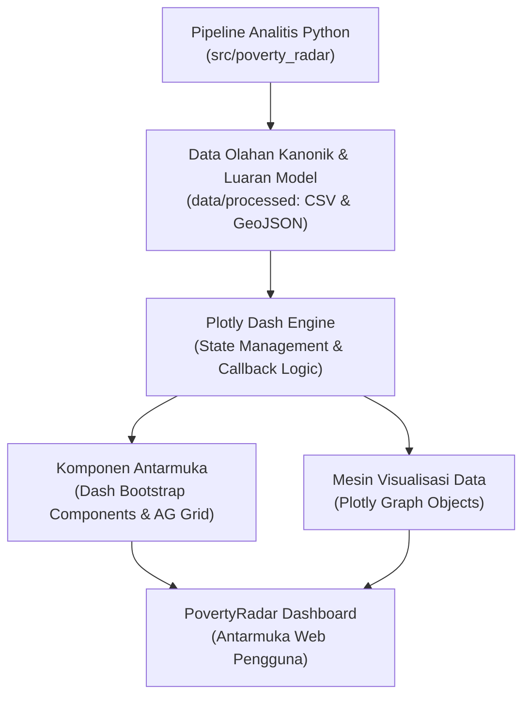
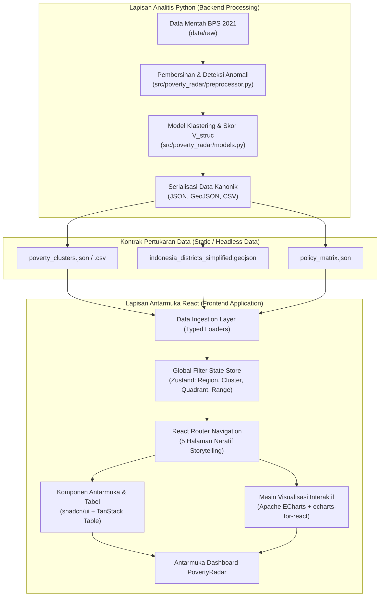
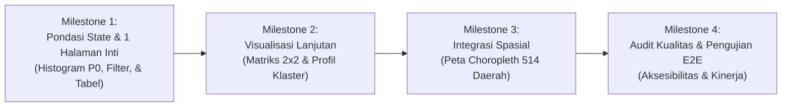

# Rekomendasi Arsitektur Tech Stack: PovertyRadar SDGs

Dokumen ini menyajikan kajian perbandingan teknis dan rekomendasi arsitektur teknologi (*technology stack*) untuk implementasi antarmuka dashboard interaktif **PovertyRadar SDGs: Regional Poverty Clustering and Relative Vulnerability Screening System for Indonesian Districts (514 Regency/City, BPS 2021 Data)**.

Terdapat dua alternatif pendekatan arsitektur yang dievaluasi untuk memenuhi kebutuhan dashboard PovertyRadar. Keduanya mampu mengakomodasi spesifikasi perancangan antarmuka, namun memiliki karakteristik, pola kerja, serta kompleksitas pengembangan yang berbeda:
1. **Versi 1 — Python-First (*Python + Plotly Dash*)**: Seluruh siklus aplikasi (pengolahan data, logika interaksi antarmuka, hingga rendering visualisasi) dikembangkan dalam satu ekosistem bahasa pemrograman Python.
2. **Versi 2 — Hybrid Python + React (*Python + React + TypeScript + Vite*)**: Pemisahan tanggung jawab secara tegas (*separation of concerns*), di mana Python menangani komputasi analitis data dan pembentukan data olahan, sedangkan React menangani lapisan antarmuka pengguna, navigasi multihalaman, dan interaktivitas frontend.

---

## 1. Versi 1 — Python-First (*Python + Plotly Dash*)

### 1.1 Ringkasan Pendekatan
Pendekatan *Python-First* menempatkan seluruh pengembangan antarmuka dan visualisasi di bawah ekosistem Python menggunakan framework **Plotly Dash**. Arsitektur ini memungkinkan tim yang berfokus pada data science untuk membangun dashboard analitis terintegrasi tanpa perlu menulis kode JavaScript secara terpisah.

*Referensi Contoh Visual:* [Plotly Dash Bar Chart & Dashboard Example](https://klaauzpnk.blob.core.windows.net/rvu1errked/dash-plotly-bar-chart-example.html?utm_source=chatgpt.com)

### 1.2 Lapisan Teknologi (*Technology Stack*)

| Lapisan Arsitektur | Teknologi Terpilih | Peran & Fungsi Teknis |
| :--- | :--- | :--- |
| **Dashboard Framework** | Plotly Dash | Pengelolaan struktur aplikasi, perutean multihalaman, dan manajemen *callback* interaktif |
| **Visualization Engine** | Plotly Express & Graph Objects | Rendering visualisasi statistik, *scatter plot*, dan grafik distribusi interaktif |
| **UI Components** | Dash Bootstrap Components | Penyusunan *sidebar*, kartu KPI, grid *layout*, dan responsivitas antarmuka |
| **Data Table** | Dash AG Grid | Penyajian tabel data interaktif dengan dukungan *sorting*, *filtering*, dan paginasi |
| **Data Processing** | Pandas + NumPy | Pembacaan, manipulasi, kalkulasi metrik agregat, dan penyaringan data |
| **Geospatial Processing** | GeoPandas + Shapely | Validasi topologi dan pengolahan layer poligon spasial GeoJSON |
| **Statistical Analysis** | SciPy + scikit-learn | Eksekusi model klastering, standarisasi fitur, dan evaluasi signifikansi ANOVA |
| **Styling** | Custom CSS | Kustomisasi tema warna (*Okabe-Ito*), tipografi, dan margin visual |
| **Testing** | Pytest | Pengujian unit otomatis untuk fungsi transformasi data dan callback |
| **Deployment** | Gunicorn (Opsional) | WSGI HTTP Server untuk menjalankan aplikasi pada lingkungan produksi Linux |

### 1.3 Diagram Alur Arsitektur

### 1.4 Evaluasi Arsitektur Versi 1
* **Kelebihan**:
  1. *Single Language Ecosystem*: Seluruh alur kerja dari *data ingestion*, *clustering*, hingga visualisasi berada dalam satu lingkungan Python.
  2. *Direct Integration*: Integrasi langsung dengan hasil *preprocessing* dan fungsi modul `src/poverty_radar/` tanpa lapisan penerjemah format tambahan.
  3. *Callback Reactive Framework*: Mekanisme *callback* bawaan Dash mendukung sinkronisasi state antar-komponen filter secara reaktif.
  4. *Rapid Prototyping*: Kecepatan pengembangan awal relatif tinggi untuk tim dengan latar belakang dominan *data science*.
* **Kekurangan**:
  1. *Restricted Frontend Customization*: Kebebasan desain antarmuka, tata letak mikro, dan animasi transisi halaman tidak sefleksibel arsitektur web modern berbasis komponen.
  2. *Complex Custom Interaction*: Interaksi antarmuka yang sangat dinamis (*state transitions* kompleks) menuntut penulisan *callback chains* yang berpotensi rumit dipelihara.
  3. *Tightly Coupled Pattern*: Struktur tampilan sangat terikat pada konvensi komponen bawaan Dash.
* **Kriteria Kesesuaian (Kapan Tepat Digunakan)**:
  Pendekatan ini tepat dipilih apabila prioritas tim adalah menghadirkan dashboard fungsional dalam waktu sesingkat mungkin, mengoptimalkan pipeline Python yang telah terbangun tanpa alokasi beban kerja pengembangan frontend terpisah.

---

## 2. Versi 2 — Hybrid Python + React (*Python + React + TypeScript + Vite*) — Rekomendasi Utama

### 2.1 Ringkasan Pendekatan
Pendekatan *Hybrid* memisahkan sistem menjadi dua lapisan independen dengan batas tanggung jawab yang tegas (*Strict Separation of Concerns*):
1. **Lapisan Komputasi & Analisis (Python)**: Bertanggung jawab penuh atas pembersihan data, deteksi anomali, kalkulasi model unsupervised clustering, penghitungan indeks kerentanan struktural ($V_{\text{struc}}$), evaluasi ketahanan model, dan serialisasi data kanonik ke format terstruktur.
2. **Lapisan Antarmuka & Eksplorasi Interaktif (React)**: Bertanggung jawab penuh menyajikan data, memfasilitasi navigasi 5-babak naratif, mengelola state filter global, dan merender visualisasi tingkat tinggi yang responsif.

*Referensi Contoh Visual:* [Modern Analytics Dashboard UI Template](https://images.openai.com/static-rsc-4/qvaPzSMI5E86kqD_isZy5rGbpvWs9uYikLlBiGkD_Qw5rxUwH1QDU2TTmO5LyDsFy8sXvkYcfRU9IatWjEUacX_thRWsPlCjWfv9Pm3tBjUggS99HmHVzYA2tl4zmLY8K3rIzJ9053JXunAGEztab42hwO_-l63ogo7g0oqEXbi-uMgqCZ38b55itrPN2QjL?purpose=inline)

### 2.2 Lapisan Teknologi Antarmuka (*Frontend Stack*)

| Lapisan Arsitektur | Teknologi Terpilih | Peran & Fungsi Teknis |
| :--- | :--- | :--- |
| **Frontend Framework** | React + TypeScript | Pembangunan struktur aplikasi berbasis komponen modular dengan jaminan *type-safety* |
| **Build Tool & Bundler** | Vite | Server pengembangan cepat dengan *Hot Module Replacement* (HMR) dan build produksi teroptimasi |
| **Styling Engine** | Tailwind CSS | Sistem desain berbasis *utility classes*, grid layout fleksibel, dan adaptasi responsif |
| **UI Component Library** | shadcn/ui | Komponen antarmuka standar aksesibilitas tinggi (*accessible*, *customizable*, dan konsisten) |
| **Visualization Engine** | Apache ECharts | Rendering grafik visualisasi berkinerja tinggi berbasis kanvas/SVG dengan interaksi lancar |
| **ECharts Integration** | echarts-for-react | Jembatan reaktif antara siklus hidup (*lifecycle*) komponen React dan instance ECharts |
| **Client-Side Routing** | React Router | Manajemen navigasi dan perutean multihalaman (5 halaman naratif) tanpa memicu *full page reload* |
| **Global State Manager** | Zustand | Penyimpanan dan sinkronisasi filter global lintas halaman secara terpusat (*lightweight & predictable*) |
| **Data Table Engine** | TanStack Table | Manipulasi tabel data performan (*headless*): *sorting*, *multi-column filtering*, dan seleksi baris |
| **Iconography** | Lucide React | Simbol visual standar antarmuka yang seragam dan ringan |
| **Frontend Testing** | Vitest + Playwright | Pengujian unit komponen antarmuka (*Vitest*) dan pengujian end-to-end simulasi pengguna (*Playwright*) |

### 2.3 Lapisan Komputasi Analitis (*Python Analytical Layer*)

| Lapisan Arsitektur | Teknologi Terpilih | Peran & Fungsi Teknis |
| :--- | :--- | :--- |
| **Runtime Environment** | Python (>=3.11) | Ekosistem eksekusi komputasi saintifik dan analitis |
| **Data Ingestion & Wrangling** | Pandas + NumPy | Transformasi data tabular, normalisasi skala, dan kalkulasi statistik deskriptif |
| **Statistical Testing** | SciPy | Pengujian signifikansi perbedaan indikator antar-klaster (uji ANOVA / Kruskal-Wallis) |
| **Machine Learning & Modeling** | scikit-learn | Eksekusi K-Means clustering, PCA, Isolation Forest, dan evaluasi stabilitas *multi-seed* |
| **Geospatial Pipeline** | GeoPandas + Shapely | Pembersihan poligon spasial kabupaten/kota dan simplifikasi batas administratif GeoJSON |
| **Data Contract & Exchange** | JSON + GeoJSON | Format data keluaran terstruktur sebagai kontrak tunggal penghubung Python dan React |

### 2.4 Diagram Alur Arsitektur

### 2.5 Pembagian Tanggung Jawab (*Separation of Concerns*)
* **Tanggung Jawab Penuh Lapisan Python**:
  * Melakukan *data auditing*, validasi skema data, dan penanganan nilai anomali/hilang.
  * Menjalankan algoritma klastering *unsupervised*, reduksi dimensi PCA, dan penetapan garis pemisah median ($P_0$ dan $V_{\text{struc}}$).
  * Menghasilkan berkas data hasil olahan kanonik yang telah terverifikasi dan siap dikonsumsi.
* **Tanggung Jawab Penuh Lapisan React**:
  * Menyajikan data visual secara interaktif tanpa melakukan kalkulasi pemodelan statistik berat di sisi klien.
  * Memfasilitasi interaksi pengguna (pencarian instan, filter multi-kriteria, penyorotan titik, dan peralihan tab).
  * Menjamin responsivitas tata letak di berbagai resolusi layar sesuai kaidah visualisasi data.

### 2.6 Evaluasi Arsitektur Versi 2
* **Kelebihan**:
  1. *Unrestricted UI/UX Design*: Fleksibilitas perancangan antarmuka, tata kelola ruang visual (*data-ink ratio*), dan tipografi berkualitas tinggi sesuai standar publikasi.
  2. *High-Performance Charting*: Apache ECharts menyediakan kemampuan rendering visual berbasis Canvas/WebGL yang efisien untuk memuat visualisasi kompleks (choropleth map dan scatter plot 514 titik).
  3. *Predictable Global State*: Pengelolaan filter menggunakan Zustand memastikan state filter antar-halaman tersinkronisasi secara terpusat tanpa risiko siklus render berulang (*re-render loops*).
  4. *Component Reusability*: Komponen UI (kartu metrik KPI, boks metodologi, modal informasi) dapat digunakan kembali secara modular di seluruh layar.
  5. *Scalable Architecture*: Pondasi frontend mandiri mempermudah penambahan fitur masa depan (misal: integrasi backend API FastAPI atau sistem basis data).
* **Kekurangan**:
  1. *Dual Ecosystem Maintenance*: Menuntut pemeliharaan dua ekosistem teknologi yang berbeda (Python untuk analisis dan Node.js/TypeScript untuk antarmuka).
  2. *Data Exchange Setup*: Memerlukan pendefinisian skema kontrak data (*data schema contracts*) yang ketat antara luaran Python dan input parser TypeScript.
  3. *Higher Development Overhead*: Memerlukan konfigurasi *routing*, komponen UI, dan visualisasi yang lebih terperinci di awal proyek.
* **Kriteria Kesesuaian (Kapan Tepat Digunakan)**:
  Pendekatan ini direkomendasikan ketika sasaran akhir adalah menghadirkan dashboard analitis dengan tampilan profesional setara produk web modern, fleksibilitas interaksi pengguna yang tinggi, dan visualisasi spasial/matriks yang mulus.

---

## 3. Matriks Perbandingan Komprehensif Antar-Arsitektur

| Kriteria Evaluasi | Versi 1: Python-First (Plotly Dash) | Versi 2: Hybrid (Python + React) |
| :--- | :--- | :--- |
| **Kecepatan Pengembangan Awal** | Cepat (terpusat di Python) | Bertahap (memerlukan setup frontend mandiri) |
| **Tingkat Kompleksitas Sistem** | Rendah hingga Menengah | Menengah hingga Tinggi |
| **Integrasi Pipeline Python** | Terkoneksi langsung dalam satu lingkungan runtime | Terhubung melalui kontrak data terstruktur (JSON / CSV) |
| **Kendali Desain & Tata Letak Antarmuka** | Terbatas pada grid Bootstrap dan komponen Dash | Sangat luas (kontrol penuh via Tailwind CSS & Radix/shadcn) |
| **Fleksibilitas Interaksi Kustom** | Cukup baik (berbasis skema input/output callback) | Sangat fleksibel (interaksi bebas berbasis event-driven React) |
| **Mesin Visualisasi Data** | Plotly (SVG / WebGL) | Apache ECharts (Canvas / SVG berperforma tinggi) |
| **Pengelolaan State Global Antar-Halaman** | Dash Callbacks & *dcc.Store* | Zustand (*Lightweight Centralized State Store*) |
| **Skalabilitas Frontend Jangka Panjang** | Terbatas dalam batasan framework Dash | Sangat luas dan dapat dikembangkan menjadi aplikasi web penuh |
| **Beban Koding Lapisan Frontend** | Minimal (didefinisikan dalam Python) | Signifikan (TypeScript, JSX, Tailwind) |

---

## 4. Evaluasi & Rekomendasi Arsitektur Akhir

### 4.1 Rekomendasi Utama: Versi 2 (Hybrid Python + React)
Arsitektur **Versi 2 (Hybrid Python + React + TypeScript + Vite)** ditetapkan sebagai **Rekomendasi Utama** untuk pengembangan antarmuka PovertyRadar SDGs.

Rekomendasi ini didasarkan pada pertimbangan bahwa sasaran perancangan tidak sebatas menyajikan grafik statistik individual, melainkan membangun sistem aplikasi utuh yang mengusung narasi 5-babak (*5-Act Storytelling Architecture*), navigasi multihalaman dengan filter persisten, visualisasi spasial pulau dan kabupaten/kota, serta matriks skrining kuadran 2×2 yang membutuhkan latensi interaksi rendah.

### 4.2 Prinsip Integritas Arsitektur: *Single Source of Truth*

> [!IMPORTANT]
> **Larangan Memindahkan Komputasi Analitis ke Frontend (Single Analytical Source of Truth)**  
> Logika analisis data, transformasi fitur, standarisasi Z-Score, pembentukan klaster K-Means, perhitungan korelasi, uji ANOVA, dan penentuan garis ambang median ($P_0$ dan $V_{\text{struc}}$) **wajib diselesaikan sepenuhnya di lapisan Python**.
> 
> Lapisan antarmuka React tidak diperkenankan menghitung ulang matematika model analitis. React hanya mengonsumsi luaran data terstruktur yang telah terverifikasi (*read-only consumption*) untuk menjamin konsistensi ilmiah dan menghindari deviasi hasil kalkulasi di sisi klien.

### 4.3 Ringkasan Keputusan Rekomendasi

| Dimensi Keputusan | Keputusan Rekomendasi Arsitektur | Keterangan & Rujukan Teknis |
| :--- | :--- | :--- |
| **Pilihan Arsitektur Utama** | **Python + React + TypeScript + Vite** | Fleksibilitas visual optimal dan ekosistem komponen antarmuka yang mapan |
| **Alternatif Sederhana (Cadangan)** | **Python + Plotly Dash** | Cadangan bila kapasitas waktu tim terbatas untuk pengerjaan frontend mandiri |
| **Format Pertukaran Data Awal** | **Static JSON + GeoJSON / Processed CSV** | File hasil olahan kanonik di `data/processed/` dikonsumsi langsung oleh frontend |
| **Lapisan Backend API** | **Belum Diperlukan** | Konsumsi berkas data statis mencukupi untuk 514 baris data BPS 2021; pertimbangkan FastAPI di masa depan jika terdapat pembaruan data real-time |
| **Sistem Basis Data (Database)** | **Belum Diperlukan** | Dataset berskala kecil (514 baris), efisien dimuat penuh ke dalam memori klien (*in-memory*) |
| **Prioritas Urutan Implementasi** | Data Integration $\rightarrow$ UI Foundation $\rightarrow$ Charts $\rightarrow$ Interactions $\rightarrow$ Maps $\rightarrow$ Testing | Tahapan pengerjaan bertahap dari data mentah terverifikasi hingga integrasi peta |

---

## 5. Strategi Eksekusi Bertahap (*Iterative Milestone Delivery*)

Untuk meminimalkan risiko integrasi dan memastikan arsitektur berjalan secara solid, pengembangan antarmuka dilakukan secara berjenjang melalui validasi modul awal (*Proof of Concept*):

1. **Milestone 1 (Verifikasi Bukti Awal Arsitektur)**:
   * Membangun Halaman 1 (*Poverty Landscape*) terlebih dahulu sebagai *Proof of Concept* (PoC).
   * Memvalidasi integrasi 4 komponen kunci:
     - Kartu KPI metrik nasional (Median $P_0$, Rasio disparitas).
     - Grafik histogram sebaran $P_0$ terhubung filter.
     - Komponen filter wilayah pulau/provinsi terpusat.
     - Tabel peringkat wilayah yang dapat diurutkan.
   * Keberhasilan komunikasi data antara berkas data olahan dan antarmuka pada tahap ini menjadi bukti awal bahwa arsitektur yang dipilih berjalan dengan baik sebelum memperluas fitur ke layar lainnya.
2. **Milestone 2 (Matriks Analitis & Pemodelan)**:
   * Mengintegrasikan Halaman 3 (*Regional Profiles*) dan Halaman 4 (*Priority & Implications*).
   * Menerapkan *scatterplot* kuadran 2×2 beserta penapisan kebijakan dan palet warna *Okabe-Ito*.
3. **Milestone 3 (Peta Spasial Choropleth)**:
   * Mengintegrasikan Halaman 2 (*Poverty & Indicator Map*) menggunakan layer poligon GeoJSON terkompresi.
   * Menyediakan alternatif visual berupa *Ranking Bar Chart* jika rendering spasial menghadapi kendala kompatibilitas perangkat klien.
4. **Milestone 4 (Penyempurnaan & Pengujian Mutu)**:
   * Mengimplementasikan Halaman 5 (*Methodology & Data Quality*).
   * Menguji responsivitas layar desktop (`1366×768 px` dan `1440×900 px`) dan kepatuhan kontras warna WCAG 2.1 Level AA.
